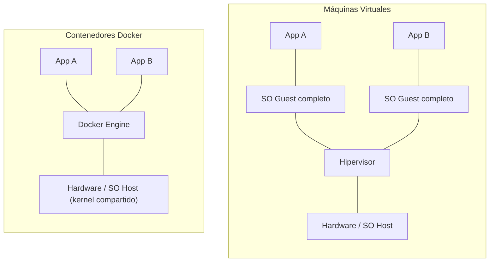
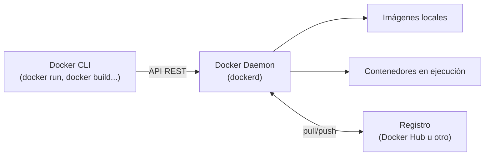

# 01 — Introducción y Arquitectura

> Para Docker aplicado específicamente a proyectos de Ciencia de Datos/ML, ver [[10 - Docker para Ciencia de Datos y ML]]. Para el paso siguiente cuando se necesitan múltiples contenedores coordinados a escala, ver [[Kubernetes/01 - Introducción y Arquitectura del Clúster|Kubernetes]].

## El problema que Docker resuelve

El clásico "en mi máquina funciona": una aplicación desarrollada y probada en una máquina falla al ejecutarse en otra, por diferencias de versión de librerías, del sistema operativo, o de configuración. Docker empaqueta una aplicación junto con **todo lo que necesita para correr** (runtime, librerías, variables de entorno, archivos) en una unidad portable que se ejecuta igual en cualquier máquina con Docker instalado.

## Contenedores vs. Máquinas Virtuales (VMs)



La diferencia central: una VM virtualiza el **hardware** y ejecuta un sistema operativo completo por cada instancia (pesado, minutos para arrancar); un contenedor virtualiza el **sistema operativo** y comparte el kernel del host entre todos los contenedores (ligero, arranca en segundos). Un contenedor no es "una VM pequeña" — es un proceso aislado del host mediante mecanismos del propio kernel de Linux (ver más abajo), no un sistema operativo completo emulado.

| | Máquina Virtual | Contenedor Docker |
|---|---|---|
| Qué virtualiza | Hardware completo | Sistema operativo (kernel compartido) |
| Tiempo de arranque | Minutos | Segundos (a veces milisegundos) |
| Tamaño típico | Gigabytes | Megabytes |
| Aislamiento | Total (kernel propio) | De proceso (kernel compartido, namespaces) |
| Densidad por servidor | Decenas | Cientos o miles |

## Arquitectura: cliente, daemon y registro



- **Docker CLI**: el comando `docker` que se escribe en la terminal — es solo un cliente, no ejecuta nada por sí mismo.
- **Docker Daemon (`dockerd`)**: el proceso en segundo plano que realmente construye imágenes, ejecuta contenedores y gestiona redes/volúmenes. El CLI le habla a través de una API REST (normalmente sobre un socket Unix local).
- **Registro (registry)**: un repositorio de imágenes. **Docker Hub** es el registro público por defecto; los equipos suelen usar además un registro privado (ECR, GCR, Harbor) para imágenes internas.

## Los mecanismos del kernel que hacen posible el aislamiento

Dos características del kernel de Linux son la base real de los contenedores (Docker es, en esencia, una interfaz cómoda sobre ellas):

- **Namespaces**: aíslan lo que un proceso puede *ver* — cada contenedor tiene su propia vista de procesos (PID namespace), red (network namespace), sistema de archivos (mount namespace), etc. Un proceso dentro de un contenedor no puede ver los procesos de otro contenedor ni del host.
- **cgroups (control groups)**: limitan lo que un proceso puede *usar* — CPU, memoria, I/O de disco. Sin cgroups, un contenedor sin límites podría consumir todos los recursos del host.

```bash
docker run --memory="512m" --cpus="1.5" mi-imagen   # límites de recursos vía cgroups, expuestos como flags simples
```

## Instalación y primer contacto

```bash
docker --version
docker run hello-world      # descarga (si no existe localmente) y ejecuta una imagen mínima de prueba
docker info                 # detalles del daemon: contenedores, imágenes, driver de almacenamiento
```

## Imagen vs. contenedor — la distinción más importante

Una **imagen** es una plantilla inmutable de solo lectura (análoga a una "clase" en programación orientada a objetos); un **contenedor** es una instancia en ejecución de esa imagen (análogo a un "objeto"). De una misma imagen se pueden lanzar múltiples contenedores independientes.

```bash
docker images        # listar imágenes locales
docker ps            # listar contenedores en ejecución
docker ps -a         # incluir también los detenidos
```

## Ver también

- [[02 - Dockerfile en Profundidad]]
- [[05 - Ciclo de Vida de Contenedores]]
- [[12 - Buenas Prácticas, Troubleshooting y Comparativa]]
