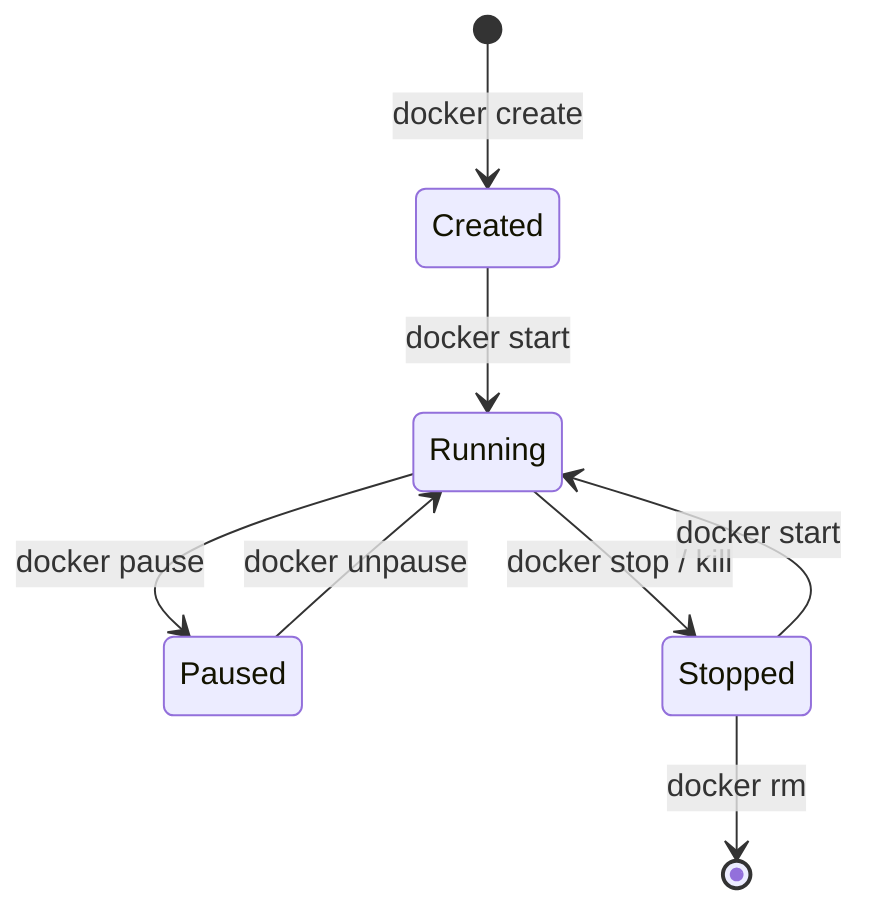

# 05 — Ciclo de Vida de Contenedores

## Los estados de un contenedor



## Ejecutar un contenedor

```bash
docker run mi-imagen                       # crea y arranca en un solo paso (primer plano)
docker run -d mi-imagen                    # -d (detached): en segundo plano
docker run -it mi-imagen bash              # -it: interactivo, con terminal (para explorar/depurar)
docker run --name mi-contenedor mi-imagen  # asignar un nombre explícito (si no, Docker genera uno aleatorio)
docker run -p 8080:80 mi-imagen            # -p host:contenedor -- publica el puerto 80 del contenedor como 8080 del host
docker run --rm mi-imagen                  # eliminar el contenedor automáticamente al terminar (útil para tareas puntuales)
```

## Inspeccionar contenedores en ejecución

```bash
docker ps                    # contenedores activos
docker ps -a                 # todos, incluyendo detenidos
docker logs mi-contenedor    # salida estándar/error del proceso principal
docker logs -f mi-contenedor # seguir el log en tiempo real (como tail -f)
docker inspect mi-contenedor # metadatos completos: IP, volúmenes montados, variables de entorno
docker stats                 # uso de CPU/memoria en tiempo real de todos los contenedores activos
```

## Ejecutar comandos dentro de un contenedor ya corriendo

```bash
docker exec -it mi-contenedor bash        # abrir una terminal dentro del contenedor
docker exec mi-contenedor ls /app         # ejecutar un solo comando sin entrar interactivamente
```

`exec` corre un proceso **adicional** dentro de un contenedor que ya existe; no confundir con `docker run`, que crea un contenedor **nuevo** a partir de una imagen.

## Detener, reiniciar y eliminar

```bash
docker stop mi-contenedor      # detiene con SIGTERM, con un tiempo de gracia antes de forzar
docker kill mi-contenedor      # detiene inmediatamente con SIGKILL, sin tiempo de gracia
docker restart mi-contenedor
docker rm mi-contenedor        # elimina un contenedor detenido
docker rm -f mi-contenedor     # detiene y elimina de una vez
```

## Restart policies — reinicio automático ante fallos

```bash
docker run --restart unless-stopped mi-imagen
docker run --restart on-failure:5 mi-imagen   # reintenta hasta 5 veces solo si el proceso sale con error
docker run --restart always mi-imagen         # siempre reinicia, incluso tras reiniciar el host
```

| Política | Comportamiento |
|---|---|
| `no` (por defecto) | Nunca reinicia automáticamente |
| `on-failure[:N]` | Reinicia solo si el contenedor termina con código de error distinto de 0 |
| `unless-stopped` | Reinicia siempre, salvo que se haya detenido manualmente con `docker stop` |
| `always` | Reinicia siempre, incluso después de reiniciar el daemon/host |

## Límites de recursos

```bash
docker run --memory="512m" --memory-swap="512m" mi-imagen   # límite de memoria, sin swap adicional
docker run --cpus="1.5" mi-imagen                            # límite de CPU (1.5 núcleos)
```

Sin límites explícitos, un contenedor puede consumir toda la memoria/CPU disponible del host y afectar a otros contenedores o servicios — establecerlos es una práctica estándar en producción, no opcional.

## Limpieza general

```bash
docker container prune          # elimina todos los contenedores detenidos
docker system prune             # limpia contenedores detenidos, redes no usadas, imágenes huérfanas
docker system prune -a --volumes  # limpieza agresiva -- incluye imágenes no usadas y volúmenes; usar con cuidado
```

## Ver también

- [[01 - Introducción y Arquitectura]]
- [[06 - Redes en Docker]]
- [[07 - Volúmenes y Persistencia de Datos]]
