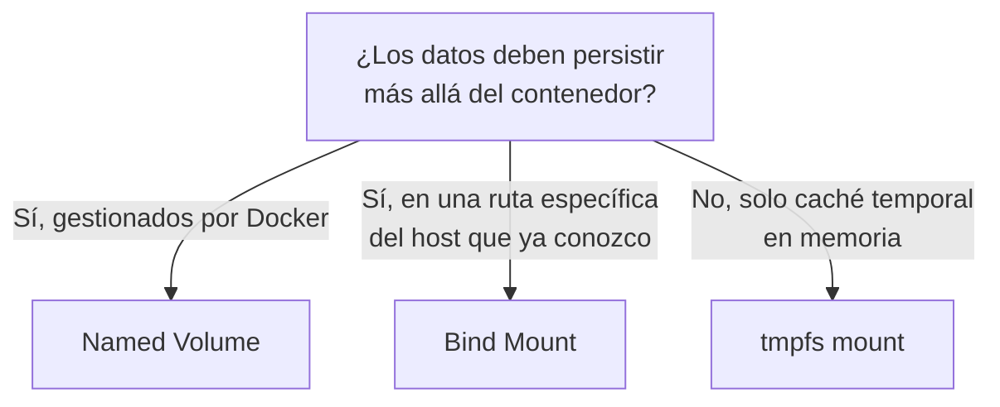

# 07 — Volúmenes y Persistencia de Datos

## El problema: el sistema de archivos de un contenedor es efímero

Todo lo que un contenedor escribe en su propio sistema de archivos **desaparece** al eliminarlo (`docker rm`). Para datos que deben sobrevivir más allá del ciclo de vida de un contenedor específico (una base de datos, archivos subidos por usuarios, un dataset de entrenamiento), es necesario un mecanismo de almacenamiento externo al contenedor.

## Los tres mecanismos



## Named Volumes — la opción recomendada por defecto

Docker gestiona la ubicación física del volumen; el usuario solo se refiere a él por nombre.

```bash
docker volume create mis-datos
docker run -v mis-datos:/var/lib/postgresql/data postgres

docker volume ls              # listar volúmenes
docker volume inspect mis-datos   # ubicación real en el host, entre otros metadatos
docker volume rm mis-datos     # eliminar (falla si algún contenedor lo usa activamente)
```

Ventajas sobre un bind mount: Docker gestiona los permisos correctamente, funciona igual en cualquier sistema operativo host, y es más fácil de respaldar/migrar con las herramientas del propio Docker.

## Bind Mounts — montar una ruta específica del host

Útil en desarrollo, para que los cambios de código en el host se reflejen inmediatamente dentro del contenedor sin reconstruir la imagen:

```bash
docker run -v /ruta/en/el/host:/app mi-imagen
docker run -v $(pwd):/app mi-imagen              # forma común en desarrollo: el directorio actual
```

A diferencia de un named volume, aquí el usuario controla exactamente la ruta del host — pero también hereda sus permisos y estructura, lo que puede causar inconsistencias entre distintas máquinas de desarrollo.

## `tmpfs` — almacenamiento solo en memoria

```bash
docker run --tmpfs /app/cache mi-imagen
```

Nunca toca disco; se pierde al detener el contenedor. Útil para datos temporales sensibles que no deberían persistir en ningún disco (secretos temporales, caché de sesión).

## Cuándo usar cada uno

| Mecanismo | Cuándo usarlo |
|---|---|
| Named Volume | Datos de producción que deben persistir (bases de datos, uploads) — opción por defecto |
| Bind Mount | Desarrollo local, para ver cambios de código sin reconstruir la imagen |
| `tmpfs` | Datos temporales sensibles que no deben tocar disco |

## Volúmenes de solo lectura

```bash
docker run -v mis-datos:/app/config:ro mi-imagen   # :ro -- el contenedor no puede escribir en este volumen
```

## Respaldar y restaurar un volumen

```bash
# Respaldar: montar el volumen en un contenedor temporal y comprimir su contenido
docker run --rm -v mis-datos:/datos -v $(pwd):/backup alpine \
  tar czf /backup/respaldo.tar.gz -C /datos .

# Restaurar: el proceso inverso
docker run --rm -v mis-datos:/datos -v $(pwd):/backup alpine \
  tar xzf /backup/respaldo.tar.gz -C /datos
```

## Ver también

- [[05 - Ciclo de Vida de Contenedores]]
- [[10 - Docker para Ciencia de Datos y ML]] — montar datasets sin incluirlos en la imagen
