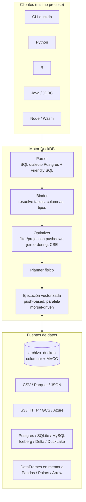

# 01 — Introducción y Arquitectura

> Este cheat-sheet es la referencia práctica de DuckDB. Para el panorama conceptual de dónde encaja DuckDB frente a Spark, Polars y los warehouses, ver [[04-Ingenieria-de-Datos#DuckDB|04-Ingenieria-de-Datos]] en `Machine Learning/`. Para la sintaxis SQL estándar (joins, CTEs, window functions) que DuckDB hereda, ver la carpeta `SQL/`, empezando por [[DQL (Data Query Language)]].

## ¿Qué es DuckDB?

**DuckDB** es un sistema de gestión de bases de datos **analítico (OLAP)**, **embebido** y **open source** (licencia MIT). La frase que mejor lo resume es: **"SQLite para analítica"**.

- **Embebido / in-process**: no hay servidor. DuckDB es una librería que corre *dentro* de tu proceso (tu script de Python, tu notebook, tu app en Java o Node, o su propia CLI). No hay que instalar un servicio, abrir puertos ni gestionar usuarios.
- **Analítico**: está optimizado para consultas que leen muchas filas y pocas columnas: agregaciones, joins grandes, window functions y escaneos de archivos completos. No está pensado para miles de `INSERT`/`UPDATE` pequeños por segundo, como haría el backend de una app web.
- **Un solo archivo** (`.duckdb`) contiene la base completa, o bien todo vive **en memoria** (`:memory:`).
- **Lee archivos directamente**: CSV, Parquet, JSON, Excel, Iceberg o Delta, en local o en S3/HTTP, **sin importarlos primero**.

```sql
-- Esto funciona tal cual, sin CREATE TABLE ni carga previa:
SELECT region, SUM(monto) AS total
FROM 'ventas/*.parquet'
GROUP BY ALL
ORDER BY total DESC;
```

## OLTP vs. OLAP: por qué importa el tipo de motor

| Aspecto | OLTP (SQLite, PostgreSQL, MySQL) | OLAP (DuckDB, Snowflake, BigQuery) |
|---|---|---|
| Patrón típico | Leer/escribir **pocas filas completas** muchas veces | Leer **millones de filas, pocas columnas** |
| Ejemplo | "Trae el usuario con `id = 42`" | "Ventas promedio por región y mes en 5 años" |
| Almacenamiento | **Por filas** (row store) | **Por columnas** (column store) |
| Ejecución | Fila por fila (tuple-at-a-time) | **Vectorizada** (lotes de ~2048 valores) |
| Escrituras | Muchas transacciones pequeñas y concurrentes | Cargas masivas (bulk) |
| Índices | B-trees esenciales | Zonemaps/min-max; los índices importan poco |

DuckDB y SQLite son ambos embebidos y de un solo archivo, pero resuelven problemas opuestos. Usa **SQLite** como base transaccional de una app y **DuckDB** para analizar datos.

## Arquitectura interna



Ideas clave del diseño:

1. **Almacenamiento columnar comprimido.** Cada columna se guarda en *row groups* (~122,880 filas) con compresión ligera (RLE, dictionary, bitpacking, FSST para strings, ALP para floats). Si una consulta solo usa 3 de 50 columnas, solo lee esas 3.
2. **Ejecución vectorizada.** Los operadores procesan **vectores** de valores, no filas sueltas. Así se aprovecha la caché del CPU y las instrucciones SIMD.
3. **Paralelismo automático.** El trabajo se divide en *morsels* que se reparten entre todos los núcleos. No configuras nada: por defecto usa todos los threads.
4. **Larger-than-memory.** Joins, agregaciones y ordenamientos que no caben en RAM hacen *spilling* a disco (ver [[15 - Rendimiento y Optimización]]).
5. **Optimizador moderno.** Hace *filter pushdown* y *projection pushdown* hasta los archivos Parquet, reordena joins, elimina subconsultas correlacionadas, etc.
6. **Transacciones ACID con MVCC.** Garantiza consistencia aunque sea embebido (ver [[10 - DDL, Transacciones y Concurrencia]]).
7. **Zero-copy con Arrow.** Puede leer DataFrames de Pandas, Polars y Arrow **sin copiarlos** (ver [[11 - Integración con Pandas, Polars y Arrow]]).

## ¿Cuándo usar DuckDB y cuándo no?

### Úsalo cuando

- Tienes de **MB a cientos de GB** de datos que caben en un disco (no necesariamente en RAM).
- Quieres **SQL rápido sobre archivos** (Parquet/CSV) sin montar un warehouse.
- Haces **EDA** en notebooks y Pandas se queda lento o sin memoria.
- Necesitas un **motor local para dbt** (dev, CI, proyectos pequeños; ver [[02 - Instalación, Proyecto y profiles.yml|dbt/02]]).
- Construyes **pipelines ETL ligeros** dentro de una tarea de Airflow, un contenedor Docker o una Lambda.
- Quieres **embeber analítica** en una aplicación (incluso en el navegador con DuckDB-Wasm).
- Haces **tests de pipelines SQL** sin depender de un warehouse en la nube.

### No lo uses cuando

- Necesitas una **base transaccional** para una app con muchos usuarios escribiendo concurrentemente. Ahí van PostgreSQL o MySQL.
- Necesitas que **muchos procesos o servidores escriban** a la vez sobre la misma base. DuckDB permite un solo proceso escritor; ver [[10 - DDL, Transacciones y Concurrencia]].
- Los datos son de **muchos TB** y requieren cómputo distribuido. Ahí van Spark, Snowflake o BigQuery. Aunque MotherDuck y DuckLake estiran bastante este límite, ver [[14 - DuckLake, MotherDuck y el Lakehouse Ligero]].
- Necesitas control de acceso multiusuario, roles y permisos. DuckDB no tiene `GRANT`/`REVOKE` (ver [[DCL (Data Control Language)]] para lo que sí ofrecen los motores cliente-servidor).

## DuckDB frente a sus alternativas

| Herramienta | Modelo | Lenguaje principal | Fortaleza | Debilidad frente a DuckDB |
|---|---|---|---|---|
| **DuckDB** | Motor SQL embebido | SQL (+ API relacional) | SQL rápido sobre archivos, cero infraestructura | Un solo nodo y un solo escritor |
| **SQLite** | Motor SQL embebido OLTP | SQL | Transacciones, ubicuidad | Muy lento en agregaciones grandes |
| **Pandas** | DataFrame en memoria | Python | Ecosistema enorme | Un hilo, mucha RAM, sin optimizador |
| **Polars** | DataFrame (Rust, lazy) | Python/Rust | API de expresiones, velocidad similar | No es una base de datos (sin persistencia ni transacciones) |
| **Spark** | Motor distribuido | Python/Scala/SQL | Escala horizontal a TB/PB | Overhead de cluster, lento para datos chicos |
| **PostgreSQL** | Servidor OLTP | SQL | Concurrencia, ecosistema | Analítica lenta a escala |
| **Snowflake/BigQuery** | Warehouse cloud | SQL | Escala elástica, multiusuario | Costo, latencia de red, vendor lock-in |

**DuckDB y Polars no compiten tanto como parece.** Comparten el formato Arrow y se complementan: puedes hacer SQL con DuckDB sobre un DataFrame de Polars y devolver el resultado como Polars (ver [[Python/Polars/16 - Integración con el Ecosistema|Polars/16]] y [[Python/Polars/17 - Buenas Prácticas, Errores Comunes y Comparativa|Polars/17]]). Usa el que te resulte más expresivo para cada paso.

## Un primer vistazo completo

```python
import duckdb

# 1. Consulta directa sobre un archivo, sin conexión explícita (usa una DB en memoria global)
duckdb.sql("SELECT * FROM 'datos/clientes.csv' LIMIT 5").show()

# 2. Base persistente
con = duckdb.connect("analitica.duckdb")
con.sql("""
    CREATE OR REPLACE TABLE ventas AS
    SELECT * FROM read_parquet('datos/ventas/*.parquet')
""")

# 3. Consultar y traer a Pandas o Polars
df = con.sql("""
    SELECT date_trunc('month', fecha) AS mes,
           region,
           SUM(monto)        AS total,
           COUNT(DISTINCT cliente_id) AS clientes
    FROM ventas
    GROUP BY ALL
    ORDER BY mes
""").df()          # .pl() para Polars, .arrow() para Arrow

# 4. Exportar el resultado
con.sql("COPY (SELECT * FROM ventas WHERE region = 'LATAM') TO 'latam.parquet' (FORMAT parquet)")
con.close()
```

## Versiones y ciclo de releases

- DuckDB alcanzó la **1.0 en junio de 2024**, con la garantía de que el formato de almacenamiento es compatible hacia atrás: una versión nueva puede leer bases creadas con versiones anteriores.
- Desde la 1.4 existen versiones **LTS** (soporte extendido) además de las releases regulares.
- Revisa la versión con `SELECT version();` o `duckdb --version`. Usa la misma versión en desarrollo y producción, porque una base escrita con una versión nueva puede no abrirse con una más vieja.

## Mapa de este cheat-sheet

| Tema | Nota |
|---|---|
| Instalación, CLI, bases y configuración | [[02 - Instalación, CLI y Bases de Datos]] |
| API de Python | [[03 - API de Python]] |
| CSV y JSON | [[04 - Leer y Escribir CSV y JSON]] |
| Parquet y particionado | [[05 - Parquet, Globs y Particionado Hive]] |
| S3, HTTP y cloud | [[06 - Fuentes Remotas y Cloud]] |
| Extensiones del dialecto SQL | [[07 - Friendly SQL]] |
| LIST, STRUCT, MAP, JSON | [[08 - Tipos Anidados]] |
| PIVOT, ASOF, series de tiempo | [[09 - Analítica Avanzada]] |
| DDL, macros, transacciones | [[10 - DDL, Transacciones y Concurrencia]] |
| Pandas / Polars / Arrow | [[11 - Integración con Pandas, Polars y Arrow]] |
| Extensiones | [[12 - Extensiones]] |
| UDFs en Python | [[13 - UDFs en Python y Funciones Personalizadas]] |
| DuckLake y MotherDuck | [[14 - DuckLake, MotherDuck y el Lakehouse Ligero]] |
| Rendimiento | [[15 - Rendimiento y Optimización]] |
| Pipelines y buenas prácticas | [[16 - DuckDB en Pipelines y Buenas Prácticas]] |

## Ver también

- [[04-Ingenieria-de-Datos#DuckDB|04-Ingenieria-de-Datos]] (en `Machine Learning/`): DuckDB frente a Spark y Polars dentro del stack de datos
- [[07-Librerias-de-Data-Science-y-ML]] (en `Machine Learning/`)
- [[Python/Polars/01 - Introducción y Arquitectura|Polars/01]]: la otra herramienta "de un solo nodo" moderna
- [[01 - Introducción y Arquitectura|dbt/01]]: DuckDB como warehouse local de dbt
- [[24 - Databases]] (en `Python/`): conexión a bases de datos desde Python en general
- [[02 - Instalación, CLI y Bases de Datos]]
- [[03 - API de Python]]
