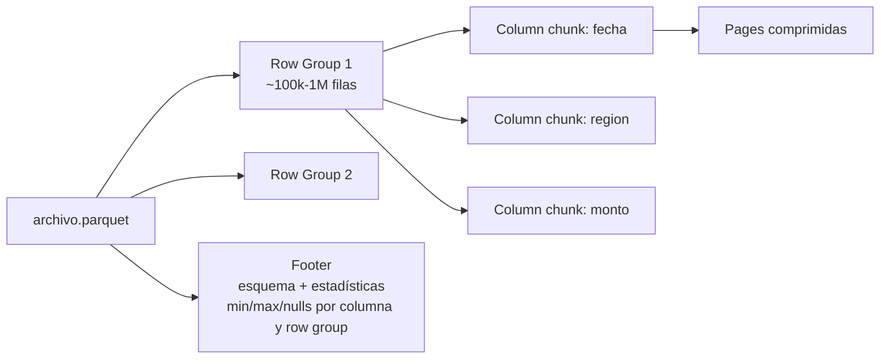

# 05 — Parquet, Globs y Particionado Hive

> Continúa de [[04 - Leer y Escribir CSV y JSON]]. **Parquet** es el formato natural de DuckDB y del ecosistema analítico moderno. Esta nota explica por qué, cómo lo aprovecha DuckDB (pushdown), cómo leer muchos archivos con globs y cómo leer y escribir datasets **particionados estilo Hive**, la base de cualquier data lake.

## ¿Por qué Parquet?

| Característica | CSV | Parquet |
|---|---|---|
| Orientación | Filas, texto | **Columnar, binario** |
| Tipos | No (todo es texto) | **Sí, con esquema embebido** |
| Compresión | Externa (gzip del archivo entero) | **Por columna** (Snappy, ZSTD, dictionary, RLE) |
| Leer 2 de 100 columnas | Hay que leer todo | **Solo esas 2 columnas** |
| Filtrar `WHERE fecha > X` | Leer todo | **Saltar row groups** usando estadísticas min/max |
| Tipos anidados | No | Sí (LIST, STRUCT, MAP) |
| Tamaño típico | 1× | **0.1×–0.2×** |

Estructura interna de un archivo Parquet:



DuckDB lee primero el **footer**. Con él decide qué columnas y qué row groups necesita realmente, y solo entonces lee esos bytes.

---

## Leer Parquet

```sql
SELECT * FROM 'ventas.parquet';
SELECT * FROM read_parquet('ventas.parquet');
SELECT * FROM read_parquet(['2025.parquet', '2026.parquet']);
SELECT * FROM read_parquet('ventas/*.parquet', filename = true);
SELECT * FROM read_parquet('ventas/*.parquet', union_by_name = true);   -- esquemas que evolucionan
```

### Pushdown: el motivo por el que es tan rápido

```sql
EXPLAIN
SELECT region, SUM(monto)
FROM 'ventas/*.parquet'
WHERE fecha >= DATE '2026-06-01'
GROUP BY region;
```

En el plan, el operador `PARQUET_SCAN` (o `READ_PARQUET`) muestra:

- **Projections**: solo `region`, `monto` y `fecha`. Esto es *projection pushdown*.
- **Filters**: `fecha >= 2026-06-01`. Es *filter pushdown*: DuckDB compara el filtro contra el min/max de cada row group y **salta** los que no pueden contener filas válidas.

> **Consecuencia práctica:** el filter pushdown funciona mucho mejor si los datos están **ordenados** (o agrupados) por la columna que filtras. Un Parquet ordenado por `fecha` permite saltar casi todos los row groups al filtrar por fecha; uno desordenado obliga a leerlos casi todos. Ver [[15 - Rendimiento y Optimización#Orden de los datos y zonemaps]].

### Inspeccionar metadatos sin leer los datos

```sql
-- Esquema
DESCRIBE FROM 'ventas.parquet';
FROM parquet_schema('ventas.parquet');

-- Metadatos por row group y columna: estadísticas, compresión, tamaños
SELECT row_group_id, path_in_schema, num_values, stats_min, stats_max,
       compression, total_compressed_size
FROM parquet_metadata('ventas.parquet');

-- Metadatos a nivel de archivo (versión, filas totales, creador)
FROM parquet_file_metadata('ventas/*.parquet');

-- Metadatos clave-valor (por ejemplo, el esquema de pandas/arrow)
FROM parquet_kv_metadata('ventas.parquet');

-- Contar filas: DuckDB lo resuelve leyendo solo los footers
SELECT COUNT(*) FROM 'ventas/*.parquet';
```

Sirve para depurar ("¿por qué este archivo es tan grande?", "¿tiene estadísticas la columna?") y para auditar datos de terceros.

---

## Globs: leer muchos archivos

| Patrón | Significado |
|---|---|
| `*` | Cualquier secuencia de caracteres, sin cruzar `/` |
| `**` | Cualquier cantidad de subdirectorios (recursivo) |
| `?` | Un carácter |
| `[abc]` / `[0-9]` | Un carácter del conjunto o rango |

```sql
FROM 'logs/2026-0[1-6]-*.parquet';          -- primer semestre
FROM 'lake/**/*.parquet';                    -- todo el árbol
FROM glob('lake/**/*.parquet');              -- lista los archivos que matchean, sin leerlos
SELECT filename, COUNT(*) FROM read_parquet('lake/*.parquet', filename = true) GROUP BY ALL;
```

DuckDB lee los archivos **en paralelo**. Muchos archivos pequeños (miles de archivos de pocos KB) perjudican el rendimiento, sobre todo en S3. Lo ideal son archivos de **100 MB a 1 GB**. Ver [[16 - DuckDB en Pipelines y Buenas Prácticas#Compactación de archivos pequeños]].

---

## Particionado estilo Hive

Un dataset **particionado estilo Hive** codifica el valor de algunas columnas en la **ruta de carpetas**:

```
ventas/
├── anio=2025/
│   ├── mes=11/data_0.parquet
│   └── mes=12/data_0.parquet
└── anio=2026/
    ├── mes=01/data_0.parquet
    └── mes=02/data_0.parquet
```

### Leer

```sql
SELECT * FROM read_parquet('ventas/*/*/*.parquet', hive_partitioning = true);
-- 'anio' y 'mes' aparecen como columnas aunque no estén dentro de los archivos.
-- DuckDB auto-detecta el patrón clave=valor, así que hive_partitioning suele ser opcional.

-- Partition pruning: solo abre las carpetas anio=2026/mes=01..02
SELECT SUM(monto)
FROM read_parquet('ventas/**/*.parquet', hive_partitioning = true)
WHERE anio = 2026 AND mes <= 2;

-- Tipos de las columnas de partición (por defecto se infieren)
FROM read_parquet('ventas/**/*.parquet', hive_partitioning = true,
                  hive_types = {'anio': INTEGER, 'mes': INTEGER});
```

El *partition pruning* (descartar carpetas enteras sin abrirlas) es aún más potente que el filtro por row groups, porque evita listar y abrir archivos.

### Escribir

```sql
COPY (
    SELECT *, year(fecha) AS anio, month(fecha) AS mes
    FROM ventas
) TO 'lake/ventas' (
    FORMAT parquet,
    PARTITION_BY (anio, mes),
    COMPRESSION zstd,
    OVERWRITE_OR_IGNORE,            -- no fallar si la carpeta existe
    FILENAME_PATTERN 'ventas_{uuid}' -- o 'data_{i}'; {uuid} evita colisiones entre ejecuciones
);
```

Opciones de escritura particionada:

| Opción | Efecto |
|---|---|
| `PARTITION_BY (cols)` | Crea las carpetas `col=valor/` |
| `OVERWRITE_OR_IGNORE` | Escribe sin borrar lo existente; sobreescribe archivos con el mismo nombre |
| `OVERWRITE` | **Borra** el directorio destino antes de escribir |
| `APPEND` | Agrega archivos nuevos con nombres únicos (no sobreescribe) |
| `FILENAME_PATTERN` | Plantilla de nombre: `{i}` es un índice, `{uuid}` un UUID |
| `WRITE_PARTITION_COLUMNS true` | Guarda también las columnas de partición dentro de los archivos |

### ¿Por qué columna particionar?

- Por columnas que aparecen **siempre** en los filtros (casi siempre la fecha: `anio/mes` o `fecha`).
- Con **baja cardinalidad**. Particionar por `cliente_id` crea millones de carpetas diminutas, lo cual es un antipatrón clásico.
- Cada partición debería pesar **al menos decenas de MB**.

| Volumen diario | Partición sugerida |
|---|---|
| < 10 MB/día | `anio` o `anio/mes` |
| 10 MB – 1 GB/día | `anio/mes` o `fecha` |
| > 1 GB/día | `fecha` (y quizá `region`) |

---

## Escribir Parquet: opciones de calidad

```sql
COPY ventas TO 'ventas.parquet' (
    FORMAT parquet,
    COMPRESSION zstd,            -- snappy (default), zstd, gzip, lz4, uncompressed
    COMPRESSION_LEVEL 9,         -- solo zstd
    ROW_GROUP_SIZE 122880,       -- filas por row group
    ROW_GROUPS_PER_FILE 10,      -- partir en varios archivos
    PARQUET_VERSION v2,
    KV_METADATA {fuente: 'erp', generado_por: 'pipeline_ventas'}
);
```

- **ZSTD** suele dar archivos más chicos que Snappy con velocidad similar de lectura. Es buena opción por defecto para un data lake.
- **Ordena antes de escribir** por la columna de filtro principal: `COPY (FROM ventas ORDER BY fecha) TO ...`. Las estadísticas min/max quedan más útiles.
- Para un Parquet que van a leer otras herramientas (Spark, Pandas, Power BI), evita tipos exóticos de DuckDB (`UNION`, `HUGEINT`, `ENUM` muy grandes) o castea antes de escribir.

## Encriptación de Parquet

DuckDB soporta encriptación modular de Parquet (columnas y footer) con claves registradas:

```sql
PRAGMA add_parquet_key('clave1', '0123456789112345');
COPY ventas TO 'ventas_enc.parquet' (ENCRYPTION_CONFIG {footer_key: 'clave1'});
SELECT * FROM read_parquet('ventas_enc.parquet', encryption_config = {footer_key: 'clave1'});
```

## Más allá de Parquet "suelto": formatos de tabla

Un directorio de archivos Parquet no tiene transacciones, ni historial, ni un esquema central. Para eso existen los **formatos de tabla abiertos**: Iceberg y Delta Lake (ver [[12 - Extensiones#Iceberg y Delta Lake]]) y **DuckLake** (ver [[14 - DuckLake, MotherDuck y el Lakehouse Ligero]]).

## Ver también

- [[04 - Leer y Escribir CSV y JSON]]
- [[06 - Fuentes Remotas y Cloud]]: los mismos datasets particionados, pero en S3
- [[15 - Rendimiento y Optimización]]
- [[Python/Pandas/15 - Rendimiento y Optimización|Pandas/15]]: Parquet desde Pandas
- [[04-Ingenieria-de-Datos]] (en `Machine Learning/`): data lakes y la arquitectura medallion
