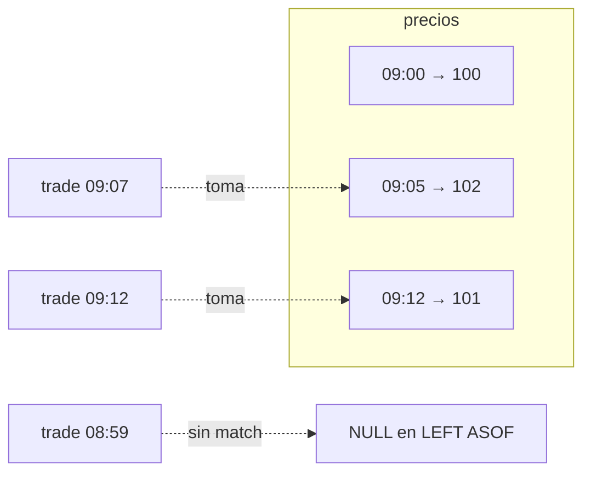

# 09 — Analítica Avanzada

> Continúa de [[08 - Tipos Anidados]]. Esta nota reúne las herramientas de DuckDB para análisis "de verdad": **PIVOT/UNPIVOT**, **ASOF JOIN**, window functions avanzadas, series de tiempo (buckets, gaps, fechas), estadística dentro del SQL, `GROUPING SETS` y muestreo. Las window functions básicas están en [[Window Functions]]; aquí va lo que DuckDB añade y los patrones de análisis.

## PIVOT: filas a columnas

### Sintaxis simplificada de DuckDB

```sql
-- ventas(region, anio, monto)
PIVOT ventas
ON anio                 -- valores que se convierten en columnas
USING sum(monto)        -- agregado de cada celda
GROUP BY region;        -- filas resultantes
-- region | 2024 | 2025 | 2026
```

```sql
-- Varias columnas en ON (combinaciones) y varios agregados
PIVOT ventas
ON anio, canal
USING sum(monto) AS total, count(*) AS n
GROUP BY region;
-- columnas: 2025_online_total, 2025_online_n, ...

-- Limitar a valores concretos (y fijar su orden)
PIVOT ventas ON anio IN (2025, 2026) USING sum(monto) GROUP BY region;

-- Expresiones en ON
PIVOT ventas ON monthname(fecha) USING sum(monto) GROUP BY region;
```

Sin `GROUP BY`, se agrupa por todas las columnas que no aparecen en `ON` ni en `USING`.

### Sintaxis estándar (dentro de una consulta)

```sql
SELECT *
FROM ventas
PIVOT (sum(monto) FOR anio IN (2025, 2026) GROUP BY region);
```

> Si no fijas `IN (...)`, el PIVOT **dinámico** primero lee los valores distintos y luego construye las columnas, así que el esquema del resultado depende de los datos. En pipelines y vistas conviene fijar `IN` para que el esquema sea estable.

Equivalente en Pandas: `pivot_table` (ver [[Python/Pandas/10 - Reshaping y Pivoting|Pandas/10]]). En Power BI/DAX, la matriz.

## UNPIVOT: columnas a filas

```sql
-- presupuesto(area, ene, feb, mar, ...)
UNPIVOT presupuesto
ON ene, feb, mar
INTO NAME mes VALUE monto;

-- Con COLUMNS: todas menos la clave
UNPIVOT presupuesto
ON COLUMNS(* EXCLUDE area)
INTO NAME mes VALUE monto;

-- Varios grupos de valores a la vez
UNPIVOT metricas
ON (ventas_q1, costo_q1) AS q1, (ventas_q2, costo_q2) AS q2
INTO NAME trimestre VALUE ventas, costo;
```

Muy útil para "despivotear" Excels de negocio, que casi siempre traen un mes por columna. Equivale a `melt` en Pandas.

---

## ASOF JOIN: el "valor vigente" en el tiempo

Un **ASOF JOIN** une cada fila de la izquierda con la fila de la derecha **más cercana en el tiempo sin pasarse**. Es el join clave de finanzas, IoT y features para ML sin *data leakage*.

```sql
-- trades(simbolo, ts, cantidad)       precios(simbolo, ts, precio)
-- ¿A qué precio vigente se ejecutó cada trade?
SELECT t.simbolo, t.ts, t.cantidad, p.precio, p.ts AS ts_precio
FROM trades t
ASOF JOIN precios p
  ON t.simbolo = p.simbolo        -- igualdades: definen el "grupo"
 AND t.ts >= p.ts;                -- UNA desigualdad: el último precio <= ts del trade
```

```sql
-- LEFT ASOF: conserva trades sin precio previo (precio NULL)
SELECT * FROM trades t ASOF LEFT JOIN precios p
  ON t.simbolo = p.simbolo AND t.ts >= p.ts;

-- USING: la última columna de USING es la de desigualdad (>=)
SELECT * FROM trades ASOF JOIN precios USING (simbolo, ts);
```



### Caso ML: features "point-in-time"

Para entrenar un modelo, cada etiqueta debe ver solo los features **conocidos en ese momento**. Usar el valor más reciente de la tabla filtra información del futuro (*data leakage*):

```sql
SELECT e.cliente_id, e.fecha_evento, e.churn,
       f.compras_30d, f.ticket_promedio
FROM etiquetas e
ASOF LEFT JOIN features_cliente f
  ON e.cliente_id = f.cliente_id
 AND e.fecha_evento > f.fecha_calculo;   -- estrictamente antes del evento
```

Este es exactamente el problema que resuelven las feature stores (ver [[09-MLOps-en-Profundidad]] y [[29-SQL-para-Machine-Learning]]).

---

## Window functions: lo que añade DuckDB

```sql
SELECT fecha, region, monto,
    -- Ventanas nombradas: define una vez, reutiliza
    sum(monto)   OVER w                                  AS acumulado,
    avg(monto)   OVER (w ROWS BETWEEN 6 PRECEDING AND CURRENT ROW) AS media_movil_7,
    lag(monto)   OVER w                                  AS anterior,
    monto / lag(monto) OVER w - 1                        AS crecimiento,
    -- IGNORE NULLS: último valor no nulo (forward fill)
    last_value(monto IGNORE NULLS) OVER (w ROWS UNBOUNDED PRECEDING) AS ffill,
    -- Frames por RANGE con intervalos de tiempo
    sum(monto) OVER (PARTITION BY region ORDER BY fecha
                     RANGE BETWEEN INTERVAL 30 DAY PRECEDING AND CURRENT ROW) AS ventas_30d,
    -- Ranking
    ntile(4)      OVER (ORDER BY monto)                  AS cuartil,
    percent_rank() OVER (ORDER BY monto)                 AS pct,
    -- Agregados ordenados dentro de una ventana
    list(monto)   OVER (w ROWS 2 PRECEDING)              AS ultimos_3,
    -- Excluir la fila actual del frame
    avg(monto) OVER (w ROWS BETWEEN 3 PRECEDING AND 3 FOLLOWING EXCLUDE CURRENT ROW) AS vecinos
FROM ventas_diarias
WINDOW w AS (PARTITION BY region ORDER BY fecha)
QUALIFY fecha >= DATE '2026-01-01';
```

| Patrón | Expresión |
|---|---|
| Acumulado | `sum(x) OVER (PARTITION BY g ORDER BY t)` |
| Media móvil | `avg(x) OVER (... ROWS BETWEEN n-1 PRECEDING AND CURRENT ROW)` |
| Ventana por tiempo real (con huecos) | `... RANGE BETWEEN INTERVAL 7 DAY PRECEDING AND CURRENT ROW` |
| Forward fill | `last_value(x IGNORE NULLS) OVER (... ROWS UNBOUNDED PRECEDING)` |
| Variación vs. periodo anterior | `x / lag(x) OVER (...) - 1` |
| % del total del grupo | `x / sum(x) OVER (PARTITION BY g)` |
| Dedupe | `QUALIFY row_number() OVER (PARTITION BY k ORDER BY t DESC) = 1` |

---

## Series de tiempo

### Truncar y agrupar por buckets

```sql
SELECT date_trunc('hour', ts)                         AS hora,
       time_bucket(INTERVAL '15 minutes', ts)         AS bucket_15m,
       time_bucket(INTERVAL '1 week', ts, DATE '2026-01-05') AS semana_desde_lunes,
       count(*)
FROM eventos GROUP BY ALL;
```

### Rellenar huecos (gap filling)

Las fechas sin ventas no aparecen en un `GROUP BY`. Para series continuas, que es lo que necesitan los gráficos y los modelos de forecasting, genera el calendario y haz un `LEFT JOIN`:

```sql
WITH calendario AS (
    SELECT unnest(generate_series(DATE '2026-01-01', DATE '2026-03-31', INTERVAL 1 DAY))::DATE AS dia
),
diario AS (
    SELECT fecha::DATE AS dia, sum(monto) AS total FROM ventas GROUP BY ALL
)
SELECT c.dia,
       coalesce(d.total, 0) AS total,
       avg(coalesce(d.total, 0)) OVER (ORDER BY c.dia ROWS 6 PRECEDING) AS mm7
FROM calendario c LEFT JOIN diario d USING (dia)
ORDER BY c.dia;
```

### Funciones de fecha esenciales

```sql
SELECT current_date, now(), today(),
       date_part('dow', d) AS dia_semana,      -- 0 = domingo
       dayname(d), monthname(d), week(d), quarter(d), yearweek(d),
       date_diff('day', d1, d2), date_sub('month', d1, d2),
       d + INTERVAL 1 MONTH, last_day(d), make_date(2026, 11, 15),
       strftime(d, '%d/%m/%Y')       AS texto,
       strptime('15/11/2026', '%d/%m/%Y') AS parseada,
       epoch(ts), to_timestamp(1763164800), epoch_ms(ts),
       ts AT TIME ZONE 'America/Lima' AS local
FROM ...;
```

Para zonas horarias y sus trampas desde Python, ver [[53 - Fechas y Zonas Horarias]].

### Sesionización

```sql
-- Nueva sesión si pasan más de 30 min desde el evento anterior del usuario
WITH marcados AS (
    SELECT *,
           CASE WHEN ts - lag(ts) OVER (PARTITION BY user_id ORDER BY ts) > INTERVAL 30 MINUTE
                  OR lag(ts) OVER (PARTITION BY user_id ORDER BY ts) IS NULL
                THEN 1 ELSE 0 END AS nueva
    FROM eventos
)
SELECT *, sum(nueva) OVER (PARTITION BY user_id ORDER BY ts) AS sesion_id
FROM marcados;
```

---

## Subtotales: GROUPING SETS, ROLLUP, CUBE

```sql
SELECT region, canal, sum(monto) AS total,
       grouping(region, canal) AS nivel     -- 0 = detalle, 3 = total general
FROM ventas
GROUP BY ROLLUP (region, canal)             -- (region,canal), (region), ()
ORDER BY region NULLS LAST, canal NULLS LAST;

GROUP BY CUBE (region, canal);              -- todas las combinaciones
GROUP BY GROUPING SETS ((region), (canal), ());
```

Así se obtiene en SQL el típico reporte con subtotales y total general de un pivot de Excel.

---

## Estadística en SQL

```sql
SELECT corr(precio, unidades)                 AS pearson,
       covar_samp(x, y), stddev_samp(x), var_pop(x),
       regr_slope(y, x), regr_intercept(y, x), regr_r2(y, x),   -- regresión lineal simple
       skewness(x), kurtosis(x), entropy(categoria),
       quantile_disc(x, 0.9), mad(x),                           -- desviación absoluta mediana
       histogram(width_bucket(x, 0, 100, 10))                   -- distribución en 10 bins
FROM datos;
```

```sql
-- Detección de outliers por IQR
WITH q AS (
    SELECT quantile_cont(monto, 0.25) AS q1, quantile_cont(monto, 0.75) AS q3 FROM ventas
)
SELECT v.*
FROM ventas v, q
WHERE monto < q1 - 1.5 * (q3 - q1) OR monto > q3 + 1.5 * (q3 - q1);

-- Z-score por grupo
SELECT *, (monto - avg(monto) OVER g) / stddev(monto) OVER g AS z
FROM ventas WINDOW g AS (PARTITION BY region)
QUALIFY abs(z) > 3;
```

Para pruebas de hipótesis e inferencia, el SQL se queda corto: exporta a SciPy o StatsModels (ver [[Estadística Aplicada/05 - Pruebas de Hipótesis para Data Science|Estadística Aplicada/05]] y [[Python/SciPy/05 - Estadística II - Pruebas de Hipótesis (scipy.stats)|SciPy/05]]).

## Muestreo reproducible

```sql
-- Split train/test determinístico por hash (estable entre ejecuciones)
SELECT *, CASE WHEN hash(cliente_id) % 10 < 8 THEN 'train' ELSE 'test' END AS split
FROM clientes;

-- Muestra estratificada: 100 por región
SELECT * FROM clientes
QUALIFY row_number() OVER (PARTITION BY region ORDER BY random()) <= 100;

SELECT setseed(0.42);   -- fija la semilla de random()
```

## Ver también

- [[Window Functions]], [[SQL/Aggregate Functions|Aggregate Functions]] (en `SQL/`)
- [[07 - Friendly SQL]]
- [[26-SQL-Profesional-Nivel-1-Consultas-Avanzadas]] y [[29-SQL-para-Machine-Learning]] (en `Machine Learning/`)
- [[13 - UDFs en Python y Funciones Personalizadas]]: cuando el SQL no basta
- [[14 - Semantic Layer y Métricas|dbt/14]]: definir métricas una sola vez
