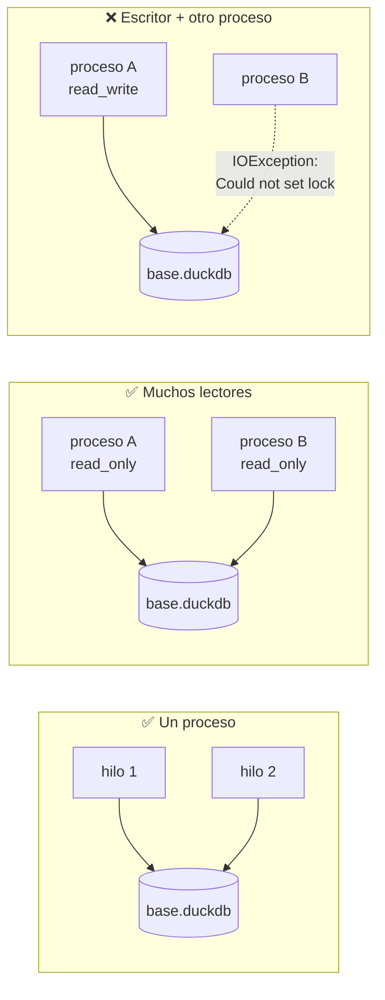

# 10 — DDL, Transacciones y Concurrencia

> Continúa de [[09 - Analítica Avanzada]]. DuckDB es una base de datos completa: tablas con constraints, vistas, secuencias, tipos propios, **macros SQL**, transacciones ACID y un modelo de concurrencia con reglas propias. Entender ese modelo (un solo proceso escritor) es lo que evita el error más común en producción. La base de DDL, DML y TCL está en [[DDL (Data Definition Language)]], [[DML (Data Manipulation Language)]] y [[TCL (Transaction Control Language)]].

## Tablas

```sql
CREATE TABLE clientes (
    id          INTEGER PRIMARY KEY,
    email       VARCHAR UNIQUE NOT NULL,
    nombre      VARCHAR,
    pais        VARCHAR DEFAULT 'PE',
    edad        INTEGER CHECK (edad >= 18),
    creado      TIMESTAMP DEFAULT current_timestamp,
    nombre_up   VARCHAR GENERATED ALWAYS AS (upper(nombre)) VIRTUAL   -- columna calculada
);

CREATE TABLE pedidos (
    id          BIGINT PRIMARY KEY,
    cliente_id  INTEGER REFERENCES clientes(id),     -- foreign key
    total       DECIMAL(12, 2)
);

-- CTAS: la forma más común en analítica
CREATE OR REPLACE TABLE ventas AS FROM 'ventas/*.parquet';
CREATE TEMP TABLE tmp AS SELECT ...;         -- temporal, desaparece al cerrar la conexión

ALTER TABLE clientes ADD COLUMN segmento VARCHAR;
ALTER TABLE clientes RENAME COLUMN nombre TO nombre_completo;
ALTER TABLE clientes ALTER COLUMN edad TYPE SMALLINT;
ALTER TABLE clientes DROP COLUMN segmento;
ALTER TABLE clientes RENAME TO customers;
DROP TABLE IF EXISTS tmp;
```

Las constraints se detallan en [[Constraints]].

> **Sobre las constraints en DuckDB:** las `PRIMARY KEY` y `UNIQUE` crean un **índice ART** y se validan en cada inserción, lo cual **ralentiza las cargas masivas**. En tablas analíticas grandes (hechos de millones de filas) es común **no declararlas** y validar unicidad con tests (dbt o Pandera). Ver [[15 - Rendimiento y Optimización#Índices]].

### Tipos útiles

| Tipo | Nota |
|---|---|
| `TINYINT`/`SMALLINT`/`INTEGER`/`BIGINT`/`HUGEINT` | 1/2/4/8/16 bytes. También `UTINYINT`... sin signo |
| `DECIMAL(p, s)` | Dinero: **nunca** `DOUBLE` para montos contables |
| `DOUBLE` / `FLOAT` | Medidas científicas, ML |
| `VARCHAR` | Sin límite real; `VARCHAR(n)` no impone el largo |
| `DATE`, `TIME`, `TIMESTAMP`, `TIMESTAMPTZ`, `INTERVAL` | Fechas |
| `BOOLEAN`, `UUID`, `BLOB`, `BIT` | |
| `ENUM` | Categorías de baja cardinalidad: ocupa 1 byte y acelera los `GROUP BY` |

```sql
CREATE TYPE estado AS ENUM ('pendiente', 'pagado', 'enviado', 'cancelado');
CREATE TABLE ordenes (id INT, st estado);
-- ENUM desde los datos
CREATE TYPE region_t AS ENUM (SELECT DISTINCT region FROM ventas WHERE region IS NOT NULL);
```

## Vistas y secuencias

```sql
CREATE OR REPLACE VIEW v_ventas_mensuales AS
SELECT date_trunc('month', fecha) AS mes, sum(monto) AS total FROM ventas GROUP BY ALL;

-- Vista sobre archivos: siempre lee la versión más reciente de los Parquet
CREATE VIEW raw_eventos AS FROM read_parquet('lake/eventos/**/*.parquet');

CREATE SEQUENCE seq_pedidos START 1000 INCREMENT 1;
INSERT INTO pedidos VALUES (nextval('seq_pedidos'), 1, 99.90);
SELECT currval('seq_pedidos');

-- Autoincremental: DEFAULT nextval
CREATE TABLE logs (id BIGINT DEFAULT nextval('seq_pedidos'), msg VARCHAR);
```

Ver [[Views]].

## DML: inserts, updates y upserts

```sql
INSERT INTO clientes (id, email, nombre) VALUES (1, 'ana@x.com', 'Ana'), (2, 'luis@x.com', 'Luis');
INSERT INTO clientes BY NAME SELECT email, nombre, id FROM staging;
INSERT INTO ventas SELECT * FROM 'nuevas.parquet';

-- Upsert (requiere PK o UNIQUE en la columna de conflicto)
INSERT INTO clientes VALUES (1, 'ana@nuevo.com', 'Ana M.')
ON CONFLICT (id) DO UPDATE SET email = excluded.email, nombre = excluded.nombre;

INSERT OR REPLACE INTO clientes VALUES (...);   -- atajo: reemplaza en conflicto
INSERT OR IGNORE  INTO clientes VALUES (...);   -- ignora en conflicto

-- UPDATE con join
UPDATE pedidos p SET total = s.total
FROM staging_pedidos s WHERE p.id = s.id;

DELETE FROM logs WHERE ts < now() - INTERVAL 90 DAY;
TRUNCATE logs;

-- RETURNING
INSERT INTO pedidos VALUES (nextval('seq_pedidos'), 2, 10) RETURNING id;
```

### MERGE INTO (1.4+)

Sintaxis estándar para aplicar en una sola sentencia los cambios de un staging sobre una tabla destino:

```sql
MERGE INTO clientes AS t
USING staging_clientes AS s
ON t.id = s.id
WHEN MATCHED AND s.borrado THEN DELETE
WHEN MATCHED THEN UPDATE SET email = s.email, nombre = s.nombre
WHEN NOT MATCHED THEN INSERT (id, email, nombre) VALUES (s.id, s.email, s.nombre);
```

Es la base de los modelos incrementales con estrategia `merge` en dbt (ver [[07 - Modelos Incrementales|dbt/07]]) y de las dimensiones SCD (ver [[08 - Snapshots y SCD Tipo 2|dbt/08]]).

---

## Macros: funciones SQL reutilizables

Una **macro** es una función definida en SQL que DuckDB **expande en línea** dentro de la consulta. No tiene el costo de una UDF de Python.

### Macros escalares

```sql
CREATE OR REPLACE MACRO igv(monto) AS monto * 0.18;
CREATE OR REPLACE MACRO con_igv(monto, tasa := 0.18) AS monto * (1 + tasa);   -- parámetro con default
CREATE OR REPLACE MACRO safe_div(a, b) AS CASE WHEN b = 0 THEN NULL ELSE a / b END;
CREATE OR REPLACE MACRO limpiar_email(e) AS lower(trim(e));

SELECT monto, igv(monto), con_igv(monto, tasa := 0.10), safe_div(ventas, visitas)
FROM ventas;
```

### Table macros: "vistas con parámetros"

```sql
CREATE OR REPLACE MACRO ventas_de(r, desde) AS TABLE
    SELECT * FROM ventas WHERE region = r AND fecha >= desde;

FROM ventas_de('LATAM', DATE '2026-01-01');

-- Macro de tabla genérica sobre cualquier archivo
CREATE OR REPLACE MACRO perfil(archivo) AS TABLE
    SUMMARIZE SELECT * FROM query_table(archivo);
FROM perfil('clientes.csv');
```

`query_table('nombre')` y `query('SELECT ...')` permiten referenciar tablas o consultas cuyo nombre llega como string, algo útil dentro de macros.

```sql
SELECT * FROM duckdb_functions() WHERE function_type = 'macro';
DROP MACRO igv;
DROP MACRO TABLE ventas_de;
```

Las macros persisten en la base si la creas en un archivo `.duckdb` (usa `CREATE TEMP MACRO` para que solo vivan en la sesión). Son el equivalente DuckDB de las funciones de [[Stored Procedures and Functions]]. DuckDB **no tiene stored procedures ni triggers**: esa lógica va en Python o en el orquestador.

---

## Transacciones

DuckDB es **ACID**. Cada sentencia suelta es su propia transacción (autocommit), y puedes agrupar varias:

```sql
BEGIN TRANSACTION;
    DELETE FROM ventas WHERE fecha = DATE '2026-11-14';
    INSERT INTO ventas SELECT * FROM 'ventas_2026-11-14.parquet';
COMMIT;            -- o ROLLBACK; si algo salió mal
```

```python
con = duckdb.connect("analitica.duckdb")
try:
    con.begin()
    con.execute("DELETE FROM ventas WHERE fecha = ?", [dia])
    con.execute("INSERT INTO ventas SELECT * FROM read_parquet(?)", [archivo])
    con.commit()
except Exception:
    con.rollback()
    raise
```

Este patrón **delete + insert de una partición dentro de una transacción** hace que la carga sea **idempotente**: si reprocesas el mismo día, no duplicas datos. Es fundamental para tareas de Airflow que pueden reintentarse (ver [[16 - DuckDB en Pipelines y Buenas Prácticas]]).

Además, el DDL también es transaccional: un `CREATE TABLE` dentro de un `BEGIN` desaparece si haces `ROLLBACK`.

### MVCC y aislamiento

- DuckDB usa **MVCC** (*Multi-Version Concurrency Control*) con aislamiento **snapshot**: cada transacción ve una foto consistente de la base desde que empezó.
- Los lectores **nunca bloquean** a los escritores, y viceversa.
- Dos transacciones que modifican **las mismas filas** a la vez generan un conflicto: la segunda falla con `TransactionException: Conflict on update`. Se resuelve con un reintento. Los `INSERT` en una misma tabla desde transacciones distintas sí pueden convivir.

---

## Concurrencia

Esta es la regla más importante para usar DuckDB en producción:

| Escenario | ¿Funciona? |
|---|---|
| **Un proceso**, varias conexiones o hilos leyendo y escribiendo | ✅ Sí (con cursores por hilo; MVCC entre transacciones) |
| **Varios procesos**, todos en `read_only` | ✅ Sí |
| **Un proceso** escribiendo y **otros procesos** leyendo el mismo archivo | ❌ No: el escritor toma un lock exclusivo del archivo |
| **Varios procesos** escribiendo el mismo archivo | ❌ No |



Error típico: `IOException: Could not set lock on file "base.duckdb": Conflicting lock is held in ... (PID 1234)`. Suele aparecer cuando tienes la base abierta en DBeaver, en un notebook o en la UI mientras corre un script.

### Soluciones según el caso

1. **Serializar las escrituras**: una sola tarea escribe y las demás esperan (en Airflow, con un `pool` de tamaño 1; ver [[16 - DuckDB en Pipelines y Buenas Prácticas]]).
2. **Abrir, escribir y cerrar rápido**: no mantengas conexiones de escritura abiertas mucho tiempo.
3. **Separar almacenamiento y cómputo**: cada proceso escribe sus propios **archivos Parquet** (sin lock) y los lectores consultan los Parquet. Este es el patrón de data lake.
4. **Un servicio dueño de la base**: una API (FastAPI) mantiene la única conexión y los demás le hacen requests (ver [[Python/FastAPI/01 - Introducción y Arquitectura|FastAPI]]).
5. **DuckLake o MotherDuck** cuando de verdad necesitas varios escritores concurrentes (ver [[14 - DuckLake, MotherDuck y el Lakehouse Ligero]]).
6. **Para una app OLTP multiusuario, usa PostgreSQL**. DuckDB puede consultarla vía `ATTACH ... (TYPE postgres)` para la parte analítica.

## Checkpoint y mantenimiento

```sql
CHECKPOINT;              -- vuelca el WAL al archivo principal
FORCE CHECKPOINT;        -- aunque haya transacciones activas (las aborta)
SET checkpoint_threshold = '1GB';   -- tamaño de WAL que dispara el checkpoint automático

VACUUM;                  -- recalcula estadísticas
ANALYZE;                 -- igual que VACUUM en DuckDB (estadísticas para el optimizador)
```

> DuckDB **no compacta automáticamente** el espacio que liberan los `DELETE` masivos: el archivo no se encoge. Para recuperarlo, copia la base: `ATTACH 'nueva.duckdb' AS n; COPY FROM DATABASE vieja TO n;`, o haz `EXPORT`/`IMPORT DATABASE`.

## Ver también

- [[DDL (Data Definition Language)]], [[DML (Data Manipulation Language)]], [[TCL (Transaction Control Language)]], [[Constraints]], [[Views]] (en `SQL/`)
- [[02 - Instalación, CLI y Bases de Datos]]: `read_only` y `ATTACH`
- [[13 - UDFs en Python y Funciones Personalizadas]]: cuando una macro SQL no alcanza
- [[15 - Rendimiento y Optimización]]
- [[16 - DuckDB en Pipelines y Buenas Prácticas]]
- [[56 - Sincronización y Modelos de Concurrencia]] (en `Python/`)
