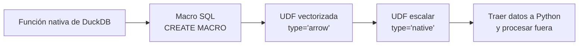

# 13 — UDFs en Python y Funciones Personalizadas

> Continúa de [[12 - Extensiones]]. Cuando ni el SQL ni las macros alcanzan (necesitas una librería de Python, un modelo de ML, una regex compleja o una llamada a una API), DuckDB permite registrar **funciones de Python como funciones SQL** (UDFs). Esta nota cubre los tipos de UDF, su rendimiento y cuándo conviene **no** usarlas.

## Jerarquía de opciones: de la más rápida a la más lenta



1. **Busca primero una función nativa**: DuckDB tiene cientos (`SELECT * FROM duckdb_functions()`).
2. Si es una combinación de funciones SQL, usa una **macro** (ver [[10 - DDL, Transacciones y Concurrencia#Macros: funciones SQL reutilizables]]). Se expande en línea y no tiene overhead.
3. Si necesitas Python, usa una **UDF vectorizada (Arrow)**, que procesa columnas enteras de una vez.
4. La **UDF escalar** fila por fila solo para lógica que no puede vectorizarse.

---

## UDF escalar (`type='native'`)

Se llama una vez **por fila**. Es simple, pero lenta en millones de filas porque cada llamada cruza la frontera entre C++ y Python.

```python
import duckdb
from duckdb.sqltypes import VARCHAR, INTEGER, DOUBLE   # en versiones anteriores: duckdb.typing

con = duckdb.connect()

def normalizar_ruc(ruc: str) -> str:
    digitos = "".join(c for c in ruc if c.isdigit())
    return digitos.zfill(11)

con.create_function("normalizar_ruc", normalizar_ruc, [VARCHAR], VARCHAR)

con.sql("SELECT normalizar_ruc(' 2060-1234-567 ') AS ruc").show()
```

### Inferencia de tipos por type hints

Si la función tiene anotaciones de tipo, puedes omitir los tipos de parámetros y de retorno:

```python
def iva(monto: float, tasa: float = 0.18) -> float:
    return round(monto * tasa, 2)

con.create_function("iva", iva)      # tipos inferidos de los hints
con.sql("SELECT iva(100.0, 0.18)").fetchone()
```

Ver [[42 - Type Hints y el Módulo Typing]]. Ojo: los parámetros con valor por defecto **no** se vuelven opcionales en SQL; la UDF siempre recibe todos los argumentos.

### Parámetros de `create_function`

```python
con.create_function(
    "nombre_sql",
    funcion_python,
    parameters=[VARCHAR, INTEGER],   # tipos de entrada
    return_type=VARCHAR,             # tipo de salida
    type="native",                   # 'native' (fila a fila) o 'arrow' (vectorizada)
    null_handling="default",         # 'default': NULL entra -> NULL sale sin llamar a la función
                                     # 'special': la función recibe None y decide
    exception_handling="default",    # 'default': lanza error | 'return_null': devuelve NULL
    side_effects=False,              # True si no es determinista (random, API, now): evita caché
)

con.remove_function("nombre_sql")
```

```python
# Manejo explícito de NULL y errores
import json

def extraer_campo(js: str | None, campo: str) -> str | None:
    if js is None:
        return None
    return json.loads(js).get(campo)

con.create_function("extraer_campo", extraer_campo, [VARCHAR, VARCHAR], VARCHAR,
                    null_handling="special", exception_handling="return_null")
```

---

## UDF vectorizada (`type='arrow'`)

La función recibe **arrays de PyArrow** (lotes de hasta ~2048 filas) y debe devolver un array del mismo largo. Es mucho más rápida porque la frontera C++/Python se cruza una vez por lote, y dentro puedes usar operaciones vectorizadas de `pyarrow.compute`, NumPy o Pandas.

```python
import pyarrow as pa
import pyarrow.compute as pc

def limpiar_texto(col: pa.Array) -> pa.Array:
    col = pc.utf8_lower(col)
    col = pc.utf8_trim_whitespace(col)
    return pc.replace_substring_regex(col, r"\s+", " ")

con.create_function("limpiar_texto", limpiar_texto, [VARCHAR], VARCHAR, type="arrow")
con.sql("SELECT limpiar_texto(comentario) FROM 'encuestas.parquet'").show()
```

```python
# Con NumPy: convertir, operar y volver a Arrow
import numpy as np

def log1p_seguro(x: pa.Array) -> pa.Array:
    arr = x.to_numpy(zero_copy_only=False)
    return pa.array(np.log1p(np.clip(arr, 0, None)))

con.create_function("log1p_seguro", log1p_seguro, [DOUBLE], DOUBLE, type="arrow")
```

### Comparación de rendimiento (orientativa)

| Implementación | 10M filas (orden de magnitud) |
|---|---|
| Función nativa SQL (`lower(trim(x))`) | ~0.1–0.3 s |
| Macro SQL | ~igual que nativa |
| UDF Arrow con `pyarrow.compute` | ~1–2 s |
| UDF native (Python puro por fila) | ~10–60 s |

Mide con `.timer on` o `EXPLAIN ANALYZE` en tu caso (ver [[15 - Rendimiento y Optimización]]).

---

## Caso práctico: inferencia de un modelo de ML dentro de SQL

```python
import joblib
import numpy as np
import pyarrow as pa
from duckdb.sqltypes import DOUBLE

modelo = joblib.load("modelo_churn.joblib")   # pipeline de sklearn entrenado

def predecir_churn(recencia: pa.Array, frecuencia: pa.Array, monto: pa.Array) -> pa.Array:
    X = np.column_stack([a.to_numpy(zero_copy_only=False) for a in (recencia, frecuencia, monto)])
    return pa.array(modelo.predict_proba(X)[:, 1])

con.create_function("predecir_churn", predecir_churn,
                    [DOUBLE, DOUBLE, DOUBLE], DOUBLE, type="arrow")

con.sql("""
    SELECT cliente_id, predecir_churn(recencia, frecuencia, monto) AS p_churn
    FROM features_clientes
    QUALIFY p_churn > 0.7
    ORDER BY p_churn DESC
""").df()
```

Esto permite **batch scoring** dentro de un pipeline SQL (o de un modelo dbt sobre DuckDB). Alternativas: cargar el modelo desde MLflow (`mlflow.pyfunc.load_model`, ver [[Python/MLflow/07 - Model Registry|MLflow/07]]) o traer el DataFrame a Python, predecir y volver a insertar. Esta última suele ser igual de rápida y más fácil de depurar.

## UDFs con efectos secundarios

```python
import requests

def geocodificar(direccion: str) -> str:
    r = requests.get("https://api.geocoder.ejemplo/v1", params={"q": direccion}, timeout=10)
    return r.text

con.create_function("geocodificar", geocodificar, [VARCHAR], VARCHAR,
                    side_effects=True, exception_handling="return_null")
```

⚠️ Llamar APIs fila por fila dentro de SQL es frágil: sin reintentos, sin rate limiting, sin caché y sin paralelismo controlado. Para eso es mejor un script de Python con `asyncio` o `httpx` y caché, que luego escribe los resultados en una tabla. Ver [[54 - Asyncio en Profundidad]] y [[25 - APIs]].

---

## Table functions desde Python

DuckDB no permite (en la API estable de Python) definir funciones de tabla arbitrarias. Hay dos patrones equivalentes:

```python
# 1. Una función de Python que devuelve un DataFrame y se consulta por replacement scan
def eventos_api(desde: str) -> "pd.DataFrame":
    ...
    return df

nuevos = eventos_api("2026-11-01")
con.sql("INSERT INTO eventos SELECT * FROM nuevos")

# 2. Table macro en SQL (si la lógica es SQL)
con.sql("CREATE MACRO top_n(t, n) AS TABLE SELECT * FROM query_table(t) LIMIT n")
```

## Buenas prácticas

- **Registra las UDFs al crear la conexión**, en una función `get_connection()` centralizada: las UDFs **no se persisten** en el archivo `.duckdb`.
- **Funciones puras y deterministas** siempre que puedas; marca `side_effects=True` las que no lo son.
- **Testea la función de Python por separado** con pytest antes de registrarla (ver [[Python/Pytest/01 - Introducción y Arquitectura|Pytest]]).
- Las UDFs **no existen fuera de Python**: si la CLI o dbt deben ejecutar la misma lógica, usa una macro SQL.
- En dbt-duckdb puedes registrar UDFs mediante un plugin (ver [[16 - DuckDB en Pipelines y Buenas Prácticas#dbt-duckdb]]).

## Ver también

- [[10 - DDL, Transacciones y Concurrencia#Macros: funciones SQL reutilizables]]
- [[11 - Integración con Pandas, Polars y Arrow]]
- [[15 - Rendimiento y Optimización]]
- [[31 - Funciones de Alto Orden y Programación Funcional]] (en `Python/`)
- [[Python/Scikit-learn/01 - Introducción, Filosofía y la API Consistente|Scikit-learn]]: entrenar el modelo que luego se usa en la UDF
