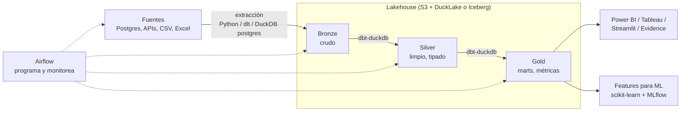

# 14 — DuckLake, MotherDuck y el Lakehouse Ligero

> Continúa de [[13 - UDFs en Python y Funciones Personalizadas]]. DuckDB tiene dos límites de diseño: **un solo nodo** y **un solo proceso escritor** (ver [[10 - DDL, Transacciones y Concurrencia#Concurrencia]]). Esta nota cubre las dos piezas del ecosistema que los estiran. **DuckLake** es un formato abierto de lakehouse que permite varios escritores concurrentes sobre almacenamiento de objetos. **MotherDuck** es un servicio cloud de DuckDB gestionado con ejecución híbrida. Al final se arma una arquitectura de "lakehouse ligero" con ambos.

## El problema: Parquet suelto no es una tabla

Un directorio `s3://lake/ventas/*.parquet` funciona para leer, pero le falta lo que tiene una tabla de base de datos:

| Necesidad | Parquet suelto | Formato de tabla (Iceberg / Delta / DuckLake) |
|---|---|---|
| Transacciones atómicas (todo o nada) | ❌ Archivos a medio escribir visibles | ✅ |
| Varios escritores concurrentes | ❌ | ✅ |
| `UPDATE` / `DELETE` / `MERGE` | ❌ Reescribir a mano | ✅ |
| Evolución de esquema | Frágil (`union_by_name`) | ✅ Versionado |
| Time travel / rollback | ❌ | ✅ Snapshots |
| Saber qué archivos forman la tabla | Listar S3 (lento) | ✅ Metadata/catálogo |

**Iceberg** y **Delta Lake** resuelven esto guardando la metadata como **archivos** (JSON/Avro) dentro del propio almacenamiento de objetos, y suelen necesitar además un catálogo externo (Glue, Unity, REST). DuckDB los lee y escribe (ver [[12 - Extensiones#Iceberg y Delta Lake]]).

---

## DuckLake

**DuckLake** (presentado por DuckDB Labs en mayo de 2025) parte de una idea simple: **guardar toda la metadata en una base de datos SQL** en lugar de en miles de archivos de metadata, y **los datos en Parquet** en almacenamiento de objetos.

```mermaid
flowchart LR
    subgraph COMPUTO["Cómputo: N procesos DuckDB"]
        D1[DuckDB laptop]
        D2[DuckDB en tarea de Airflow]
        D3[DuckDB en API]
    end
    subgraph CATALOGO["Catálogo (base SQL)"]
        PG[(PostgreSQL / MySQL /<br/>SQLite / DuckDB)<br/>snapshots, esquemas,<br/>lista de archivos, estadísticas]
    end
    subgraph DATOS["Datos"]
        S3[(S3 / GCS / Azure / disco<br/>archivos Parquet)]
    end
    D1 & D2 & D3 -- transacciones SQL --> PG
    D1 & D2 & D3 -- leen/escriben Parquet --> S3
```

Por qué es interesante:

- **Varios escritores concurrentes**: si el catálogo es PostgreSQL, varios procesos DuckDB pueden escribir a la vez. Las transacciones del catálogo garantizan la consistencia.
- **Simplicidad**: no requiere un servicio de catálogo aparte. El catálogo es "solo una base de datos".
- **Rápido para cambios pequeños**: consultar la metadata es una consulta SQL, no una lectura de muchos archivos.
- **Formato abierto**: los datos son Parquet estándar y la especificación de la metadata es pública.

> DuckLake es un proyecto joven que evoluciona rápido. Revisa la versión y la documentación vigente antes de adoptarlo en producción, y fija las versiones de DuckDB y de la extensión `ducklake`.

### Crear y usar un DuckLake

```sql
INSTALL ducklake; LOAD ducklake;

-- Modo local: catálogo en un archivo DuckDB y datos en una carpeta
ATTACH 'ducklake:catalogo.ducklake' AS lake (DATA_PATH 'datos_lake/');
USE lake;

-- A partir de aquí es SQL normal
CREATE TABLE ventas AS FROM 'ventas_2026.parquet';
INSERT INTO ventas FROM 'ventas_nuevas.parquet';
UPDATE ventas SET region = 'LATAM' WHERE region = 'Latam';
DELETE FROM ventas WHERE monto < 0;
ALTER TABLE ventas ADD COLUMN canal VARCHAR;
```

```sql
-- Modo multiusuario: catálogo en PostgreSQL y datos en S3
CREATE SECRET (TYPE s3, PROVIDER credential_chain);
CREATE SECRET pg_lake (TYPE postgres, HOST 'catalogo.empresa.com', DATABASE 'ducklake',
                       USER 'lake', PASSWORD '...');

ATTACH 'ducklake:postgres:' AS lake (
    METADATA_PARAMETERS MAP {'TYPE': 'postgres', 'SECRET': 'pg_lake'},
    DATA_PATH 's3://empresa-lake/'
);
```

### Time travel y snapshots

Cada transacción confirmada crea un **snapshot**:

```sql
FROM ducklake_snapshots('lake');          -- id, timestamp, cambios de cada snapshot

SELECT * FROM ventas AT (VERSION => 3);
SELECT * FROM ventas AT (TIMESTAMP => now() - INTERVAL 1 DAY);

-- Adjuntar el lake completo "congelado" en un snapshot
ATTACH 'ducklake:catalogo.ducklake' AS lake_ayer (SNAPSHOT_VERSION 3);

-- Change data feed: qué filas cambiaron entre dos snapshots
FROM ducklake_table_changes('lake', 'main', 'ventas', 3, 5);
```

Esto es muy útil para **reproducibilidad en ML**: entrenar con `AT (VERSION => n)` y registrar ese número en MLflow permite reconstruir exactamente el dataset de entrenamiento. Es un rol parecido al que cumple DVC para archivos (ver [[46-Reproducibilidad-con-DVC]] y [[Python/MLflow/02 - Tracking - Fundamentos y API de Logging|MLflow Tracking]]).

### Mantenimiento

Muchas escrituras pequeñas generan muchos archivos Parquet pequeños, y los snapshots viejos retienen archivos ya borrados lógicamente.

```sql
CALL ducklake_merge_adjacent_files('lake');                         -- compactar archivos pequeños
CALL ducklake_expire_snapshots('lake', older_than => now() - INTERVAL 30 DAY);
CALL ducklake_cleanup_old_files('lake', cleanup_all => true);      -- borrar archivos huérfanos
CALL lake.set_option('target_file_size', '256MB');
```

Prográmalo como tarea periódica en Airflow.

### DuckLake vs. Iceberg vs. Delta

| | **DuckLake** | **Iceberg** | **Delta Lake** |
|---|---|---|---|
| Metadata | Base SQL | Archivos JSON/Avro + catálogo | Log de transacciones JSON |
| Motores que lo usan | DuckDB (crece el soporte en otros) | Spark, Trino, Flink, Snowflake, BigQuery, DuckDB... | Databricks, Spark, DuckDB, Polars... |
| Complejidad de operación | Baja | Media-alta (catálogo) | Media |
| Ideal para | Equipos pequeños y medianos centrados en DuckDB | Interoperabilidad entre muchos motores | Ecosistema Databricks |

**Criterio:** si toda tu organización ya usa Iceberg o Delta (Databricks, Snowflake), usa ese formato y lee con DuckDB. Si arrancas de cero con un equipo pequeño y DuckDB es tu motor principal, DuckLake es la opción más simple.

---

## MotherDuck

**MotherDuck** es un servicio cloud gestionado basado en DuckDB, creado por una empresa aliada con DuckDB Labs. Aporta lo que DuckDB embebido no tiene: almacenamiento persistente en la nube, compartir bases entre personas y ejecutar consultas pesadas en servidores.

### Conectarse

```bash
export motherduck_token="eyJ..."     # token desde la UI de MotherDuck
```

```sql
ATTACH 'md:';                         -- todas tus bases de MotherDuck
ATTACH 'md:analitica' AS md_ana;      -- una base concreta
SHOW DATABASES;
```

```python
import duckdb
con = duckdb.connect("md:analitica")          # lee motherduck_token del entorno
con.sql("SELECT COUNT(*) FROM ventas").show()
```

### Ejecución híbrida (dual execution)

La característica distintiva: una misma consulta puede combinar **datos locales** (archivos, DataFrames, bases en tu laptop) con **datos en MotherDuck**, y el planificador decide qué parte se ejecuta en local y qué parte en la nube para mover la menor cantidad de datos posible.

```sql
-- 'pedidos_local.parquet' está en tu disco; md_ana.clientes en la nube
SELECT c.segmento, SUM(p.monto)
FROM 'pedidos_local.parquet' p
JOIN md_ana.clientes c ON p.cliente_id = c.id
GROUP BY ALL;
```

### Subir, compartir y migrar

```sql
-- Subir una base local completa
ATTACH 'analitica.duckdb' AS local_db;
CREATE DATABASE analitica_cloud FROM local_db;

-- Compartir (solo lectura) con colegas
CREATE SHARE ventas_share FROM analitica_cloud;
-- el colega ejecuta: ATTACH 'md:_share/analitica_cloud/<id>' AS ventas;
```

### ¿Cuándo tiene sentido?

| Necesidad | DuckDB local | MotherDuck |
|---|---|---|
| Análisis personal, pipelines en una máquina | ✅ | |
| Varios analistas consultando los mismos datos | Archivos compartidos (frágil) | ✅ |
| BI (Power BI, Tableau, Metabase...) sobre una base central | Difícil | ✅ Conectores |
| Datos que no deben salir de tu infraestructura | ✅ | ❌ Revisar cumplimiento |
| Costo | Gratis | Plan gratuito limitado y planes de pago |

---

## Arquitectura de referencia: lakehouse ligero

Para un equipo pequeño o mediano que quiere un stack moderno **sin Spark ni un warehouse caro**:



- **Cómputo**: DuckDB en las tareas de Airflow o en contenedores efímeros.
- **Transformación**: dbt con el adapter `dbt-duckdb` (ver [[16 - DuckDB en Pipelines y Buenas Prácticas#dbt-duckdb]]).
- **Almacenamiento**: Parquet en S3, gobernado por DuckLake o Iceberg.
- **Orquestación**: Airflow (ver [[Python/Airflow/01 - Introducción y Arquitectura|Python/Airflow]]).
- **Consumo**: BI, notebooks y ML. Se puede añadir MotherDuck como capa de servicio compartida.

Este stack escala cómodamente hasta cientos de GB o algunos TB con un costo de infraestructura mínimo.

## Ver también

- [[05 - Parquet, Globs y Particionado Hive]]
- [[06 - Fuentes Remotas y Cloud]]
- [[12 - Extensiones#Iceberg y Delta Lake]]
- [[10 - DDL, Transacciones y Concurrencia#Concurrencia]]
- [[04-Ingenieria-de-Datos]] y [[08-Plataformas-de-Datos-y-ML]] (en `Machine Learning/`): lakehouse, medallion, Databricks, Snowflake
- [[13 - Estructura de Proyecto y Modelado|dbt/13]]: capas staging/intermediate/marts
