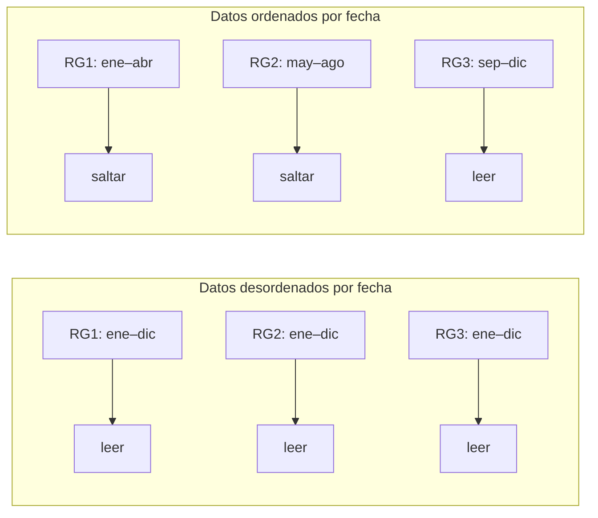

# 15 — Rendimiento y Optimización

> Continúa de [[14 - DuckLake, MotherDuck y el Lakehouse Ligero]]. DuckDB es rápido por defecto: la mayoría de las consultas no necesitan ningún ajuste. Esta nota sirve para cuando algo **sí** va lento o se queda sin memoria: cómo leer un plan, perfilar, gestionar memoria y spilling, organizar los datos para aprovechar los zonemaps y hacer cargas masivas eficientes. Para los principios generales de optimización SQL, ver [[27-SQL-Profesional-Nivel-2-Optimizacion]].

## Medir antes de optimizar

```sql
.timer on                         -- en la CLI: tiempo de cada consulta
SET enable_progress_bar = true;
```

```python
import time
t = time.perf_counter()
con.sql(q).fetchall()             # ¡materializa! .sql() solo es lazy
print(time.perf_counter() - t)
```

> Error común al medir en Python: `con.sql(q)` sin `.fetchall()`, `.df()` o similar **no ejecuta** la consulta completa, porque la relación es lazy. Mide siempre materializando el resultado.

## EXPLAIN y EXPLAIN ANALYZE

```sql
EXPLAIN SELECT ...;           -- plan físico estimado (no ejecuta)
EXPLAIN ANALYZE SELECT ...;   -- ejecuta y muestra tiempo y filas reales por operador
```

Qué buscar en el plan:

| Señal | Problema probable | Acción |
|---|---|---|
| `SEQ_SCAN` / `READ_PARQUET` sin `Filters` | El filtro no se empuja al escaneo | Revisa funciones sobre la columna (`WHERE year(fecha)=2026` en vez de un rango) |
| `Projections` con todas las columnas | `SELECT *` innecesario | Selecciona solo las columnas que necesitas |
| Un `HASH_JOIN` con muchísimas filas de salida | Join explosivo (claves duplicadas) | Verifica la cardinalidad de las claves |
| `NESTED_LOOP_JOIN` / `BLOCKWISE_NL_JOIN` | Join sin igualdad | Reformula con igualdades, o usa `ASOF` si es temporal |
| `CROSS_PRODUCT` | Falta una condición de join | Corrige el `ON` |
| `ORDER_BY` sobre millones de filas sin `LIMIT` | Ordenamiento caro | ¿Hace falta ordenar? |
| Tiempo alto en una UDF de Python | UDF escalar lenta | Vectoriza o usa una macro (ver [[13 - UDFs en Python y Funciones Personalizadas]]) |

```sql
-- Filtro "sargable" (se empuja) vs. no sargable
WHERE fecha >= DATE '2026-01-01' AND fecha < DATE '2027-01-01'   -- ✅ usa min/max
WHERE year(fecha) = 2026                                          -- ⚠️ DuckDB a veces lo reescribe, pero no confíes
```

## Profiling detallado

```sql
SET enable_profiling = 'json';                 -- 'query_tree' (texto), 'json', 'query_tree_optimizer'
SET profiling_output = 'perfil.json';
SET profiling_mode = 'detailed';               -- incluye tiempos del optimizador
SELECT ...;
SET enable_profiling = 'no_output';
```

El JSON se puede visualizar con herramientas como `duckdb-query-graph`. También existe `PRAGMA enable_profiling`.

---

## Memoria y spilling

### Configuración

```sql
SET memory_limit = '8GB';        -- por defecto: 80% de la RAM física
SET temp_directory = '/data/duckdb_tmp';   -- por defecto: <base>.tmp o .tmp en el cwd
SET max_temp_directory_size = '100GB';
SET threads = 8;                 -- por defecto: núcleos lógicos

SELECT * FROM duckdb_memory();             -- uso por componente
SELECT * FROM duckdb_temporary_files();    -- spilling en curso
```

Los operadores que pueden hacer **spilling a disco** (larger-than-memory) son los hash joins, las agregaciones (`GROUP BY`), los `ORDER BY`, las window functions y la escritura de Parquet o CSV. Algunas operaciones aún no tienen spilling o lo tienen limitado, como algunos agregados de listas (`list()`, `string_agg` con grupos enormes) y `PIVOT` muy anchos.

### Si te quedas sin memoria (`Out of Memory Error`)

1. **Reduce threads**: cada thread tiene su propio estado intermedio. `SET threads = 4` usa menos memoria pico.
2. **`SET preserve_insertion_order = false`**: permite que las cargas y exportaciones no mantengan el orden, lo que reduce mucho la memoria al hacer `COPY` o `CREATE TABLE AS` de datasets grandes.
3. **Asegúrate de tener `temp_directory`** con espacio en disco (rápido, idealmente SSD).
4. **Divide la carga**: procesa por partición (por mes) en un bucle en lugar de todo junto.
5. **Selecciona menos columnas**, sobre todo strings largos.
6. **Evita `list()` / `string_agg` sobre grupos enormes**.
7. En **contenedores**, fija `memory_limit` por debajo del límite del contenedor. Si no, DuckDB calcula el 80% de la RAM del host y el kernel lo mata (OOM-killed). Ver [[Docker/02 - Dockerfile en Profundidad|Docker/02]] y los `resources.limits` en [[Kubernetes/01 - Introducción y Arquitectura del Clúster|Kubernetes]].

```python
# Procesamiento por particiones para datos enormes
meses = con.sql("SELECT DISTINCT date_trunc('month', fecha) FROM 'raw/*.parquet' ORDER BY 1").fetchall()
for (mes,) in meses:
    con.execute("""
        COPY (SELECT ... FROM read_parquet('raw/*.parquet')
              WHERE fecha >= $m AND fecha < $m + INTERVAL 1 MONTH)
        TO 'out' (FORMAT parquet, PARTITION_BY (anio, mes), APPEND)
    """, {"m": mes})
```

---

## Orden de los datos y zonemaps

DuckDB guarda, para cada columna de cada row group (~122k filas), el **mínimo y el máximo** (zonemap). Un filtro puede **saltar** row groups completos si su rango no coincide. Lo mismo ocurre con las estadísticas de los row groups de Parquet.



```sql
-- WHERE fecha >= '2026-10-01'
-- Al cargar, ordena por la columna de filtro más frecuente
CREATE OR REPLACE TABLE ventas AS
SELECT * FROM 'raw/*.parquet' ORDER BY fecha;

COPY (FROM ventas ORDER BY fecha) TO 'ventas.parquet' (FORMAT parquet);
```

Si filtras por dos columnas con frecuencia, ordena primero por la de menor cardinalidad que más filtre (por ejemplo, `ORDER BY region, fecha`). Ordenar cuesta tiempo en la carga, pero se gana en cada lectura.

## Índices

| Índice | Cuándo se crea | Para qué sirve |
|---|---|---|
| **Zonemaps (min-max)** | Automático, siempre | Filtros por rango en todas las columnas |
| **ART** | `PRIMARY KEY`, `UNIQUE`, `CREATE INDEX` | Búsquedas puntuales muy selectivas (`WHERE id = 42`) y constraints |
| **HNSW** | `CREATE INDEX ... USING HNSW` (vss) | Vecinos más cercanos en vectores |
| **FTS** | `PRAGMA create_fts_index` | Texto completo |

```sql
CREATE INDEX idx_cliente_email ON clientes (email);   -- solo si haces lookups puntuales frecuentes
DROP INDEX idx_cliente_email;
```

En analítica, los índices ART **casi nunca ayudan** a las consultas de agregación y **sí perjudican** las cargas: cada `INSERT` debe actualizarlos y ocupan memoria. Crea índices solo para lookups puntuales (por ejemplo, una API que busca por id).

---

## Cargas masivas

| Método | Velocidad | Uso |
|---|---|---|
| `COPY tabla FROM 'archivo'` / `CREATE TABLE AS FROM 'archivo'` | ⚡⚡⚡ | Archivos |
| `INSERT INTO t SELECT * FROM df` (DataFrame o Arrow) | ⚡⚡⚡ | Datos ya en Python |
| Appender (C/C++/Java/Go/Rust) | ⚡⚡⚡ | Ingesta desde aplicaciones |
| `executemany` con muchas filas | 🐢 | Pocas filas |
| `INSERT ... VALUES` en un bucle, en autocommit | 🐢🐢🐢 | **Nunca** para volumen |

```python
# ❌ Lento: una transacción por fila
for fila in filas:
    con.execute("INSERT INTO t VALUES (?, ?)", fila)

# ✅ Rápido: acumular y cargar en bloque
import pyarrow as pa
lote = pa.Table.from_pylist([{"a": x, "b": y} for x, y in filas])
con.execute("INSERT INTO t SELECT * FROM lote")

# ✅ Si es inevitable fila por fila, agrupa en una sola transacción
con.begin()
con.executemany("INSERT INTO t VALUES (?, ?)", filas)
con.commit()
```

Además, al cargar volúmenes grandes:

- No declares `PRIMARY KEY` / `UNIQUE` en la tabla destino durante la carga.
- `SET preserve_insertion_order = false`.
- Carga primero y crea los índices después, si los necesitas.

---

## Tipos de datos y almacenamiento

- **Tipos ajustados**: `INTEGER` en lugar de `BIGINT`, `DATE` en lugar de `TIMESTAMP`, `ENUM` o `VARCHAR` de baja cardinalidad en lugar de strings largos. Comprimen mejor y se procesan más rápido.
- **No guardes números ni fechas como `VARCHAR`**: impide los zonemaps útiles y obliga a castear en cada consulta.
- **Revisa la compresión** con `PRAGMA storage_info('tabla')` (columna `compression`).
- **Persistente vs. en memoria**: para consultas repetidas sobre los mismos datos, una tabla en `.duckdb` es más rápida que releer Parquet, sobre todo si es remoto.

## Configuraciones de rendimiento a mano

```sql
SET threads = 16;                           -- más threads para I/O remoto (S3)
SET preserve_insertion_order = false;       -- cargas y exportaciones grandes
SET enable_object_cache = true;             -- caché de metadata de Parquet entre consultas
SET enable_external_file_cache = true;      -- caché de bloques de archivos remotos
SET default_order = 'ASC';
SET checkpoint_threshold = '1GB';           -- menos checkpoints durante cargas masivas
```

## Checklist de diagnóstico

1. ¿Estás midiendo con la consulta **materializada**?
2. `EXPLAIN ANALYZE`: ¿qué operador consume el tiempo?
3. ¿Los filtros aparecen como `Filters` en el escaneo? ¿Las proyecciones son mínimas?
4. ¿Los datos están **ordenados** por la columna de filtro? ¿Hay **partición Hive** por ella?
5. ¿Hay **miles de archivos pequeños**? Compacta (ver [[16 - DuckDB en Pipelines y Buenas Prácticas#Compactación de archivos pequeños]]).
6. ¿Hay una **UDF de Python** escalar en el camino caliente?
7. ¿Se queda sin memoria? Revisa `threads`, `preserve_insertion_order`, `temp_directory` y el procesamiento por partes.
8. ¿Lees de S3 repetidamente? Materializa en local.

## Ver también

- [[27-SQL-Profesional-Nivel-2-Optimizacion]] (en `Machine Learning/`)
- [[05 - Parquet, Globs y Particionado Hive]]
- [[10 - DDL, Transacciones y Concurrencia]]
- [[Python/Pandas/15 - Rendimiento y Optimización|Pandas/15]]: la contraparte en Pandas
- [[58 - Profiling y Optimización de Rendimiento]] (en `Python/`)
- [[Indexes]] (en `SQL/`)
