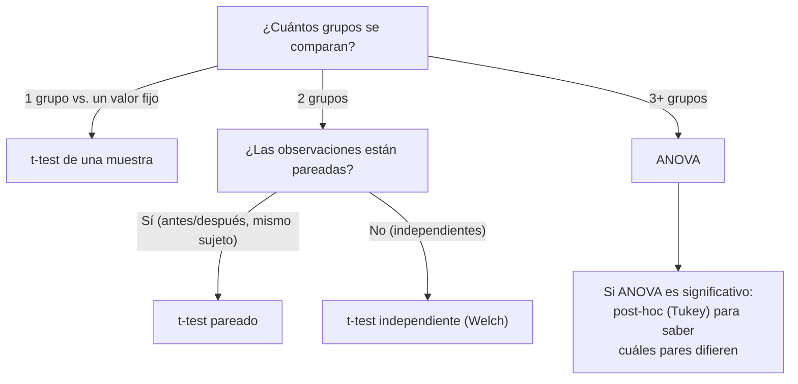

# 05 — Pruebas de Hipótesis para Data Science

> Para la sintaxis de cada prueba en Python, ver [[Python/SciPy/05 - Estadística II - Pruebas de Hipótesis (scipy.stats)|SciPy]]. Este archivo cubre **cuándo** aplicar cada una en un flujo de trabajo real de Data Science, más allá del cálculo aislado.

## El árbol de decisión: qué prueba usar



## t-test: la prueba más común, con las trampas más comunes

```python
from scipy import stats

# SIEMPRE con equal_var=False (corrección de Welch) salvo razón fuerte para lo contrario:
# asumir varianzas iguales cuando no lo son infla la tasa de falsos positivos.
t_stat, p_valor = stats.ttest_ind(grupo_a, grupo_b, equal_var=False)
```

## Chi-cuadrado: variables categóricas, no numéricas

Uso típico en Data Science: verificar si dos variables categóricas están asociadas (¿el dispositivo del usuario está asociado con la tasa de conversión?):

```python
import pandas as pd
from scipy.stats import chi2_contingency

tabla = pd.crosstab(df["dispositivo"], df["convirtio"])
chi2, p_valor, df_libertad, esperado = chi2_contingency(tabla)
```

## ANOVA + post-hoc: comparar más de dos variantes

Cuando un experimento tiene más de dos grupos (A/B/C testing), ANOVA responde "¿hay al menos una diferencia entre los grupos?" pero no dice **cuáles** difieren — para eso se necesita una prueba post-hoc con corrección por comparaciones múltiples:

```python
from scipy.stats import f_oneway
from statsmodels.stats.multicomp import pairwise_tukeyhsd

f_stat, p_valor = f_oneway(grupo_a, grupo_b, grupo_c)

if p_valor < 0.05:
    resultado_tukey = pairwise_tukeyhsd(
        endog=pd.concat([grupo_a, grupo_b, grupo_c]),
        groups=["A"]*len(grupo_a) + ["B"]*len(grupo_b) + ["C"]*len(grupo_c),
        alpha=0.05
    )
    print(resultado_tukey)
```

## El error de aplicar t-test repetidamente en vez de ANOVA

Comparar A vs B, luego A vs C, luego B vs C con tres t-tests separados **infla la tasa de error** — cada prueba tiene 5% de probabilidad de falso positivo, y al hacer tres, la probabilidad de al menos un falso positivo sube a casi 15%. Este es el mismo problema de comparaciones múltiples que aparece en [[06 - A-B Testing de Principio a Fin#El problema de las comparaciones múltiples|A/B testing con varias variantes]] — usar ANOVA + post-hoc con corrección en vez de múltiples t-tests independientes.

## Pruebas no paramétricas: cuando no se puede asumir Normalidad

Alternativas que no requieren el supuesto de Normalidad, útiles con muestras pequeñas o datos claramente asimétricos:

```python
from scipy.stats import mannwhitneyu, wilcoxon, kruskal

mannwhitneyu(grupo_a, grupo_b)   # alternativa no paramétrica al t-test independiente
wilcoxon(antes, despues)         # alternativa no paramétrica al t-test pareado
kruskal(grupo_a, grupo_b, grupo_c)   # alternativa no paramétrica a ANOVA
```

Regla práctica: con $n$ razonablemente grande (>30 por grupo) y sin outliers extremos, el t-test/ANOVA son robustos incluso si la Normalidad no es perfecta (por el TCL); con muestras pequeñas y datos claramente no Normales, preferir la versión no paramétrica.

## Ver también

- [[Python/SciPy/05 - Estadística II - Pruebas de Hipótesis (scipy.stats)]]
- [[06 - A-B Testing de Principio a Fin]]
- [[08 - Supuestos Estadísticos Detrás de los Modelos de ML]]
