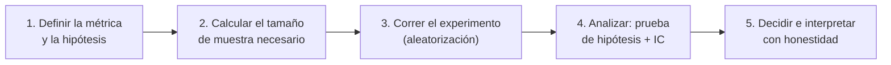

# 06 — A/B Testing de Principio a Fin

> Este archivo integra [[03 - Muestreo, TCL y Bootstrap en la Práctica]], [[04 - Intervalos de Confianza Aplicados]] y [[05 - Pruebas de Hipótesis para Data Science]] en el flujo completo de un experimento real, de diseño a decisión.

## Las cinco etapas de un A/B test



## Etapa 1 — Definir la métrica y la hipótesis ANTES de ver los datos

```
H0: la tasa de conversión de B es igual a la de A (no hay efecto)
H1: la tasa de conversión de B es distinta de la de A
```

Decidir de antemano: la métrica exacta (no varias métricas para "ver cuál da significativo" — eso es *p-hacking*), el nivel de significancia $\alpha$ (convencionalmente 0.05), y si la prueba es de una cola o dos colas.

## Etapa 2 — Calcular el tamaño de muestra necesario

Correr un experimento sin calcular el tamaño de muestra de antemano es el error más común: un experimento subdimensionado puede fallar en detectar un efecto real que sí existe (bajo poder estadístico).

```python
from statsmodels.stats.power import NormalIndPower
from statsmodels.stats.proportion import proportion_effectsize

p_control = 0.10       # tasa de conversión actual, de datos históricos
p_esperado_b = 0.12    # mejora mínima que se quiere poder detectar

effect_size = proportion_effectsize(p_control, p_esperado_b)

analisis = NormalIndPower()
n_necesario = analisis.solve_power(effect_size=effect_size, alpha=0.05, power=0.80)
print(f"Se necesitan ~{n_necesario:.0f} usuarios por grupo")
```

`power=0.80` (80%) es la convención estándar: la probabilidad de detectar el efecto si realmente existe. Ver la lógica de fondo (redondeo hacia arriba, el mismo principio de $n \ge (z\sigma/E)^2$) en [[University Degree Notes/Ciclo 04/Estadística Inferencial/Clase 07 - Estimación e Intervalos de Confianza#Determinar el Tamaño de Muestra por Adelantado|Estadística Inferencial, Clase 07]].

## Etapa 3 — Aleatorización correcta

La validez de todo el análisis depende de que la asignación a grupo A o B sea verdaderamente aleatoria e independiente del resultado — sesgos de asignación (por ejemplo, asignar usuarios más activos preferentemente a B) invalidan cualquier prueba estadística posterior, sin importar qué tan bien se calcule.

## Etapa 4 — Analizar

```python
from scipy.stats import chi2_contingency
import numpy as np

conversiones_a, n_a = 42, 500
conversiones_b, n_b = 58, 500

tabla = np.array([[conversiones_a, n_a - conversiones_a], [conversiones_b, n_b - conversiones_b]])
chi2, p_valor, df, esperado = chi2_contingency(tabla)

p_a, p_b = conversiones_a / n_a, conversiones_b / n_b
print(f"Tasa A: {p_a:.3f}, Tasa B: {p_b:.3f}, p-valor: {p_valor:.4f}")
```

## Etapa 5 — Decidir e interpretar con honestidad

Reportar siempre el intervalo de confianza de la diferencia, no solo el p-valor (ver [[04 - Intervalos de Confianza Aplicados#IC para una diferencia de medias (A/B testing)|IC para diferencia de medias]]) — un resultado "estadísticamente significativo" con una mejora de 0.1 puntos porcentuales puede no justificar el costo de implementar el cambio (significancia estadística no es lo mismo que significancia práctica/de negocio).

## El problema de las comparaciones múltiples

Probar muchas variantes o muchas métricas simultáneamente sobre el mismo experimento infla la probabilidad de un falso positivo, igual que en [[05 - Pruebas de Hipótesis para Data Science#El error de aplicar t-test repetidamente en vez de ANOVA|el caso de tres t-tests en vez de ANOVA]]. La corrección estándar es Bonferroni (dividir $\alpha$ entre el número de comparaciones) u otra igualmente conservadora:

```python
alpha_original = 0.05
n_comparaciones = 5   # 5 variantes comparadas contra el control

alpha_corregido = alpha_original / n_comparaciones   # 0.01 -- Corrección de Bonferroni
```

## Errores clásicos de A/B testing

- **"Peeking"**: revisar el resultado repetidamente y detener el experimento en cuanto se ve significancia — infla drásticamente la tasa de falsos positivos. Definir la duración/tamaño de muestra de antemano y no detener antes de tiempo.
- **Ignorar la novedad**: un cambio de UI puede mostrar una mejora inicial solo porque es nuevo (efecto novedad), no porque sea mejor a largo plazo.
- **Muestra insuficiente y forzar una conclusión**: un IC muy ancho no es "sin efecto" — es "no hay suficiente evidencia todavía", una distinción crítica al comunicar resultados.

## Ver también

- [[04 - Intervalos de Confianza Aplicados]]
- [[05 - Pruebas de Hipótesis para Data Science]]
- [[07 - Correlación vs Causalidad y Errores Comunes de Inferencia]]
