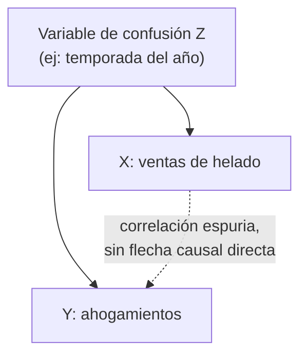

# 07 — Correlación vs Causalidad y Errores Comunes de Inferencia

## La regla que todo el mundo conoce mal en la práctica

"Correlación no implica causalidad" se cita con frecuencia, pero el error real más común en la práctica de Data Science no es afirmar causalidad directamente — es **actuar** sobre una correlación como si fuera causal (por ejemplo, invertir presupuesto en una variable solo porque correlaciona con la métrica de negocio, sin verificar el mecanismo).

## Variables de confusión (confounders)

Una variable de confusión es una tercera variable que influye tanto en $X$ como en $Y$, produciendo una correlación entre ellas sin que exista una relación causal directa:

Las ventas de helado correlacionan con los ahogamientos — no porque el helado cause ahogamientos, sino porque ambos aumentan en verano. Antes de actuar sobre una correlación observada, preguntar: ¿existe una variable de confusión plausible que explique ambas?

## Causalidad reversa

A veces la dirección de la causalidad es la contraria a la asumida: una empresa observa que los clientes que usan más una función premium tienen mayor retención, y concluye que la función *causa* retención — pero es igualmente plausible que los clientes ya comprometidos con el producto (que iban a quedarse de todas formas) sean los que más exploran funciones premium.

## El "efecto de selección" en datos observacionales

Comparar usuarios que eligieron usar una función contra los que no la usaron **no** es un experimento controlado — los dos grupos ya diferían antes de la exposición (los que la eligieron probablemente ya eran más comprometidos). Esta es la razón de fondo por la que el A/B testing (ver [[06 - A-B Testing de Principio a Fin]]) con asignación *aleatoria* es la forma más confiable de establecer causalidad: la aleatorización garantiza que, en promedio, los grupos son comparables en todo excepto el tratamiento.

## Cuándo sí se puede inferir causalidad sin un experimento (mención breve)

Cuando un A/B test no es posible (por ética, costo, o porque el evento ya ocurrió), existen métodos de inferencia causal diseñados para datos observacionales — *propensity score matching*, *diferencias en diferencias*, variables instrumentales. Quedan fuera del alcance de este cheat-sheet, pero vale reconocer que existen: la alternativa a "no se puede probar causalidad sin experimento" no es "ignorar el problema", sino recurrir a estos métodos cuando el experimento verdadero no es viable.

## El problema del *data dredging* / *p-hacking*

Probar suficientes hipótesis sobre el mismo dataset eventualmente encuentra "algo significativo" por puro azar — con $\alpha=0.05$, probar 20 correlaciones independientes produce, en promedio, **una** significativa aunque no exista ninguna relación real. La corrección es la misma vista en [[06 - A-B Testing de Principio a Fin#El problema de las comparaciones múltiples|comparaciones múltiples]]: ajustar $\alpha$ por el número de pruebas, o —mejor aún— definir las hipótesis a probar *antes* de explorar los datos, no después.

## Checklist antes de afirmar una relación causal

1. ¿Hay una asignación aleatoria (experimento controlado), o son datos observacionales?
2. Si son observacionales, ¿existe una variable de confusión plausible?
3. ¿La dirección de la causalidad podría ser la inversa?
4. ¿Esta relación sobrevivió a corrección por comparaciones múltiples, o fue "encontrada" explorando muchas variables?

## Ver también

- [[06 - A-B Testing de Principio a Fin]]
- [[02 - Distribuciones y su Uso en ML]]
