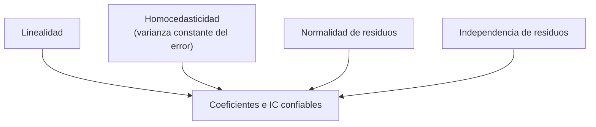

# 08 — Supuestos Estadísticos Detrás de los Modelos de ML

> Para el fundamento matemático del error estándar y los residuos, ver [[University Degree Notes/Ciclo 04/Estadística Inferencial/Clase 07 - Estimación e Intervalos de Confianza]]. Este archivo cubre cómo esos supuestos se verifican en la práctica al entrenar un modelo con [[Python/Scikit-learn/01 - Introducción, Filosofía y la API Consistente|scikit-learn]].

## Por qué importa verificar supuestos (y qué pasa si se ignoran)

Un modelo de regresión lineal entrena y produce predicciones aunque sus supuestos estén completamente violados — no hay ningún error en tiempo de ejecución que avise del problema. Lo que se ve comprometido es la **validez de la inferencia**: los intervalos de confianza de los coeficientes, los p-valores de significancia, y la confiabilidad de las predicciones fuera de la muestra de entrenamiento.

## Los cuatro supuestos clásicos de la regresión lineal (OLS)



### 1. Linealidad

La relación entre predictores y variable objetivo debe ser (aproximadamente) lineal. Diagnóstico: graficar residuos contra valores predichos — un patrón curvo indica que falta un término no lineal (o que conviene transformar una variable).

```python
import matplotlib.pyplot as plt

residuos = y_test - modelo.predict(X_test)
plt.scatter(modelo.predict(X_test), residuos)
plt.axhline(0, color='red')
plt.xlabel("Valores predichos"); plt.ylabel("Residuos")
```

### 2. Homocedasticidad — varianza constante del error

Si la dispersión de los residuos crece (o decrece) sistemáticamente con el valor predicho (forma de "embudo" en el gráfico anterior), hay **heterocedasticidad**: los errores estándar de los coeficientes ya no son confiables. Prueba formal:

```python
from statsmodels.stats.diagnostic import het_breuschpagan

lm_stat, lm_p, f_stat, f_p = het_breuschpagan(residuos, X_test_con_constante)
# H0: homocedasticidad. p pequeño -> evidencia de heterocedasticidad.
```

### 3. Normalidad de los residuos

No requiere que la variable objetivo sea Normal, solo los residuos — se verifica con el mismo [[Python/SciPy/05 - Estadística II - Pruebas de Hipótesis (scipy.stats)#Prueba de normalidad|test de Shapiro-Wilk]] visto en SciPy:

```python
from scipy.stats import shapiro

stat, p_valor = shapiro(residuos)
```

Con muestras muy grandes, Shapiro-Wilk rechaza la Normalidad casi siempre aunque la desviación sea trivial en la práctica — para $n$ grande conviene complementar con una inspección visual (histograma de residuos, gráfico Q-Q) en vez de depender solo del p-valor.

### 4. Independencia de los residuos

Crítico en datos de series de tiempo o datos agrupados (varias observaciones del mismo cliente/tienda): si los residuos están autocorrelacionados, los errores estándar se subestiman.

```python
from statsmodels.stats.stattools import durbin_watson

durbin_watson(residuos)   # ~2: sin autocorrelación. <1 o >3: autocorrelación fuerte, señal de alerta.
```

## Multicolinealidad — no es un supuesto, pero es igual de importante

Predictores muy correlacionados entre sí no violan un supuesto formal de OLS, pero hacen que los coeficientes individuales sean inestables y difíciles de interpretar (aunque las predicciones del modelo en conjunto sigan siendo razonables):

```python
from statsmodels.stats.outliers_influence import variance_inflation_factor

vif = [variance_inflation_factor(X.values, i) for i in range(X.shape[1])]
# VIF > 10 (regla práctica común) señala multicolinealidad problemática para ese predictor
```

## Supuestos en otros modelos, brevemente

| Modelo | Supuesto clave | Consecuencia de violarlo |
|---|---|---|
| Regresión logística | Log-odds lineal en los predictores; observaciones independientes | Coeficientes/IC poco confiables |
| Naive Bayes | Independencia condicional entre features dado la clase | El modelo suele funcionar razonablemente bien igual, pero las probabilidades predichas no están bien calibradas |
| K-Means | Clusters aproximadamente esféricos y de tamaño similar | Asigna mal clusters de forma alargada o de tamaños muy distintos — ver [[Python/Scikit-learn/09 - Clustering y Reducción de Dimensionalidad]] |
| Modelos basados en árboles (Random Forest, Gradient Boosting) | Ninguno de los anteriores — no asumen linealidad ni Normalidad | Por eso son más robustos a violaciones de estos supuestos, a costa de menor interpretabilidad de coeficientes |

## Ver también

- [[02 - Distribuciones y su Uso en ML]]
- [[05 - Pruebas de Hipótesis para Data Science]]
- [[Python/Scikit-learn/01 - Introducción, Filosofía y la API Consistente]]
