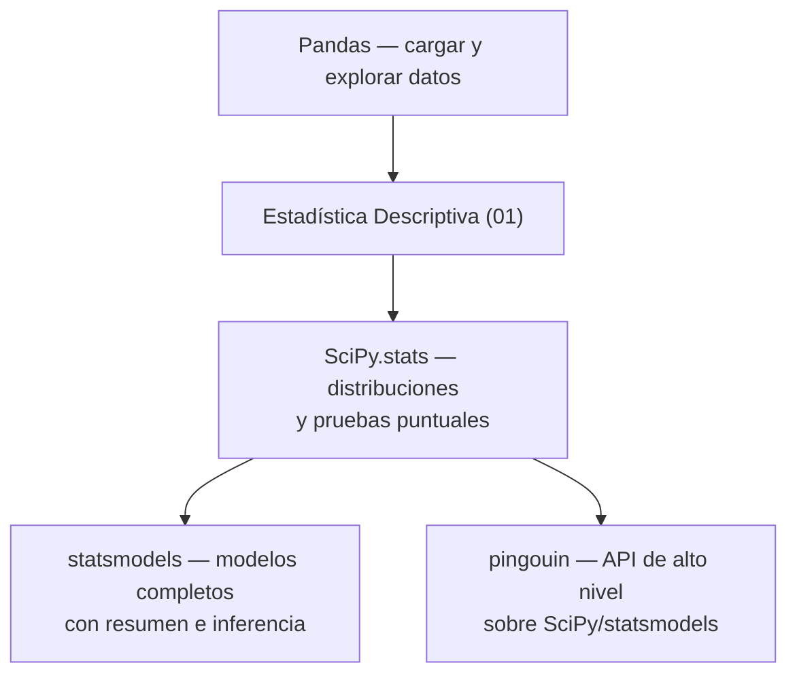

# 10 — Integración con el Ecosistema y Comparativa

## Panorama de herramientas



## `scipy.stats` vs `statsmodels` vs `pingouin`

| | `scipy.stats` | `statsmodels` | `pingouin` |
|---|---|---|---|
| Enfoque | Funciones puntuales: `(estadístico, p-valor)` | Modelos completos, con `.summary()` | API de alto nivel, un DataFrame de resultados por llamada |
| Curva de aprendizaje | Baja, pero salida mínima | Media — replica la salida de R | Baja — pensada para ser la más simple de las tres |
| Series de tiempo, GLM | No | Sí | No |
| Tamaño de efecto incluido automáticamente | No (se calcula aparte) | Parcial | Sí, casi siempre |

```python
import pingouin as pg

# El mismo t-test de scipy.stats, con salida enriquecida: tamaño de efecto, poder, IC -- todo en una tabla
pg.ttest(grupo_a, grupo_b, correction=True)
```

Regla práctica: `scipy.stats` para prototipar rápido o cuando ya se está en un contexto de NumPy puro; `pingouin` cuando se quiere un reporte completo (tamaño de efecto, poder estadístico) sin ensamblarlo a mano; `statsmodels` cuando se necesita un modelo real (regresión, series de tiempo) y no solo una prueba.

## Con scikit-learn

`scikit-learn` no reporta significancia estadística de coeficientes por diseño (su filosofía es predicción, no inferencia) — para obtener p-valores e IC de coeficientes de una regresión, se usa `statsmodels` en paralelo, típicamente para la fase de análisis/reporte, mientras scikit-learn se reserva para el pipeline de predicción en producción:

```python
import statsmodels.api as sm

X_con_constante = sm.add_constant(X)   # statsmodels no agrega el intercepto automáticamente
modelo_ols = sm.OLS(y, X_con_constante).fit()
print(modelo_ols.summary())   # coeficientes, errores estándar, IC, p-valores -- todo lo que sklearn no da
```

## Con la Estadística Inferencial de la universidad

Esta carpeta asume el fundamento teórico ya cubierto en [[University Degree Notes/Ciclo 03/Probabilidad y Estadística/Clase 01 - Introducción al Método Estadístico|Probabilidad y Estadística]] y [[University Degree Notes/Ciclo 04/Estadística Inferencial/Clase 01 - Distribuciones de Probabilidad Discretas - Introducción a R|Estadística Inferencial]] — la diferencia es de propósito, no de contenido: las clases enseñan a calcular a mano y en R con rigor matemático completo; esta carpeta traduce esos mismos conceptos a Python y los orienta a decisiones de producto/modelo del mundo real (A/B testing, supuestos de modelos, métricas de ML).

## SQL: agregaciones estadísticas directamente en la base de datos

Para datasets grandes, calcular estadística descriptiva básica directamente en SQL antes de traer los datos a Python ahorra memoria y tiempo — ver [[SQL/Aggregate Functions|SQL]] para `AVG`, `STDDEV`, `PERCENTILE_CONT`.

## Ver también

- [[01 - Estadística Descriptiva para EDA]]
- [[Python/SciPy/04 - Estadística I - Distribuciones (scipy.stats)]]
- [[Machine Learning/05-Ciencia-de-Datos-Estadistica-y-Fundamentos-ML]]
