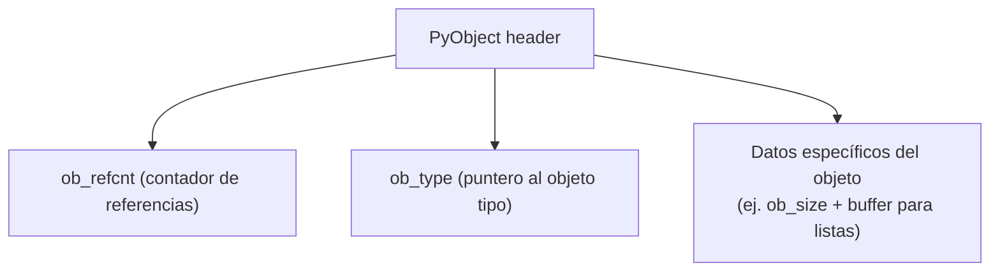

# 26 - Modelo de Objetos y Memoria en CPython

> Con esto arranca la segunda parte del recorrido por Python: 25 archivos ([[01 - Introduction to Python|01]] a [[25 - APIs|25]]) cubrieron los fundamentos; de aquí en adelante se asume que ya los dominas y se profundiza en el funcionamiento interno del lenguaje, patrones avanzados y temas que antes solo se mencionaron de pasada.

**Todo en Python es un objeto.** Números, funciones, clases, módulos e incluso los tipos mismos son instancias de algún objeto en memoria. Entender cómo CPython (el intérprete de referencia) representa y gestiona esos objetos es la base para razonar sobre mutabilidad, identidad, rendimiento y, más adelante, sobre el [[27 - Gestión de Memoria y Garbage Collection|garbage collector]].

## Identidad, Tipo y Valor

Cada objeto en CPython tiene tres propiedades:

- **Identidad (`id()`):** una dirección de memoria única mientras el objeto vive. No cambia en toda su vida útil.
- **Tipo (`type()`):** determina qué operaciones soporta el objeto. No cambia (salvo casos extremos con `__class__`).
- **Valor:** el dato que contiene. Puede ser mutable o inmutable.

```python
a = [1, 2, 3]
print(id(a), type(a), a)

b = a          # b apunta al MISMO objeto que a
c = [1, 2, 3]  # c es un objeto distinto con el mismo valor

print(a is b)  # True  -> misma identidad
print(a is c)  # False -> distinta identidad
print(a == c)  # True  -> mismo valor
```

`is` compara **identidad** (¿es el mismo objeto en memoria?); `==` compara **valor** (invoca `__eq__`, ver [[37 - Dunder Methods y Protocolos Avanzados|Dunder Methods]]). Confundirlos es una fuente clásica de bugs sutiles.

## El Header de un Objeto en CPython

Internamente, cada objeto de CPython (implementado en C) comienza con una cabecera común (`PyObject`) que incluye, entre otras cosas, un **contador de referencias** y un puntero al tipo:



Ese `ob_refcnt` es exactamente lo que revisa [[27 - Gestión de Memoria y Garbage Collection|el recolector de basura]] para decidir cuándo liberar memoria.

## Variables como Etiquetas, no Cajas

Una de las confusiones más comunes viniendo de otros lenguajes es pensar en las variables como "cajas" que contienen valores. En Python, las variables son **etiquetas (referencias)** que apuntan a objetos que viven independientemente en el heap.

```python
x = 1000
y = x     # y apunta al mismo objeto 1000
x = 2000  # x ahora apunta a un objeto NUEVO; y sigue apuntando al 1000 original

print(x, y)  # 2000 1000
```

Esto explica por qué reasignar `x` **no afecta** a `y`: no se modificó el objeto `1000`, simplemente `x` dejó de apuntar a él.

## Mutabilidad: la Diferencia que Sí Importa

| Tipo | Mutable | Ejemplos |
|---|---|---|
| Numéricos | No | `int`, `float`, `complex`, `bool` |
| Texto | No | `str`, `bytes` |
| Secuencias | No / Sí | `tuple` (no), `list` (sí) |
| Mapeos | Sí | `dict` |
| Conjuntos | No / Sí | `frozenset` (no), `set` (sí) |
| Objetos definidos por el usuario | Sí (por defecto) | Instancias de clases sin `__slots__`/`frozen` |

Cuando un objeto es **mutable**, modificar su contenido con métodos como `.append()` o `[]=` cambia el objeto en el lugar (misma identidad, nuevo contenido). Cuando es **inmutable**, cualquier "modificación" en realidad crea un objeto nuevo.

```python
lista = [1, 2, 3]
id_antes = id(lista)
lista.append(4)          # mutación in-place
print(id(lista) == id_antes)  # True

texto = "hola"
id_antes = id(texto)
texto += " mundo"        # crea una cadena NUEVA
print(id(texto) == id_antes)  # False
```

> **Nota — el error clásico de los argumentos mutables por defecto:** una función con `def f(items=[])` reutiliza el **mismo** objeto lista entre llamadas, porque los valores por defecto se evalúan **una sola vez**, al definir la función. Ver [[03 - Functions|03 - Functions]] para el repaso básico de argumentos y [[32 - Args, Kwargs y Firmas Avanzadas|32]] para el patrón correcto (`None` como centinela).

## Interning: Cuando Python Reutiliza Objetos

Para optimizar memoria, CPython **interna** (reutiliza) ciertos objetos inmutables pequeños:

- Enteros pequeños entre **-5 y 256** son cacheados y reutilizados siempre.
- Cadenas cortas que parecen identificadores (sin espacios ni símbolos) suelen internarse automáticamente.

```python
a = 100
b = 100
print(a is b)  # True -> ambos apuntan al entero cacheado 100

x = 1000
y = 1000
print(x is y)  # False (en la mayoría de implementaciones) -> fuera del rango cacheado

s1 = "hola"
s2 = "hola"
print(s1 is s2)  # True -> interning de strings "simples"
```

> **Por eso `is` nunca debe usarse para comparar valores** (usa `==`); el comportamiento de interning es un detalle de implementación de CPython, no una garantía del lenguaje. La única excepción legítima es comparar contra los singletons `None`, `True` y `False` (`if x is None`), que sí están garantizados como únicos.

## Copias: Referencia, Superficial y Profunda

```python
import copy

original = [[1, 2], [3, 4]]

referencia = original            # misma identidad
superficial = original.copy()    # nueva lista, mismos sub-objetos
profunda = copy.deepcopy(original)  # nueva lista y nuevos sub-objetos

original[0].append(99)

print(referencia)   # [[1, 2, 99], [3, 4]] -> cambia (es el mismo objeto)
print(superficial)  # [[1, 2, 99], [3, 4]] -> cambia (comparte sub-listas)
print(profunda)     # [[1, 2], [3, 4]]     -> NO cambia (todo independiente)
```

| Operación | ¿Nuevo objeto contenedor? | ¿Nuevos sub-objetos? |
|---|---|---|
| `b = a` | No | No |
| `b = a.copy()` / `a[:]` | Sí | No |
| `b = copy.deepcopy(a)` | Sí | Sí |

## `sys.getsizeof`: Cuánto Pesa un Objeto

```python
import sys

print(sys.getsizeof(42))          # tamaño del objeto int en bytes
print(sys.getsizeof("hola"))
print(sys.getsizeof([1, 2, 3]))
```

`getsizeof` solo mide el objeto en sí, **no** lo que referencia recursivamente (una lista de listas reporta un tamaño pequeño aunque contenga mucho). Para medir memoria real de estructuras completas se usan herramientas como `pympler.asizeof` o el propio `tracemalloc`, cubierto en [[58 - Profiling y Optimización de Rendimiento|58 - Profiling]].

## Ver también

- [[27 - Gestión de Memoria y Garbage Collection]] — qué pasa cuando el contador de referencias llega a cero.
- [[28 - Namespaces, Scope y Closures a Fondo]] — cómo los nombres se resuelven a estas referencias.
- [[17 - OOP]] — la base de objetos e instancias que este archivo profundiza a nivel de memoria.
- [[36 - Descriptors]] — cómo `__get__`/`__set__` intervienen en el acceso a atributos de un objeto.
