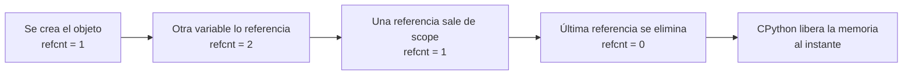
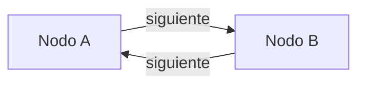

# 27 - Gestión de Memoria y Garbage Collection

> Continúa de [[26 - Modelo de Objetos y Memoria en CPython|26]]. Ahí se vio que cada objeto lleva un contador de referencias (`ob_refcnt`); aquí se cubre qué hace CPython con ese contador y qué pasa cuando no es suficiente.

Python gestiona la memoria automáticamente mediante dos mecanismos complementarios: **conteo de referencias (_reference counting_)** como mecanismo principal, y un **recolector de basura generacional (_garbage collector_)** como respaldo para los casos que el conteo de referencias no puede resolver por sí solo: los **ciclos de referencias**.

## Conteo de Referencias

Cada objeto mantiene un contador de cuántas referencias apuntan a él. El contador sube y baja constantemente:

```python
import sys

a = []
print(sys.getrefcount(a))  # cuenta base + 1 por el argumento temporal de getrefcount

b = a           # +1 referencia
print(sys.getrefcount(a))

del b           # -1 referencia
print(sys.getrefcount(a))
```

En cuanto el contador llega a **cero**, CPython libera la memoria del objeto **inmediatamente y de forma determinista** (a diferencia de lenguajes como Java, donde el GC decide cuándo actuar). Esto es lo que permite que objetos con `__del__` o gestores de contexto liberen recursos de forma predecible en la mayoría de los casos.



## El Problema: Ciclos de Referencias

El conteo de referencias por sí solo **no puede** detectar ciclos: dos o más objetos que se referencian entre sí nunca llegan a cero, aunque nada externo los use.

```python
class Nodo:
    def __init__(self, nombre):
        self.nombre = nombre
        self.siguiente = None

a = Nodo("A")
b = Nodo("B")
a.siguiente = b
b.siguiente = a   # ciclo: a -> b -> a

del a
del b
# Ninguno de los dos objetos llega a refcnt=0 por sí solo:
# cada uno sigue siendo referenciado por el otro.
```



Para esto existe el **recolector generacional**, implementado en el módulo `gc`.

## El Recolector Generacional (`gc`)

El GC de CPython organiza los objetos en **tres generaciones** (0, 1, 2), bajo la hipótesis de que la mayoría de los objetos mueren jóvenes:

| Generación | Contenido | Frecuencia de escaneo |
|---|---|---|
| 0 | Objetos recién creados | Muy alta |
| 1 | Sobrevivientes de una recolección de gen 0 | Media |
| 2 | Objetos de larga vida (sobrevivieron gen 1) | Baja |

Cuando un objeto sobrevive a una recolección de su generación, **asciende** a la siguiente. El GC solo necesita rastrear objetos que **pueden** participar en ciclos (contenedores como listas, dicts, instancias de clases); tipos simples como `int` o `str` quedan excluidos de este rastreo.

```python
import gc

print(gc.isenabled())        # True por defecto
print(gc.get_threshold())    # (700, 10, 10) -> umbrales de cada generación
print(gc.get_count())        # objetos acumulados por generación desde la última recolección

gc.collect()                 # fuerza una recolección completa (las 3 generaciones)
print(gc.garbage)            # objetos con __del__ que el GC no pudo liberar (raro en Python 3.4+)
```

> **Nota:** desde Python 3.4 (PEP 442), el GC **sí** puede recolectar ciclos que incluyen objetos con `__del__`, algo que en Python 2 obligaba a dejarlos varados en `gc.garbage`. Aun así, sigue siendo mejor evitar `__del__` para lógica crítica — su momento de ejecución no está garantizado.

## `weakref`: Referencias que No Cuentan

Una **referencia débil** apunta a un objeto sin incrementar su contador de referencias. Es la herramienta correcta cuando necesitas una relación entre objetos (como caches o el padre en una estructura de árbol) sin causar un ciclo que impida su liberación.

```python
import weakref

class Cache:
    def __init__(self, valor):
        self.valor = valor

obj = Cache("dato costoso de calcular")
ref = weakref.ref(obj)

print(ref())        # Cache instance -> el objeto sigue vivo
del obj
print(ref())         # None -> ya fue liberado, la referencia débil no lo mantuvo vivo
```

`weakref.WeakValueDictionary` y `weakref.WeakKeyDictionary` son variantes de diccionario donde las entradas desaparecen automáticamente cuando el objeto referenciado deja de tener referencias fuertes — muy usado para implementar cachés que no generan fugas de memoria.

```python
class Nodo:
    def __init__(self, nombre, padre=None):
        self.nombre = nombre
        self._padre = weakref.ref(padre) if padre else None

    @property
    def padre(self):
        return self._padre() if self._padre else None
```

Aquí el hijo referencia débilmente a su padre: evita el ciclo padre↔hijo sin sacrificar la capacidad de navegar hacia arriba en el árbol.

## `tracemalloc`: Rastreando el Origen de las Asignaciones

Para depurar fugas de memoria reales (no solo medir tamaño), `tracemalloc` rastrea **dónde** en el código se originó cada asignación:

```python
import tracemalloc

tracemalloc.start()

datos = [str(i) * 100 for i in range(10_000)]

snapshot = tracemalloc.take_snapshot()
top_stats = snapshot.statistics("lineno")

for stat in top_stats[:3]:
    print(stat)
```

Se profundiza en el resto del toolkit de profiling (`cProfile`, `line_profiler`) en [[58 - Profiling y Optimización de Rendimiento|58 - Profiling]].

## Buenas Prácticas

- No llames a `gc.collect()` manualmente salvo en casos muy específicos (benchmarks, liberar memoria antes de una operación pesada); el recolector automático ya está bien afinado.
- Evita depender de `__del__` para lógica crítica de limpieza (cerrar archivos, conexiones); usa [[15 - Context Manager|context managers]] (`with`) o `contextlib.ExitStack` (ver [[50 - Context Managers Avanzados|50]]).
- Usa `weakref` en estructuras de datos que naturalmente forman ciclos (árboles con puntero al padre, observadores/listeners, cachés).
- Si sospechas una fuga de memoria en un proceso de larga duración, combina `gc.get_objects()`, `tracemalloc` y perfiles periódicos antes de asumir que es "un problema del GC".

## Ver también

- [[26 - Modelo de Objetos y Memoria en CPython]] — el conteo de referencias que este archivo extiende.
- [[58 - Profiling y Optimización de Rendimiento]] — herramientas para medir el impacto real en memoria/CPU.
- [[50 - Context Managers Avanzados]] — la alternativa correcta a `__del__` para liberar recursos.
- [[15 - Context Manager]] — la base de `with` sobre la que se construye el archivo anterior.
