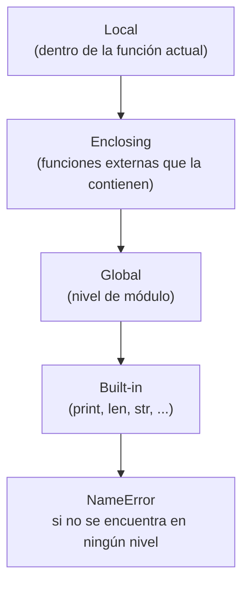
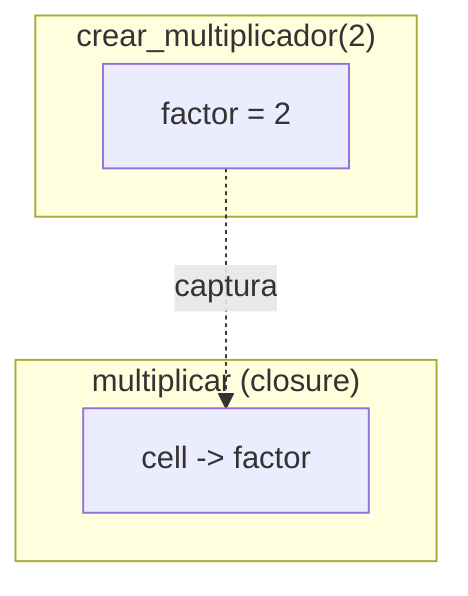

# 28 - Namespaces, Scope y Closures a Fondo

> Continúa de [[27 - Gestión de Memoria y Garbage Collection|27]]. [[03 - Functions|03 - Functions]] mostró cómo declarar funciones; aquí se profundiza en **dónde** vive cada nombre y cómo Python decide a qué objeto apunta una variable en un momento dado.

Un **namespace** (espacio de nombres) es, literalmente, un diccionario que mapea nombres a objetos. Python mantiene varios namespaces simultáneos y los consulta en un orden estricto cada vez que evalúa un identificador.

## La Regla LEGB

Cuando Python encuentra un nombre, lo busca en este orden:



```python
x = "global"

def externa():
    x = "enclosing"

    def interna():
        x = "local"
        print(x)  # "local" -> se detiene en el primer nivel que lo encuentra

    interna()
    print(x)  # "enclosing" -> no fue afectado por 'interna'

externa()
print(x)  # "global" -> no fue afectado por ninguna de las dos funciones
```

Cada función tiene su **propio** namespace local, creado al invocarla y destruido al terminar (salvo que algo, como un closure, mantenga una referencia viva a él).

## `globals()` y `locals()`

```python
contador = 0

def incrementar():
    local_var = 1
    print(locals())    # {'local_var': 1} -> solo lo que existe en ESTE scope
    print("contador" in globals())  # True
```

> **Nota:** modificar el diccionario devuelto por `locals()` dentro de una función **no** garantiza que afecte a las variables reales — CPython puede usar un array optimizado para variables locales en vez del diccionario real. `globals()` sí es seguro de modificar porque el namespace global **es** un diccionario real.

## `global`: Modificar el Namespace Global desde una Función

```python
contador = 0

def incrementar():
    global contador   # sin esto, "contador += 1" crearía una variable LOCAL nueva
    contador += 1

incrementar()
incrementar()
print(contador)  # 2
```

Sin `global`, Python interpretaría cualquier asignación a `contador` dentro de la función como la creación de una variable local nueva — y lanzaría `UnboundLocalError` al intentar leer `contador` antes de esa asignación, porque Python decide el scope de una variable de forma **estática** (al compilar la función), no según el orden de ejecución.

```python
x = 10

def buggy():
    print(x)   # UnboundLocalError, NO imprime 10
    x = 20     # esta línea hace que Python trate 'x' como local en TODA la función
```

## Closures: Funciones que Recuerdan su Entorno

Un **closure** es una función interna que "recuerda" las variables del scope que la envuelve (_enclosing_), incluso después de que ese scope externo haya terminado de ejecutarse.

```python
def crear_multiplicador(factor):
    def multiplicar(numero):
        return numero * factor   # 'factor' viene del scope externo
    return multiplicar

duplicar = crear_multiplicador(2)
triplicar = crear_multiplicador(3)

print(duplicar(5))   # 10
print(triplicar(5))  # 15
```

`crear_multiplicador` ya terminó de ejecutarse, pero `duplicar` y `triplicar` siguen "recordando" su propio valor de `factor`. Esto es posible porque Python empaqueta las variables capturadas en **celdas (`cell` objects)**, accesibles vía `__closure__`:

```python
print(duplicar.__closure__)              # (<cell at 0x...: int object at 0x...>,)
print(duplicar.__closure__[0].cell_contents)  # 2
print(duplicar.__code__.co_freevars)     # ('factor',) -> nombres de variables libres capturadas
```



## `nonlocal`: Modificar una Variable del Enclosing Scope

Igual que `global` habilita escribir en el namespace global, `nonlocal` habilita escribir en el scope **enclosing** más cercano (no el global) desde una función anidada.

```python
def contador_persistente():
    cuenta = 0

    def incrementar():
        nonlocal cuenta
        cuenta += 1
        return cuenta

    return incrementar

contador = contador_persistente()
print(contador())  # 1
print(contador())  # 2
print(contador())  # 3
```

Este patrón — una función que retorna otra función con estado propio persistente — es la base de los **decoradores con estado** (ver [[16 - Decorators|16 - Decorators]]) y una alternativa ligera a una clase completa cuando solo necesitas encapsular un poco de estado mutable.

## La Trampa Clásica: Late Binding en Closures dentro de Loops

Las closures capturan la **variable**, no su valor en el momento de la creación. Si la variable cambia después (como el índice de un `for`), todas las closures verán el valor **final**.

```python
funciones = []
for i in range(3):
    funciones.append(lambda: i)

print([f() for f in funciones])  # [2, 2, 2] -> NO [0, 1, 2] como se esperaría
```

**Solución 1 — capturar el valor con un argumento por defecto** (evaluado una sola vez, al definir la lambda):

```python
funciones = []
for i in range(3):
    funciones.append(lambda i=i: i)

print([f() for f in funciones])  # [0, 1, 2]
```

**Solución 2 — envolver en una función que crea un nuevo scope por iteración:**

```python
def crear_funcion(valor):
    return lambda: valor

funciones = [crear_funcion(i) for i in range(3)]
print([f() for f in funciones])  # [0, 1, 2]
```

## Comparativa Rápida: `global` vs `nonlocal`

| | `global` | `nonlocal` |
|---|---|---|
| Apunta a | Namespace del módulo | Namespace de la función *enclosing* más cercana |
| Requiere una función anidada | No | Sí |
| Uso típico | Contadores/estado a nivel de módulo (poco recomendable) | Closures con estado (fábricas de funciones, decoradores) |
| Alternativa más "pythonica" | Encapsular el estado en una clase o `functools.partial` | Igual — pero las closures suelen ser más ligeras para casos simples |

## Ver también

- [[03 - Functions]] — la base de definición de funciones que este archivo extiende.
- [[16 - Decorators]] — el uso más común de closures en código real.
- [[33 - Functools en Profundidad]] — `functools.partial` como alternativa a closures manuales.
- [[35 - Generadores y Corutinas Clásicas]] — otro mecanismo de Python que "recuerda" estado entre llamadas.
