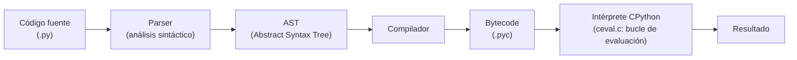

# 30 - Bytecode e Internals del Intérprete

> Continúa de [[29 - Introspección y Metaprogramación|29]] y cierra el bloque de internals. Aquí se responde a la pregunta: ¿qué hace realmente CPython entre que escribes `python mi_script.py` y que se imprime un resultado?

## El Pipeline de Ejecución



A diferencia de C o Go, Python **no** compila a código máquina nativo. Compila a un formato intermedio — **bytecode** — que luego es interpretado instrucción por instrucción por un bucle escrito en C dentro del propio CPython (`ceval.c`).

## Viendo el AST

```python
import ast

codigo = "x = 1 + 2"
arbol = ast.parse(codigo)
print(ast.dump(arbol, indent=2))
```

El AST es la representación estructurada del código antes de convertirse en bytecode. Herramientas de análisis estático como `ast` (usado internamente por linters, ver [[44 - Linters y Formateadores|44]]) trabajan sobre este árbol, no sobre el texto crudo.

## El Módulo `dis`: Desensamblando Bytecode

```python
import dis

def suma(a, b):
    return a + b

dis.dis(suma)
```

Salida aproximada:

```text
  2           0 RESOURCE_LOAD_FAST      0 (a)
              2 LOAD_FAST                1 (b)
              4 BINARY_OP                0 (+)
              8 RETURN_VALUE
```

Cada línea es una instrucción de la máquina virtual de Python: cargar variables locales en una pila (`LOAD_FAST`), operar sobre la pila (`BINARY_OP`), y devolver el resultado (`RETURN_VALUE`). Python usa una **máquina de pila (_stack machine_)**: casi todas las instrucciones empujan o sacan valores de una pila de evaluación.

```python
def es_par(n):
    if n % 2 == 0:
        return True
    return False

dis.dis(es_par)  # compara visualmente cuántas instrucciones genera cada rama
```

`dis` es útil para responder preguntas concretas de rendimiento: por ejemplo, comparar si una comprensión de listas genera menos instrucciones que un `for` equivalente, o entender por qué una función con muchas comprobaciones `isinstance` es más lenta que una versión con `try`/`except` ([[49 - Excepciones Avanzadas|49]] profundiza en cuándo EAFP le gana a LBYL en rendimiento).

## Objetos de Código (`code objects`)

Cada función compilada tiene asociado un objeto `code` con metadatos sobre el bytecode:

```python
print(suma.__code__.co_code)       # bytes crudos del bytecode
print(suma.__code__.co_varnames)   # ('a', 'b') -> nombres de variables locales
print(suma.__code__.co_consts)     # constantes usadas en la función
print(suma.__code__.co_argcount)   # 2 -> número de argumentos posicionales
```

Estos son los mismos atributos que `inspect` (ver [[29 - Introspección y Metaprogramación|29]]) consulta internamente.

## `.pyc` y `__pycache__`

Cuando importas un módulo, Python compila su código fuente a bytecode y lo cachea en disco dentro de `__pycache__/` con extensión `.pyc`, para no tener que re-parsear el `.py` en cada ejecución si no ha cambiado (se detecta por hash o timestamp del archivo fuente).

```text
mi_paquete/
├── modulo.py
└── __pycache__/
    └── modulo.cpython-313.pyc
```

> Esto **no** aplica al script que ejecutas directamente (`python script.py`) — solo a los módulos que se **importan**. Es una de las razones por las que la primera importación de un paquete grande puede sentirse ligeramente más lenta que las siguientes ejecuciones.

## El GIL, Revisitado desde el Intérprete

[[23 - Concurrency|23 - Concurrency]] presentó el GIL desde la perspectiva de "qué implica para hilos y procesos". Desde el intérprete, el GIL es literalmente un mutex que rodea el bucle `ceval` para garantizar que solo un hilo ejecute bytecode Python a la vez — necesario porque operaciones aparentemente atómicas como `contador += 1` en realidad son **varias** instrucciones de bytecode (`LOAD_FAST`, `BINARY_OP`, `STORE_FAST`), y sin el GIL dos hilos podrían intercalarse a mitad de esa secuencia y corromper el estado.

```python
import dis
def incrementar():
    global contador
    contador += 1

dis.dis(incrementar)  # varias instrucciones -> no es atómico sin el GIL
```

> **CPython vs otras implementaciones:** todo este bloque describe **CPython**, la implementación de referencia (la que instalas desde python.org). Otras implementaciones como **PyPy** (compilación JIT, mucho más rápida para código puro de Python) o **Jython**/**IronPython** (sobre la JVM/.NET) tienen internals completamente distintos, y algunas —notablemente PyPy— no tienen GIL de la misma forma. El bytecode mostrado aquí es específico de CPython y puede variar entre versiones (3.11 introdujo cambios significativos de rendimiento en `ceval`, 3.13 añadió soporte experimental sin GIL vía PEP 703).

## Cuándo te Importa Esto en la Práctica

| Situación | Herramienta relevante |
|---|---|
| "¿Por qué esta función es más lenta de lo que esperaba?" | `dis.dis()` + `timeit` ([[58 - Profiling y Optimización de Rendimiento|58]]) |
| "¿Es seguro este código entre hilos sin un lock?" | Entender que casi ninguna operación es atómica a nivel de bytecode ([[56 - Sincronización y Modelos de Concurrencia|56]]) |
| "¿Por qué la primera ejecución de mi paquete tarda más?" | Compilación a `.pyc` y cacheo en `__pycache__` |
| "Quiero analizar código Python programáticamente (un linter, un formateador)" | El módulo `ast` |

## Ver también

- [[23 - Concurrency]] — el GIL desde la perspectiva de hilos/procesos/asyncio.
- [[56 - Sincronización y Modelos de Concurrencia]] — por qué casi ninguna operación es atómica.
- [[58 - Profiling y Optimización de Rendimiento]] — medir en vez de adivinar dónde está el cuello de botella.
- [[44 - Linters y Formateadores]] — herramientas construidas sobre el AST descrito aquí.
