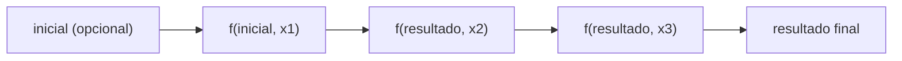

# 31 - Funciones de Alto Orden y Programación Funcional

> Continúa de [[30 - Bytecode e Internals del Intérprete|30]] y abre el bloque dedicado a funciones. [[03 - Functions|03 - Functions]] cubrió la sintaxis básica; aquí se profundiza en tratar funciones **como valores** — pasarlas, devolverlas, combinarlas — el corazón del estilo funcional en Python.

En Python, las funciones son **ciudadanos de primera clase (_first-class citizens_)**: pueden asignarse a variables, guardarse en estructuras de datos, pasarse como argumentos y devolverse desde otras funciones, exactamente igual que un `int` o una `str`.

## Funciones como Valores

```python
def cuadrado(x):
    return x ** 2

operacion = cuadrado          # asignar una función a una variable (sin paréntesis: no se llama)
print(operacion(5))           # 25

operaciones = [cuadrado, abs, str]   # guardarlas en una lista
resultados = [op(-4) for op in operaciones]
print(resultados)             # [16, 4, '-4']
```

## Funciones de Alto Orden

Una **función de alto orden** es una función que recibe otra función como argumento, la devuelve como resultado, o ambas.

```python
def aplicar_dos_veces(funcion, valor):
    return funcion(funcion(valor))

print(aplicar_dos_veces(cuadrado, 3))  # 81 -> cuadrado(cuadrado(3))
```

### `map`, `filter` y la Alternativa con Comprensiones

```python
numeros = [1, 2, 3, 4, 5, 6]

# map: aplica una función a cada elemento
cuadrados = list(map(cuadrado, numeros))
print(cuadrados)  # [1, 4, 9, 16, 25, 36]

# filter: conserva los elementos que cumplen una condición
pares = list(filter(lambda n: n % 2 == 0, numeros))
print(pares)  # [2, 4, 6]

# El equivalente "pythonico" suele preferir comprensiones (ver 05 - Lists and Tuples)
cuadrados_comprension = [cuadrado(n) for n in numeros]
pares_comprension = [n for n in numeros if n % 2 == 0]
```

| | `map`/`filter` | Comprensión de listas |
|---|---|---|
| Legibilidad para lógica simple | Menor | Mayor (más "pythonico") |
| Legibilidad con función ya definida y nombrada | Mayor (`map(procesar, datos)`) | Similar |
| Evaluación | Perezosa (devuelve un iterador) | Ansiosa (`[...]`) o perezosa (`(...)` generador) |
| Combinarlas (`map` + `filter` anidados) | Se vuelve ilegible rápido | Una sola comprensión con `if` es más clara |

> La guía de estilo de la comunidad ([[45 - Estilo Pythonico y Buenas Prácticas|45]]) generalmente recomienda comprensiones sobre `map`/`filter` con `lambda`, reservando `map`/`filter` para cuando ya tienes una función con nombre y bien definida.

### `functools.reduce`: Acumulando un Resultado

```python
from functools import reduce

numeros = [1, 2, 3, 4, 5]

producto = reduce(lambda acumulado, actual: acumulado * actual, numeros)
print(producto)  # 120 (5!)

producto_con_inicial = reduce(lambda acc, x: acc * x, numeros, 10)
print(producto_con_inicial)  # 1200 -> empieza el acumulador en 10
```



A diferencia de `map`/`filter`, `reduce` no tiene equivalente directo como comprensión — para acumulaciones simples (suma, máximo) siempre son preferibles las funciones built-in (`sum`, `max`, `min`), reservando `reduce` para lógica de acumulación verdaderamente custom.

## El Módulo `operator`: Evitando Lambdas Triviales

```python
from operator import add, mul, itemgetter, attrgetter

print(reduce(mul, [1, 2, 3, 4]))  # 24 -> más legible que lambda a, b: a * b

personas = [{"nombre": "Ana", "edad": 30}, {"nombre": "Luis", "edad": 25}]
personas_ordenadas = sorted(personas, key=itemgetter("edad"))
print(personas_ordenadas)

class Producto:
    def __init__(self, nombre, precio):
        self.nombre, self.precio = nombre, precio

productos = [Producto("B", 20), Producto("A", 10)]
productos_ordenados = sorted(productos, key=attrgetter("precio"))
```

`operator.itemgetter`/`attrgetter` son más rápidos que sus equivalentes en `lambda` porque evitan la sobrecarga de una llamada a función de Python — se implementan en C.

## Composición de Funciones

Python no tiene un operador nativo de composición (`f . g` como en Haskell), pero es trivial construirlo:

```python
def componer(*funciones):
    """Compone funciones de derecha a izquierda: componer(f, g)(x) == f(g(x))."""
    def funcion_compuesta(x):
        resultado = x
        for f in reversed(funciones):
            resultado = f(resultado)
        return resultado
    return funcion_compuesta

incrementar = lambda x: x + 1
duplicar = lambda x: x * 2

pipeline = componer(duplicar, incrementar)  # duplicar(incrementar(x))
print(pipeline(5))  # duplicar(6) = 12
```

## Funciones Puras vs Funciones con Efectos Secundarios

El estilo funcional favorece **funciones puras**: dado el mismo input, siempre devuelven el mismo output, y no modifican estado externo (variables globales, argumentos mutables, archivos, bases de datos).

```python
# Impura: depende de y modifica estado externo
total = 0
def sumar_al_total(x):
    global total
    total += x
    return total

# Pura: mismo input -> mismo output, sin efectos secundarios
def sumar(a, b):
    return a + b
```

| | Función pura | Función con efectos secundarios |
|---|---|---|
| Testeable de forma aislada | Trivial | Requiere mockear/preparar estado (ver [[Python/Pytest/09 - Mocking y Monkeypatching|Python/Pytest/09]]) |
| Paralelizable sin riesgo | Sí | Requiere sincronización ([[56 - Sincronización y Modelos de Concurrencia|56]]) |
| Cacheable con `lru_cache` | Sí (ver [[33 - Functools en Profundidad|33]]) | No de forma segura |
| Necesaria en la práctica | No siempre suficiente por sí sola | Inevitable (I/O, side effects son parte de programas reales) |

No se trata de eliminar todos los efectos secundarios (un programa que no hace I/O no sirve de mucho), sino de **aislarlos** deliberadamente en los bordes del programa y mantener la lógica de negocio central lo más pura posible — más fácil de testear, razonar y paralelizar.

## Ver también

- [[03 - Functions]] — la sintaxis base de funciones que este archivo extiende.
- [[33 - Functools en Profundidad]] — `partial`, `reduce`, `lru_cache` y más herramientas funcionales.
- [[34 - Itertools en Profundidad]] — el complemento natural de `map`/`filter` para iteración perezosa.
- [[45 - Estilo Pythonico y Buenas Prácticas]] — cuándo preferir comprensiones sobre `map`/`filter`/`lambda`.
