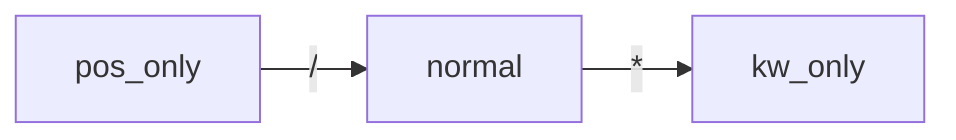

# 32 - Args, Kwargs y Firmas Avanzadas

> Continúa de [[31 - Funciones de Alto Orden y Programación Funcional|31]]. [[03 - Functions|03 - Functions]] presentó `*args` y `**kwargs` de forma introductoria; aquí se cubre el modelo completo de parámetros de Python, incluyendo las restricciones de posición/keyword introducidas en versiones recientes.

## Los Cinco Tipos de Parámetros

Python distingue explícitamente varias categorías de parámetros, y desde Python 3.8 puedes forzar cómo debe llamarse cada uno usando `/` y `*` en la firma.

```python
def funcion(pos_only, /, normal, *, kw_only):
    #         ^--------^  ^------^  ^-------^
    #    solo posicional  cualquiera  solo por keyword
    pass
```



| Sintaxis | Cómo se puede pasar |
|---|---|
| `def f(a, /)` | Solo posicional: `f(1)` — `f(a=1)` lanza `TypeError` |
| `def f(a)` | Posicional o keyword: `f(1)` o `f(a=1)` |
| `def f(*, a)` | Solo por keyword: `f(a=1)` — `f(1)` lanza `TypeError` |
| `def f(*args)` | Empaqueta posicionales extra en una tupla |
| `def f(**kwargs)` | Empaqueta keywords extra en un diccionario |

```python
def crear_usuario(id, /, nombre, *, activo=True):
    return {"id": id, "nombre": nombre, "activo": activo}

crear_usuario(1, "Ana")                    # OK
crear_usuario(1, nombre="Ana")             # OK
crear_usuario(id=1, nombre="Ana")          # TypeError: id es solo posicional
crear_usuario(1, "Ana", True)              # TypeError: activo es solo por keyword
```

**¿Por qué forzar esto?** Los parámetros solo-posicionales protegen tu API: puedes renombrar `id` internamente sin romper a quienes ya llaman `crear_usuario(1, ...)`, porque el nombre nunca fue parte del contrato público. Es el mismo motivo por el que funciones built-in como `len(obj, /)` son posicionales-only.

## `*args` y `**kwargs` en Profundidad

```python
def funcion_flexible(*args, **kwargs):
    print("posicionales:", args)    # tupla
    print("nombrados:", kwargs)     # diccionario

funcion_flexible(1, 2, 3, nombre="Ana", activo=True)
# posicionales: (1, 2, 3)
# nombrados: {'nombre': 'Ana', 'activo': True}
```

### Desempaquetado (_Unpacking_): la Otra Cara de la Moneda

El mismo `*`/`**` que empaqueta al **definir** una función, **desempaqueta** al **llamarla**:

```python
def sumar_tres(a, b, c):
    return a + b + c

numeros = [1, 2, 3]
print(sumar_tres(*numeros))          # desempaqueta la lista como 3 argumentos posicionales

datos = {"a": 10, "b": 20, "c": 30}
print(sumar_tres(**datos))           # desempaqueta el dict como argumentos por keyword
```

Esto también funciona para combinar estructuras:

```python
base = {"host": "localhost", "port": 5432}
override = {"port": 5433, "user": "admin"}

config = {**base, **override}   # {'host': 'localhost', 'port': 5433, 'user': 'admin'}
# las claves de 'override' pisan a las de 'base' -> orden importa
```

```python
inicio = [1, 2]
fin = [4, 5]
completa = [*inicio, 3, *fin]   # [1, 2, 3, 4, 5]
```

## Orden Obligatorio al Definir una Función

```python
def firma_completa(pos_only, /, normal, *args, kw_only, **kwargs):
    pass
```

El orden es siempre: **posicional-only → normal → `*args` → solo-keyword → `**kwargs`**. Cambiar este orden es un `SyntaxError`.

## El Error Clásico: Argumentos Mutables por Defecto

Ya mencionado en [[26 - Modelo de Objetos y Memoria en CPython|26]] desde la óptica de memoria — aquí el patrón correcto:

```python
# MAL: la lista por defecto se crea UNA VEZ y se comparte entre todas las llamadas
def agregar_item(item, lista=[]):
    lista.append(item)
    return lista

print(agregar_item(1))  # [1]
print(agregar_item(2))  # [1, 2]  <- ¡sorpresa! sigue siendo la misma lista

# BIEN: usar None como centinela y crear el mutable dentro de la función
def agregar_item_correcto(item, lista=None):
    if lista is None:
        lista = []
    lista.append(item)
    return lista

print(agregar_item_correcto(1))  # [1]
print(agregar_item_correcto(2))  # [2]
```

## Firmas Dinámicas con `functools.wraps`

Al envolver una función con un decorador (ver [[16 - Decorators|16 - Decorators]]), es fácil perder su firma original. `*args, **kwargs` en el wrapper preserva la **flexibilidad**, pero `functools.wraps` preserva los **metadatos** (`__name__`, `__doc__`, y desde Python 3.4 también `__wrapped__` para que `inspect.signature` siga funcionando):

```python
from functools import wraps

def registrar_llamada(func):
    @wraps(func)
    def wrapper(*args, **kwargs):
        print(f"Llamando a {func.__name__}")
        return func(*args, **kwargs)
    return wrapper

@registrar_llamada
def saludar(nombre):
    """Saluda a alguien por su nombre."""
    return f"Hola, {nombre}"

print(saludar.__name__)  # "saludar" (sin @wraps sería "wrapper")
print(saludar.__doc__)   # "Saluda a alguien por su nombre."
```

Se profundiza en `wraps` como parte de `functools` en [[33 - Functools en Profundidad|33]].

## Validación de Argumentos con `**kwargs`: Cuándo Es una Mala Señal

```python
# Firma opaca: no se sabe qué acepta sin leer el cuerpo completo
def crear_reporte(**kwargs):
    titulo = kwargs.get("titulo", "Sin título")
    autor = kwargs.get("autor")
    ...

# Firma explícita: autocompletado, type-checking, documentación gratis
def crear_reporte(titulo: str = "Sin título", autor: str | None = None):
    ...
```

`**kwargs` es imprescindible para **wrappers genéricos** (decoradores, proxies) que reenvían argumentos sin conocerlos de antemano. Para funciones de negocio con un contrato conocido, una firma explícita con [[42 - Type Hints y el Módulo Typing|type hints]] siempre es preferible — es más legible, más fácil de refactorizar y permite que el editor/mypy detecten errores antes de ejecutar.

## Ver también

- [[03 - Functions]] — la introducción a `*args`/`**kwargs` que este archivo profundiza.
- [[16 - Decorators]] — el caso de uso más común de `*args, **kwargs` combinados con `wraps`.
- [[33 - Functools en Profundidad]] — `wraps`, `partial` y otras utilidades sobre funciones.
- [[42 - Type Hints y el Módulo Typing]] — cómo tipar correctamente `*args: int` y `**kwargs: str`.
