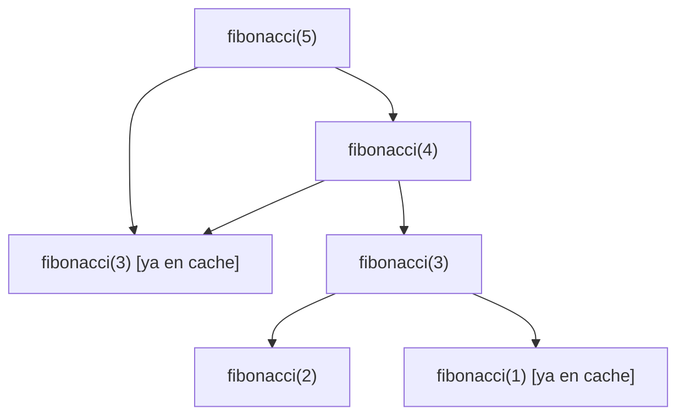

# 33 - Functools en Profundidad

> Continúa de [[32 - Args, Kwargs y Firmas Avanzadas|32]]. `functools` es la caja de herramientas estándar de Python para programación funcional y manipulación de funciones de alto orden — varias piezas ya se mencionaron sueltas en archivos anteriores; aquí se cubren todas juntas.

## `functools.partial`: Fijando Argumentos por Adelantado

`partial` crea una nueva función con algunos argumentos ya "congelados", sin necesidad de escribir una closure manual (comparar con [[28 - Namespaces, Scope y Closures a Fondo|28]]).

```python
from functools import partial

def potencia(base, exponente):
    return base ** exponente

cuadrado = partial(potencia, exponente=2)
cubo = partial(potencia, exponente=3)

print(cuadrado(5))  # 25
print(cubo(5))      # 125

# Equivalente manual con closure:
def crear_potencia(exponente):
    def calcular(base):
        return base ** exponente
    return calcular
```

`partial` es preferible a una closure manual cuando solo necesitas fijar argumentos (sin lógica adicional) — es más declarativo y ligeramente más rápido, al estar implementado en C.

## `functools.reduce`

Ya presentado en [[31 - Funciones de Alto Orden y Programación Funcional|31]] — vive en `functools` precisamente porque es la pieza más "funcional pura" del módulo: acumula un iterable en un único valor aplicando una función binaria repetidamente.

## `@functools.wraps`

Ya presentado en [[32 - Args, Kwargs y Firmas Avanzadas|32]] — preserva `__name__`, `__doc__` y `__wrapped__` al envolver una función con un decorador.

## `@functools.lru_cache` / `@functools.cache`: Memoización Automática

`lru_cache` guarda en memoria los resultados de una función según sus argumentos, evitando recalcular lo mismo dos veces:

```python
from functools import lru_cache
import time

@lru_cache(maxsize=128)
def fibonacci(n):
    if n < 2:
        return n
    return fibonacci(n - 1) + fibonacci(n - 2)

inicio = time.perf_counter()
print(fibonacci(35))
print(f"Con cache: {time.perf_counter() - inicio:.4f}s")

print(fibonacci.cache_info())  # CacheInfo(hits=..., misses=..., maxsize=128, currsize=...)
fibonacci.cache_clear()        # vacía el cache manualmente
```

Sin `lru_cache`, `fibonacci(35)` recalcula el mismo subproblema millones de veces (complejidad exponencial); con cache, cada valor único se calcula una sola vez (complejidad lineal).



Desde Python 3.9, `@cache` es un atajo equivalente a `@lru_cache(maxsize=None)` (cache ilimitado, sin política de expulsión):

```python
from functools import cache

@cache
def es_primo(n):
    if n < 2:
        return False
    return all(n % i != 0 for i in range(2, int(n**0.5) + 1))
```

> **Requisito:** los argumentos deben ser **hashables** (`int`, `str`, `tuple`, no `list`/`dict`) porque `lru_cache` los usa como clave de un diccionario interno. Y **cuidado con métodos de instancia**: `lru_cache` en un método guarda una referencia a `self`, lo que puede impedir que la instancia sea recolectada por el GC ([[27 - Gestión de Memoria y Garbage Collection|27]]) mientras el cache viva.

## `@functools.cached_property`: Propiedades que se Calculan una Sola Vez

```python
from functools import cached_property

class Reporte:
    def __init__(self, datos):
        self.datos = datos

    @cached_property
    def resumen_costoso(self):
        print("Calculando resumen...")  # solo se imprime la primera vez
        return sum(self.datos) / len(self.datos)

r = Reporte([1, 2, 3, 4, 5])
print(r.resumen_costoso)  # "Calculando resumen..." -> 3.0
print(r.resumen_costoso)  # 3.0 (sin recalcular)
```

A diferencia de `@property` (ver [[17 - OOP|17 - OOP]] y [[36 - Descriptors|36]]), `cached_property` guarda el resultado en `self.__dict__` tras el primer acceso, reemplazando efectivamente al descriptor por un valor normal — por eso requiere que la clase **no** use `__slots__` sin declarar explícitamente espacio para el atributo cacheado.

## `@functools.singledispatch`: Sobrecarga Basada en el Tipo

Python no tiene sobrecarga de funciones nativa (ver la nota al respecto en [[17 - OOP|17 - OOP]]), pero `singledispatch` implementa el patrón para funciones libres, despachando según el tipo del **primer** argumento:

```python
from functools import singledispatch

@singledispatch
def procesar(dato):
    raise NotImplementedError(f"No sé procesar {type(dato)}")

@procesar.register
def _(dato: int):
    return f"Procesando entero: {dato * 2}"

@procesar.register
def _(dato: str):
    return f"Procesando texto: {dato.upper()}"

@procesar.register
def _(dato: list):
    return f"Procesando lista de {len(dato)} elementos"

print(procesar(5))          # "Procesando entero: 10"
print(procesar("hola"))     # "Procesando texto: HOLA"
print(procesar([1, 2, 3]))  # "Procesando lista de 3 elementos"
```

Su contraparte para métodos de instancia es `functools.singledispatchmethod`, con la misma idea pero despachando según el tipo del primer argumento **después** de `self`.

## `functools.total_ordering`: Comparaciones Completas desde Dos Métodos

```python
from functools import total_ordering

@total_ordering
class Version:
    def __init__(self, numero):
        self.numero = numero

    def __eq__(self, otro):
        return self.numero == otro.numero

    def __lt__(self, otro):
        return self.numero < otro.numero

# total_ordering genera automáticamente __le__, __gt__, __ge__
# a partir de __eq__ y __lt__

v1, v2 = Version(1.0), Version(2.0)
print(v1 < v2, v1 <= v2, v1 > v2, v1 >= v2)  # True True False False
```

Evita tener que implementar los seis métodos de comparación (`__eq__`, `__lt__`, `__le__`, `__gt__`, `__ge__`, `__ne__`) manualmente — ver la lista completa de dunder methods de comparación en [[37 - Dunder Methods y Protocolos Avanzados|37]].

## Resumen: Qué Usar y Cuándo

| Herramienta | Úsala cuando... |
|---|---|
| `partial` | Necesitas "pre-llenar" argumentos de una función existente |
| `reduce` | Necesitas acumular un iterable con lógica custom (no cubierta por `sum`/`max`/`min`) |
| `wraps` | Escribes un decorador y quieres preservar metadatos de la función original |
| `lru_cache` / `cache` | Una función pura y costosa se llama repetidamente con los mismos argumentos |
| `cached_property` | Una propiedad de instancia es costosa de calcular pero no cambia tras el primer acceso |
| `singledispatch` | Necesitas comportamiento distinto según el tipo del argumento, sin una cadena de `isinstance` |
| `total_ordering` | Necesitas ordenar objetos pero no quieres escribir los 6 métodos de comparación |

## Ver también

- [[31 - Funciones de Alto Orden y Programación Funcional]] — el contexto funcional donde encajan estas herramientas.
- [[28 - Namespaces, Scope y Closures a Fondo]] — la alternativa manual (closures) a `partial`.
- [[36 - Descriptors]] — cómo funciona `@property`/`cached_property` por debajo.
- [[58 - Profiling y Optimización de Rendimiento]] — medir el impacto real de `lru_cache` en tu código.
