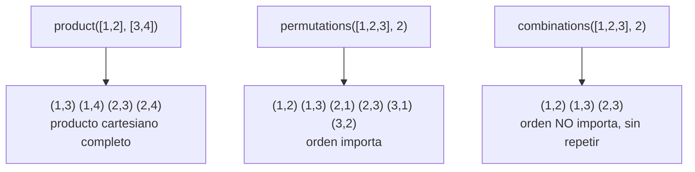

# 34 - Itertools en Profundidad

> Continúa de [[33 - Functools en Profundidad|33]]. Si `functools` opera sobre funciones, `itertools` opera sobre **iterables** — es la caja de herramientas para construir iteradores eficientes en memoria, sin materializar listas intermedias completas.

Todas las funciones de `itertools` devuelven **iteradores perezosos**: no calculan nada hasta que se les pide el siguiente valor (con `next()`, un `for`, o convirtiéndolos con `list()`). Esto las hace ideales para trabajar con secuencias grandes o incluso infinitas.

## Iteradores Infinitos

```python
from itertools import count, cycle, repeat
from itertools import islice

# count: cuenta indefinidamente desde un inicio, con un paso
contador = count(start=10, step=5)
print(list(islice(contador, 4)))  # [10, 15, 20, 25]

# cycle: repite un iterable indefinidamente
colores = cycle(["rojo", "verde", "azul"])
print(list(islice(colores, 7)))  # ['rojo', 'verde', 'azul', 'rojo', 'verde', 'azul', 'rojo']

# repeat: repite un valor fijo (opcionalmente un número limitado de veces)
print(list(repeat("x", 3)))  # ['x', 'x', 'x']
```

`islice` es imprescindible con iteradores infinitos: hace lo que `lista[inicio:fin:paso]` haría con una lista, pero de forma perezosa — sin él, `list(count())` nunca terminaría.

## Combinatoria

```python
from itertools import product, permutations, combinations, combinations_with_replacement

# product: producto cartesiano (equivalente a for anidados)
print(list(product([1, 2], ["a", "b"])))
# [(1, 'a'), (1, 'b'), (2, 'a'), (2, 'b')]

# permutations: todos los ordenamientos posibles
print(list(permutations([1, 2, 3], r=2)))
# [(1, 2), (1, 3), (2, 1), (2, 3), (3, 1), (3, 2)]

# combinations: subconjuntos sin importar el orden, sin repetir elementos
print(list(combinations([1, 2, 3], r=2)))
# [(1, 2), (1, 3), (2, 3)]

# combinations_with_replacement: subconjuntos permitiendo repetir elementos
print(list(combinations_with_replacement([1, 2, 3], r=2)))
# [(1, 1), (1, 2), (1, 3), (2, 2), (2, 3), (3, 3)]
```



`product(rango, repeat=n)` reemplaza a `n` bucles `for` anidados — útil para búsqueda de hiperparámetros por fuerza bruta (grid search manual) antes de usar herramientas dedicadas como las de scikit-learn.

## Encadenar y Agrupar

```python
from itertools import chain, groupby

# chain: concatena varios iterables en uno solo, sin copiar memoria
lista1, lista2 = [1, 2, 3], [4, 5, 6]
print(list(chain(lista1, lista2)))  # [1, 2, 3, 4, 5, 6]

# groupby: agrupa elementos CONSECUTIVOS con la misma clave
datos = [("A", 1), ("A", 2), ("B", 3), ("B", 4), ("A", 5)]
for clave, grupo in groupby(datos, key=lambda x: x[0]):
    print(clave, list(grupo))
# A [('A', 1), ('A', 2)]
# B [('B', 3), ('B', 4)]
# A [('A', 5)]   <- ¡OJO! aparece un segundo grupo "A" porque no está ordenado
```

> **Trampa clásica de `groupby`:** solo agrupa elementos **consecutivos**. Si los datos no están previamente ordenados por la clave de agrupación, obtendrás grupos duplicados y fragmentados (como el segundo grupo `"A"` arriba). La solución casi siempre es `sorted(datos, key=...)` antes de `groupby`:

```python
datos_ordenados = sorted(datos, key=lambda x: x[0])
for clave, grupo in groupby(datos_ordenados, key=lambda x: x[0]):
    print(clave, list(grupo))
# A [('A', 1), ('A', 2), ('A', 5)]
# B [('B', 3), ('B', 4)]
```

Para agrupaciones más ricas (agregaciones, múltiples claves) sobre datos tabulares, `pandas.groupby` (ver `Python/Pandas/08 - Agrupación y Agregación (GroupBy).md`) es casi siempre preferible en la práctica — `itertools.groupby` brilla con iteradores puros de Python fuera de un contexto de DataFrame.

## Filtrado

```python
from itertools import filterfalse, takewhile, dropwhile, compress

numeros = [1, 2, 3, 4, 5, 6, 7, 8]

# filterfalse: lo opuesto a filter() -> conserva lo que NO cumple la condición
print(list(filterfalse(lambda n: n % 2 == 0, numeros)))  # [1, 3, 5, 7]

# takewhile: toma elementos MIENTRAS se cumpla la condición, se detiene al primer fallo
print(list(takewhile(lambda n: n < 5, numeros)))  # [1, 2, 3, 4]

# dropwhile: descarta elementos MIENTRAS se cumpla la condición, luego toma el resto
print(list(dropwhile(lambda n: n < 5, numeros)))  # [5, 6, 7, 8]

# compress: selecciona elementos según una máscara booleana paralela
print(list(compress(numeros, [1, 0, 1, 0, 1, 0, 1, 0])))  # [1, 3, 5, 7]
```

`takewhile`/`dropwhile` son distintos de `filter`: dejan de evaluar en cuanto la condición cambia, en vez de revisar **todos** los elementos — más eficiente cuando sabes que los datos están ordenados o siguen un patrón.

## Acumulación

```python
from itertools import accumulate
import operator

numeros = [1, 2, 3, 4, 5]

print(list(accumulate(numeros)))              # [1, 3, 6, 10, 15] -> suma acumulada (por defecto)
print(list(accumulate(numeros, operator.mul)))  # [1, 2, 6, 24, 120] -> producto acumulado
print(list(accumulate(numeros, max)))          # [1, 2, 3, 4, 5] -> máximo acumulado
```

A diferencia de `functools.reduce` (que solo devuelve el resultado **final**), `accumulate` devuelve **cada paso intermedio** — útil para gráficas de progreso acumulado o saldos corrientes.

## Construyendo tus Propios Generadores "estilo itertools"

Muchas funciones de `itertools` se pueden reimplementar con generadores (ver [[35 - Generadores y Corutinas Clásicas|35]]) para entender qué hacen por debajo:

```python
def mi_chain(*iterables):
    for iterable in iterables:
        yield from iterable

def mi_take(iterable, n):
    iterador = iter(iterable)
    for _ in range(n):
        yield next(iterador)
```

## Referencia Rápida

| Función | Qué hace |
|---|---|
| `count`, `cycle`, `repeat` | Iteradores infinitos |
| `product`, `permutations`, `combinations` | Combinatoria |
| `chain` | Concatena iterables sin copiar |
| `groupby` | Agrupa elementos consecutivos (requiere datos ordenados) |
| `filterfalse`, `takewhile`, `dropwhile`, `compress` | Filtrado avanzado |
| `accumulate` | Acumulación paso a paso |
| `islice` | Slicing perezoso sobre cualquier iterable |
| `tee` | Duplica un iterador en varios independientes |

## Ver también

- [[31 - Funciones de Alto Orden y Programación Funcional]] — `map`/`filter` como contraparte ansiosa/simple de `itertools`.
- [[35 - Generadores y Corutinas Clásicas]] — cómo construir tus propios iteradores perezosos.
- [[05 - Lists and Tuples]] — la base de secuencias sobre la que operan estas herramientas.
- [[58 - Profiling y Optimización de Rendimiento]] — cuándo la evaluación perezosa realmente importa para el rendimiento.
