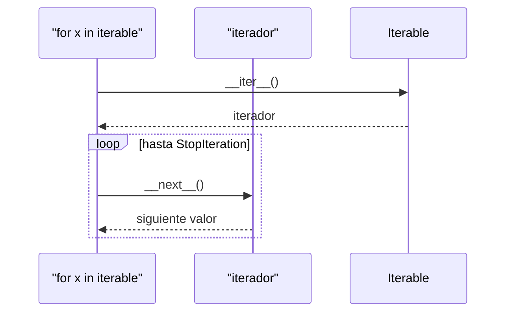

# 35 - Generadores y Corutinas Clásicas

> Continúa de [[34 - Itertools en Profundidad|34]] y cierra el bloque de funciones/programación funcional. Aquí se cubre el mecanismo con el que `itertools` construye toda su magia: los **generadores**.

## El Protocolo de Iteración

Antes de los generadores, hay que entender cómo funciona `for` por debajo. Cualquier objeto **iterable** implementa `__iter__`, que devuelve un **iterador** — un objeto con `__next__`, que produce un valor a la vez y lanza `StopIteration` cuando se agota.

```python
lista = [1, 2, 3]
iterador = iter(lista)       # llama a lista.__iter__()

print(next(iterador))  # 1
print(next(iterador))  # 2
print(next(iterador))  # 3
print(next(iterador))  # StopIteration
```



Un `for x in obj:` es, literalmente, azúcar sintáctico para llamar repetidamente a `__next__()` sobre el iterador hasta capturar `StopIteration`.

## Generadores: Iteradores sin Escribir una Clase

Una función que contiene `yield` se convierte automáticamente en una **función generadora**: al llamarla, no ejecuta su cuerpo — devuelve un objeto generador (que ya implementa `__iter__` y `__next__` por ti).

```python
def contar_hasta(n):
    print("Generador iniciado")
    i = 1
    while i <= n:
        yield i
        i += 1
    print("Generador terminado")

gen = contar_hasta(3)   # NO imprime nada todavía: el cuerpo no se ha ejecutado
print(next(gen))  # "Generador iniciado" -> 1
print(next(gen))  # 2
print(next(gen))  # 3
print(next(gen))  # "Generador terminado" -> StopIteration
```

Cada `yield` **pausa** la función, recordando exactamente dónde se quedó (variables locales incluidas), hasta la siguiente llamada a `next()`.

### Generador vs Función Normal: la Diferencia de Memoria

```python
def cuadrados_lista(n):
    return [x**2 for x in range(n)]   # calcula TODO de una vez, en memoria

def cuadrados_generador(n):
    for x in range(n):
        yield x**2                     # calcula UNO a la vez, bajo demanda

# Con un millón de elementos:
suma_lista = sum(cuadrados_lista(1_000_000))        # crea una lista de 1M elementos en RAM
suma_generador = sum(cuadrados_generador(1_000_000))  # nunca tiene más de 1 elemento en RAM
```

| | Lista/comprensión `[...]` | Generador (`yield` o `(...)`) |
|---|---|---|
| Memoria | O(n) — todo en RAM | O(1) — un elemento a la vez |
| Se puede recorrer varias veces | Sí | No — se agota tras un recorrido |
| Indexable (`lista[5]`) | Sí | No |
| Ideal para | Datos pequeños, acceso repetido | Datos grandes/infinitos, un solo recorrido |

### Expresiones Generadoras

Igual que existen comprensiones de listas, existen su equivalente perezoso con paréntesis:

```python
cuadrados = (x**2 for x in range(1_000_000))  # expresión generadora
print(sum(cuadrados))  # se consume sin materializar la lista completa
```

## `yield from`: Delegando en Otro Iterable

```python
def generador_interno():
    yield 1
    yield 2

def generador_externo():
    yield "inicio"
    yield from generador_interno()   # delega, en vez de: for x in generador_interno(): yield x
    yield "fin"

print(list(generador_externo()))  # ['inicio', 1, 2, 'fin']
```

`yield from` no es solo azúcar sintáctico para un `for` con `yield` — también reenvía correctamente `send()`, `throw()` y el valor de retorno del subgenerador, algo que un `for` manual no hace.

## Generadores como Corutinas: `send()`, `throw()`, `close()`

Antes de `async`/`await` (ver [[54 - Asyncio en Profundidad|54]]), Python usaba generadores extendidos como corutinas rudimentarias — vale la pena entenderlos porque `async def` se construye conceptualmente sobre esta misma base.

```python
def acumulador():
    total = 0
    while True:
        valor = yield total   # yield puede RECIBIR un valor con send()
        total += valor

acc = acumulador()
next(acc)              # "priming": avanza hasta el primer yield (obligatorio antes de send)
print(acc.send(10))    # 10 -> total ahora es 10
print(acc.send(5))     # 15 -> total ahora es 15
acc.close()             # termina el generador (lanza GeneratorExit internamente)
```

```python
def generador_con_manejo_de_errores():
    try:
        while True:
            yield "esperando"
    except ValueError as e:
        print(f"Error recibido dentro del generador: {e}")
        yield "recuperado"

gen = generador_con_manejo_de_errores()
print(next(gen))               # "esperando"
print(gen.throw(ValueError("algo salió mal")))  # imprime el mensaje, luego "recuperado"
```

`throw()` permite inyectar una excepción **dentro** del punto donde el generador está pausado — la base conceptual de cómo `asyncio` cancela tareas.

## Valor de Retorno de un Generador

```python
def generador_con_retorno():
    yield 1
    yield 2
    return "resultado final"   # NO se obtiene con next() -> se lanza como StopIteration.value

gen = generador_con_retorno()
print(next(gen))  # 1
print(next(gen))  # 2
try:
    next(gen)
except StopIteration as e:
    print(e.value)  # "resultado final"
```

Esto es exactamente lo que `yield from` captura automáticamente para ti al delegar en un subgenerador.

## Generadores Infinitos y Control de Flujo

```python
def numeros_naturales():
    n = 1
    while True:
        yield n
        n += 1

from itertools import islice
primeros_10 = list(islice(numeros_naturales(), 10))
print(primeros_10)  # [1, 2, ..., 10]
```

Un generador infinito nunca causa un bucle infinito real de memoria porque nunca se materializa completo — solo produce valores mientras alguien siga pidiéndolos (con `next()` o un `islice`, ver [[34 - Itertools en Profundidad|34]]).

## Cuándo Usar Generadores

| Escenario | ¿Generador? |
|---|---|
| Procesar un archivo línea por línea sin cargarlo completo en memoria | Sí |
| Un pipeline de transformación de datos con varios pasos (`leer → filtrar → transformar`) | Sí — cada paso es un generador que consume al anterior |
| Necesitas acceder a un elemento por índice o recorrer la colección varias veces | No — usa una lista |
| Representar una secuencia potencialmente infinita (streaming, sensores) | Sí |
| Implementar una máquina de estados simple con memoria propia | Sí (o considera una clase, ver [[17 - OOP|17]]) |

## Ver también

- [[34 - Itertools en Profundidad]] — herramientas construidas enteramente sobre este protocolo.
- [[54 - Asyncio en Profundidad]] — cómo `async`/`await` extiende esta misma idea de "pausar y reanudar" con soporte nativo del intérprete.
- [[55 - Async Generators y Async Context Managers]] — la versión asíncrona de todo lo visto aquí.
- [[13 - Files Handling]] — el caso de uso más común de generadores: procesar archivos grandes línea por línea.
