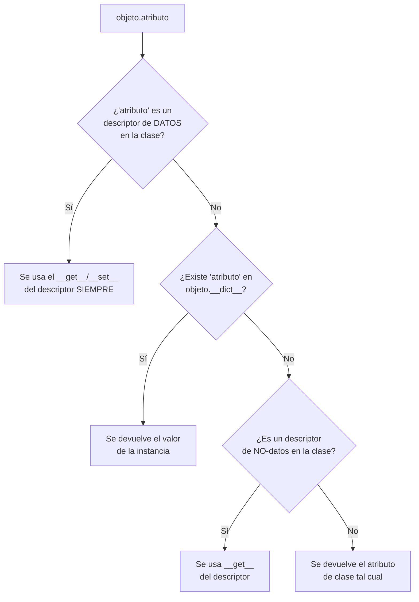

# 36 - Descriptors

> Continúa de [[35 - Generadores y Corutinas Clásicas|35]] y abre el bloque de POO avanzada. Los **descriptors** son el mecanismo interno detrás de `@property`, los métodos de instancia, y buena parte de la magia de ORMs como el de Django o SQLAlchemy — entenderlos es entender **cómo funciona realmente** el acceso a atributos en Python.

## El Protocolo Descriptor

Un **descriptor** es cualquier objeto que define al menos uno de estos métodos especiales, y que se asigna como **atributo de clase** (no de instancia):

```python
class Descriptor:
    def __get__(self, instancia, owner):
        ...
    def __set__(self, instancia, valor):
        ...
    def __delete__(self, instancia):
        ...
```

Cuando accedes a `objeto.atributo`, si `atributo` está definido en la **clase** como un descriptor, Python no devuelve el descriptor directamente — invoca su `__get__` automáticamente.

## Descriptors de Datos vs No-Datos

| Tipo | Define | Prioridad frente al `__dict__` de instancia |
|---|---|---|
| **Descriptor de datos** | `__get__` y `__set__` (y opcionalmente `__delete__`) | Siempre gana, incluso si la instancia tiene el mismo nombre en su `__dict__` |
| **Descriptor de no-datos** | Solo `__get__` | El `__dict__` de la instancia tiene prioridad si existe la misma clave |



## Implementando un Descriptor Propio

```python
class Positivo:
    """Descriptor que valida que un valor numérico sea siempre positivo."""

    def __set_name__(self, owner, nombre):
        self.nombre_privado = f"_{nombre}"

    def __get__(self, instancia, owner):
        if instancia is None:
            return self   # acceso desde la clase, no desde una instancia
        return getattr(instancia, self.nombre_privado)

    def __set__(self, instancia, valor):
        if valor < 0:
            raise ValueError(f"El valor debe ser positivo, se recibió {valor}")
        setattr(instancia, self.nombre_privado, valor)

class Producto:
    precio = Positivo()      # descriptor compartido por TODAS las instancias
    stock = Positivo()

    def __init__(self, precio, stock):
        self.precio = precio  # invoca Positivo.__set__
        self.stock = stock

p = Producto(precio=100, stock=5)
print(p.precio)     # invoca Positivo.__get__ -> 100

p.precio = -10       # ValueError: El valor debe ser positivo, se recibió -10
```

`__set_name__` (Python 3.6+) le informa al descriptor el nombre con el que fue asignado en la clase (`"precio"`, `"stock"`), permitiéndole generar un nombre de almacenamiento privado único por atributo — sin esto, ambos descriptores `Positivo()` compartirían el mismo almacenamiento interno.

## Cómo `@property` es en Realidad un Descriptor de Datos

```python
class Circulo:
    def __init__(self, radio):
        self._radio = radio

    @property
    def radio(self):
        return self._radio

    @radio.setter
    def radio(self, valor):
        if valor <= 0:
            raise ValueError("El radio debe ser positivo")
        self._radio = valor

    @property
    def area(self):
        return 3.14159 * self._radio ** 2
```

`property` es, literalmente, una clase built-in que implementa el protocolo descriptor internamente. Una implementación simplificada de `property` desde cero:

```python
class MiProperty:
    def __init__(self, fget=None, fset=None):
        self.fget = fget
        self.fset = fset

    def __get__(self, instancia, owner):
        if instancia is None:
            return self
        return self.fget(instancia)

    def __set__(self, instancia, valor):
        if self.fset is None:
            raise AttributeError("No se puede asignar: no hay setter")
        self.fset(instancia, valor)

    def setter(self, fset):
        return MiProperty(self.fget, fset)
```

Ver la lista completa de dunder methods de este tipo (`__set_name__`, `__get__`, etc.) en [[37 - Dunder Methods y Protocolos Avanzados|37]].

## Cómo los Métodos son Descriptors (de No-Datos)

Este es uno de los detalles más elegantes del lenguaje: **las funciones son descriptors de no-datos**. Es literalmente el mecanismo que convierte una función definida en una clase en un "método ligado" (_bound method_) cuando se accede desde una instancia.

```python
class Saludador:
    def saludar(self):
        return "Hola"

s = Saludador()

print(Saludador.saludar)   # <function Saludador.saludar at 0x...> -> función simple
print(s.saludar)           # <bound method Saludador.saludar of <...>> -> método ligado

print(s.saludar())         # "Hola" -> self se pasó automáticamente
print(Saludador.saludar(s))  # "Hola" -> equivalente manual, sin azúcar sintáctico
```

Cuando accedes a `s.saludar`, Python invoca `saludar.__get__(s, Saludador)` (porque toda función implementa `__get__`), que devuelve un objeto `method` con `self` ya pre-vinculado — por eso `s.saludar()` no necesita que pases `s` explícitamente.

## `__slots__`: Restringiendo Atributos (y Ahorrando Memoria)

Sin `__slots__`, cada instancia tiene su propio `__dict__` para almacenar atributos dinámicamente — flexible, pero con overhead de memoria. `__slots__` reemplaza ese `__dict__` por descriptors fijos generados automáticamente por la clase:

```python
class PuntoConDict:
    def __init__(self, x, y):
        self.x = x
        self.y = y
        # tiene __dict__: se le puede agregar CUALQUIER atributo nuevo
        # p.z = 10  <- funcionaría sin error

class PuntoConSlots:
    __slots__ = ("x", "y")   # solo estos dos atributos existen; no hay __dict__

    def __init__(self, x, y):
        self.x = x
        self.y = y

p = PuntoConSlots(1, 2)
p.z = 10  # AttributeError: 'PuntoConSlots' object has no attribute 'z'
```

| | Con `__dict__` (por defecto) | Con `__slots__` |
|---|---|---|
| Memoria por instancia | Mayor (overhead del diccionario) | Menor (~40-50% menos en instancias simples) |
| Se pueden agregar atributos nuevos dinámicamente | Sí | No (a menos que `__dict__` esté explícitamente en `__slots__`) |
| Compatible con `weakref` sin configuración extra | Sí | No (requiere agregar `"__weakref__"` a `__slots__`) |
| Compatible con herencia múltiple de varias clases con slots | Con cuidado | Puede causar conflictos de layout de memoria |
| Cuándo usarlo | Uso general | Millones de instancias pequeñas (ej. nodos de un árbol, puntos de una nube de datos) |

## Ver también

- [[17 - OOP]] — la base de `@property` y clases que este archivo profundiza a nivel de protocolo.
- [[37 - Dunder Methods y Protocolos Avanzados]] — el resto de métodos especiales relacionados.
- [[38 - Metaclases y type()]] — el siguiente nivel: interceptar la creación de la clase misma, no solo el acceso a atributos.
- [[27 - Gestión de Memoria y Garbage Collection]] — por qué `__slots__` reduce el uso de memoria.
