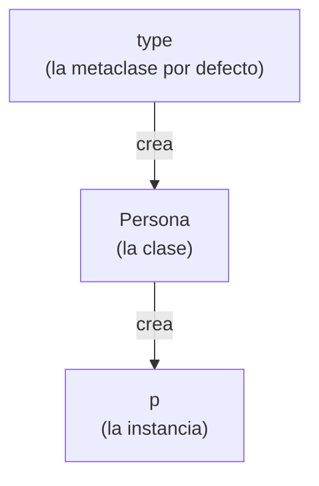
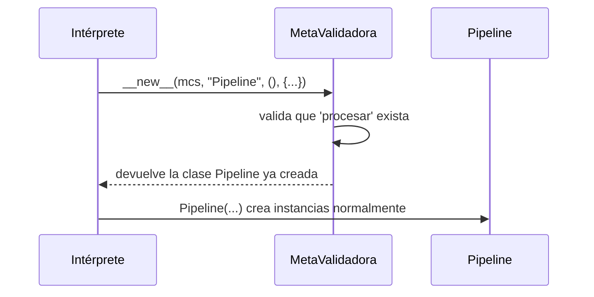

# 38 - Metaclases y type()

> Continúa de [[37 - Dunder Methods y Protocolos Avanzados|37]]. Si los [[36 - Descriptors|descriptors]] controlan el acceso a **atributos**, las metaclases controlan la creación de **clases enteras**. Es, deliberadamente, el tema más avanzado de este bloque — la mayoría del código Python nunca necesita definir una metaclase propia, pero entenderlas explica por qué frameworks como Django ORM o los ABCs de Python funcionan como funcionan.

## "Las Clases También Son Objetos"

Ya se mencionó en [[26 - Modelo de Objetos y Memoria en CPython|26]]: todo en Python es un objeto, incluyendo las clases mismas. Si una clase es un objeto, algo tuvo que **crear** ese objeto — y ese "algo" es su **metaclase**.

```python
class Persona:
    pass

p = Persona()

print(type(p))         # <class '__main__.Persona'>  -> la clase de la instancia
print(type(Persona))   # <class 'type'>                -> la metaclase de la clase
print(type(type))      # <class 'type'>                -> type es su propia metaclase
```



Por defecto, **toda** clase en Python es una instancia de `type`. `class Persona: ...` es, en el fondo, una forma declarativa de llamar a `type(...)`.

## `type()` como Constructor de Clases

`type()` tiene dos usos completamente distintos según cuántos argumentos reciba:

```python
# Uso 1: consultar el tipo de un objeto (un argumento)
print(type(42))  # <class 'int'>

# Uso 2: CREAR una clase dinámicamente (tres argumentos)
def __init__(self, nombre):
    self.nombre = nombre

def saludar(self):
    return f"Hola, {self.nombre}"

Persona = type(
    "Persona",                          # nombre de la clase
    (),                                  # tupla de clases base (herencia)
    {"__init__": __init__, "saludar": saludar}  # namespace: atributos y métodos
)

p = Persona("Ana")
print(p.saludar())  # "Hola, Ana"
print(type(p))       # <class '__main__.Persona'>
```

Esto es **exactamente** equivalente a escribir la clase con la sintaxis `class` normal — `class` es azúcar sintáctico que termina llamando a `type(nombre, bases, namespace)`.

## Definiendo tu Propia Metaclase

Una metaclase personalizada se define heredando de `type` y sobrescribiendo `__new__` o `__init__` para interceptar la creación de **cualquier** clase que la use.

```python
class MetaValidadora(type):
    def __new__(mcs, nombre, bases, namespace):
        # Se ejecuta ANTES de que la clase termine de crearse
        if "procesar" not in namespace:
            raise TypeError(f"{nombre} debe implementar el método 'procesar'")
        return super().__new__(mcs, nombre, bases, namespace)

class Pipeline(metaclass=MetaValidadora):
    def procesar(self, datos):
        return datos

class PipelineIncompleto(metaclass=MetaValidadora):
    pass
# TypeError: PipelineIncompleto debe implementar el método 'procesar'
```



## `__init_subclass__`: la Alternativa Moderna y Más Simple

Desde Python 3.6, la mayoría de los casos que antes requerían una metaclase se resuelven con `__init_subclass__`, un hook mucho más simple que se ejecuta cada vez que se **hereda** de una clase:

```python
class Plugin:
    registro = {}

    def __init_subclass__(cls, **kwargs):
        super().__init_subclass__(**kwargs)
        Plugin.registro[cls.__name__] = cls   # auto-registro de subclases

class PluginCSV(Plugin):
    pass

class PluginJSON(Plugin):
    pass

print(Plugin.registro)
# {'PluginCSV': <class 'PluginCSV'>, 'PluginJSON': <class 'PluginJSON'>}
```

Este patrón de **auto-registro de plugins** (usado por frameworks para descubrir automáticamente serializadores, comandos de CLI, o modelos de un ORM) casi nunca requiere una metaclase completa — `__init_subclass__` es más legible y evita los problemas de conflictos de metaclase al combinar herencia múltiple.

## Metaclases vs `__init_subclass__` vs Decoradores de Clase

| Mecanismo | Cuándo se ejecuta | Puede cambiar bases/MRO | Complejidad |
|---|---|---|---|
| Decorador de clase (ver [[29 - Introspección y Metaprogramación\|29]]) | Después de crear la clase | No | Baja |
| `__init_subclass__` | Al crear cada **subclase** | No | Media |
| Metaclase (`type` personalizado) | Al crear la clase (y todas sus subclases) | Sí | Alta |

**Regla práctica (parafraseando a Tim Peters, autor del Zen of Python):** *"Las metaclases son magia más profunda de la que el 99% de los usuarios debería preocuparse. Si te preguntas si las necesitas, no las necesitas."* Antes de escribir una metaclase, evalúa si un decorador de clase o `__init_subclass__` resuelve el mismo problema — casi siempre es así.

## Dónde Aparecen las Metaclases en la Práctica

- **ABCs (`abc.ABCMeta`):** las clases abstractas (`abc.ABC`, ver [[17 - OOP|17 - OOP]]) usan una metaclase para impedir instanciar una clase con métodos `@abstractmethod` sin implementar.
- **Enums:** `enum.EnumMeta` es la metaclase que le da a `Enum` su sintaxis especial de iteración y comparación (ver [[39 - Enums Avanzados|39]]).
- **ORMs (Django, SQLAlchemy declarativo):** usan metaclases para convertir atributos de clase (`nombre = CharField()`) en columnas de base de datos reales al momento de definir el modelo.

```python
from abc import ABC, abstractmethod

class Forma(ABC):
    @abstractmethod
    def area(self): ...

f = Forma()  # TypeError: Can't instantiate abstract class Forma with abstract method area
print(type(Forma))  # <class 'abc.ABCMeta'> -> la metaclase que hace posible este error
```

## Ver también

- [[26 - Modelo de Objetos y Memoria en CPython]] — la base de "todo es un objeto" que hace posible este archivo.
- [[36 - Descriptors]] — el otro protocolo de bajo nivel para personalizar el comportamiento de clases.
- [[29 - Introspección y Metaprogramación]] — decoradores de clase, la alternativa más simple a una metaclase.
- [[39 - Enums Avanzados]] — un caso real de metaclase (`EnumMeta`) integrada en la librería estándar.
