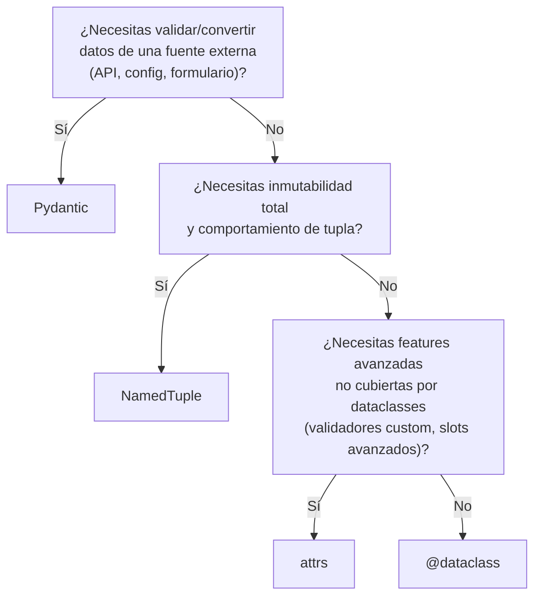

# 40 - Dataclasses, NamedTuple y Comparativa con Attrs/Pydantic

> Continúa de [[39 - Enums Avanzados|39]]. Buena parte del código orientado a objetos existe solo para **agrupar datos relacionados** — `__init__`, `__repr__` y `__eq__` repetitivos que Python puede generar automáticamente.

## El Problema: Boilerplate de una Clase "Solo Datos"

```python
# Sin dataclass: mucho código repetitivo para algo conceptualmente simple
class PuntoManual:
    def __init__(self, x, y):
        self.x = x
        self.y = y

    def __repr__(self):
        return f"PuntoManual(x={self.x}, y={self.y})"

    def __eq__(self, otro):
        if not isinstance(otro, PuntoManual):
            return NotImplemented
        return (self.x, self.y) == (otro.x, otro.y)
```

## `@dataclass`: Generando Todo Eso Automáticamente

```python
from dataclasses import dataclass, field

@dataclass
class Punto:
    x: float
    y: float

p1 = Punto(1, 2)
p2 = Punto(1, 2)

print(p1)             # Punto(x=1, y=2)  -> __repr__ generado
print(p1 == p2)        # True             -> __eq__ generado
print(p1)               # el orden de los campos sigue la declaración
```

`@dataclass` lee las **anotaciones de tipo** (ver [[42 - Type Hints y el Módulo Typing|42]]) de la clase para generar `__init__`, `__repr__` y `__eq__` automáticamente — el tipo en sí no se valida en runtime por defecto, solo se usa como especificación de qué campos existen.

### Opciones de `@dataclass`

```python
@dataclass(order=True)       # genera __lt__, __le__, __gt__, __ge__ comparando tupla de campos
class Version:
    mayor: int
    menor: int
    parche: int = 0           # valor por defecto

@dataclass(frozen=True)      # genera __setattr__ que lanza excepción -> instancias inmutables
class Coordenada:
    latitud: float
    longitud: float

c = Coordenada(19.4, -99.1)
# c.latitud = 0  # dataclasses.FrozenInstanceError

@dataclass(slots=True)       # (3.10+) genera __slots__ automáticamente -> ver 36 - Descriptors
class PuntoLigero:
    x: float
    y: float
```

| Parámetro | Efecto |
|---|---|
| `order=True` | Genera métodos de comparación de orden (`<`, `<=`, `>`, `>=`) |
| `frozen=True` | Hace las instancias inmutables (y hashables si además tienen `eq=True`) |
| `slots=True` (3.10+) | Genera `__slots__` automáticamente — ahorra memoria |
| `kw_only=True` (3.10+) | Fuerza que todos los campos se pasen por keyword al construir |

### Campos con `field()`: Más Control

```python
from dataclasses import dataclass, field

@dataclass
class Carrito:
    items: list = field(default_factory=list)   # NUNCA uses default=[] (ver 26 y 32)
    descuento: float = field(default=0.0, repr=False)  # no aparece en __repr__
    id: int = field(init=False, default=0)              # no se pasa al constructor
```

`default_factory` es obligatorio para valores por defecto mutables (`list`, `dict`, `set`) — `@dataclass` incluso lanza un `ValueError` explícito si intentas `items: list = []`, previniendo exactamente el error clásico visto en [[32 - Args, Kwargs y Firmas Avanzadas|32]].

### `__post_init__`: Lógica Adicional tras la Generación Automática

```python
@dataclass
class Rectangulo:
    ancho: float
    alto: float
    area: float = field(init=False)

    def __post_init__(self):
        self.area = self.ancho * self.alto

r = Rectangulo(4, 5)
print(r.area)  # 20 -> calculado automáticamente tras __init__
```

## `NamedTuple`: Cuando Quieres Inmutabilidad Real y Comportamiento de Tupla

```python
from typing import NamedTuple

class Punto(NamedTuple):
    x: float
    y: float

p = Punto(1, 2)
print(p.x, p[0])       # 1 1 -> acceso por nombre O por índice
x, y = p                # desempaquetable como cualquier tupla
print(isinstance(p, tuple))  # True

# p.x = 10  # AttributeError: no se puede reasignar, es una tupla inmutable
```

| | `@dataclass` | `NamedTuple` |
|---|---|---|
| Mutabilidad | Mutable por defecto (`frozen=True` para lo contrario) | Siempre inmutable |
| Es una subclase de `tuple` | No | Sí — desempaquetable, indexable |
| Herencia | Soporta herencia normal | Limitada (no se recomienda heredar de un NamedTuple) |
| Rendimiento/memoria | Similar a una clase normal (menor con `slots=True`) | Muy liviano (como una tupla) |
| Uso típico | Modelos de datos con lógica propia | Registros simples e inmutables (una fila, una coordenada) |

## Comparativa Completa: Clases Manuales vs Dataclasses vs Attrs vs Pydantic

| | Clase manual | `@dataclass` (stdlib) | `attrs` (librería externa) | `Pydantic` |
|---|---|---|---|---|
| Genera `__init__`/`__repr__`/`__eq__` | No (a mano) | Sí | Sí | Sí |
| Requiere dependencia externa | No | No | Sí | Sí |
| **Valida** tipos en runtime | No | No | Parcial (validadores manuales) | **Sí, automáticamente** |
| Convierte/parsea tipos (`"5"` → `5`) | No | No | No (por defecto) | **Sí** |
| Serialización a JSON integrada | No | No (manual con `asdict`) | No (integración externa) | **Sí** (`.model_dump_json()`) |
| Rendimiento de creación | Rápido | Rápido | Rápido | Más lento (hace validación real) |
| Ecosistema/uso típico | Cualquier lugar | Uso general en Python puro | Alternativa madura a dataclasses con más features | APIs web, validación de configuración/entrada externa |

```python
# Con Pydantic (ver Python/FastAPI/03 - Request Body y Modelos Pydantic para el detalle completo)
from pydantic import BaseModel

class Usuario(BaseModel):
    nombre: str
    edad: int

u = Usuario(nombre="Ana", edad="25")  # el string "25" se CONVIERTE a int automáticamente
print(u.edad, type(u.edad))            # 25 <class 'int'>

# Usuario(nombre="Ana", edad="no-numero")  # ValidationError -> Pydantic sí valida en runtime
```

## Árbol de Decisión



## Convertir Dataclasses hacia/desde Otros Formatos

```python
from dataclasses import dataclass, asdict, astuple

@dataclass
class Punto:
    x: float
    y: float

p = Punto(1, 2)
print(asdict(p))    # {'x': 1, 'y': 2}  -> útil para serializar a JSON (ver 14 - JSON and YAML)
print(astuple(p))   # (1, 2)
```

## Ver también

- [[42 - Type Hints y el Módulo Typing]] — las anotaciones de tipo que `@dataclass` consume.
- [[36 - Descriptors]] — cómo `slots=True` reduce memoria por instancia.
- [[17 - OOP]] — la base de clases sobre la que `@dataclass` genera código automáticamente.
- `Python/FastAPI/03 - Request Body y Modelos Pydantic.md` — Pydantic aplicado a validación de requests HTTP.
