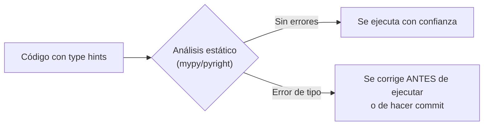

# 43 - Análisis Estático con Mypy y Pyright

> Continúa de [[42 - Type Hints y el Módulo Typing|42]]. Las anotaciones de tipo por sí solas son solo documentación para Python — cobran valor real cuando una herramienta de **análisis estático** las revisa antes de que el código se ejecute.

## Por Qué Importa: Errores Detectados Antes de Ejecutar

```python
def calcular_total(precios: list[float]) -> float:
    return sum(precios)

resultado = calcular_total([10, 20, "30"])  # error de tipo, pero Python lo ejecuta igual
```

Sin un type-checker, ese `"30"` en la lista solo se descubre si el código llega a ejecutarse con ese input exacto (o revienta en producción con un `TypeError` al sumar `int + str`). Con mypy o pyright, el error se marca **en el editor, antes de correr una sola línea**.



## Mypy: Instalación y Uso Básico

```bash
pip install mypy
mypy mi_script.py
mypy mi_paquete/          # revisa un paquete completo
```

```python
# archivo: ejemplo.py
def dividir(a: int, b: int) -> float:
    return a / b

dividir(10, "2")  # mypy: Argument 2 to "dividir" has incompatible type "str"; expected "int"
```

```text
ejemplo.py:4: error: Argument 2 to "dividir" has incompatible type "str"; expected "int"  [arg-type]
Found 1 error in 1 file (checked 1 source file)
```

### Configuración con `mypy.ini` / `pyproject.toml`

```toml
# pyproject.toml
[tool.mypy]
python_version = "3.13"
strict = true                     # activa todas las comprobaciones estrictas
warn_return_any = true            # advierte si una función anotada devuelve 'Any'
disallow_untyped_defs = true      # exige anotar TODAS las funciones
ignore_missing_imports = true     # no falla por librerías de terceros sin type stubs
```

| Nivel de estrictez | Cuándo usarlo |
|---|---|
| Sin configuración (por defecto) | Código heredado sin anotaciones, migración gradual |
| `disallow_untyped_defs = true` | Exigir que todo código nuevo tenga type hints |
| `strict = true` | Proyectos nuevos, librerías públicas, código crítico |

## Gradual Typing: Adoptando Tipos Poco a Poco

Mypy fue diseñado para **tipado gradual** — no es todo o nada. Puedes tipar solo las partes críticas de una base de código grande:

```python
def funcion_sin_tipos(a, b):      # mypy la ignora si disallow_untyped_defs=False
    return a + b

def funcion_tipada(a: int, b: int) -> int:   # esta SÍ se valida completamente
    return a + b
```

`# type: ignore` silencia un error puntual cuando sabes que es un falso positivo o una limitación temporal:

```python
resultado = libreria_sin_tipos.hacer_algo()  # type: ignore[no-untyped-call]
```

## Pyright: la Alternativa de Microsoft (Motor de Pylance en VS Code)

`pyright` es el type-checker que impulsa **Pylance** en VS Code — generalmente más rápido que mypy y con excelente soporte de editor en tiempo real.

```bash
pip install pyright
pyright mi_paquete/
```

```json
// pyrightconfig.json
{
  "include": ["src"],
  "exclude": ["**/node_modules", "**/__pycache__"],
  "pythonVersion": "3.13",
  "typeCheckingMode": "strict"
}
```

## Mypy vs Pyright

| | mypy | pyright |
|---|---|---|
| Mantenido por | Comunidad Python / originalmente Jukka Lehtosalo | Microsoft |
| Velocidad | Más lento (especialmente en proyectos grandes) | Notablemente más rápido (escrito para ser incremental) |
| Integración de editor | Vía plugins | Nativo en VS Code (Pylance) |
| Madurez / adopción en la industria | Muy alta, es el "estándar de facto" histórico | Creciendo rápido, ya dominante en editores VS Code |
| Soporta plugins de tipado (Django, SQLAlchemy) | Sí, ecosistema de plugins maduro | Soporte más limitado |
| Uso recomendado | CI/CD, proyectos con plugins específicos | Desarrollo diario en VS Code, feedback instantáneo |

Muchos equipos usan **ambos**: pyright/Pylance para feedback instantáneo mientras escriben código, y mypy en CI como validación final antes de mergear — no son mutuamente excluyentes.

## Integrando el Type-Checking en el Flujo de Trabajo

```yaml
# .pre-commit-config.yaml (ver 44 - Linters y Formateadores para el detalle de pre-commit)
repos:
  - repo: https://github.com/pre-commit/mirrors-mypy
    rev: v1.11.0
    hooks:
      - id: mypy
        additional_dependencies: [types-requests]
```

```yaml
# GitHub Actions (fragmento de CI)
- name: Type check
  run: mypy src/ --strict
```

## Stubs (`.pyi`): Tipando Librerías que No Tienen Type Hints

Muchas librerías de terceros no incluyen anotaciones. La comunidad mantiene **type stubs** por separado en el proyecto `typeshed`:

```bash
pip install types-requests types-PyYAML
```

Un archivo `.pyi` contiene solo las **firmas** de un módulo, sin implementación — sirve exclusivamente para que el type-checker entienda la forma de una API externa sin necesitar leer su código fuente real.

```python
# requests-stubs/__init__.pyi (simplificado, conceptual)
def get(url: str, timeout: float | None = ...) -> Response: ...
```

## Cuándo Vale la Pena el Esfuerzo

| Contexto | ¿Vale la pena tipar estrictamente? |
|---|---|
| Script de un solo uso, notebook exploratorio | Generalmente no |
| Librería/paquete reutilizado por otros | Sí, casi obligatorio |
| API pública (FastAPI, ver `Python/FastAPI/`) | Sí — además Pydantic lo aprovecha para validar en runtime |
| Proyecto en equipo, mantenido a largo plazo | Sí — previene una clase entera de bugs en integración |
| Prototipo rápido para validar una idea | Tipado ligero (solo funciones públicas) es un buen punto medio |

## Ver también

- [[42 - Type Hints y el Módulo Typing]] — la sintaxis que este archivo pone a trabajar.
- [[44 - Linters y Formateadores]] — cómo integrar mypy/pyright junto con ruff/black en el mismo flujo.
- [[40 - Dataclasses, NamedTuple y Comparativa con Attrs-Pydantic]] — Pydantic, la validación equivalente pero en runtime.
- `Python/Pytest/` — testing y análisis estático son complementarios, no sustitutos el uno del otro.
