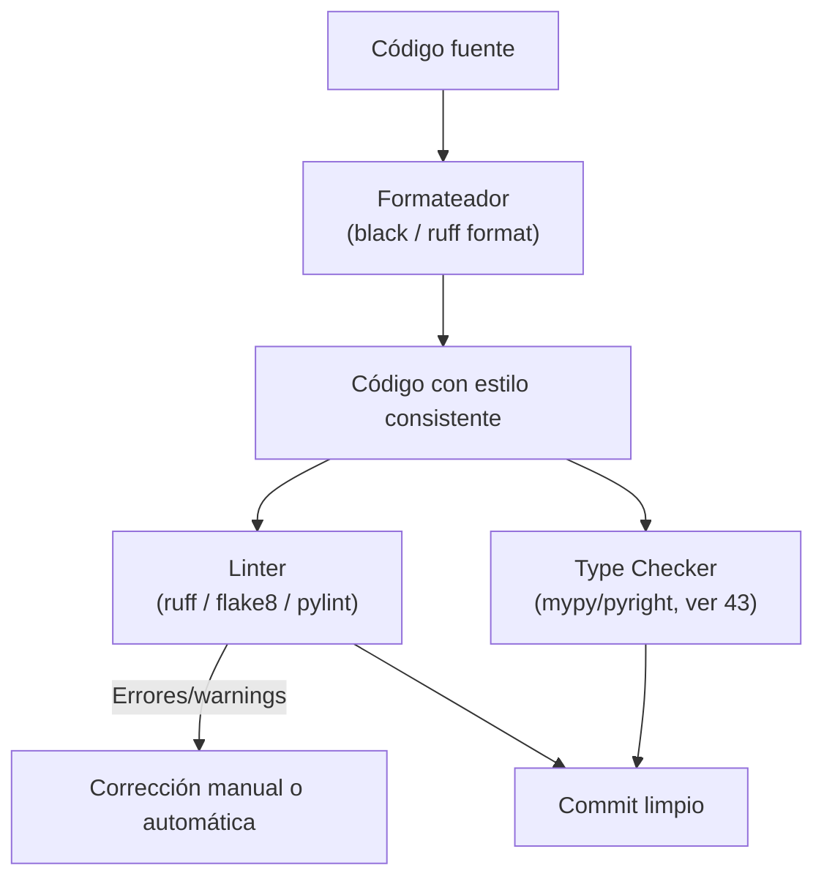
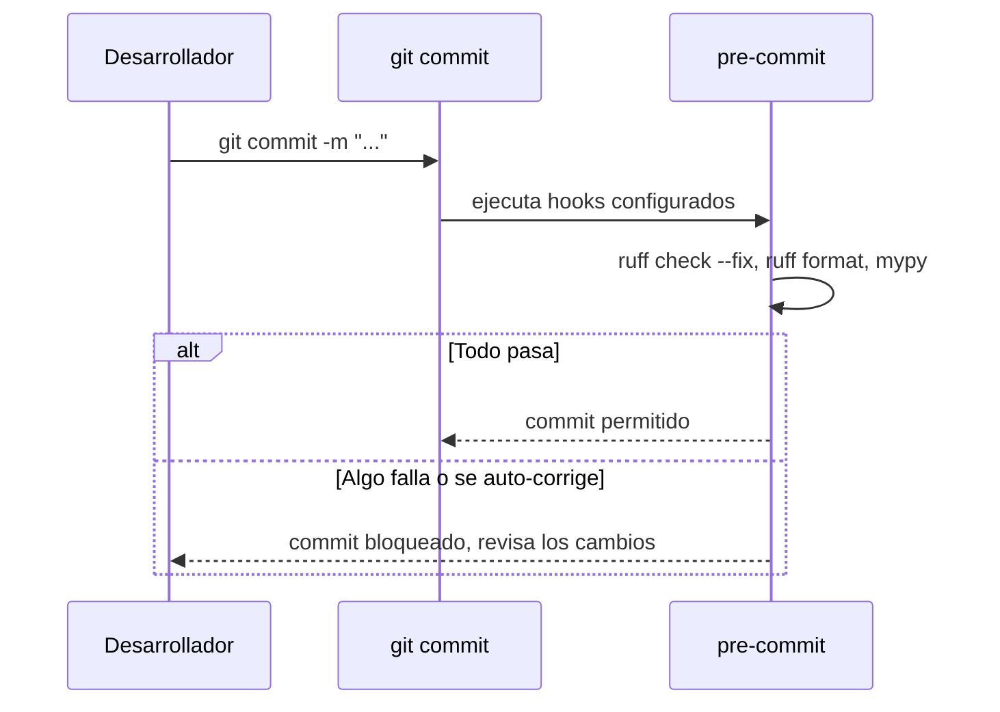

# 44 - Linters y Formateadores

> Continúa de [[43 - Análisis Estático con Mypy y Pyright|43]]. Mientras mypy/pyright verifican **tipos**, los linters verifican **calidad y estilo** de código, y los formateadores lo **reescriben automáticamente** para que sea consistente — juntos automatizan gran parte de lo que antes era revisión manual en un code review.

## El Ecosistema, de un Vistazo



## `black`: El Formateador "Sin Opiniones que Discutir"

`black` reformatea el código automáticamente según un único estilo — su filosofía es eliminar por completo los debates de estilo en un equipo ("cualquier color, siempre que sea negro").

```bash
pip install black
black mi_paquete/          # reformatea todos los archivos
black --check mi_paquete/  # solo verifica, no modifica (útil en CI)
black --diff mi_script.py  # muestra qué cambiaría, sin aplicar
```

```python
# Antes de black
def   f(a,b,   c ) :
    return{'x':a,'y':b,'z' :c}

# Después de black
def f(a, b, c):
    return {"x": a, "y": b, "z": c}
```

## `ruff`: Linter (y Formateador) Extremadamente Rápido

`ruff`, escrito en Rust, reemplaza a `flake8` + `isort` + decenas de plugins con una sola herramienta, y es 10-100x más rápido. Se ha vuelto el estándar de facto en proyectos nuevos.

```bash
pip install ruff
ruff check mi_paquete/         # lint
ruff check --fix mi_paquete/   # lint + auto-corrección de lo que se pueda arreglar solo
ruff format mi_paquete/         # formateo (alternativa a black, compatible en estilo)
```

```toml
# pyproject.toml
[tool.ruff]
line-length = 100
target-version = "py313"

[tool.ruff.lint]
select = ["E", "F", "I", "N", "UP", "B"]
# E, F: errores de pycodestyle/pyflakes | I: orden de imports | N: convenciones de nombres
# UP: sugiere sintaxis moderna (pyupgrade) | B: bugs comunes (bugbear)
ignore = ["E501"]  # ignora "línea demasiado larga" si ya controlas line-length

[tool.ruff.lint.per-file-ignores]
"tests/*" = ["S101"]  # permite 'assert' en tests (normalmente señalado como riesgo de seguridad)
```

## `isort`: Ordenando Imports (Ya Integrado en Ruff)

```python
# Antes
import os
from mi_paquete import modulo
import sys
from collections import OrderedDict

# Después de isort (o ruff con la regla "I")
import os
import sys
from collections import OrderedDict

from mi_paquete import modulo
```

`isort` agrupa imports en bloques (stdlib → librerías de terceros → paquete propio) separados por líneas en blanco — `ruff` ya incorpora esta misma lógica con la categoría de reglas `I`, por lo que en proyectos nuevos rara vez hace falta `isort` por separado.

## `flake8` y `pylint`: las Opciones "Clásicas"

| | flake8 | pylint | ruff |
|---|---|---|---|
| Velocidad | Media | Lenta (análisis muy profundo) | Muy rápida (Rust) |
| Profundidad de análisis | Básica (estilo + errores comunes) | Muy profunda (detecta más patrones sospechosos) | Amplia y creciente, cubre la mayoría de casos de flake8+plugins |
| Configuración | Requiere plugins separados para más reglas | Extensa por defecto, a veces demasiado ruidosa | Un solo archivo `pyproject.toml`, reglas activables por categoría |
| Adopción en proyectos nuevos (2025+) | Decreciente | Nicho / equipos que ya lo usaban | Dominante |

Para un proyecto nuevo hoy, `ruff` (lint + format) + `mypy` o `pyright` (tipos) cubre prácticamente todo lo que antes requería `flake8` + `isort` + `black` + `pylint` combinados.

## `pre-commit`: Automatizando Todo Antes de cada Commit

`pre-commit` ejecuta linters/formateadores automáticamente cada vez que intentas hacer `git commit`, bloqueando el commit si algo falla (o auto-corrigiendo y pidiéndote que vuelvas a añadir los cambios).

```yaml
# .pre-commit-config.yaml
repos:
  - repo: https://github.com/astral-sh/ruff-pre-commit
    rev: v0.6.0
    hooks:
      - id: ruff
        args: [--fix]
      - id: ruff-format

  - repo: https://github.com/pre-commit/mirrors-mypy
    rev: v1.11.0
    hooks:
      - id: mypy
```

```bash
pip install pre-commit
pre-commit install          # instala el hook de git una sola vez por repositorio
pre-commit run --all-files  # ejecuta manualmente sobre todo el proyecto
```



## Integrando Todo en CI (GitHub Actions)

```yaml
# .github/workflows/quality.yml
name: Calidad de código
on: [push, pull_request]

jobs:
  lint:
    runs-on: ubuntu-latest
    steps:
      - uses: actions/checkout@v4
      - uses: actions/setup-python@v5
        with:
          python-version: "3.13"
      - run: pip install ruff mypy
      - run: ruff check .
      - run: ruff format --check .
      - run: mypy src/
```

Combinar esto con la suite de tests (ver `Python/Pytest/`) da una tubería de calidad completa: estilo → tipos → comportamiento — cada capa detecta un tipo distinto de problema antes de llegar a producción.

## Resumen: Qué Herramienta Resuelve Qué

| Pregunta | Herramienta |
|---|---|
| "¿El código sigue un formato consistente?" | `black` / `ruff format` |
| "¿Hay errores comunes, imports sin usar, variables no definidas?" | `ruff check` (o `flake8`/`pylint`) |
| "¿Los tipos son coherentes en todo el proyecto?" | `mypy` / `pyright` ([[43 - Análisis Estático con Mypy y Pyright|43]]) |
| "¿Puedo evitar que esto se olvide antes de cada commit?" | `pre-commit` |
| "¿El comportamiento del código es correcto?" | Tests (`Python/Pytest/`) — ningún linter reemplaza esto |

## Ver también

- [[43 - Análisis Estático con Mypy y Pyright]] — la capa de verificación de tipos que complementa a estas herramientas.
- [[45 - Estilo Pythonico y Buenas Prácticas]] — las convenciones (PEP 8) que estas herramientas automatizan.
- `Python/Pytest/` — la capa de verificación de comportamiento, complementaria al lint/tipos.
- [[61 - Empaquetado y Distribución]] — dónde vive la configuración de estas herramientas en un proyecto real (`pyproject.toml`).
