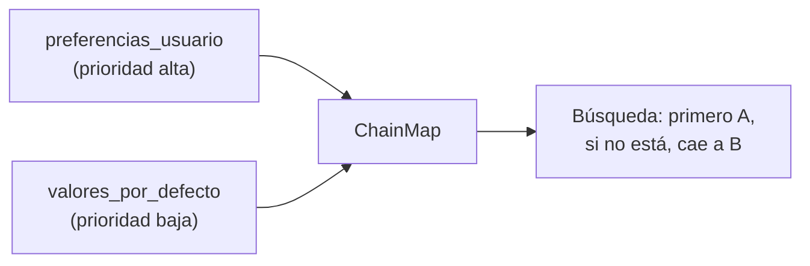

# 46 - Collections en Profundidad

> Continúa de [[45 - Estilo Pythonico y Buenas Prácticas|45]] y abre el bloque de estructuras y datos avanzados. [[05 - Lists and Tuples|05]], [[06 - Dictionaries|06]] y [[07 - Sets|07]] cubrieron las estructuras nativas; el módulo `collections` extiende esas estructuras con variantes especializadas para problemas muy comunes.

## `deque`: Cola de Doble Extremo

Una lista normal es ineficiente para insertar/eliminar por el **principio** (`O(n)`, porque todos los elementos deben desplazarse). `deque` (_double-ended queue_) hace ambos extremos `O(1)`.

```python
from collections import deque

cola = deque([1, 2, 3])

cola.append(4)        # agrega al final -> O(1)
cola.appendleft(0)     # agrega al inicio -> O(1)  (una lista normal sería O(n) con insert(0, ...))
print(cola)  # deque([0, 1, 2, 3, 4])

cola.pop()             # quita del final -> O(1)
cola.popleft()          # quita del inicio -> O(1)
print(cola)  # deque([1, 2, 3])

# maxlen: un buffer circular automático (útil para "últimos N eventos")
historial = deque(maxlen=3)
for evento in ["a", "b", "c", "d", "e"]:
    historial.append(evento)
print(historial)  # deque(['c', 'd', 'e'], maxlen=3) -> los más viejos se descartan solos
```

| Operación | `list` | `deque` |
|---|---|---|
| Agregar/quitar al final | O(1) | O(1) |
| Agregar/quitar al inicio | O(n) | O(1) |
| Acceso por índice aleatorio | O(1) | O(n) |

`deque` es la estructura correcta para colas (BFS en grafos/árboles, ver [[18 - Data Structures and Algorithms|18]]), historiales de tamaño fijo, y buffers de streaming.

## `Counter`: Contando Elementos

```python
from collections import Counter

palabras = "el gato come pescado y el perro come carne y el gato duerme".split()
conteo = Counter(palabras)

print(conteo)                    # Counter({'el': 3, 'come': 2, 'gato': 2, ...})
print(conteo["el"])              # 3
print(conteo["inexistente"])     # 0 -> a diferencia de un dict normal, NO lanza KeyError
print(conteo.most_common(2))     # [('el', 3), ('come', 2)] -> los 2 más frecuentes

# Operaciones aritméticas entre Counters
c1 = Counter(a=3, b=1)
c2 = Counter(a=1, b=2)
print(c1 + c2)   # Counter({'a': 4, 'b': 3}) -> suma
print(c1 - c2)   # Counter({'a': 2})          -> resta (descarta valores <= 0)
```

`Counter` es una subclase de `dict` con `defaultdict`-like behavior integrado para claves faltantes (devuelve `0` en vez de lanzar `KeyError`).

## `defaultdict`: Diccionarios con Valor por Defecto Automático

```python
from collections import defaultdict

# Sin defaultdict: hay que verificar manualmente si la clave existe
grupos = {}
for nombre, categoria in [("Ana", "A"), ("Luis", "B"), ("Eva", "A")]:
    if categoria not in grupos:
        grupos[categoria] = []
    grupos[categoria].append(nombre)

# Con defaultdict: la lógica de "crear si no existe" desaparece
grupos = defaultdict(list)
for nombre, categoria in [("Ana", "A"), ("Luis", "B"), ("Eva", "A")]:
    grupos[categoria].append(nombre)   # si "categoria" no existe, se crea list() automáticamente

print(dict(grupos))  # {'A': ['Ana', 'Eva'], 'B': ['Luis']}
```

El argumento de `defaultdict` es cualquier **función invocable sin argumentos** que produce el valor por defecto: `list`, `int` (produce `0`), `set`, o incluso una lambda/función propia:

```python
contador_anidado = defaultdict(lambda: defaultdict(int))
contador_anidado["ventas"]["enero"] += 100
contador_anidado["ventas"]["febrero"] += 50
print(dict(contador_anidado["ventas"]))  # {'enero': 100, 'febrero': 50}
```

## `OrderedDict`: ¿Sigue Siendo Necesario?

Antes de Python 3.7, los diccionarios normales **no** garantizaban orden de inserción — `OrderedDict` existía específicamente para eso.

```python
from collections import OrderedDict

od = OrderedDict()
od["b"] = 2
od["a"] = 1
print(od)  # OrderedDict([('b', 2), ('a', 1)]) -> preserva el orden de inserción
```

> **Desde Python 3.7, los `dict` normales ya garantizan orden de inserción** como parte del lenguaje (no solo detalle de implementación). `OrderedDict` sigue teniendo dos diferencias reales: soporta `move_to_end()` de forma nativa, y su comparación de igualdad **sí considera el orden** (`OrderedDict([("a",1),("b",2)]) != OrderedDict([("b",2),("a",1)])`, mientras que dos `dict` normales con las mismas claves/valores son iguales sin importar el orden).

## `ChainMap`: Combinando Varios Diccionarios sin Copiarlos

```python
from collections import ChainMap

valores_por_defecto = {"color": "azul", "tamaño": "M"}
preferencias_usuario = {"tamaño": "L"}

config = ChainMap(preferencias_usuario, valores_por_defecto)
print(config["tamaño"])   # "L"  -> busca primero en preferencias_usuario
print(config["color"])    # "azul" -> no está en preferencias_usuario, cae al siguiente mapa

config["tamaño"] = "XL"   # SOLO modifica el primer diccionario de la cadena
print(preferencias_usuario)  # {'tamaño': 'XL'}
print(valores_por_defecto)   # {'color': 'azul', 'tamaño': 'M'}  -> sin cambios
```

`ChainMap` es ideal para resolver **capas de configuración con prioridad** (argumentos de línea de comandos > variables de entorno > archivo de config > valores por defecto) sin fusionar copias completas de cada capa.



## `namedtuple`: la Versión Ligera de `NamedTuple` de `typing`

```python
from collections import namedtuple

Punto = namedtuple("Punto", ["x", "y"])
p = Punto(1, 2)
print(p.x, p[0])  # 1 1

# namedtuple con valores por defecto
Configuracion = namedtuple("Configuracion", ["host", "puerto"], defaults=["localhost", 8080])
print(Configuracion())          # Configuracion(host='localhost', puerto=8080)
print(Configuracion("prod.com"))  # Configuracion(host='prod.com', puerto=8080)
```

`collections.namedtuple` y `typing.NamedTuple` (ver [[40 - Dataclasses, NamedTuple y Comparativa con Attrs-Pydantic|40]]) generan resultados prácticamente idénticos — la diferencia es de **sintaxis**: `namedtuple` usa una fábrica funcional (útil para generar tipos dinámicamente), mientras `typing.NamedTuple` usa sintaxis de clase con type hints (mejor integración con mypy/pyright).

## Resumen: Cuál Usar y Cuándo

| Necesitas... | Usa |
|---|---|
| Insertar/quitar eficientemente por ambos extremos | `deque` |
| Contar frecuencias de elementos | `Counter` |
| Un diccionario que nunca lance `KeyError` en lectura (crea el valor solo) | `defaultdict` |
| Combinar varias fuentes de configuración con prioridad, sin copiarlas | `ChainMap` |
| Un registro inmutable simple, accesible por nombre e índice | `namedtuple` (o `typing.NamedTuple` si ya usas type hints) |
| Garantizar orden y comparación sensible al orden (raro hoy en día) | `OrderedDict` |

## Ver también

- [[05 - Lists and Tuples]], [[06 - Dictionaries]], [[07 - Sets]] — las estructuras nativas que `collections` extiende.
- [[18 - Data Structures and Algorithms]] — `deque` como estructura base para BFS y colas.
- [[40 - Dataclasses, NamedTuple y Comparativa con Attrs-Pydantic]] — la alternativa moderna y tipada a `namedtuple`.
- [[47 - Datos Binarios]] — el siguiente nivel de estructuras especializadas, para datos binarios.
