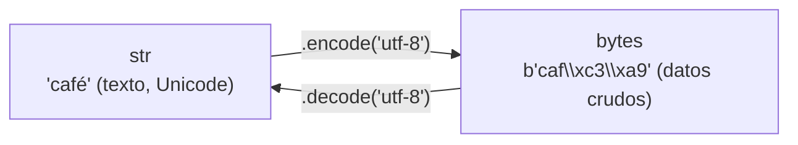

# 47 - Datos Binarios

> Continúa de [[46 - Collections en Profundidad|46]]. Hasta ahora casi todo el contenido trabajó con datos de "alto nivel" (`str`, `int`, objetos). Este archivo cubre cómo Python maneja **bytes crudos** — necesario para redes, formatos de archivo binarios, y compatibilidad con C.

## `bytes` vs `str`: la Distinción Fundamental

```python
texto = "café"           # str: secuencia de caracteres Unicode (texto)
datos = b"caf\xc3\xa9"    # bytes: secuencia de números enteros 0-255 (datos crudos)

print(type(texto), type(datos))  # <class 'str'> <class 'bytes'>

# Convertir entre ambos requiere ESPECIFICAR una codificación
codificado = texto.encode("utf-8")     # str -> bytes
decodificado = codificado.decode("utf-8")  # bytes -> str

print(codificado)     # b'caf\xc3\xa9'
print(decodificado)   # "café"
```



> **Error clásico:** un `UnicodeDecodeError` casi siempre significa que decodificaste con la codificación equivocada (por ejemplo, un archivo guardado en `latin-1` que intentas leer asumiendo `utf-8`). Ver [[13 - Files Handling|13 - Files Handling]] para el manejo de codificaciones al leer/escribir archivos de texto.

## `bytes` es Inmutable, `bytearray` es Mutable

```python
datos = b"hola"
# datos[0] = 72  # TypeError: 'bytes' object does not support item assignment

datos_mutables = bytearray(b"hola")
datos_mutables[0] = 72         # 'H' en ASCII
print(datos_mutables)          # bytearray(b'Hola')
print(bytes(datos_mutables))   # b'Hola' -> convertir de vuelta a inmutable
```

La relación entre `bytes`/`bytearray` es exactamente análoga a la de `tuple`/`list` o `frozenset`/`set` (ver [[26 - Modelo de Objetos y Memoria en CPython|26]]): mismo comportamiento, distinta mutabilidad.

## `struct`: Empaquetando/Desempaquetando Datos Binarios con Formato Fijo

`struct` convierte entre valores de Python y su representación binaria exacta (como la usaría un programa en C), útil para leer formatos de archivo binarios o protocolos de red.

```python
import struct

# '>' = big-endian, 'I' = unsigned int (4 bytes), 'f' = float (4 bytes), 'H' = unsigned short (2 bytes)
formato = ">IfH"

datos_empaquetados = struct.pack(formato, 1000, 3.14, 42)
print(datos_empaquetados)             # b'\x00\x00\x03\xe8@I\x0f\xdb\x00*'
print(len(datos_empaquetados))        # 10 bytes = 4 + 4 + 2

valores = struct.unpack(formato, datos_empaquetados)
print(valores)                        # (1000, 3.140000104904175, 42)
```

| Código de formato | Tipo C | Tamaño (bytes) |
|---|---|---|
| `B` | unsigned char | 1 |
| `H` | unsigned short | 2 |
| `I` | unsigned int | 4 |
| `Q` | unsigned long long | 8 |
| `f` | float | 4 |
| `d` | double | 8 |
| `s` | char[] (string de bytes fijo) | variable |

`struct` es la herramienta correcta para leer cabeceras de archivos binarios (imágenes, audio, formatos propietarios) o implementar un protocolo de red de bajo nivel con `socket`.

## `memoryview`: Accediendo a Bytes sin Copiar Memoria

```python
datos = bytearray(b"Hola Mundo")
vista = memoryview(datos)

# Modificar a través de la vista modifica el buffer ORIGINAL, sin copiar nada
vista[0:4] = b"Chao"
print(datos)  # bytearray(b'Chao Mundo')

# Slicing de memoryview NO copia (a diferencia de slicing normal de bytes/bytearray)
sub_vista = vista[5:]
print(bytes(sub_vista))  # b'Mundo'
```

```python
# Comparación de rendimiento conceptual con un buffer grande
datos_grandes = bytearray(10_000_000)

copia = datos_grandes[1000:2000]         # copia 1000 bytes -> nueva asignación de memoria
vista = memoryview(datos_grandes)[1000:2000]  # NO copia -> solo referencia la región
```

`memoryview` es crítico cuando procesas archivos o streams de red grandes: evita copias innecesarias de memoria que `bytes`/`bytearray` slicing sí haría. NumPy y librerías de I/O de alto rendimiento usan este protocolo internamente (el "protocolo de buffer" de Python).

## `array`: Arrays Homogéneos y Compactos (Anterior a NumPy)

```python
from array import array

# 'i' = enteros con signo; todos los elementos DEBEN ser del mismo tipo
enteros = array("i", [1, 2, 3, 4, 5])
print(enteros)              # array('i', [1, 2, 3, 4, 5])
print(enteros.itemsize)      # 4 (bytes por elemento)

enteros.append(6)
# enteros.append("texto")   # TypeError: solo acepta el tipo declarado
```

| | `list` | `array` | `numpy.ndarray` |
|---|---|---|---|
| Tipos mixtos permitidos | Sí | No (homogéneo) | No (homogéneo) |
| Memoria contigua compacta | No (array de punteros a objetos) | Sí | Sí |
| Operaciones vectorizadas | No | No | Sí |
| Uso típico | Propósito general | Casos simples de memoria compacta sin depender de NumPy | Cómputo numérico serio (ver `Python/NumPy/`) |

En la práctica, si el proyecto ya usa NumPy (casi cualquier trabajo de ciencia de datos), `array` del stdlib rara vez se justifica — NumPy ofrece lo mismo y mucho más.

## Codificación Base64: Representando Binario como Texto

```python
import base64

datos_binarios = b"Datos que necesitan viajar por un canal solo de texto"

codificado = base64.b64encode(datos_binarios)
print(codificado)   # b'RGF0b3MgcXVlIG5lY2VzaXRhbiB2aWFqYXIgcG9yIHVuIGNhbmFsIHNvbG8gZGUgdGV4dG8='

decodificado = base64.b64decode(codificado)
print(decodificado == datos_binarios)  # True
```

Base64 es imprescindible cuando necesitas incrustar datos binarios (una imagen, un archivo) dentro de un formato de solo texto — JSON, XML, o el cuerpo de un email — ver [[14 - JSON and YAML|14 - JSON and YAML]].

## Ver también

- [[13 - Files Handling]] — modos de apertura de archivos (`"rb"`, `"wb"`) que producen/consumen `bytes`.
- [[46 - Collections en Profundidad]] — el bloque anterior de estructuras de datos especializadas.
- [[48 - Serialización Avanzada]] — `pickle`, que serializa objetos Python completos a `bytes`.
- `Python/NumPy/` — la evolución natural de `array` para cómputo numérico serio.
