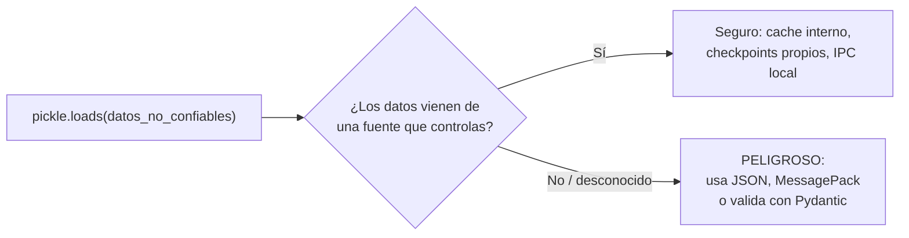

# 48 - Serialización Avanzada

> Continúa de [[47 - Datos Binarios|47]] y cierra el bloque de estructuras y datos avanzados. [[14 - JSON and YAML|14]] cubrió la serialización a formatos de texto legibles por humanos; aquí se cubre `pickle`, la serialización nativa de Python que persiste **cualquier** objeto, junto con sus riesgos y alternativas.

## `pickle`: Serializando Objetos Python Arbitrarios

A diferencia de JSON (que solo entiende tipos básicos: strings, números, listas, diccionarios), `pickle` puede serializar prácticamente **cualquier objeto de Python**: instancias de clases personalizadas, funciones (con limitaciones), estructuras anidadas complejas.

```python
import pickle

class Punto:
    def __init__(self, x, y):
        self.x, self.y = x, y

    def __repr__(self):
        return f"Punto({self.x}, {self.y})"

datos = {
    "puntos": [Punto(1, 2), Punto(3, 4)],
    "metadata": {"version": 1, "activo": True},
}

# Serializar a bytes
datos_serializados = pickle.dumps(datos)
print(type(datos_serializados))  # <class 'bytes'>

# Deserializar de vuelta al objeto Python original
datos_recuperados = pickle.loads(datos_serializados)
print(datos_recuperados)  # {'puntos': [Punto(1, 2), Punto(3, 4)], 'metadata': {...}}

# Trabajando directamente con archivos
with open("datos.pkl", "wb") as f:
    pickle.dump(datos, f)

with open("datos.pkl", "rb") as f:
    datos_desde_archivo = pickle.load(f)
```

> `pickle` requiere que la **definición de la clase** (`Punto` en este ejemplo) esté disponible en el proceso que deserializa — un `.pkl` no incluye el código de la clase, solo referencias a ella por nombre de módulo. Deserializar un pickle sin tener acceso al mismo módulo/clase lanza `AttributeError` o `ModuleNotFoundError`.

## ⚠️ El Riesgo de Seguridad de `pickle`

```python
# NUNCA hagas esto con datos de una fuente no confiable:
datos_maliciosos = obtener_de_internet()  # podría ser CUALQUIER cosa
objeto = pickle.loads(datos_maliciosos)   # puede ejecutar código arbitrario en tu máquina
```

`pickle.loads` puede ejecutar código Python arbitrario durante la deserialización (a través del método especial `__reduce__` que cualquier clase puede definir). Un pickle malicioso construido a mano puede, por ejemplo, borrar archivos o abrir una conexión a un atacante — sin que el código se vea sospechoso a simple vista.



> **Regla práctica:** usa `pickle` solo para datos que **tú mismo generaste** y controlas completamente (checkpoints de modelos de ML entre procesos propios, cachés internos, comunicación entre procesos de tu propia aplicación con `multiprocessing`). Para cualquier dato que cruce una frontera de confianza (una API, un archivo subido por un usuario, un mensaje de una cola externa), usa JSON ([[14 - JSON and YAML|14]]) o valida la estructura con Pydantic ([[40 - Dataclasses, NamedTuple y Comparativa con Attrs-Pydantic|40]]). Ver [[62 - Seguridad en Python|62]] para el panorama completo de riesgos de deserialización.

## `marshal`: Aún Más Bajo Nivel (y de Uso Aún Más Restringido)

`marshal` es el formato interno que CPython usa para serializar **código compilado** (los `.pyc` mencionados en [[30 - Bytecode e Internals del Intérprete|30]]) — no está pensado para uso general.

```python
import marshal

datos_simples = {"a": 1, "b": [1, 2, 3]}
serializado = marshal.dumps(datos_simples)
recuperado = marshal.loads(serializado)
```

| | `marshal` | `pickle` |
|---|---|---|
| Propósito | Formato interno de CPython (bytecode) | Serialización general de objetos Python |
| Estabilidad entre versiones | **No garantizada** — puede cambiar entre versiones de Python | Estable, con protocolos versionados |
| Tipos soportados | Muy limitado | Prácticamente cualquier objeto |
| Uso recomendado en código de aplicación | Nunca directamente | Sí, con las precauciones de seguridad ya mencionadas |

## Protocolos de `pickle` y Compatibilidad

```python
import pickle

# El protocolo determina el formato binario exacto; protocolos más nuevos son más eficientes
print(pickle.HIGHEST_PROTOCOL)  # el más nuevo disponible en tu versión de Python

datos_serializados = pickle.dumps(datos, protocol=pickle.HIGHEST_PROTOCOL)

# Para compatibilidad entre versiones distintas de Python, fija un protocolo específico
datos_compatibles = pickle.dumps(datos, protocol=4)  # protocolo 4: compatible desde Python 3.4+
```

## Comparativa: JSON vs Pickle vs MessagePack

| | JSON | `pickle` | MessagePack (librería externa) |
|---|---|---|---|
| Legible por humanos | Sí | No (binario) | No (binario) |
| Tipos de Python soportados | Básicos (str, int, float, bool, list, dict, None) | Prácticamente cualquiera | Básicos + extensiones tipadas |
| Interoperable con otros lenguajes | Sí (estándar universal) | No (específico de Python) | Sí (estándar multiplataforma) |
| Seguro con datos no confiables | Sí | **No** | Sí |
| Tamaño/velocidad | Moderado | Rápido, compacto | Muy compacto y rápido |
| Uso típico | APIs, configuración, interoperabilidad | Checkpoints internos, caché, `multiprocessing` | Sistemas de alto rendimiento, colas de mensajes |

```python
# multiprocessing usa pickle internamente para pasar datos entre procesos
from multiprocessing import Pool

def cuadrado(x):
    return x ** 2

with Pool(4) as pool:
    # los argumentos y resultados se serializan con pickle para cruzar el límite de proceso
    resultados = pool.map(cuadrado, range(10))
```

Esto explica una limitación práctica de [[57 - Paralelismo Real|57 - Paralelismo Real]]: las funciones pasadas a `multiprocessing` deben ser **"picklables"** (definidas a nivel de módulo, no lambdas ni funciones anidadas), porque necesitan serializarse para viajar al proceso hijo.

## Ver también

- [[14 - JSON and YAML]] — la alternativa segura e interoperable para datos que cruzan fronteras de confianza.
- [[62 - Seguridad en Python]] — el panorama completo de riesgos de deserialización insegura.
- [[57 - Paralelismo Real]] — por qué `multiprocessing` depende de que los datos sean "picklables".
- [[47 - Datos Binarios]] — `bytes`, el formato de salida de `pickle.dumps`.
