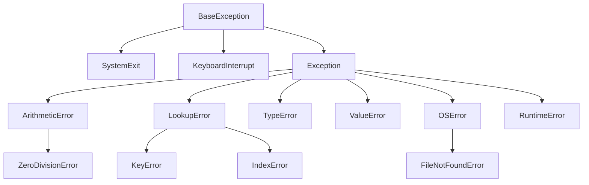
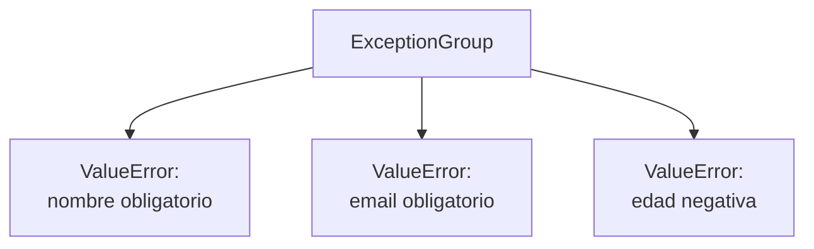

# 49 - Excepciones Avanzadas

> Continúa de [[48 - Serialización Avanzada|48]] y abre el bloque de errores, IO y sistema. [[11 - Exception Handling|11]] cubrió `try`/`except`/`finally`; aquí se profundiza en la jerarquía de excepciones, excepciones personalizadas, encadenamiento, y la novedad de Python 3.11: los grupos de excepciones.

## La Jerarquía de Excepciones Built-in



> **Nota crítica:** `except Exception:` **no** captura `SystemExit` ni `KeyboardInterrupt` (ambos heredan de `BaseException`, no de `Exception`) — es intencional, para que `Ctrl+C` o `sys.exit()` sigan funcionando incluso dentro de un bloque `try` genérico. Un `except:` desnudo (sin especificar tipo) sí captura todo, incluyendo esos dos casos — por eso está fuertemente desaconsejado.

```python
try:
    print("procesando...")
except:  # MAL: captura hasta KeyboardInterrupt, dificultando detener el programa con Ctrl+C
    pass

try:
    print("procesando...")
except Exception:  # BIEN: captura errores de la aplicación, respeta Ctrl+C
    pass
```

## Excepciones Personalizadas

```python
class ErrorDeAplicacion(Exception):
    """Excepción base para todos los errores de esta aplicación."""
    pass

class SaldoInsuficienteError(ErrorDeAplicacion):
    def __init__(self, saldo_actual, monto_solicitado):
        self.saldo_actual = saldo_actual
        self.monto_solicitado = monto_solicitado
        super().__init__(
            f"Saldo insuficiente: disponible {saldo_actual}, solicitado {monto_solicitado}"
        )

class CuentaBloqueadaError(ErrorDeAplicacion):
    pass

def retirar(saldo, monto):
    if monto > saldo:
        raise SaldoInsuficienteError(saldo, monto)
    return saldo - monto

try:
    retirar(100, 500)
except SaldoInsuficienteError as e:
    print(f"Error: {e}")
    print(e.saldo_actual, e.monto_solicitado)  # atributos custom disponibles
except ErrorDeAplicacion:
    print("Otro error de la aplicación")
```

**Por qué crear una jerarquía propia:** permite capturar errores con distinto nivel de granularidad (`except SaldoInsuficienteError` específico, o `except ErrorDeAplicacion` genérico) sin depender de excepciones built-in genéricas como `ValueError`, que podrían confundirse con errores de validación no relacionados con tu dominio.

## `raise ... from ...`: Encadenamiento Explícito de Excepciones

```python
def cargar_configuracion(ruta):
    try:
        with open(ruta) as f:
            return f.read()
    except FileNotFoundError as e:
        raise RuntimeError(f"No se pudo cargar la configuración desde {ruta}") from e

try:
    cargar_configuracion("config.json")
except RuntimeError as e:
    print(e)
    print(e.__cause__)  # la excepción ORIGINAL (FileNotFoundError), preservada explícitamente
```

Sin `from e`, Python igual muestra la excepción original como contexto implícito (`__context__`), pero con el texto genérico "During handling of the above exception, another exception occurred" — `raise ... from ...` comunica **intencionalidad**: "esta nueva excepción reemplaza deliberadamente a la anterior, y aquí está la causa raíz para debugging".

```python
# Suprimir la cadena de causalidad por completo cuando el contexto original no aporta valor
raise RuntimeError("Error genérico") from None
```

## Exception Groups (Python 3.11+): Múltiples Errores Simultáneos

Antes de 3.11, una operación solo podía propagar **una** excepción a la vez. Los **exception groups** (PEP 654) permiten agrupar varios errores independientes que ocurrieron "al mismo tiempo" — típicamente en código concurrente.

```python
def validar_formulario(datos):
    errores = []
    if not datos.get("nombre"):
        errores.append(ValueError("El nombre es obligatorio"))
    if not datos.get("email"):
        errores.append(ValueError("El email es obligatorio"))
    if datos.get("edad", 0) < 0:
        errores.append(ValueError("La edad no puede ser negativa"))

    if errores:
        raise ExceptionGroup("Errores de validación", errores)

try:
    validar_formulario({"edad": -5})
except* ValueError as eg:   # sintaxis 'except*': captura excepciones DENTRO del grupo
    for error in eg.exceptions:
        print(f"- {error}")
# - El nombre es obligatorio
# - El email es obligatorio
# - La edad no puede ser negativa
```



`except*` puede filtrar por tipo, dejando pasar los errores que no coinciden hacia otro `except*` o propagándolos en un `ExceptionGroup` residual — muy usado en conjunto con `asyncio.TaskGroup` (ver [[54 - Asyncio en Profundidad|54]]), donde varias tareas concurrentes pueden fallar de forma independiente.

## `contextlib.suppress`: Ignorando Excepciones Específicas de Forma Explícita

```python
from contextlib import suppress

# Antes: try/except/pass, funcional pero verboso para el caso "ignorar a propósito"
try:
    os.remove("archivo_temporal.txt")
except FileNotFoundError:
    pass

# Con suppress: la intención es más clara de un vistazo
with suppress(FileNotFoundError):
    os.remove("archivo_temporal.txt")
```

Se profundiza en `contextlib` como herramienta general en [[50 - Context Managers Avanzados|50]].

## EAFP y el Costo Real de las Excepciones

Retomando [[45 - Estilo Pythonico y Buenas Prácticas|45]]: lanzar una excepción en CPython tiene un costo medible (construir el objeto excepción, capturar el traceback), pero **entrar** en un bloque `try` sin que se lance nada es prácticamente gratis.

```python
import timeit

# Costo de un try/except cuando NO se lanza excepción: insignificante
def con_try_sin_error():
    try:
        return 10 / 2
    except ZeroDivisionError:
        return None

# Costo cuando SÍ se lanza y captura una excepción: notablemente mayor
def con_try_con_error():
    try:
        return 10 / 0
    except ZeroDivisionError:
        return None

print(timeit.timeit(con_try_sin_error, number=1_000_000))  # rápido
print(timeit.timeit(con_try_con_error, number=1_000_000))   # notablemente más lento
```

**Conclusión práctica:** EAFP es eficiente cuando el error es la **excepción real** (poco frecuente); si esperas que el "error" ocurra en una fracción significativa de las llamadas (por ejemplo, validar formato de más del 50% de las entradas), LBYL explícito puede ser más rápido — mide con [[58 - Profiling y Optimización de Rendimiento|58]] antes de asumir cuál es más rápido en tu caso concreto.

## Ver también

- [[11 - Exception Handling]] — la base de `try`/`except`/`finally` que este archivo extiende.
- [[45 - Estilo Pythonico y Buenas Prácticas]] — EAFP vs LBYL, el trade-off filosófico detrás de este archivo.
- [[54 - Asyncio en Profundidad]] — `TaskGroup` y `except*` aplicados a concurrencia real.
- [[50 - Context Managers Avanzados]] — `contextlib.suppress` y otras utilidades relacionadas.
