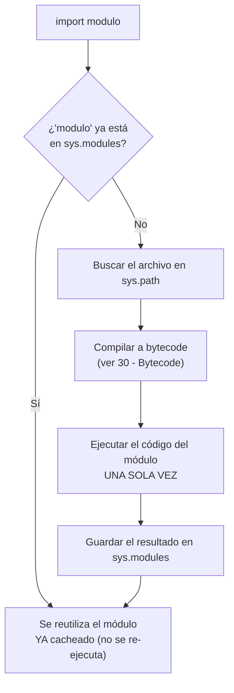

# 51 - Módulos e Imports a Fondo

> Continúa de [[50 - Context Managers Avanzados|50]]. `import` es una de las primeras cosas que se aprenden en Python, pero pocas veces se explica **qué hace realmente** — este archivo cubre el sistema de módulos completo: resolución de rutas, cacheo, imports circulares y paquetes.

## Qué Pasa Realmente al Hacer `import`



```python
import sys

print("mi_modulo" in sys.modules)  # False, antes de importarlo

import json
print("json" in sys.modules)  # True, después de importarlo

print(id(json) == id(sys.modules["json"]))  # True -> es literalmente el mismo objeto
```

Esto explica por qué un módulo es efectivamente un **singleton** (ver [[41 - Patrones de Diseño Pythonicos|41]]): sin importar cuántas veces distintos archivos hagan `import config`, todos comparten la misma instancia ejecutada una sola vez.

## `sys.path`: Dónde Busca Python los Módulos

```python
import sys
for ruta in sys.path:
    print(ruta)
```

Python busca módulos, en orden, en:

1. El directorio del script que se está ejecutando (o el directorio actual en modo interactivo).
2. Las rutas en la variable de entorno `PYTHONPATH`.
3. Las rutas de instalación estándar de la librería y de paquetes de terceros (`site-packages`, dentro del [[22 - Virtual Environments|entorno virtual]] activo).

```python
# Modificar sys.path en runtime (útil en scripts sueltos, evitar en paquetes reales)
sys.path.insert(0, "/ruta/personalizada")
```

## Paquetes: `__init__.py` y su Rol

```text
mi_paquete/
├── __init__.py
├── modulo_a.py
└── subpaquete/
    ├── __init__.py
    └── modulo_b.py
```

```python
# mi_paquete/__init__.py
from .modulo_a import funcion_publica

__all__ = ["funcion_publica"]   # controla qué se exporta con "from mi_paquete import *"
```

`__init__.py` se ejecuta automáticamente al importar el paquete (`import mi_paquete`) — es el lugar natural para definir qué parte de la API interna se expone como "pública".

### Imports Absolutos vs Relativos

```python
# Import absoluto: ruta completa desde la raíz del paquete instalado
from mi_paquete.subpaquete.modulo_b import funcion

# Import relativo: relativo al módulo actual (solo válido DENTRO de un paquete)
from .modulo_a import funcion          # mismo nivel
from ..subpaquete import modulo_b      # nivel superior
```

> Los imports relativos (`.`, `..`) solo funcionan dentro de un paquete real (con `__init__.py`), nunca en un script ejecutado directamente (`python script.py`) — intentarlo lanza `ImportError: attempted relative import with no known parent package`.

## Namespace Packages (PEP 420): Paquetes sin `__init__.py`

Desde Python 3.3, un directorio **sin** `__init__.py` puede seguir funcionando como paquete (_namespace package_), lo cual permite dividir un mismo paquete lógico en múltiples ubicaciones de disco/distribuciones instalables — una técnica usada por algunos frameworks de plugins.

```text
proyecto_a/mi_paquete/servicio_a.py   (sin __init__.py)
proyecto_b/mi_paquete/servicio_b.py   (sin __init__.py, MISMO nombre 'mi_paquete')
```

```python
import mi_paquete.servicio_a
import mi_paquete.servicio_b   # Python combina ambos directorios como un solo namespace
```

Para paquetes normales de una sola aplicación, seguir usando `__init__.py` explícito es más predecible y sigue siendo la recomendación por defecto — los namespace packages son una herramienta especializada, no la opción por defecto.

## Imports Circulares: Por Qué Ocurren y Cómo Resolverlos

```python
# archivo_a.py
from archivo_b import funcion_b

def funcion_a():
    return funcion_b()

# archivo_b.py
from archivo_a import funcion_a   # ImportError: circular

def funcion_b():
    return funcion_a()
```


El problema ocurre porque, al importar `archivo_a`, Python empieza a ejecutarlo, llega al `import` de `archivo_b`, y **mientras ejecuta `archivo_b`**, este intenta importar `archivo_a` de vuelta — pero `archivo_a` todavía no ha terminado de definirse (está a medias en `sys.modules`).

**Soluciones, de más a menos recomendada:**

```python
# 1. Reestructurar: mover la dependencia compartida a un tercer módulo
# archivo_comun.py
def funcion_compartida(): ...

# 2. Import diferido: importar DENTRO de la función, no al inicio del módulo
def funcion_a():
    from archivo_b import funcion_b   # se resuelve cuando funcion_a() se LLAMA, no al importar
    return funcion_b()

# 3. Solo para type hints: usar TYPE_CHECKING (ver 42 - Type Hints y el Módulo Typing)
from typing import TYPE_CHECKING
if TYPE_CHECKING:
    from archivo_b import ClaseB

def procesar(obj: "ClaseB") -> None: ...
```

La opción 1 (reestructurar) casi siempre es la señal de que el diseño de módulos tiene un problema real de acoplamiento — las opciones 2 y 3 son parches válidos, pero vale la pena preguntarse si la circularidad revela que dos módulos deberían fusionarse o que falta un tercer módulo compartido.

## `importlib`: Imports Programáticos

```python
import importlib

modulo = importlib.import_module("json")   # equivalente a "import json", pero con el nombre como string
print(modulo.dumps({"a": 1}))

# Recargar un módulo ya importado (útil en desarrollo interactivo, notebooks)
importlib.reload(modulo)
```

`importlib.import_module` es la base de sistemas de plugins que descubren módulos dinámicamente por nombre (leído de un archivo de configuración, por ejemplo), sin que el nombre del módulo esté escrito literalmente en el código como un `import` estático.

## `if __name__ == "__main__":` Explicado

```python
# mi_script.py
def funcion_principal():
    print("Ejecutando lógica principal")

if __name__ == "__main__":
    funcion_principal()
```

Cuando un archivo se **ejecuta directamente** (`python mi_script.py`), Python le asigna `__name__ = "__main__"`. Cuando el mismo archivo se **importa** desde otro módulo (`import mi_script`), `__name__` toma el nombre real del módulo (`"mi_script"`). Este patrón permite que un archivo sirva simultáneamente como script ejecutable y como módulo importable, sin que la lógica de "ejecución directa" se dispare accidentalmente al importarlo.

## `from modulo import *`: Por Qué Evitarlo

```python
# modulo.py
__all__ = ["funcion_publica"]   # si se define, "import *" SOLO trae estos nombres

def funcion_publica(): ...
def _funcion_privada(): ...     # el guion bajo también la excluye de "import *" sin __all__
```

Ya se mencionó en [[45 - Estilo Pythonico y Buenas Prácticas|45]]: `import *` rompe la explicitud de dónde viene cada nombre, y puede sobrescribir silenciosamente nombres ya definidos en el módulo que importa. `__all__` al menos delimita qué se expone, pero un import explícito (`from modulo import funcion_publica`) sigue siendo preferible en código de producción.

## Ver también

- [[30 - Bytecode e Internals del Intérprete]] — la compilación a `.pyc` que ocurre durante un import.
- [[42 - Type Hints y el Módulo Typing]] — `TYPE_CHECKING` como solución a imports circulares solo de tipos.
- [[41 - Patrones de Diseño Pythonicos]] — el módulo como singleton natural de Python.
- [[61 - Empaquetado y Distribución]] — cómo estos módulos/paquetes se empaquetan para distribución real.
