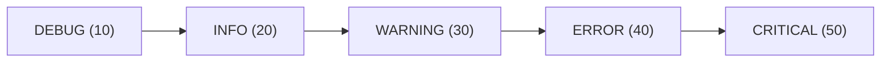
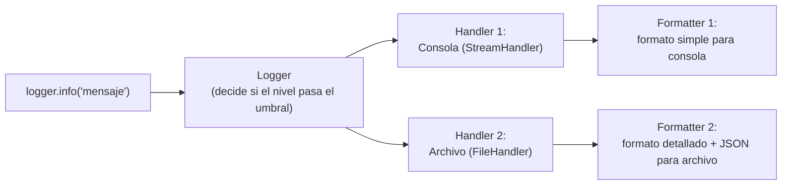
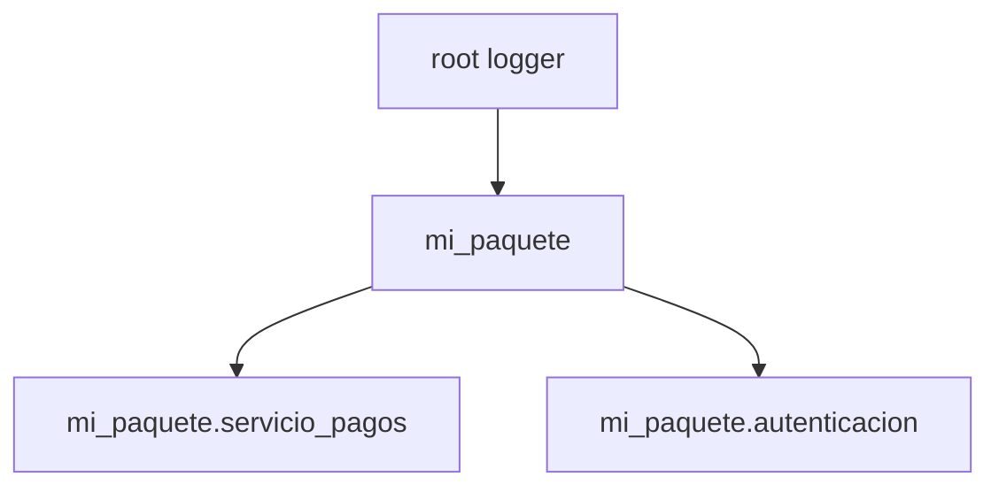

# 52 - Logging Avanzado

> Continúa de [[51 - Módulos e Imports a Fondo|51]]. [[12 - Debugging|12]] mencionó `logging` de pasada como alternativa a `print()`; aquí se cubre la configuración real del módulo — handlers, formatters, niveles por módulo, y logging estructurado para producción.

## Por Qué `logging` en vez de `print()`

```python
# print(): sin niveles, sin timestamps, sin poder desactivarlo selectivamente,
# sin poder redirigir a un archivo distinto según el tipo de mensaje
print("Usuario autenticado:", usuario.id)

# logging: niveles, timestamps, configuración centralizada, múltiples destinos
import logging
logger = logging.getLogger(__name__)
logger.info("Usuario autenticado: %s", usuario.id)
```

| | `print()` | `logging` |
|---|---|---|
| Niveles de severidad | No | Sí (`DEBUG`, `INFO`, `WARNING`, `ERROR`, `CRITICAL`) |
| Se puede desactivar sin tocar el código | No | Sí (cambiar el nivel del logger) |
| Múltiples destinos simultáneos (consola + archivo + red) | No | Sí (handlers) |
| Formato configurable (timestamp, módulo, línea) | Manual | Integrado |
| Apto para producción | No | Sí |

## Los Cinco Niveles de Severidad

```python
import logging

logging.basicConfig(level=logging.DEBUG)
logger = logging.getLogger(__name__)

logger.debug("Detalle técnico solo relevante en desarrollo")
logger.info("Evento normal del flujo de la aplicación")
logger.warning("Algo inesperado, pero la aplicación puede continuar")
logger.error("Un error ocurrió, una operación falló")
logger.critical("Error grave, la aplicación puede no poder continuar")
```



El **nivel** configurado en el logger determina el umbral mínimo que se procesa: si configuras `level=logging.WARNING`, los mensajes `debug()` e `info()` se ignoran silenciosamente — sin necesidad de comentar/quitar esas líneas del código.

## La Arquitectura: Logger, Handler, Formatter, Filter



```python
import logging

logger = logging.getLogger("mi_aplicacion")
logger.setLevel(logging.DEBUG)

# Handler 1: consola, solo INFO en adelante, formato corto
handler_consola = logging.StreamHandler()
handler_consola.setLevel(logging.INFO)
handler_consola.setFormatter(logging.Formatter("%(levelname)s - %(message)s"))

# Handler 2: archivo, TODO desde DEBUG, formato detallado
handler_archivo = logging.FileHandler("app.log")
handler_archivo.setLevel(logging.DEBUG)
handler_archivo.setFormatter(
    logging.Formatter("%(asctime)s - %(name)s - %(levelname)s - %(message)s")
)

logger.addHandler(handler_consola)
logger.addHandler(handler_archivo)

logger.debug("Solo va al archivo")          # no aparece en consola (nivel INFO ahí)
logger.info("Va a ambos destinos")
```

Un mismo evento puede terminar en **varios destinos simultáneamente**, cada uno con su propio nivel mínimo y formato — algo imposible de replicar limpiamente con `print()`.

## `getLogger(__name__)`: Loggers por Módulo

```python
# archivo: mi_paquete/servicio_pagos.py
import logging
logger = logging.getLogger(__name__)   # __name__ == "mi_paquete.servicio_pagos"
```

Usar `__name__` crea una **jerarquía de loggers** que refleja la estructura de paquetes/módulos, permitiendo configurar niveles de forma granular:

```python
logging.getLogger("mi_paquete").setLevel(logging.WARNING)          # todo el paquete
logging.getLogger("mi_paquete.servicio_pagos").setLevel(logging.DEBUG)  # excepción específica
```



Un mensaje registrado en `mi_paquete.servicio_pagos` "burbujea" hacia arriba en la jerarquía por defecto (`propagate=True`), a menos que se desactive explícitamente.

## `dictConfig`: Configuración Centralizada (Recomendada en Producción)

```python
import logging.config

configuracion = {
    "version": 1,
    "disable_existing_loggers": False,
    "formatters": {
        "simple": {"format": "%(levelname)s - %(message)s"},
        "detallado": {"format": "%(asctime)s - %(name)s - %(levelname)s - %(message)s"},
    },
    "handlers": {
        "consola": {"class": "logging.StreamHandler", "level": "INFO", "formatter": "simple"},
        "archivo": {
            "class": "logging.handlers.RotatingFileHandler",
            "level": "DEBUG",
            "formatter": "detallado",
            "filename": "app.log",
            "maxBytes": 10_000_000,
            "backupCount": 5,
        },
    },
    "loggers": {
        "mi_paquete": {"handlers": ["consola", "archivo"], "level": "DEBUG"},
    },
}

logging.config.dictConfig(configuracion)
```

`dictConfig` (habitualmente cargado desde un archivo YAML/JSON de configuración, ver [[14 - JSON and YAML|14]]) permite cambiar el comportamiento de logging **sin tocar el código fuente** — configuración distinta para desarrollo, staging y producción.

## `RotatingFileHandler` y `TimedRotatingFileHandler`

```python
from logging.handlers import RotatingFileHandler, TimedRotatingFileHandler

# Rota el archivo cuando alcanza un tamaño máximo, conservando N backups
handler_tamaño = RotatingFileHandler("app.log", maxBytes=10_000_000, backupCount=5)

# Rota el archivo según un intervalo de tiempo (diario, cada hora, etc.)
handler_tiempo = TimedRotatingFileHandler("app.log", when="midnight", backupCount=7)
```

Sin rotación, un archivo de log de una aplicación de larga duración crece indefinidamente hasta llenar el disco — la rotación es prácticamente obligatoria en cualquier servicio de producción.

## Logging Estructurado (JSON) para Observabilidad Moderna

En sistemas distribuidos, los logs suelen enviarse a plataformas centralizadas (Elasticsearch, Datadog, CloudWatch) que procesan **JSON**, no texto libre:

```python
import logging
import json
from datetime import datetime, timezone

class FormateadorJSON(logging.Formatter):
    def format(self, record):
        entrada = {
            "timestamp": datetime.now(timezone.utc).isoformat(),
            "nivel": record.levelname,
            "logger": record.name,
            "mensaje": record.getMessage(),
        }
        if record.exc_info:
            entrada["excepcion"] = self.formatException(record.exc_info)
        return json.dumps(entrada)

handler = logging.StreamHandler()
handler.setFormatter(FormateadorJSON())

logger = logging.getLogger("app")
logger.addHandler(handler)
logger.info("Solicitud procesada")
# {"timestamp": "2026-09-07T...", "nivel": "INFO", "logger": "app", "mensaje": "Solicitud procesada"}
```

Este es el mismo patrón que `Python/FastAPI/15 - Despliegue y Producción.md` recomienda para servicios contenedorizados: loguear JSON a `stdout`, dejando que el orquestador (Docker/Kubernetes, ver `Kubernetes/`) recolecte y centralice los logs.

## Capturando Excepciones con Traceback Completo

```python
try:
    1 / 0
except ZeroDivisionError:
    logger.exception("Fallo al dividir")  # incluye el traceback COMPLETO automáticamente
    # equivalente a: logger.error("Fallo al dividir", exc_info=True)
```

## Ver también

- [[12 - Debugging]] — la introducción a `logging` que este archivo profundiza.
- [[14 - JSON and YAML]] — el formato típico de logs estructurados y de archivos de configuración de `dictConfig`.
- `Python/FastAPI/15 - Despliegue y Producción.md` — logging estructurado aplicado a un servicio real en producción.
- [[49 - Excepciones Avanzadas]] — `logger.exception()` y el manejo de tracebacks.
