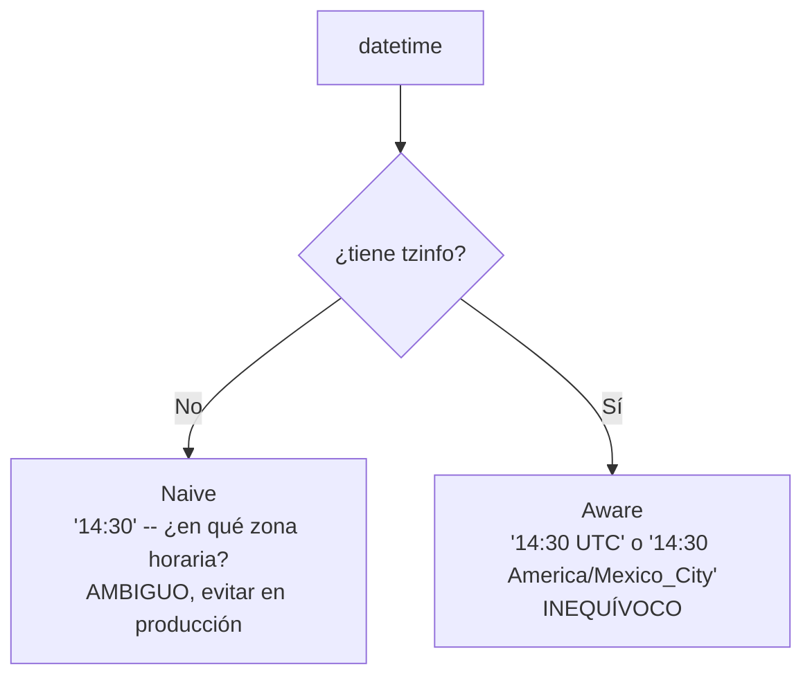

# 53 - Fechas y Zonas Horarias

> Continúa de [[52 - Logging Avanzado|52]] y cierra el bloque de errores, IO y sistema. El manejo de fechas parece trivial hasta que entran en juego zonas horarias, horario de verano, y la diferencia entre "un instante en el tiempo" y "una fecha de calendario" — una fuente clásica de bugs sutiles en producción.

## `datetime`: los Tres Tipos Básicos

```python
from datetime import date, time, datetime, timedelta

hoy = date.today()                    # solo fecha: 2026-09-07
hora_actual = time(14, 30, 0)          # solo hora: 14:30:00
ahora = datetime.now()                 # fecha + hora: 2026-09-07 14:30:00.123456

print(hoy, hora_actual, ahora)
print(ahora.year, ahora.month, ahora.day, ahora.hour, ahora.minute)
```

## `timedelta`: Aritmética de Fechas

```python
from datetime import datetime, timedelta

ahora = datetime.now()
en_una_semana = ahora + timedelta(weeks=1)
hace_30_dias = ahora - timedelta(days=30)

diferencia = en_una_semana - ahora
print(diferencia)            # 7 days, 0:00:00
print(diferencia.total_seconds())  # 604800.0

# Comparaciones directas
if hace_30_dias < ahora:
    print("hace_30_dias es anterior a ahora")
```

## Naive vs Aware: la Distinción Más Importante

Un `datetime` puede ser **naive** (sin información de zona horaria) o **aware** (con zona horaria explícita). Confundirlos es la fuente #1 de bugs de fechas en producción.

```python
from datetime import datetime, timezone

naive = datetime.now()                       # "2026-09-07 14:30:00" -> ¿en qué zona horaria?
aware = datetime.now(timezone.utc)           # "2026-09-07 19:30:00+00:00" -> inequívoco: UTC

print(naive.tzinfo)   # None -> naive
print(aware.tzinfo)   # UTC  -> aware
```



> **Regla práctica:** en cualquier sistema que almacene o compare fechas entre distintas ubicaciones (casi cualquier aplicación real), usa **siempre datetimes aware**, idealmente almacenados en **UTC**, y conviértelos a la zona horaria local del usuario solo al **mostrarlos**. Mezclar naive y aware en la misma comparación lanza `TypeError: can't compare offset-naive and offset-aware datetimes`.

## `zoneinfo`: Zonas Horarias Reales (Python 3.9+)

```python
from datetime import datetime
from zoneinfo import ZoneInfo

utc_ahora = datetime.now(ZoneInfo("UTC"))
mexico = utc_ahora.astimezone(ZoneInfo("America/Mexico_City"))
tokio = utc_ahora.astimezone(ZoneInfo("Asia/Tokyo"))

print(utc_ahora)   # 2026-09-07 19:30:00+00:00
print(mexico)       # 2026-09-07 13:30:00-06:00
print(tokio)         # 2026-09-08 04:30:00+09:00
```

`zoneinfo` (parte del stdlib desde 3.9, usando la base de datos IANA del sistema operativo) reemplazó a la librería externa `pytz`, que durante años fue la única forma confiable de manejar zonas horarias reales en Python — código nuevo debería preferir `zoneinfo`.

```python
# El mismo instante, visto desde distintas zonas horarias: SIEMPRE representa el MISMO momento
print(utc_ahora == mexico == tokio)  # True -> son el mismo instante, solo se muestran distinto
```

## Horario de Verano (DST): Por Qué la Aritmética Naive Falla

```python
from datetime import datetime, timedelta
from zoneinfo import ZoneInfo

# En zonas con horario de verano, sumar "24 horas" no siempre es sumar "1 día calendario"
inicio = datetime(2026, 3, 7, 12, 0, tzinfo=ZoneInfo("America/Mexico_City"))
un_dia_despues = inicio + timedelta(days=1)   # zoneinfo ajusta automáticamente el offset si aplica
print(un_dia_despues)
```

`zoneinfo` maneja las transiciones de DST correctamente al hacer aritmética con `timedelta` — otra razón para evitar reinventar la lógica de zonas horarias manualmente con offsets fijos (`+timedelta(hours=-6)`), que se rompe justo en los días de cambio de horario.

## Formateo y Parseo: `strftime` / `strptime`

```python
from datetime import datetime

ahora = datetime.now()

# strftime: datetime -> string, con un formato específico
formateado = ahora.strftime("%Y-%m-%d %H:%M:%S")
print(formateado)  # "2026-09-07 14:30:00"

formateado_legible = ahora.strftime("%A, %d de %B de %Y")
print(formateado_legible)  # "Monday, 07 de September de 2026" (en inglés por defecto)

# strptime: string -> datetime, especificando el formato EXACTO de entrada
texto = "2026-09-07 14:30:00"
fecha_parseada = datetime.strptime(texto, "%Y-%m-%d %H:%M:%S")
print(fecha_parseada)
```

| Código | Significado | Ejemplo |
|---|---|---|
| `%Y` | Año con 4 dígitos | 2026 |
| `%m` | Mes con 2 dígitos | 09 |
| `%d` | Día con 2 dígitos | 07 |
| `%H:%M:%S` | Hora:Minuto:Segundo (24h) | 14:30:00 |
| `%A` | Nombre completo del día | Monday |
| `%B` | Nombre completo del mes | September |
| `%z` | Offset UTC | +0000 |

## ISO 8601: el Formato Estándar para Interoperabilidad

```python
from datetime import datetime, timezone

ahora = datetime.now(timezone.utc)

iso = ahora.isoformat()          # "2026-09-07T19:30:00+00:00"
print(iso)

recuperado = datetime.fromisoformat(iso)
print(recuperado)
```

**ISO 8601 es el formato recomendado para APIs y almacenamiento** (JSON, bases de datos, ver [[14 - JSON and YAML|14]] y [[24 - Databases|24]]) — es inequívoco, ordenable como string, y prácticamente todo lenguaje/framework lo entiende sin ambigüedad, a diferencia de formatos regionales (`07/09/2026` — ¿es 7 de septiembre o 9 de julio?).

## `time.time()` vs `datetime.now()`: Cuándo Usar Cada Uno

```python
import time
from datetime import datetime

timestamp_unix = time.time()          # segundos desde el 1 de enero de 1970 (float) -> para MEDIR duración
fecha_legible = datetime.now()         # objeto datetime -> para MOSTRAR o ALMACENAR una fecha

inicio = time.perf_counter()           # el más preciso para medir tiempo transcurrido (ver 58 - Profiling)
# ... código a medir ...
duracion = time.perf_counter() - inicio
```

| Necesitas... | Usa |
|---|---|
| Medir cuánto tarda una operación | `time.perf_counter()` |
| Un timestamp Unix simple para logs/protocolo | `time.time()` |
| Representar/mostrar una fecha con año, mes, día | `datetime` |
| Aritmética de fechas (sumar días, comparar) | `datetime` + `timedelta` |
| Zonas horarias reales, con DST correcto | `zoneinfo` |

## Ver también

- [[14 - JSON and YAML]] — cómo serializar fechas (ISO 8601 es el formato recomendado).
- [[24 - Databases]] — tipos de columna `TIMESTAMP`/`DATETIME` y su relación con UTC.
- [[58 - Profiling y Optimización de Rendimiento]] — `time.perf_counter()` para medir rendimiento correctamente.
- [[52 - Logging Avanzado]] — timestamps en formato ISO dentro de logs estructurados.
