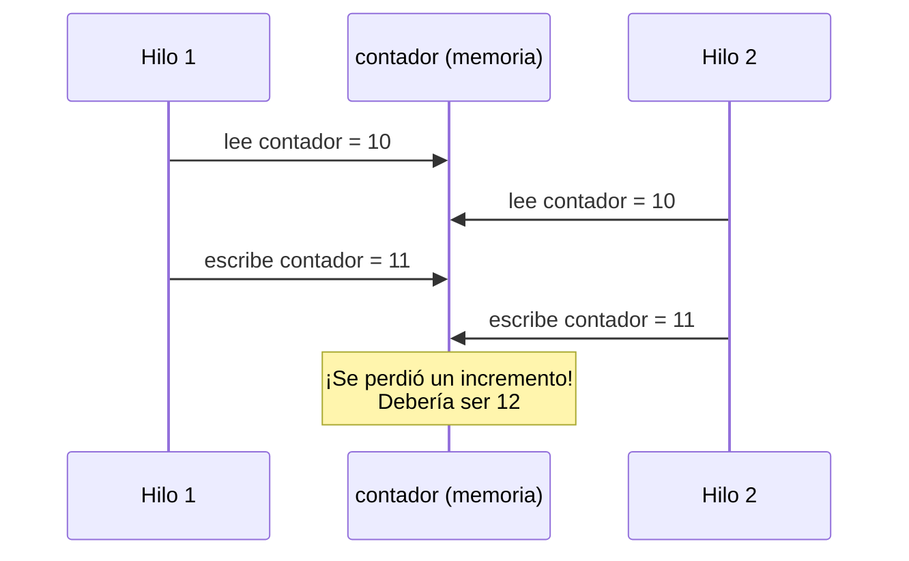
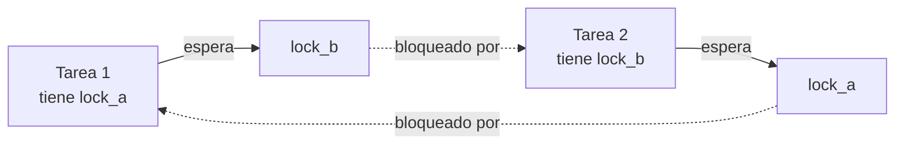

# 56 - Sincronización y Modelos de Concurrencia

> Continúa de [[55 - Async Generators y Async Context Managers|55]]. [[23 - Concurrency|23]] presentó `threading` como una de las tres opciones de concurrencia; aquí se cubre el problema central de compartir estado entre hilos — las **condiciones de carrera** — y las herramientas de sincronización para evitarlas.

## Condiciones de Carrera: el Problema Fundamental

```python
import threading

contador = 0

def incrementar():
    global contador
    for _ in range(100_000):
        contador += 1   # NO es una operación atómica (ver 30 - Bytecode)

hilos = [threading.Thread(target=incrementar) for _ in range(4)]
for h in hilos:
    h.start()
for h in hilos:
    h.join()

print(contador)  # esperarías 400,000 -- casi nunca da ese número exacto
```

Como se explicó en [[30 - Bytecode e Internals del Intérprete|30]], `contador += 1` es en realidad varias instrucciones de bytecode (`LOAD`, `ADD`, `STORE`). El GIL garantiza que cada instrucción **individual** de bytecode sea atómica, pero **no** garantiza que la secuencia completa lo sea — el intérprete puede cambiar de hilo entre esas instrucciones, causando que dos hilos lean el mismo valor antes de que ninguno haya escrito su incremento, perdiendo actualizaciones.



## `threading.Lock`: el Mecanismo Básico de Exclusión Mutua

```python
import threading

contador = 0
lock = threading.Lock()

def incrementar_seguro():
    global contador
    for _ in range(100_000):
        with lock:              # solo UN hilo a la vez puede estar dentro de este bloque
            contador += 1

hilos = [threading.Thread(target=incrementar_seguro) for _ in range(4)]
for h in hilos:
    h.start()
for h in hilos:
    h.join()

print(contador)  # siempre 400,000
```

`with lock:` es azúcar sintáctico sobre `lock.acquire()`/`lock.release()` (ver [[15 - Context Manager|15]]) — garantiza que el lock se libere incluso si ocurre una excepción dentro del bloque protegido.

## Deadlocks: Cuando los Locks se Vuelven el Problema

```python
import threading

lock_a = threading.Lock()
lock_b = threading.Lock()

def tarea_1():
    with lock_a:
        print("Tarea 1 tiene lock_a")
        with lock_b:               # espera lock_b mientras sostiene lock_a
            print("Tarea 1 tiene ambos")

def tarea_2():
    with lock_b:
        print("Tarea 2 tiene lock_b")
        with lock_a:               # espera lock_a mientras sostiene lock_b -> DEADLOCK
            print("Tarea 2 tiene ambos")
```



Si ambas tareas corren simultáneamente y cada una adquiere su primer lock antes de que la otra intente el segundo, ambas quedan esperando indefinidamente — ninguna puede avanzar. **Regla de prevención más simple:** siempre adquiere múltiples locks en el **mismo orden global** en todo el programa.

## Otras Primitivas de Sincronización

```python
import threading

# RLock: un Lock reentrante -- el MISMO hilo puede adquirirlo varias veces sin bloquearse a sí mismo
rlock = threading.RLock()

def funcion_recursiva(n):
    with rlock:
        if n > 0:
            funcion_recursiva(n - 1)   # re-adquirir rlock aquí NO causa deadlock

# Semaphore: permite hasta N hilos simultáneos (no solo 1 como Lock)
semaforo = threading.Semaphore(3)   # máximo 3 hilos accediendo a la vez

def acceso_limitado(id_hilo):
    with semaforo:
        print(f"Hilo {id_hilo} accediendo al recurso limitado")

# Event: señal simple para coordinar hilos (esperar hasta que algo ocurra)
evento = threading.Event()

def esperar_senal():
    print("Esperando señal...")
    evento.wait()          # bloquea hasta que evento.set() sea llamado desde otro hilo
    print("¡Señal recibida!")

def emitir_senal():
    import time
    time.sleep(2)
    evento.set()
```

| Primitiva | Uso típico |
|---|---|
| `Lock` | Proteger una sección crítica accedida por múltiples hilos |
| `RLock` | Lo mismo, pero cuando el mismo hilo necesita adquirirlo recursivamente |
| `Semaphore(n)` | Limitar cuántos hilos acceden a un recurso simultáneamente (ej. pool de conexiones) |
| `Event` | Un hilo espera hasta que otro le "avise" que algo ocurrió |
| `Condition` | Coordinación más compleja: esperar hasta que una condición específica sea verdadera |

## `queue.Queue`: Comunicación Segura entre Hilos (Patrón Productor-Consumidor)

En vez de compartir estado mutable directamente entre hilos (con todos los riesgos anteriores), `Queue` ofrece una estructura **thread-safe** diseñada específicamente para pasar datos entre ellos.

```python
import threading
import queue
import time

cola = queue.Queue()

def productor():
    for i in range(5):
        cola.put(f"item-{i}")
        print(f"Producido: item-{i}")
        time.sleep(0.2)
    cola.put(None)   # señal de "no hay más items"

def consumidor():
    while True:
        item = cola.get()
        if item is None:
            break
        print(f"Consumido: {item}")
        cola.task_done()

hilo_productor = threading.Thread(target=productor)
hilo_consumidor = threading.Thread(target=consumidor)
hilo_productor.start()
hilo_consumidor.start()
hilo_productor.join()
hilo_consumidor.join()
```


`queue.Queue` maneja internamente todo el locking necesario — es casi siempre preferible a compartir listas/diccionarios normales entre hilos con locks manuales, porque el patrón productor-consumidor es tan común que la librería estándar ya lo resuelve correctamente.

## `asyncio` No Necesita Locks... Casi Nunca

```python
import asyncio

contador = 0

async def incrementar_async():
    global contador
    for _ in range(100_000):
        contador += 1   # SIN condición de carrera: un solo hilo, cambios de contexto
                          # solo ocurren en puntos explícitos de 'await'

async def main():
    await asyncio.gather(incrementar_async(), incrementar_async())
    print(contador)  # siempre 200,000 -- no hay carrera porque no hay verdadero paralelismo

asyncio.run(main())
```

Como `asyncio` corre en un solo hilo (ver [[54 - Asyncio en Profundidad|54]]), el código entre dos puntos de `await` se ejecuta de forma atómica respecto a otras corutinas — **siempre y cuando no haya un `await` en medio de una operación que debería ser atómica**. `asyncio.Lock` sí existe para el caso donde una sección crítica *incluye* un `await` y no debe ser interrumpida por otra corutina a mitad de camino.

## Comparativa Final de Herramientas de Sincronización

| | `threading.Lock` | `asyncio.Lock` | `multiprocessing.Lock` |
|---|---|---|---|
| Protege contra | Condiciones de carrera entre hilos | Interleaving entre corutinas con `await` en medio | Condiciones de carrera entre procesos |
| Bloquea el hilo/proceso completo mientras espera | Sí | No (cede el control al event loop) | Sí |
| Usar con | `threading.Thread` | `async def` / `asyncio.gather` | `multiprocessing.Process` |

## Ver también

- [[23 - Concurrency]] — la introducción al GIL y por qué threading tiene sentido solo para I/O.
- [[30 - Bytecode e Internals del Intérprete]] — por qué `contador += 1` no es atómico.
- [[54 - Asyncio en Profundidad]] — por qué `asyncio` evita la mayoría de estos problemas por diseño.
- [[57 - Paralelismo Real]] — `multiprocessing.Lock` y sincronización entre procesos.
