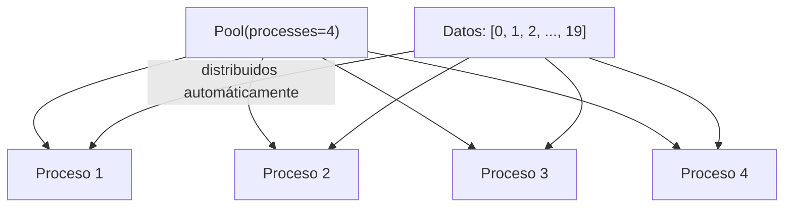

# 57 - Paralelismo Real

> Continúa de [[56 - Sincronización y Modelos de Concurrencia|56]] y cierra el bloque de concurrencia. [[23 - Concurrency|23]] mencionó `multiprocessing` como la única forma de lograr paralelismo real de CPU en CPython (debido al GIL); aquí se profundiza en cómo usarlo correctamente, sus costos, y la API moderna con `concurrent.futures`.

## Por Qué Multiprocessing (y No Threading) para CPU-Bound

```python
import time
from threading import Thread

def tarea_cpu_intensiva(n):
    return sum(i * i for i in range(n))

# Con threading: el GIL impide el paralelismo real -> NO hay mejora de velocidad
inicio = time.perf_counter()
hilos = [Thread(target=tarea_cpu_intensiva, args=(10_000_000,)) for _ in range(4)]
for h in hilos: h.start()
for h in hilos: h.join()
print(f"Threading: {time.perf_counter() - inicio:.2f}s")  # similar a hacerlo secuencial
```

Cada proceso creado por `multiprocessing` tiene su **propio intérprete de Python y su propio GIL** — por eso sí logran paralelismo real en múltiples núcleos de CPU, a diferencia de los hilos.

## `multiprocessing.Process`: la API Básica

```python
from multiprocessing import Process
import os

def trabajo(nombre):
    print(f"Proceso {nombre} (PID {os.getpid()}) trabajando")

if __name__ == "__main__":   # OBLIGATORIO en Windows/macOS (ver más abajo)
    procesos = [Process(target=trabajo, args=(f"P{i}",)) for i in range(4)]
    for p in procesos:
        p.start()
    for p in procesos:
        p.join()
```

> **`if __name__ == "__main__":` es obligatorio** al usar `multiprocessing` en Windows y macOS (con el método de inicio `spawn`, ver más abajo): cada proceso hijo **re-importa** el módulo principal para obtener acceso a la función objetivo, y sin ese guard, esa re-importación volvería a lanzar procesos hijos infinitamente. Ver [[51 - Módulos e Imports a Fondo|51]] para el detalle completo de este patrón.

## `Pool`: Distribuyendo Trabajo entre un Grupo Fijo de Procesos

```python
from multiprocessing import Pool
import time

def calcular_cuadrado(n):
    return n ** 2

if __name__ == "__main__":
    numeros = list(range(20))

    inicio = time.perf_counter()
    with Pool(processes=4) as pool:
        resultados = pool.map(calcular_cuadrado, numeros)
    print(f"Con Pool: {time.perf_counter() - inicio:.4f}s")
    print(resultados)
```

`Pool` administra un número fijo de procesos trabajadores y distribuye automáticamente los elementos de un iterable entre ellos — mucho más simple que crear y unir `Process` individuales manualmente.



## `concurrent.futures`: la API Moderna y Unificada

`concurrent.futures` ofrece una interfaz **idéntica** para threads y procesos, facilitando cambiar entre ambos con un solo cambio de línea:

```python
from concurrent.futures import ThreadPoolExecutor, ProcessPoolExecutor
import time

def tarea_io(segundos):
    time.sleep(segundos)
    return f"Completado tras {segundos}s"

def tarea_cpu(n):
    return sum(i * i for i in range(n))

if __name__ == "__main__":
    # Para I/O-bound: ThreadPoolExecutor (igual que threading, sin GIL como problema aquí)
    with ThreadPoolExecutor(max_workers=4) as executor:
        futuros = [executor.submit(tarea_io, 1) for _ in range(4)]
        resultados = [f.result() for f in futuros]

    # Para CPU-bound: ProcessPoolExecutor (paralelismo real)
    with ProcessPoolExecutor(max_workers=4) as executor:
        futuros = [executor.submit(tarea_cpu, 10_000_000) for _ in range(4)]
        resultados = [f.result() for f in futuros]
```

### `as_completed`: Procesando Resultados a Medida que Terminan

```python
from concurrent.futures import ProcessPoolExecutor, as_completed

def procesar(n):
    import time
    time.sleep(n)
    return n * 10

if __name__ == "__main__":
    tiempos = [3, 1, 2]
    with ProcessPoolExecutor() as executor:
        futuros = {executor.submit(procesar, t): t for t in tiempos}
        for futuro in as_completed(futuros):   # llegan en el orden en que TERMINAN, no en el que se enviaron
            print(f"Resultado: {futuro.result()}")
    # Imprime primero el de 1 segundo, luego el de 2, luego el de 3
```

## Comunicación entre Procesos (IPC)

A diferencia de los hilos (que comparten memoria libremente), los procesos tienen espacios de memoria **separados** — cualquier dato compartido debe serializarse y copiarse explícitamente (ver [[48 - Serialización Avanzada|48]], donde se explicó que `multiprocessing` usa `pickle` internamente para esto).

```python
from multiprocessing import Process, Queue, Value, Array

def productor(cola):
    for i in range(5):
        cola.put(i)

def consumidor(cola):
    while not cola.empty():
        print(f"Recibido: {cola.get()}")

if __name__ == "__main__":
    cola = Queue()               # cola segura para IPC entre procesos
    p1 = Process(target=productor, args=(cola,))
    p1.start()
    p1.join()

    p2 = Process(target=consumidor, args=(cola,))
    p2.start()
    p2.join()

    # Memoria compartida real (para tipos simples): Value y Array
    contador_compartido = Value("i", 0)   # "i" = entero con signo
    array_compartido = Array("d", [0.0] * 5)   # "d" = double
```

| Mecanismo | Uso |
|---|---|
| `Queue` | Pasar mensajes/datos entre procesos, con serialización automática |
| `Pipe` | Comunicación bidireccional entre exactamente dos procesos |
| `Value` / `Array` | Memoria compartida real para tipos simples (evita copiar/serializar) |
| `Manager` | Estructuras compartidas más complejas (dict, list) con overhead adicional |

## Métodos de Inicio de Procesos: `fork` vs `spawn` vs `forkserver`

```python
import multiprocessing as mp

print(mp.get_start_method())          # el método por defecto en tu plataforma
mp.set_start_method("spawn")          # forzar un método específico
```

| Método | Cómo funciona | Plataformas |
|---|---|---|
| `fork` | Copia el proceso actual completo (rápido, pero puede heredar estado inesperado) | Linux/macOS (por defecto en Linux) |
| `spawn` | Inicia un intérprete de Python nuevo y limpio, re-importando el módulo | Windows (único disponible), macOS (por defecto desde 3.8) |
| `forkserver` | Un proceso servidor dedicado hace fork bajo demanda (más seguro que fork puro) | Linux |

`spawn` es más lento al iniciar (recrea el intérprete desde cero) pero más seguro y predecible — es la razón por la que `if __name__ == "__main__":` es obligatorio en Windows: con `spawn`, el módulo se re-importa completo en cada proceso hijo.

## Cuándo NO Vale la Pena el Overhead

```python
# El overhead de crear procesos puede superar la ganancia para tareas MUY rápidas
def tarea_trivial(n):
    return n * 2

# Para 1000 operaciones triviales, el costo de serializar/crear procesos
# probablemente sea MAYOR que simplemente hacerlo secuencial
```

| Tamaño de la tarea | ¿Vale la pena `multiprocessing`? |
|---|---|
| Microsegundos por unidad de trabajo | No — el overhead de IPC domina |
| Milisegundos-segundos, CPU-intensivo | Sí |
| Miles de tareas pequeñas | Considera agrupar (`chunksize` en `Pool.map`) para amortizar overhead |

Medir con [[58 - Profiling y Optimización de Rendimiento|58]] antes de asumir que paralelizar mejorará el rendimiento — para tareas muy pequeñas, el overhead de crear procesos y serializar datos con `pickle` puede hacer que la versión "paralela" sea **más lenta** que la secuencial.

## Ver también

- [[23 - Concurrency]] — por qué el GIL hace necesario `multiprocessing` para CPU-bound.
- [[48 - Serialización Avanzada]] — `pickle`, el mecanismo detrás de la comunicación entre procesos.
- [[51 - Módulos e Imports a Fondo]] — por qué `if __name__ == "__main__":` es obligatorio aquí.
- [[58 - Profiling y Optimización de Rendimiento]] — medir antes de decidir si vale la pena paralelizar.
