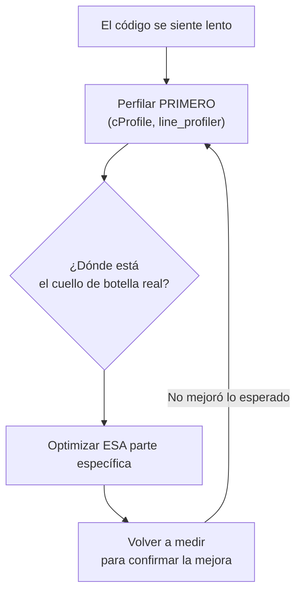
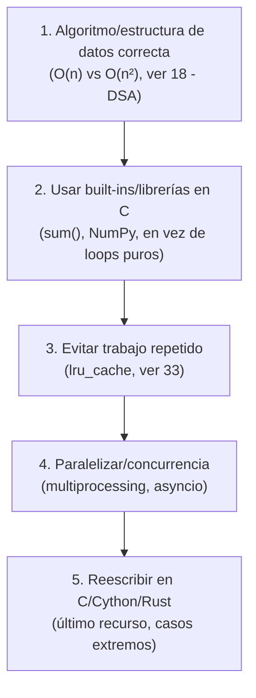

# 58 - Profiling y Optimización de Rendimiento

> Continúa de [[57 - Paralelismo Real|57]] y abre el bloque final: rendimiento y Python moderno. Varios archivos anteriores ([[27 - Gestión de Memoria y Garbage Collection|27]], [[33 - Functools en Profundidad|33]], [[57 - Paralelismo Real|57]]) dijeron "mide antes de optimizar" — este archivo cubre exactamente cómo medir.

## La Regla de Oro: No Adivines, Mide

> *"Premature optimization is the root of all evil"* — Donald Knuth. La intuición sobre qué parte del código es lenta suele estar equivocada; el profiling revela la realidad.



## `timeit`: Microbenchmarks Precisos

```python
import timeit

# Comparar dos formas de hacer lo mismo
tiempo_comprension = timeit.timeit(
    "[x**2 for x in range(1000)]", number=10_000
)
tiempo_map = timeit.timeit(
    "list(map(lambda x: x**2, range(1000)))", number=10_000
)

print(f"Comprensión: {tiempo_comprension:.4f}s")
print(f"map + lambda: {tiempo_map:.4f}s")
```

```bash
# También disponible desde la línea de comandos
python -m timeit "[x**2 for x in range(1000)]"
```

`timeit` ejecuta el código muchas veces y minimiza el ruido de fondo del sistema operativo — ideal para comparar **micro-decisiones** (¿comprensión o `map`? ¿`+=` o `.join()`?), no para perfilar un programa completo.

## `time.perf_counter`: Medir un Bloque de Código Real

```python
import time

inicio = time.perf_counter()
resultado = sum(i ** 2 for i in range(10_000_000))
duracion = time.perf_counter() - inicio
print(f"Tardó {duracion:.4f} segundos")
```

`perf_counter` es el reloj de mayor precisión disponible para medir duraciones — a diferencia de `time.time()` (pensado para timestamps, no para medir intervalos, ver [[53 - Fechas y Zonas Horarias|53]]), no se ve afectado por ajustes del reloj del sistema.

## `cProfile`: Perfilando un Programa Completo

```python
import cProfile
import pstats

def funcion_lenta():
    return sum(i ** 2 for i in range(1_000_000))

def funcion_rapida():
    return sum(range(1_000_000))

def programa_principal():
    for _ in range(5):
        funcion_lenta()
    funcion_rapida()

cProfile.run("programa_principal()", "resultado.prof")

estadisticas = pstats.Stats("resultado.prof")
estadisticas.sort_stats("cumulative").print_stats(5)
```

```text
         5000008 function calls in 1.234 seconds

   Ordered by: cumulative time

   ncalls  tottime  percall  cumtime  percall filename:lineno(function)
        1    0.000    0.000    1.234    1.234 script.py:9(programa_principal)
        5    1.100    0.220    1.100    0.220 script.py:4(funcion_lenta)
        1    0.100    0.100    0.100    0.100 script.py:7(funcion_rapida)
```

```bash
# Desde la línea de comandos, sobre un script completo
python -m cProfile -s cumulative mi_script.py
```

| Columna | Significado |
|---|---|
| `ncalls` | Cuántas veces se llamó la función |
| `tottime` | Tiempo total DENTRO de esta función, excluyendo sub-llamadas |
| `cumtime` | Tiempo total INCLUYENDO todas las sub-llamadas |
| `percall` | `tottime`/`cumtime` dividido entre `ncalls` |

`cProfile` responde "¿qué **función** consume más tiempo?" — es el punto de partida correcto antes de optimizar cualquier cosa a ciegas.

## `line_profiler`: Perfilando Línea por Línea

`cProfile` te dice qué función es lenta; `line_profiler` te dice **qué línea exacta** dentro de esa función.

```bash
pip install line_profiler
```

```python
# mi_script.py
@profile   # decorador especial que el CLI kernprof reconoce automáticamente
def procesar_datos(datos):
    resultado = []
    for item in datos:               # línea A
        transformado = item ** 2      # línea B
        if transformado > 100:        # línea C
            resultado.append(transformado)  # línea D
    return resultado
```

```bash
kernprof -l -v mi_script.py
```

```text
Line #      Hits         Time  Per Hit   % Time  Line Contents
==============================================================
     3                                           def procesar_datos(datos):
     4         1          2.0      2.0      0.0      resultado = []
     5    100000      45000.0      0.5     35.2      for item in datos:
     6    100000      52000.0      0.5     40.6          transformado = item ** 2
     7    100000      20000.0      0.2     15.6          if transformado > 100:
     8     30000      11000.0      0.4      8.6              resultado.append(transformado)
```

Esta granularidad revela, por ejemplo, que el cálculo `item ** 2` consume el 40% del tiempo — información que `cProfile` (que solo ve la función completa) no puede darte directamente.

## `memory_profiler`: Perfilando Uso de Memoria Línea por Línea

```bash
pip install memory_profiler
```

```python
from memory_profiler import profile

@profile
def cargar_datos():
    datos = [i for i in range(1_000_000)]      # crea una lista grande
    datos_duplicados = datos * 2                # duplica el uso de memoria
    return sum(datos_duplicados)
```

```bash
python -m memory_profiler mi_script.py
```

Complementa a `tracemalloc` (ya visto en [[27 - Gestión de Memoria y Garbage Collection|27]]) con una vista línea por línea del consumo de memoria, útil para encontrar exactamente dónde un pipeline de procesamiento de datos empieza a consumir memoria innecesaria.

## Optimizaciones Comunes, en Orden de Impacto



```python
# 1. Algoritmo correcto siempre gana sobre micro-optimización
def buscar_lento(lista, objetivo):       # O(n) por búsqueda
    return objetivo in lista

conjunto = set(lista)
def buscar_rapido(conjunto, objetivo):   # O(1) por búsqueda
    return objetivo in conjunto

# 2. Usar implementaciones en C en vez de loops puros de Python
suma_lenta = sum([x for x in range(1_000_000)])   # loop Python + suma
suma_rapida = sum(range(1_000_000))                 # generador, sin lista intermedia

import numpy as np
arreglo = np.arange(1_000_000)
suma_numpy = arreglo.sum()   # órdenes de magnitud más rápido para datos numéricos masivos
```

## PyPy y Otras Implementaciones: Cuándo Considerar Alternativas

Ya se mencionó en [[30 - Bytecode e Internals del Intérprete|30]] que CPython no es la única implementación de Python. **PyPy** usa compilación JIT (_Just-In-Time_) y puede ser 5-10x más rápido que CPython en código Python puro con loops intensivos — pero tiene compatibilidad limitada con extensiones en C (muchas librerías de ciencia de datos, como NumPy en versiones antiguas, tenían soporte parcial).

| | CPython | PyPy |
|---|---|---|
| Velocidad en Python puro (loops, recursión) | Base | 5-10x más rápido típicamente |
| Compatibilidad con extensiones C (NumPy, pandas) | Total | Mejorada en versiones recientes, aún con matices |
| Uso de memoria | Predecible | Puede ser mayor (JIT compilado) |
| Cuándo considerarlo | Uso general | Scripts CPU-intensivos en Python puro, sin dependencias C pesadas |

## Checklist antes de Optimizar

- ¿Medí primero con `cProfile`/`line_profiler`, o estoy optimizando por intuición?
- ¿El cuello de botella es algorítmico (`O(n²)` que podría ser `O(n log n)`) o de implementación?
- ¿Ya existe una librería en C que resuelve esto más rápido (NumPy, pandas, built-ins)?
- ¿La ganancia justifica la pérdida de legibilidad de una optimización agresiva?
- ¿Volví a medir después de optimizar, para confirmar que realmente mejoró?

## Ver también

- [[27 - Gestión de Memoria y Garbage Collection]] — `tracemalloc`, complementario a `memory_profiler`.
- [[18 - Data Structures and Algorithms]] — la elección de algoritmo/estructura, la optimización de mayor impacto.
- [[57 - Paralelismo Real]] — paralelizar solo después de confirmar que el cuello de botella lo justifica.
- `Python/NumPy/` — vectorización como alternativa de alto impacto a loops puros de Python.
