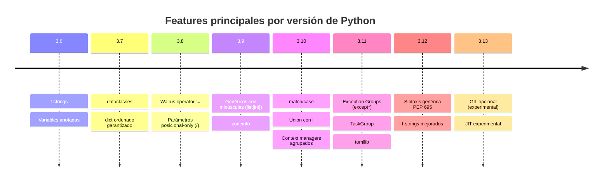

# 59 - Python Moderno por Versión

> Continúa de [[58 - Profiling y Optimización de Rendimiento|58]]. Varios archivos anteriores mencionaron features "desde Python 3.X" de pasada — aquí se organizan cronológicamente, para tener claro qué versión mínima necesitas y qué cambió en cada una.

## Línea de Tiempo de Versiones Relevantes



## Python 3.8: el Walrus Operator (`:=`)

Permite asignar una variable **como parte de una expresión**, no solo como una sentencia separada:

```python
# Antes de 3.8: calcular dos veces, o usar una línea extra
datos = obtener_datos()
if len(datos) > 10:
    print(f"Demasiados datos: {len(datos)}")

# Con walrus: asigna Y evalúa en la misma expresión
if (n := len(datos)) > 10:
    print(f"Demasiados datos: {n}")
```

```python
# Muy útil dentro de comprensiones, para evitar calcular algo costoso dos veces
resultados = [y for x in datos if (y := procesar(x)) is not None]

# Y en bucles while que leen hasta una condición
while (linea := archivo.readline()):
    procesar(linea)
```

## Python 3.9: Genéricos con Minúsculas y `zoneinfo`

```python
# Antes: había que importar de typing
from typing import List, Dict
def procesar(items: List[int]) -> Dict[str, int]: ...

# Desde 3.9: los tipos built-in ya soportan subíndices directamente
def procesar(items: list[int]) -> dict[str, int]: ...
```

`zoneinfo` (ver [[53 - Fechas y Zonas Horarias|53]]) también se incorporó al stdlib en esta versión, reemplazando la dependencia externa `pytz` para la mayoría de casos.

## Python 3.10: `match`/`case` — Pattern Matching Estructural

La adición sintáctica más grande en años — no es un simple `switch` como en otros lenguajes, sino **coincidencia de patrones estructurales**:

```python
def procesar_comando(comando):
    match comando.split():
        case ["salir"]:
            return "Cerrando aplicación"
        case ["mover", direccion] if direccion in ("norte", "sur", "este", "oeste"):
            return f"Moviendo hacia {direccion}"
        case ["mover", direccion_invalida]:
            return f"Dirección inválida: {direccion_invalida}"
        case ["atacar", objetivo, *armas]:
            return f"Atacando a {objetivo} con {armas}"
        case _:
            return "Comando no reconocido"

print(procesar_comando("mover norte"))     # "Moviendo hacia norte"
print(procesar_comando("atacar dragon espada escudo"))  # "Atacando a dragon con ['espada', 'escudo']"
```

```python
# match también puede deconstruir objetos y dataclasses (ver 40)
from dataclasses import dataclass

@dataclass
class Punto:
    x: int
    y: int

def clasificar(punto):
    match punto:
        case Punto(x=0, y=0):
            return "Origen"
        case Punto(x=0, y=y):
            return f"Sobre el eje Y en {y}"
        case Punto(x=x, y=0):
            return f"Sobre el eje X en {x}"
        case Punto(x=x, y=y) if x == y:
            return "Sobre la diagonal"
        case Punto():
            return "Punto genérico"
        case _:
            return "No es un punto"

print(clasificar(Punto(0, 5)))  # "Sobre el eje Y en 5"
```

`match` es especialmente potente para procesar datos con forma variable (respuestas de APIs, comandos de texto, árboles sintácticos) — casos donde una cadena de `if isinstance()`/`elif` se vuelve difícil de leer.

Además, 3.10 introdujo el operador `|` para uniones de tipos (`int | str` en vez de `Union[int, str]`, ver [[42 - Type Hints y el Módulo Typing|42]]) y la posibilidad de agrupar varios context managers con paréntesis (ver [[50 - Context Managers Avanzados|50]]).

## Python 3.11: Exception Groups, TaskGroup y Rendimiento

Ya cubierto en detalle en [[49 - Excepciones Avanzadas|49]] (`except*`, `ExceptionGroup`) y [[54 - Asyncio en Profundidad|54]] (`TaskGroup`, `asyncio.timeout`). Además, 3.11 trajo mejoras de rendimiento significativas en el intérprete (10-60% más rápido en muchos benchmarks respecto a 3.10, gracias a optimizaciones internas de `ceval`, ver [[30 - Bytecode e Internals del Intérprete|30]]) y `tomllib` para leer archivos TOML de forma nativa (relevante para `pyproject.toml`, ver [[61 - Empaquetado y Distribución|61]]).

```python
import tomllib   # 3.11+, solo lectura (para escribir se sigue usando una librería externa)

with open("pyproject.toml", "rb") as f:
    config = tomllib.load(f)
print(config["project"]["name"])
```

## Python 3.12: Sintaxis Genérica Simplificada (PEP 695)

```python
# Antes (3.9-3.11): requería TypeVar explícito
from typing import TypeVar
T = TypeVar("T")
def primero(lista: list[T]) -> T:
    return lista[0]

# Desde 3.12: sintaxis integrada, más concisa
def primero[T](lista: list[T]) -> T:
    return lista[0]

class Pila[T]:
    def __init__(self):
        self._items: list[T] = []
```

También mejoró significativamente los mensajes de error del intérprete (sugerencias más precisas de "quisiste decir...") y optimizó f-strings internamente, permitiendo anidarlas con las mismas comillas.

## Python 3.13: GIL Opcional (Experimental) y JIT

La adición más disruptiva a largo plazo: **PEP 703** introduce la posibilidad de compilar CPython **sin GIL** (`--disable-gil`, conocido como "free-threaded build"), en fase experimental. Esto podría eventualmente cambiar por completo el panorama de [[23 - Concurrency|23 - Concurrency]] y [[56 - Sincronización y Modelos de Concurrencia|56]] — hilos con paralelismo real de CPU sin necesitar `multiprocessing`. También se introdujo un compilador JIT experimental (_copy-and-patch_).

> **Estado a 2026:** ambas features siguen siendo experimentales/opcionales — la mayoría de proyectos y librerías del ecosistema (NumPy, pandas) todavía apuntan al modo con GIL como el estándar de producción. Vale la pena conocer que existen, pero no asumas que están activas por defecto.

## Cuándo Fijar una Versión Mínima en tu Proyecto

```toml
# pyproject.toml (ver 61 - Empaquetado y Distribución)
[project]
requires-python = ">=3.11"   # documenta explícitamente qué features asume tu código
```

| Si tu código usa... | Versión mínima requerida |
|---|---|
| Walrus operator (`:=`) | 3.8 |
| `list[int]` sin importar de `typing` | 3.9 |
| `match`/`case`, `int \| str` | 3.10 |
| `except*`, `TaskGroup`, `tomllib` | 3.11 |
| Sintaxis genérica `def f[T](...)` | 3.12 |

## Ver también

- [[42 - Type Hints y el Módulo Typing]] — la sintaxis de tipos que evolucionó a través de estas versiones.
- [[49 - Excepciones Avanzadas]] — exception groups introducidos en 3.11.
- [[54 - Asyncio en Profundidad]] — `TaskGroup` y `asyncio.timeout`, también de 3.11.
- [[61 - Empaquetado y Distribución]] — `requires-python` y cómo declarar la versión mínima de tu proyecto.
