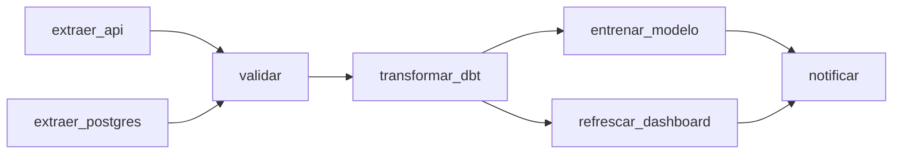
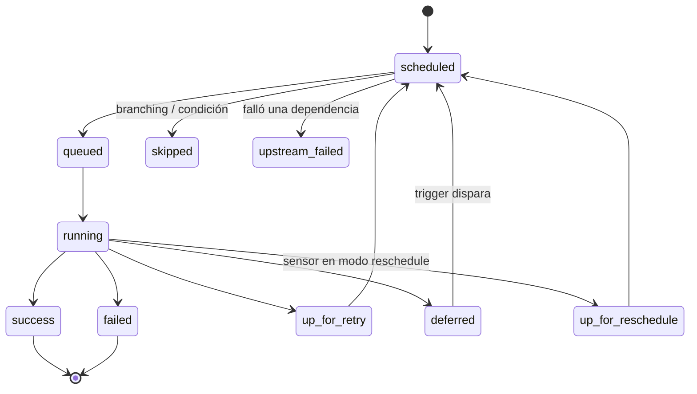
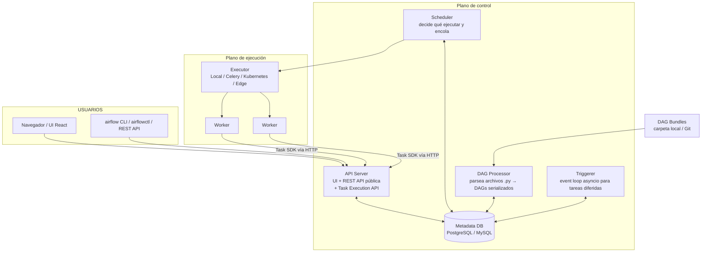
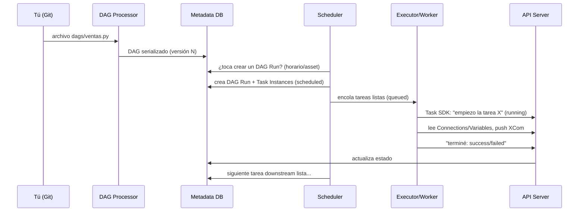

# 01 — Introducción y Arquitectura

> Este cheat-sheet es la referencia práctica de **Apache Airflow 3.x**. Para la comparación conceptual con Prefect y qué resuelve un orquestador frente a un cron, ver [[50-Orquestacion-Prefect-y-Airflow]] en `Machine Learning/`. Ojo: el ejemplo de esa nota usa sintaxis de **Airflow 2** (`schedule_interval`, `from airflow import DAG`); aquí todo está en Airflow 3 y se señalan las diferencias.

## ¿Qué es Airflow?

**Apache Airflow** es una plataforma open source para **definir, programar y monitorear flujos de trabajo** (*workflows*) escritos como **código Python**. Cada flujo es un **DAG** (*Directed Acyclic Graph*): un conjunto de **tareas** con dependencias entre ellas, que se ejecuta según un horario o un evento.



Airflow **no procesa los datos**. Es un **orquestador**: decide **qué** se ejecuta, **cuándo**, **en qué orden** y **qué pasa si falla** (reintentos, alertas, backfills). El trabajo pesado lo hacen otras herramientas: DuckDB, Spark, dbt, un contenedor o un warehouse.

### Lo que aporta frente a un cron + scripts

| Necesidad | cron + scripts | Airflow |
|---|---|---|
| Dependencias entre pasos | Implícitas (horarios escalonados) | **Explícitas** en el DAG |
| Reintentos con backoff | A mano | `retries`, `retry_delay`, `retry_exponential_backoff` |
| Visibilidad | Logs dispersos | UI con estado de cada tarea y cada ejecución |
| Re-ejecutar un rango de fechas pasado | Script ad hoc | **Backfill** |
| Parametrizar por fecha lógica | A mano | Templates (`{{ ds }}`, `data_interval_start`) |
| Credenciales | En archivos o variables sueltas | Connections y secrets backends |
| Integraciones | Escribir clientes | Cientos de **providers** (AWS, GCP, dbt, Snowflake, Slack...) |
| Disparar por llegada de datos | Polling casero | **Assets** y sensores |

### Lo que Airflow NO es

- **No es un motor de procesamiento.** No pases DataFrames de GB entre tareas (ver [[07 - XComs y Paso de Datos]]).
- **No es para streaming** ni para latencias de segundos. Está pensado para lotes (batch): cada minuto, hora o día. Para eventos en tiempo real, usa Kafka/Flink y deja a Airflow lo periódico (aunque Airflow 3 añade disparo por eventos, ver [[11 - Assets y Scheduling Event-Driven]]).
- **No es un sistema de CI/CD**, aunque a veces se use así.

---

## Conceptos fundamentales

| Concepto | Qué es |
|---|---|
| **DAG** | El workflow: tareas, dependencias, horario y configuración. Un archivo `.py` en la carpeta de DAGs |
| **Task** | Un nodo del DAG, una unidad de trabajo |
| **Operator** | La "plantilla" de una tarea: `BashOperator`, `PythonOperator`, `SQLExecuteQueryOperator`... |
| **TaskFlow (`@task`)** | Forma moderna de definir tareas como funciones de Python decoradas |
| **DAG Run** | Una ejecución concreta del DAG (por ejemplo, la del 2026-11-15) |
| **Task Instance (TI)** | Una ejecución concreta de una tarea dentro de un DAG Run, con su estado |
| **Logical date** | La fecha "a la que pertenece" una ejecución (antes `execution_date`) |
| **Data interval** | El periodo de datos que procesa una ejecución |
| **Sensor** | Tarea que **espera** a que se cumpla una condición |
| **Hook** | Cliente reutilizable para un sistema externo (Postgres, S3...) |
| **Connection** | Credenciales y host de un sistema externo, guardados en Airflow |
| **Variable** | Configuración clave-valor global |
| **XCom** | Mecanismo para pasar valores pequeños entre tareas |
| **Asset** | Un dato lógico (tabla, archivo) que una tarea produce y que puede **disparar** otros DAGs. Se llamaba *Dataset* en 2.x |
| **Provider** | Paquete pip con operadores, hooks y sensores de una integración |
| **Pool** | Límite de concurrencia compartido entre tareas |

### Estados de una Task Instance



---

## Arquitectura de Airflow 3



| Componente | Comando | Rol |
|---|---|---|
| **API Server** | `airflow api-server` | Sirve la UI (React), la REST API pública y la **Task Execution API** que usan los workers. Reemplaza al `webserver` de 2.x |
| **Scheduler** | `airflow scheduler` | Crea los DAG Runs según el horario o los eventos, decide qué tareas están listas y las envía al executor |
| **DAG Processor** | `airflow dag-processor` | Parsea los archivos de DAGs y guarda versiones serializadas en la DB. En 3.x es **un proceso obligatorio y separado** |
| **Triggerer** | `airflow triggerer` | Ejecuta los *triggers* asíncronos de las tareas diferidas (deferrable), ver [[14 - Sensores, Deferrable Operators y el Triggerer]] |
| **Executor** | (configuración) | Define **dónde** corren las tareas: procesos locales, workers de Celery, pods de Kubernetes... |
| **Workers** | `airflow celery worker`, pods, etc. | Ejecutan el código de las tareas |
| **Metadata DB** | — | Estado de todo: DAG Runs, Task Instances, conexiones, variables, XComs. PostgreSQL en producción |

### Qué cambió en Airflow 3 (abril de 2025)

| Área | Airflow 2.x | Airflow 3.x |
|---|---|---|
| Importaciones de autor | `from airflow import DAG`, `from airflow.decorators import dag, task` | **Task SDK**: `from airflow.sdk import dag, task, DAG, Asset, ...` |
| Operadores core | `airflow.operators.bash` | Paquete **`apache-airflow-providers-standard`**: `airflow.providers.standard.operators.bash` |
| Acceso a la DB desde tareas | Directo (cualquier tarea podía consultar la metadata DB) | **Prohibido**: las tareas hablan con el API Server vía Task Execution API |
| Web | `webserver` (Flask) | `api-server` (FastAPI) y una **UI nueva en React** |
| Parseo de DAGs | Dentro del scheduler (opcional separado) | `dag-processor` **separado y obligatorio** |
| Horario | `schedule_interval=` / `timetable=` | Solo **`schedule=`** |
| Fecha de ejecución | `execution_date` | **`logical_date`** (`execution_date` eliminado) |
| Datasets | `Dataset` | **`Asset`**, `@asset`, AssetWatcher (eventos externos) |
| Backfill | CLI local, bloqueante | Gestionado por el **scheduler**, lanzable desde UI, API o CLI |
| Versionado de DAGs | No: la UI mostraba siempre el código actual | **DAG versioning**: cada run queda asociado a la versión de código con la que corrió |
| SubDAGs | Existían (desaconsejados) | **Eliminados**: usa TaskGroups |
| SLAs | `sla=` | **Eliminados**; reemplazados por *Deadline Alerts* (3.1+) |
| `catchup` por defecto | `True` | **`False`** |
| Ejecución remota | Solo Celery/K8s | **Edge Executor**: workers en otras redes o nubes |
| Lenguajes de tareas | Solo Python | Task SDK pensado para varios lenguajes (Go en desarrollo) |

> **Si encuentras código antiguo** (tutoriales, Stack Overflow, el ejemplo de [[50-Orquestacion-Prefect-y-Airflow|ML/50]]), casi siempre es Airflow 2. La migración se resume en [[17 - Testing, Observabilidad y Buenas Prácticas#Migración de Airflow 2 a 3]].

---

## El ciclo de vida de un DAG



## Un DAG completo en Airflow 3

```python
# dags/hola_airflow.py
import pendulum
from airflow.sdk import dag, task
from airflow.providers.standard.operators.bash import BashOperator

@dag(
    schedule="@daily",
    start_date=pendulum.datetime(2026, 1, 1, tz="America/Lima"),
    catchup=False,
    tags=["ejemplo"],
    default_args={"retries": 2},
)
def hola_airflow():

    inicio = BashOperator(task_id="inicio", bash_command="echo 'Fecha lógica: {{ ds }}'")

    @task
    def extraer() -> list[int]:
        return [3, 1, 4, 1, 5]

    @task
    def transformar(valores: list[int]) -> int:
        return sum(valores)

    @task
    def cargar(total: int):
        print(f"Total: {total}")

    inicio >> cargar(transformar(extraer()))

hola_airflow()
```

## ¿Cuándo usar Airflow y cuándo otra cosa?

| Herramienta | Elígela cuando |
|---|---|
| **Airflow** | Organización con muchos pipelines batch heterogéneos, necesidad de un catálogo enorme de integraciones, estándar del mercado laboral |
| **Prefect** | Equipo de Python o ML que quiere orquestar código existente con mínima ceremonia (ver [[50-Orquestacion-Prefect-y-Airflow]]) |
| **Dagster** | Enfoque centrado en *assets* y data lineage desde el diseño |
| **dbt Cloud jobs** | Solo necesitas programar dbt (ver [[15 - dbt en Producción - CI-CD y Orquestación|dbt/15]]) |
| **cron / GitHub Actions** | Uno o dos scripts sin dependencias complejas |
| **Kubeflow / Azure ML Pipelines** | Pipelines de ML muy acoplados a una plataforma (ver [[51-Azure-ML]]) |

Airflow es un **estándar de facto en ingeniería de datos**: aparece en muchísimas ofertas de Data Engineer, Analytics Engineer y MLOps (ver [[02-Roles-y-Carreras-en-DS-ML]]).

## Mapa de este cheat-sheet

| Bloque | Notas |
|---|---|
| Fundamentos | [[02 - Instalación y Entorno Local]] · [[03 - CLI de Airflow]] |
| Escribir DAGs | [[04 - DAGs - Definición y Parámetros]] · [[05 - TaskFlow API]] · [[06 - Operadores Clásicos y Dependencias]] · [[07 - XComs y Paso de Datos]] · [[08 - Templating con Jinja y Contexto]] |
| Control de flujo y scheduling | [[09 - Branching, Condicionales y Trigger Rules]] · [[10 - Scheduling, Timetables y Backfills]] · [[11 - Assets y Scheduling Event-Driven]] · [[12 - Dynamic Task Mapping]] |
| Integraciones | [[13 - Connections, Variables, Hooks y Providers]] · [[14 - Sensores, Deferrable Operators y el Triggerer]] · [[15 - Airflow con dbt, Docker, Kubernetes y MLflow]] |
| Producción | [[16 - Executors, Escalado y Despliegue]] · [[17 - Testing, Observabilidad y Buenas Prácticas]] |

## Ver también

- [[50-Orquestacion-Prefect-y-Airflow]] (en `Machine Learning/`): Prefect vs. Airflow y el rol del orquestador
- [[04-Ingenieria-de-Datos]] (en `Machine Learning/`): la orquestación dentro del stack de datos
- [[09-MLOps-en-Profundidad]] (en `Machine Learning/`)
- [[DuckDB/01 - Introducción y Arquitectura|DuckDB]]: motor de cómputo ligero para las tareas
- [[dbt/01 - Introducción y Arquitectura|dbt]]: la "T" que Airflow suele orquestar
- [[02 - Instalación y Entorno Local]]
