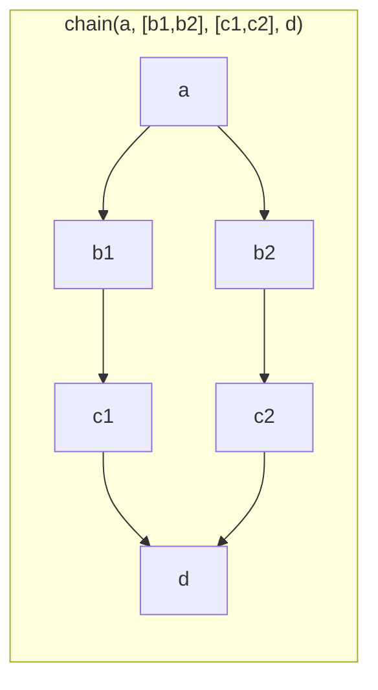
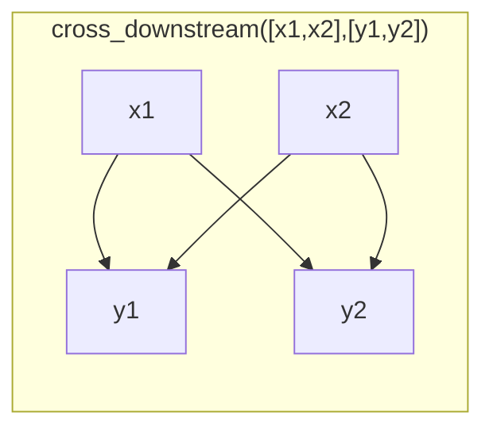

# 06 — Operadores Clásicos y Dependencias

> Continúa de [[05 - TaskFlow API]]. Los **operadores** son las clases que definen tareas (`BashOperator`, `PythonOperator`, `EmptyOperator`, cientos más en providers). Esta nota cubre los operadores del provider `standard`, todas las formas de declarar dependencias (`>>`, `chain`, `cross_downstream`), los **TaskGroups** y cómo escribir un operador propio.

## El provider `standard` (Airflow 3)

En Airflow 3 los operadores "core" se movieron al paquete **`apache-airflow-providers-standard`**, que viene preinstalado:

| Operador | Import (Airflow 3) |
|---|---|
| `BashOperator` | `airflow.providers.standard.operators.bash` |
| `PythonOperator`, `BranchPythonOperator`, `ShortCircuitOperator`, `PythonVirtualenvOperator`, `ExternalPythonOperator` | `airflow.providers.standard.operators.python` |
| `EmptyOperator` | `airflow.providers.standard.operators.empty` |
| `TriggerDagRunOperator` | `airflow.providers.standard.operators.trigger_dagrun` |
| `LatestOnlyOperator` | `airflow.providers.standard.operators.latest_only` |
| `BranchDateTimeOperator`, `BranchDayOfWeekOperator` | `airflow.providers.standard.operators.datetime` / `.weekday` |
| Sensores: `FileSensor`, `TimeDeltaSensor`, `DateTimeSensor`, `ExternalTaskSensor`, `PythonSensor` | `airflow.providers.standard.sensors.*` |

> En Airflow 2 eran `airflow.operators.bash`, `airflow.operators.python`, etc. Si ves esos imports, es código de 2.x.

---

## Operadores esenciales

### BashOperator

```python
from airflow.providers.standard.operators.bash import BashOperator

descargar = BashOperator(
    task_id="descargar",
    bash_command="curl -sf https://datos.gob/ventas_{{ ds_nodash }}.csv -o /data/raw/{{ ds }}.csv",
    env={"API_TOKEN": "{{ conn.api_ventas.password }}"},
    append_env=True,                  # mantiene el resto del entorno
    cwd="/opt/airflow/include",
    retries=3,
)

# Ejecutar un script (ruta relativa a template_searchpath o al archivo del DAG)
script = BashOperator(task_id="script", bash_command="scripts/limpiar.sh")
```

- Falla si el comando sale con un código distinto de 0. El código **99** marca la tarea como `skipped`.
- La **última línea de stdout** se guarda como XCom (`do_xcom_push=True` por defecto).
- Cuidado con los comandos que terminan en `.sh` o `.bash`: Airflow intenta leerlos como **plantilla Jinja de archivo**. Si es un comando inline, añade un espacio al final: `"bash script.sh "`.

### PythonOperator

```python
from airflow.providers.standard.operators.python import PythonOperator

def limpiar(ruta: str, umbral: float, **context):
    print(context["ds"], ruta, umbral)

limpiar_t = PythonOperator(
    task_id="limpiar",
    python_callable=limpiar,
    op_args=["/data/raw"],
    op_kwargs={"umbral": 0.5, "fecha": "{{ ds }}"},   # op_kwargs admite templates
)
```

En código nuevo, `@task` es más limpio. `PythonOperator` sigue apareciendo mucho en código existente.

### EmptyOperator

No hace nada. Sirve como **nodo de unión o estructura**: inicio y fin, puntos de sincronización y destinos de un branching.

```python
from airflow.providers.standard.operators.empty import EmptyOperator

inicio = EmptyOperator(task_id="inicio")
fin = EmptyOperator(task_id="fin", trigger_rule="none_failed_min_one_success")
```

Las tareas `EmptyOperator` no se envían al executor: el scheduler las marca como `success` directamente.

### TriggerDagRunOperator

Dispara **otro DAG** (acoplamiento explícito entre DAGs):

```python
from airflow.providers.standard.operators.trigger_dagrun import TriggerDagRunOperator

disparar_ml = TriggerDagRunOperator(
    task_id="disparar_reentreno",
    trigger_dag_id="reentreno_churn",
    conf={"fecha_datos": "{{ ds }}"},
    wait_for_completion=True,          # espera a que el DAG hijo termine
    deferrable=True,                   # espera sin ocupar un worker (nota 14)
    poke_interval=60,
)
```

Alternativa con menos acoplamiento: **Assets** (ver [[11 - Assets y Scheduling Event-Driven]]).

---

## Dependencias

### Operadores de bitshift

```python
a >> b                  # a antes que b (b es downstream de a)
b << a                  # equivalente
a >> [b, c] >> d        # fan-out y fan-in
[a, b] >> c
a >> b >> c >> d        # cadena

# Métodos equivalentes
a.set_downstream(b)
b.set_upstream(a)
```

> ❌ `[a, b] >> [c, d]` **no está permitido** (lista contra lista). Usa `cross_downstream` o `chain`.

### `chain` y `cross_downstream`

```python
from airflow.sdk import chain, cross_downstream

# Cadena lineal (equivale a a >> b >> c >> d)
chain(a, b, c, d)

# Cadenas paralelas por posición: a>>b1>>c1 y a>>b2>>c2
chain(a, [b1, b2], [c1, c2], d)

# Todas contra todas: x1>>y1, x1>>y2, x2>>y1, x2>>y2
cross_downstream([x1, x2], [y1, y2])

# Cadena de tareas generadas en un bucle
tareas = [BashOperator(task_id=f"paso_{i}", bash_command=f"echo {i}") for i in range(5)]
chain(*tareas)
```





### Dependencias con TaskFlow

Con `@task`, pasar el resultado de una tarea a otra **ya crea la dependencia**. Si una tarea no consume el dato pero debe ir después, usa `>>`:

```python
datos = extraer()
validado = validar(datos)
limpiar_tmp = limpiar()          # no recibe datos
validado >> limpiar_tmp
```

---

## TaskGroups

Los **TaskGroups** agrupan tareas visualmente en la UI (como una caja colapsable) y como unidad de dependencias. Reemplazan a los **SubDAGs**, que se eliminaron en Airflow 3.

```python
from airflow.sdk import TaskGroup

with DAG(...) as dag:
    inicio = EmptyOperator(task_id="inicio")

    with TaskGroup(group_id="extraccion", tooltip="Extrae de todas las fuentes") as extraccion:
        crm = BashOperator(task_id="crm", bash_command="...")
        erp = BashOperator(task_id="erp", bash_command="...")
        web = BashOperator(task_id="web", bash_command="...")

    with TaskGroup(group_id="transformacion") as transformacion:
        stg = BashOperator(task_id="staging", bash_command="...")
        marts = BashOperator(task_id="marts", bash_command="...")
        stg >> marts

    inicio >> extraccion >> transformacion
```

- Los `task_id` internos quedan con prefijo: `extraccion.crm`. Usa `prefix_group_id=False` para evitarlo.
- `extraccion >> transformacion` conecta **todas las hojas** del primer grupo con **todas las raíces** del segundo.
- Los grupos se pueden anidar.
- Con TaskFlow, usa el decorador `@task_group` (ver [[05 - TaskFlow API#TaskGroups con decorador]]).
- Pueden recibir `default_args` propios: `TaskGroup("g", default_args={"retries": 5})`.

### Patrón: un grupo por fuente generado en bucle

```python
fuentes = ["crm", "erp", "web"]

for f in fuentes:
    with TaskGroup(group_id=f"pipeline_{f}") as g:
        e = BashOperator(task_id="extraer", bash_command=f"extraer.sh {f} ")
        v = BashOperator(task_id="validar", bash_command=f"validar.sh {f} ")
        e >> v
    inicio >> g >> fin
```

---

## Escribir un operador propio

Cuando repites la misma lógica en muchos DAGs y quieres una interfaz declarativa, crea un operador heredando de `BaseOperator`:

```python
# include/operators/duckdb_operator.py
from collections.abc import Sequence
from airflow.sdk import BaseOperator

class DuckDBQueryOperator(BaseOperator):
    """Ejecuta SQL en DuckDB y devuelve el número de filas del resultado."""

    template_fields: Sequence[str] = ("sql", "database")   # campos que admiten Jinja
    template_ext: Sequence[str] = (".sql",)                # si sql termina en .sql, lee el archivo
    template_fields_renderers = {"sql": "sql"}             # resaltado en la UI
    ui_color = "#fff100"

    def __init__(self, *, sql: str, database: str = ":memory:", **kwargs):
        super().__init__(**kwargs)
        self.sql = sql
        self.database = database

    def execute(self, context):
        import duckdb                      # import dentro de execute: parseo rápido
        with duckdb.connect(self.database) as con:
            rel = con.sql(self.sql)
            n = len(rel.fetchall()) if rel is not None else 0
        self.log.info("Filas devueltas: %s", n)
        return n                           # se guarda como XCom
```

```python
# dags/resumen.py
from operators.duckdb_operator import DuckDBQueryOperator

resumen = DuckDBQueryOperator(
    task_id="resumen",
    database="/data/analitica.duckdb",
    sql="sql/resumen_diario.sql",     # templated: puede usar {{ ds }}
    pool="duckdb_writer",
)
```

Claves al escribir operadores:

- La lógica va en `execute(self, context)`; `__init__` solo guarda parámetros. **Nada de I/O en `__init__`**, que se ejecuta en cada parseo.
- `template_fields` declara qué atributos se renderizan con Jinja.
- Usa `self.log` para escribir logs (ver [[52 - Logging Avanzado]]).
- Para la conexión a sistemas externos, combina el operador con un **Hook** (ver [[13 - Connections, Variables, Hooks y Providers]]).
- Para operaciones largas que esperan a un sistema externo, hazlo **deferrable** (ver [[14 - Sensores, Deferrable Operators y el Triggerer]]).

## Ver también

- [[05 - TaskFlow API]]
- [[09 - Branching, Condicionales y Trigger Rules]]
- [[13 - Connections, Variables, Hooks y Providers]]
- [[17 - OOP]] (en `Python/`): herencia y clases para operadores propios
- [[41 - Patrones de Diseño Pythonicos]] (en `Python/`)
