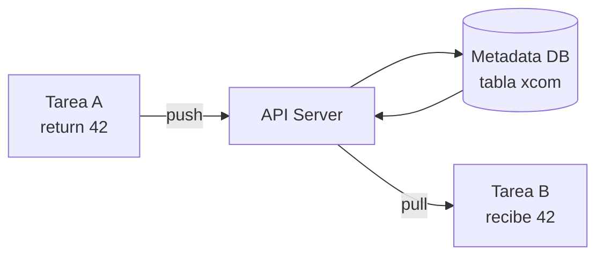

# 07 — XComs y Paso de Datos

> Continúa de [[06 - Operadores Clásicos y Dependencias]]. Las tareas de Airflow corren en **procesos separados** (incluso en máquinas distintas), así que no comparten memoria. Los **XComs** (*cross-communications*) son el mecanismo para pasar valores **pequeños** entre ellas. Esta nota cubre cómo funcionan, sus límites, los **custom XCom backends** y el patrón correcto para datos grandes: pasar **referencias, no datos**.

## Cómo funciona un XCom

Un XCom es un registro clave-valor asociado a `(dag_id, run_id, task_id, map_index, key)`:

- El **valor de retorno** de una tarea se guarda con la clave `return_value` (tanto en `@task` como en la mayoría de operadores).
- Se puede hacer push con otras claves de forma explícita.
- En Airflow 3, la tarea lee y escribe XComs **a través de la Task Execution API**; el API Server los guarda en la metadata DB, o en un backend externo si está configurado.



## Push y pull

### Implícito con TaskFlow (lo normal)

```python
@task
def contar() -> int:
    return 1234                          # push automático (key=return_value)

@task
def reportar(n: int):                    # pull automático
    print(n)

reportar(contar())
```

### Explícito con `ti`

```python
@task
def productor(ti=None):
    ti.xcom_push(key="filas", value=1234)
    ti.xcom_push(key="archivo", value="s3://lake/silver/ventas/fecha=2026-11-14/")
    return "ok"

@task
def consumidor(ti=None):
    filas = ti.xcom_pull(task_ids="productor", key="filas")
    retorno = ti.xcom_pull(task_ids="productor")                  # key=return_value
    varios = ti.xcom_pull(task_ids=["t1", "t2"])                  # lista de valores
    de_otro_dag = ti.xcom_pull(dag_id="otro_dag", task_ids="t", include_prior_dates=True)
```

### En templates (operadores clásicos)

```python
BashOperator(
    task_id="usar",
    bash_command="echo {{ ti.xcom_pull(task_ids='productor', key='archivo') }}",
)
```

### Salida de un operador clásico hacia TaskFlow

```python
listar = BashOperator(task_id="listar", bash_command="ls /data | wc -l")
mostrar(listar.output)                                 # XComArg con return_value
mostrar(listar.output["clave"])                        # si el operador devuelve un dict
```

---

## Serialización y límites

- En Airflow 3 los XComs se serializan con el **serializador de Airflow** (JSON extendido): soporta tipos básicos, listas, dicts, `datetime`/pendulum, dataclasses, `Asset` y algunos objetos como DataFrames de Pandas (se serializan a JSON). **Pickle ya no está disponible** (se eliminó por seguridad).
- El límite práctico depende de la base: en PostgreSQL una celda puede pesar hasta ~1 GB, pero **cada XCom pasa por la DB y por la red**. Más allá de unos KB, empiezan los problemas de rendimiento.

| Qué pasar por XCom | Qué NO pasar |
|---|---|
| Conteos, métricas, flags | DataFrames |
| Rutas S3, nombres de tablas, IDs | Archivos binarios |
| Listas cortas (nombres de archivos) | Listas de millones de elementos |
| Configuración pequeña (dicts) | Modelos entrenados |
| Run IDs de MLflow, versiones de DuckLake | Respuestas completas de APIs |

---

## El patrón correcto: pasar referencias

Cada tarea **escribe su resultado en almacenamiento externo** (S3, una tabla o un archivo Parquet) y pasa por XCom solo **dónde quedó**.

```python
@task
def extraer(ds=None) -> str:
    import duckdb
    destino = f"s3://lake/bronze/ventas/fecha={ds}/"
    with duckdb.connect() as con:
        con.execute("CREATE SECRET (TYPE s3, PROVIDER credential_chain)")
        con.execute(f"""
            COPY (SELECT * FROM postgres_scan('...', 'public', 'ventas') WHERE fecha = '{ds}')
            TO '{destino}' (FORMAT parquet, OVERWRITE_OR_IGNORE)
        """)
    return destino                                  # solo la ruta

@task
def transformar(origen: str, ds=None) -> str:
    destino = f"s3://lake/silver/ventas/fecha={ds}/"
    # ... leer origen, escribir destino
    return destino

@task
def validar(ruta: str) -> int:
    import duckdb
    n = duckdb.sql(f"SELECT COUNT(*) FROM '{ruta}*.parquet'").fetchone()[0]
    if n == 0:
        raise ValueError(f"Sin filas en {ruta}")
    return n

validar(transformar(extraer()))
```

Ventajas: idempotencia (cada fecha tiene su ruta), tareas reejecutables de forma independiente, datos inspeccionables fuera de Airflow y metadata DB liviana. Ver [[DuckDB/16 - DuckDB en Pipelines y Buenas Prácticas#DuckDB dentro de Airflow|DuckDB/16]].

### `ObjectStoragePath`: rutas de almacenamiento agnósticas

El Task SDK incluye una abstracción tipo `pathlib` para S3, GCS, Azure o disco local, que usa las Connections de Airflow:

```python
from airflow.sdk import ObjectStoragePath

base = ObjectStoragePath("s3://aws_default@lake/silver/")    # conn_id@bucket

@task
def escribir(ds=None) -> str:
    ruta = base / f"ventas/fecha={ds}/data.parquet"
    ruta.parent.mkdir(parents=True, exist_ok=True)
    with ruta.open("wb") as f:
        df.to_parquet(f)
    return str(ruta)
```

Ver [[13 - Files Handling]] (en `Python/`) para `pathlib`.

---

## Custom XCom backends

Si de verdad necesitas pasar objetos medianos (por ejemplo, DataFrames de algunos MB) con la ergonomía de TaskFlow, configura un **XCom backend en object storage**: los valores grandes se guardan en S3 o GCS y en la DB solo queda una referencia.

```bash
# Backend del provider common.io
export AIRFLOW__CORE__XCOM_BACKEND=airflow.providers.common.io.xcom.backend.XComObjectStorageBackend
export AIRFLOW__COMMON_IO__XCOM_OBJECTSTORAGE_PATH=s3://aws_default@mi-bucket/xcom
export AIRFLOW__COMMON_IO__XCOM_OBJECTSTORAGE_THRESHOLD=1048576     # >1 MB va a S3; menos, a la DB
export AIRFLOW__COMMON_IO__XCOM_OBJECTSTORAGE_COMPRESSION=gzip
```

Con esto, `return df` en una tarea funciona sin cargar la DB. Aun así, **pasar referencias explícitas sigue siendo más claro** en pipelines de datos de producción.

También puedes escribir un backend propio heredando de `BaseXCom` y sobreescribiendo `serialize_value` y `deserialize_value`.

---

## XComs y dynamic task mapping

Cuando una tarea está mapeada (ver [[12 - Dynamic Task Mapping]]), cada instancia tiene su `map_index`, y el pull desde downstream devuelve **la lista de todos los resultados**:

```python
@task
def procesar(archivo: str) -> int:
    return 100

@task
def sumar(conteos: list[int]) -> int:      # recibe [100, 100, 100, ...]
    return sum(conteos)

sumar(procesar.expand(archivo=["a", "b", "c"]))
```

## Limpieza

Los XComs se borran al limpiar (clear) una tarea antes de reejecutarla y con `airflow db clean`. En instalaciones grandes, la tabla `xcom` puede crecer mucho: programa `db clean` (ver [[03 - CLI de Airflow#Base de datos y administración]]).

## Errores comunes

| Síntoma | Causa | Solución |
|---|---|---|
| Metadata DB lenta o enorme | DataFrames por XCom | Pasa rutas o usa un backend de object storage |
| `TypeError: Object of type X is not JSON serializable` | Retornar un objeto no serializable | Devuelve tipos básicos, un dataclass o una ruta |
| `None` al hacer pull | `task_id` o `key` incorrectos, o tarea con `do_xcom_push=False` | Revisa los IDs; con TaskGroup el id lleva prefijo (`grupo.tarea`) |
| El XCom viejo "reaparece" | Pull con `include_prior_dates=True` | Úsalo solo a propósito |
| Un BashOperator guarda basura | Hace push de la última línea de stdout | `do_xcom_push=False` |

## Ver también

- [[05 - TaskFlow API]]
- [[08 - Templating con Jinja y Contexto]]
- [[12 - Dynamic Task Mapping]]
- [[50-Orquestacion-Prefect-y-Airflow]] (en `Machine Learning/`): XComs a nivel conceptual
- [[48 - Serialización Avanzada]] (en `Python/`)
