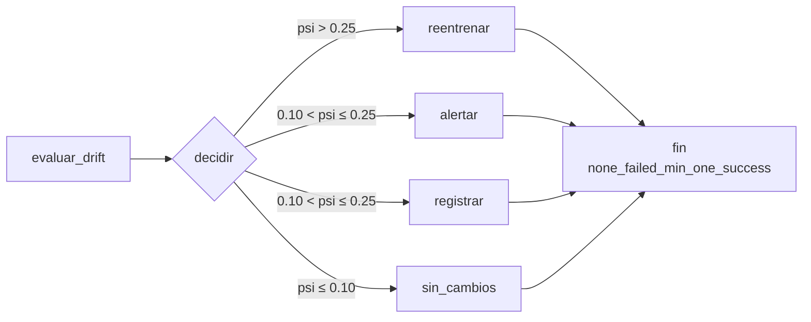

# 09 — Branching, Condicionales y Trigger Rules

> Continúa de [[08 - Templating con Jinja y Contexto]]. Un DAG es estático, pero su ejecución no tiene por qué serlo. Esta nota cubre cómo **elegir caminos** en tiempo de ejecución (`@task.branch`), **saltar** tareas según una condición (`short_circuit`, `run_if`/`skip_if`, `AirflowSkipException`), controlar **cuándo se ejecuta una tarea según el estado de sus upstream** (*trigger rules*) y el patrón **setup/teardown** para recursos efímeros.

## Branching: elegir el camino

```python
import pendulum
from airflow.sdk import dag, task
from airflow.providers.standard.operators.empty import EmptyOperator

@dag(schedule="@daily", start_date=pendulum.datetime(2026, 1, 1), catchup=False)
def reentreno_condicional():

    @task
    def evaluar_drift() -> float:
        return 0.31                                   # p. ej., PSI calculado con Evidently

    @task.branch
    def decidir(psi: float) -> str | list[str] | None:
        if psi > 0.25:
            return "reentrenar"                       # task_id a seguir
        elif psi > 0.10:
            return ["alertar", "registrar"]           # varias ramas
        return "sin_cambios"                          # None: salta todas

    @task
    def reentrenar(): ...
    @task
    def alertar(): ...
    @task
    def registrar(): ...
    sin_cambios = EmptyOperator(task_id="sin_cambios")

    fin = EmptyOperator(task_id="fin", trigger_rule="none_failed_min_one_success")  # ⭐

    rama = decidir(evaluar_drift())
    rama >> [reentrenar(), alertar(), registrar(), sin_cambios] >> fin

reentreno_condicional()
```



Reglas del branching:

- La función devuelve el **`task_id`** (o una lista, o `None`) de las tareas **inmediatamente downstream** que deben seguir. Las demás ramas quedan **`skipped`**.
- Dentro de un TaskGroup, el id lleva prefijo: `"grupo.tarea"`.
- ⚠️ La tarea donde **se unen las ramas** necesita una trigger rule distinta de la por defecto. Con `all_success`, como alguna rama quedó `skipped`, la unión también se salta. Usa **`none_failed_min_one_success`**.

Operadores equivalentes: `BranchPythonOperator`, `BranchDateTimeOperator` (rama según la hora), `BranchDayOfWeekOperator` (según el día de la semana) y `BranchSQLOperator` (según el resultado de una consulta).

```python
from airflow.providers.standard.operators.weekday import BranchDayOfWeekOperator

es_lunes = BranchDayOfWeekOperator(
    task_id="es_lunes",
    week_day="Monday",
    follow_task_ids_if_true="reporte_semanal",
    follow_task_ids_if_false="fin",
    use_task_logical_date=True,
)
```

---

## Short circuit: continuar o saltar todo lo que sigue

```python
@task.short_circuit
def hay_datos_nuevos(ds=None) -> bool:
    import duckdb
    n = duckdb.sql(f"SELECT COUNT(*) FROM 's3://lake/raw/ventas/fecha={ds}/*.parquet'").fetchone()[0]
    return n > 0          # False: TODAS las tareas downstream quedan skipped

hay_datos_nuevos() >> procesar() >> publicar()
```

```python
# Saltar solo las inmediatas y respetar las trigger rules de las siguientes
@task.short_circuit(ignore_downstream_trigger_rules=False)
def condicion() -> bool: ...
```

## `run_if` / `skip_if`: condición declarativa por tarea

Decoradores que se apilan sobre `@task` y evalúan una condición con el contexto **antes** de ejecutar:

```python
@task.run_if(lambda context: context["params"]["full_refresh"])
@task
def recrear_tablas(): ...

@task.skip_if(lambda context: context["logical_date"].day_of_week in (5, 6))   # sábado/domingo
@task
def enviar_reporte(): ...
```

Son más limpios que un branch cuando la condición afecta a **una sola tarea**.

## Saltar o fallar desde el código

```python
from airflow.exceptions import AirflowSkipException, AirflowFailException

@task(retries=3)
def descargar(ds=None):
    resp = consultar_api(ds)
    if resp.status_code == 404:
        raise AirflowSkipException(f"No hay archivo para {ds}")    # skipped, no failed
    if resp.status_code == 401:
        raise AirflowFailException("Credenciales inválidas")         # falla SIN reintentar
    resp.raise_for_status()                                          # otros errores: reintenta
```

| Excepción | Estado | ¿Reintenta? |
|---|---|---|
| Cualquier excepción | `up_for_retry` → `failed` | Sí, según `retries` |
| `AirflowFailException` | `failed` | **No** |
| `AirflowSkipException` | `skipped` | No |

Ver [[11 - Exception Handling]] y [[49 - Excepciones Avanzadas]] (en `Python/`).

---

## Trigger rules

La **trigger rule** de una tarea define **qué estados deben tener sus upstream** para que se ejecute. La regla por defecto es `all_success`.

| Trigger rule | Se ejecuta cuando... | Uso típico |
|---|---|---|
| `all_success` (default) | Todos los upstream terminaron con éxito | Flujo normal |
| `all_failed` | Todos fallaron (o `upstream_failed`) | Plan B total |
| `all_done` | Todos terminaron, en cualquier estado | **Limpieza** y reportes finales |
| `all_skipped` | Todos fueron saltados | Detectar "no había nada que hacer" |
| `one_success` | Al menos uno con éxito (no espera al resto) | Fuentes redundantes: basta con una |
| `one_failed` | Al menos uno falló (no espera al resto) | Alerta temprana |
| `one_done` | Al menos uno terminó (éxito o fallo) | |
| `none_failed` | Ninguno falló (éxitos o skipped) | Después de un branch sin exigir ejecución |
| `none_failed_min_one_success` | Ninguno falló **y** al menos uno tuvo éxito | ⭐ **Unir ramas de un branch** |
| `none_skipped` | Ninguno fue saltado | |
| `all_done_min_one_success` | Todos terminaron y al menos uno con éxito | Consolidar resultados parciales |
| `always` | Siempre, sin esperar a nada (sin dependencias efectivas) | Rara vez: tareas independientes en el mismo DAG |

```python
from airflow.sdk import task
from airflow.utils.trigger_rule import TriggerRule

@task(trigger_rule=TriggerRule.ALL_DONE)
def limpiar_temporales(): ...

@task(trigger_rule="one_failed")
def alertar_fallo(): ...
```

### Patrón: tolerar fallos parciales

```python
fuentes = [extraer.override(task_id=f"extraer_{f}")(f) for f in ["crm", "erp", "web"]]

@task(trigger_rule="all_done_min_one_success")
def consolidar(): ...         # corre si al menos una fuente se extrajo

@task(trigger_rule="one_failed")
def notificar_parcial(): ...

fuentes >> consolidar()
fuentes >> notificar_parcial()
```

---

## Setup y teardown: recursos efímeros

Patrón para **crear un recurso, usarlo y destruirlo siempre**, aunque falle el trabajo. Por ejemplo: levantar un cluster, crear una tabla temporal o lanzar una instancia con GPU.

```python
from airflow.sdk import dag, task, setup, teardown

@dag(...)
def entrenamiento_con_cluster():

    @setup
    def crear_cluster() -> str:
        return "cluster-123"

    @task
    def entrenar(cluster_id: str): ...

    @task
    def evaluar(cluster_id: str): ...

    @teardown
    def destruir_cluster(cluster_id: str): ...

    c = crear_cluster()
    entrenar(c) >> evaluar(c) >> destruir_cluster(c)

entrenamiento_con_cluster()
```

Qué garantiza Airflow con setup/teardown:

- El **teardown corre aunque fallen las tareas intermedias** (como un `finally`).
- El **estado del DAG Run** lo determinan las tareas de trabajo, no el teardown: si `entrenar` falla y el teardown tiene éxito, el run igual queda `failed`.
- Al hacer *clear* de una tarea intermedia, Airflow reejecuta también su setup y su teardown.

Con operadores clásicos:

```python
crear >> trabajo >> borrar.as_teardown(setups=crear)
```

Es el equivalente en un DAG de un context manager de Python (ver [[15 - Context Manager]] y [[50 - Context Managers Avanzados]]).

## LatestOnlyOperator

Salta el downstream en todos los runs **excepto el más reciente**. Es útil cuando hay catchup o backfill pero algunas tareas, como notificar o publicar un dashboard, solo tienen sentido para el run actual:

```python
from airflow.providers.standard.operators.latest_only import LatestOnlyOperator

solo_ultimo = LatestOnlyOperator(task_id="solo_ultimo")
procesar >> solo_ultimo >> notificar_slack
```

## Ver también

- [[06 - Operadores Clásicos y Dependencias]]
- [[10 - Scheduling, Timetables y Backfills]]
- [[12 - Dynamic Task Mapping]]
- [[17 - Testing, Observabilidad y Buenas Prácticas]]: callbacks de fallo
- [[02 - Control Flow]] (en `Python/`)
- [[18-Monitoreo-y-Observabilidad-de-Modelos]] (en `Machine Learning/`): el drift que dispara reentrenamientos condicionales
