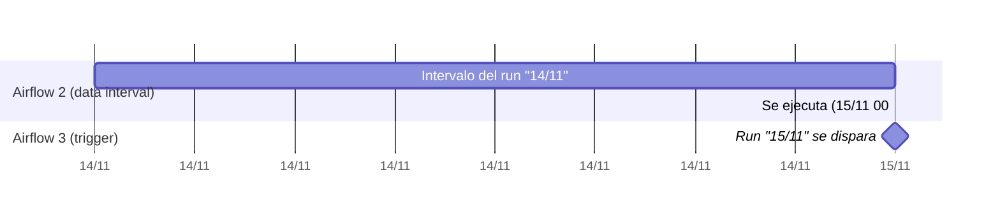

# 10 — Scheduling, Timetables y Backfills

> Continúa de [[09 - Branching, Condicionales y Trigger Rules]]. Esta nota explica **cuándo** crea Airflow un DAG Run: expresiones cron y presets, `timedelta`, los **timetables** (y el cambio de semántica de Airflow 3), `catchup`, `depends_on_past` y los **backfills** para reprocesar el pasado. El disparo por **eventos o datos** (Assets) tiene su propia nota: [[11 - Assets y Scheduling Event-Driven]].

## El parámetro `schedule`

| Valor | Significado |
|---|---|
| `None` | Solo manual (UI, CLI, API o `TriggerDagRunOperator`) |
| `"@once"` | Una única vez |
| `"@continuous"` | Un run detrás de otro, sin pausa (requiere `max_active_runs=1`) |
| `"@hourly"`, `"@daily"`, `"@weekly"`, `"@monthly"`, `"@quarterly"`, `"@yearly"` | Presets |
| `"30 6 * * 1-5"` | Expresión **cron** |
| `timedelta(hours=4)` | Cada 4 horas desde `start_date` |
| `Asset(...)` / `[a, b]` / `a \| b` | Disparo por datos (nota 11) |
| Un objeto `Timetable` | Lógica de calendario a medida |

> En Airflow 2 existían `schedule_interval=` y `timetable=`. En Airflow 3 **solo existe `schedule=`**.

### Cron en 30 segundos

```
┌───────── minuto (0-59)
│ ┌─────── hora (0-23)
│ │ ┌───── día del mes (1-31)
│ │ │ ┌─── mes (1-12)
│ │ │ │ ┌─ día de la semana (0-6, 0 = domingo; también MON-SUN)
│ │ │ │ │
* * * * *
```

| Cron | Cuándo |
|---|---|
| `0 6 * * *` | Todos los días a las 06:00 |
| `*/15 * * * *` | Cada 15 minutos |
| `0 8 * * 1-5` | Lunes a viernes a las 08:00 |
| `0 0 1 * *` | El día 1 de cada mes a medianoche |
| `0 9 * * MON` | Lunes a las 09:00 |
| `0 2 L * *` | Último día del mes (sintaxis extendida de croniter) |
| `30 23 * * 0` | Domingos a las 23:30 |

El cron se interpreta en la **zona horaria del `start_date`** (por ejemplo, `pendulum.datetime(..., tz="America/Lima")`), o en `core.default_timezone` si el `start_date` no tiene zona. Esto incluye los cambios de horario de verano en las zonas que los tienen.

---

## Timetables: trigger vs. data interval

Un **timetable** decide dos cosas: **cuándo** se crea cada run y qué **data interval** cubre.

### `CronTriggerTimetable` (default en Airflow 3)

El run se dispara **en el instante del cron** y "pertenece" a ese instante. El data interval es vacío (start = end = logical_date), salvo que configures `interval`.

```python
from airflow.timetables.trigger import CronTriggerTimetable

@dag(schedule=CronTriggerTimetable("0 6 * * *", timezone="America/Lima"), ...)
# equivalente a schedule="0 6 * * *" en Airflow 3

# Con intervalo explícito: data_interval_start = logical_date - 1 día
@dag(schedule=CronTriggerTimetable("0 6 * * *", timezone="America/Lima",
                                   interval=pendulum.duration(days=1)), ...)
```

### `CronDataIntervalTimetable` (default en Airflow 2)

Cada run cubre un **intervalo** y se ejecuta **al final** de ese intervalo. El run del intervalo `[14/11, 15/11)` corre el 15/11 a las 00:00 con `logical_date = 14/11`.

```python
from airflow.timetables.interval import CronDataIntervalTimetable

@dag(schedule=CronDataIntervalTimetable("@daily", timezone="UTC"), ...)
```



| | `CronTriggerTimetable` (3.x) | `CronDataIntervalTimetable` (2.x) |
|---|---|---|
| Run que corre el 15/11 a las 00:00 | `logical_date` = 15/11 | `logical_date` = 14/11 |
| `{{ ds }}` en ese run | `2026-11-15` | `2026-11-14` |
| Modelo mental | "Ejecuta a esta hora" | "Procesa este periodo" |
| Para procesar "ayer" | `macros.ds_add(ds, -1)` o `interval=` | `ds` directamente |

> **Recomendación:** decide explícitamente qué semántica quieres y documéntala en el DAG. Si procesas periodos de datos (ventas del día), `CronDataIntervalTimetable` o `CronTriggerTimetable(..., interval=...)` dejan el código más claro, porque `data_interval_start`/`end` delimitan exactamente lo que se procesa. Para volver globalmente al comportamiento de 2.x existe `[scheduler] create_cron_data_intervals = True`.

### Otros timetables incluidos

```python
from airflow.timetables.trigger import MultipleCronTriggerTimetable, DeltaTriggerTimetable
from airflow.timetables.events import EventsTimetable

# Varios horarios en un DAG: 08:00 y 18:00 entre semana, 10:00 los sábados
schedule = MultipleCronTriggerTimetable("0 8,18 * * 1-5", "0 10 * * 6", timezone="America/Lima")

# Fechas concretas (cierres contables, campañas)
schedule = EventsTimetable(event_dates=[
    pendulum.datetime(2026, 3, 31, 20, tz="America/Lima"),
    pendulum.datetime(2026, 6, 30, 20, tz="America/Lima"),
])

# Cada N tiempo
schedule = DeltaTriggerTimetable(pendulum.duration(hours=6))
```

### Timetable propio (plugin)

Para calendarios de negocio, como "días hábiles excluyendo feriados de Perú", hereda de `Timetable`, implementa `next_dagrun_info` e `infer_manual_data_interval`, y regístralo en un plugin:

```python
# plugins/dias_habiles.py
from airflow.plugins_manager import AirflowPlugin
from airflow.timetables.base import Timetable, DagRunInfo, DataInterval
import holidays, pendulum

FERIADOS = holidays.Peru()

class DiasHabilesTimetable(Timetable):
    def infer_manual_data_interval(self, *, run_after):
        inicio = run_after.start_of("day")
        return DataInterval(start=inicio, end=inicio.add(days=1))

    def next_dagrun_info(self, *, last_automated_data_interval, restriction):
        siguiente = (last_automated_data_interval.end if last_automated_data_interval
                     else restriction.earliest.start_of("day"))
        while siguiente.day_of_week >= 5 or siguiente.date() in FERIADOS:   # sáb/dom o feriado
            siguiente = siguiente.add(days=1)
        if restriction.latest and siguiente > restriction.latest:
            return None
        return DagRunInfo.interval(start=siguiente, end=siguiente.add(days=1))

class DiasHabilesPlugin(AirflowPlugin):
    name = "dias_habiles"
    timetables = [DiasHabilesTimetable]
```

---

## `catchup`

Cuando activas un DAG (o el scheduler estuvo caído), ¿qué pasa con los runs que "debieron" ocurrir entre `start_date` y ahora?

- **`catchup=False`** (default en 3.x): solo se crea el run más reciente.
- **`catchup=True`**: se crean **todos** los runs pendientes desde `start_date` (o desde el último run).

```python
@dag(schedule="@daily", start_date=pendulum.datetime(2025, 1, 1), catchup=True, max_active_runs=3)
# Al activarlo el 15/11/2026: ~680 runs, 3 a la vez
```

Usa `catchup=True` solo si **cada run procesa su propio periodo** de forma idempotente y quieres reconstruir el historial. Para reprocesos puntuales, un **backfill** es más controlable.

## Ejecución secuencial y dependencias entre runs

```python
@dag(max_active_runs=1, ...)                    # nunca dos runs del DAG a la vez
@task(depends_on_past=True)                     # esta tarea espera el éxito de sí misma en el run anterior
@task(wait_for_downstream=True)                 # y además el de sus downstream inmediatos
```

Úsalos cuando cada run depende del estado que dejó el anterior (por ejemplo, tablas acumulativas o SCD tipo 2; ver [[08 - Snapshots y SCD Tipo 2|dbt/08]]). Precaución: un run fallido **bloquea** a todos los siguientes hasta que lo resuelvas.

---

## Backfills

Un **backfill** crea runs para un **rango de fechas pasado**: reprocesar tras corregir un bug, cargar historia nueva o recalcular una métrica.

En Airflow 3 los backfills son entidades de primera clase **gestionadas por el scheduler** (en 2.x eran un proceso de CLI que había que mantener vivo). Se lanzan desde:

**UI:** botón *Trigger* del DAG → pestaña *Backfill* → rango de fechas, comportamiento de reproceso y concurrencia.

**CLI:**

```bash
airflow backfill create --dag-id ventas_diarias \
    --from-date 2026-10-01 --to-date 2026-10-31 \
    --reprocess-behavior failed \
    --max-active-runs 4 \
    --run-backwards                     # empieza por la fecha más reciente
```

**REST API:**

```bash
curl -X POST localhost:8080/api/v2/backfills -H "Authorization: Bearer $TOKEN" \
  -H 'Content-Type: application/json' \
  -d '{"dag_id": "ventas_diarias", "from_date": "2026-10-01T00:00:00Z",
       "to_date": "2026-10-31T00:00:00Z", "reprocess_behavior": "failed", "max_active_runs": 4}'
```

| `reprocess_behavior` | Fechas que ya tienen run... |
|---|---|
| `none` | Se omiten: solo crea las que faltan |
| `failed` | Reprocesa solo las que fallaron |
| `completed` | Reprocesa todas, incluso las exitosas |

### Requisitos para que un backfill sea seguro

1. **Idempotencia**: correr dos veces la misma fecha produce el mismo resultado (sobreescribir partición, `DELETE`+`INSERT`, `MERGE`).
2. **Determinismo por fecha**: la tarea usa `data_interval_start`/`end` o `ds`, **nunca `datetime.now()`**.
3. **Sin efectos externos irrepetibles**: no mandar 30 emails, no cobrar dos veces. Protégelos con `LatestOnlyOperator` o `run_if` (ver [[09 - Branching, Condicionales y Trigger Rules#LatestOnlyOperator]]).
4. **Concurrencia controlada**: `max_active_runs` acorde con la capacidad de la fuente y del destino.

```python
# ❌ No idempotente ni determinista
@task
def cargar():
    hoy = datetime.now().date()                        # en un backfill siempre es "hoy"
    con.execute(f"INSERT INTO ventas SELECT * FROM raw WHERE fecha = '{hoy}'")   # duplica al reintentar

# ✅ Idempotente y determinista
@task
def cargar(data_interval_start=None, data_interval_end=None):
    con.begin()
    con.execute("DELETE FROM ventas WHERE fecha >= ? AND fecha < ?", [data_interval_start, data_interval_end])
    con.execute("INSERT INTO ventas SELECT * FROM raw WHERE fecha >= ? AND fecha < ?",
                [data_interval_start, data_interval_end])
    con.commit()
```

## Pausar, reanudar y re-ejecutar

- Los DAGs nuevos arrancan **pausados** (`is_paused_upon_creation`, `core.dags_are_paused_at_creation`).
- **Clear** (UI o `airflow tasks clear`) reencola tareas de runs existentes: es la forma de reintentar sin crear runs nuevos.
- **Mark success/failed** cambia estados a mano (útil para "desbloquear" un `depends_on_past`).

## Ver también

- [[08 - Templating con Jinja y Contexto#logical_date vs. data interval: la semántica que más confunde]]
- [[11 - Assets y Scheduling Event-Driven]]
- [[03 - CLI de Airflow#Backfill]]
- [[07 - Modelos Incrementales|dbt/07]]: incrementales idempotentes que encajan con backfills
- [[53 - Fechas y Zonas Horarias]] (en `Python/`)
