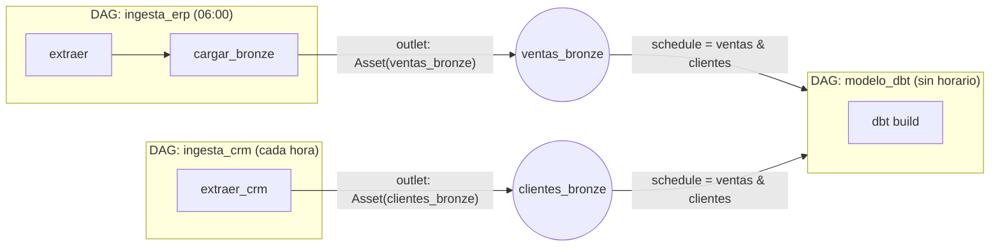

# 11 — Assets y Scheduling Event-Driven

> Continúa de [[10 - Scheduling, Timetables y Backfills]]. Programar por horario obliga a adivinar ("el ERP suele terminar a las 5, pongamos el DAG a las 6"). Los **Assets** (llamados *Datasets* en Airflow 2) permiten programar **por datos**: el DAG consumidor se dispara **cuando el productor actualiza el dato**. Airflow 3 añade además el decorador `@asset` y los **AssetWatchers**, que reaccionan a eventos externos (colas de mensajes). Esta nota cubre los tres.

## La idea



- Una tarea declara **`outlets=[asset]`**: al terminar con éxito, Airflow registra un **asset event**.
- Un DAG con **`schedule=[asset]`** se dispara cuando hay eventos nuevos de esos assets.
- Airflow **no inspecciona el dato**: un Asset es un identificador lógico. Es tu tarea la que realmente escribe en S3 o en la tabla.

---

## Definir y producir Assets

```python
from airflow.sdk import Asset, dag, task
import pendulum

ventas_bronze = Asset(
    name="ventas_bronze",                          # identificador lógico (único)
    uri="s3://lake/bronze/ventas",                 # ubicación (opcional, informativa/validada por esquema)
    group="ventas",                                # agrupación en la UI
    extra={"owner": "equipo-datos", "formato": "parquet"},
)

@dag(schedule="0 6 * * *", start_date=pendulum.datetime(2026, 1, 1, tz="America/Lima"), catchup=False)
def ingesta_erp():

    @task(outlets=[ventas_bronze])                 # al terminar OK, se emite el evento
    def cargar_bronze():
        ...

    cargar_bronze()

ingesta_erp()
```

Con operadores clásicos: `SQLExecuteQueryOperator(..., outlets=[ventas_bronze])`.

> Si la tarea **falla**, no hay evento. Si la tarea termina "OK" pero no escribió nada, **sí** hay evento, porque Airflow confía en ti. Valida dentro de la tarea antes de terminar.

## Consumir: DAGs disparados por assets

```python
clientes_bronze = Asset("clientes_bronze", uri="s3://lake/bronze/clientes")

# Se dispara cuando AMBOS se actualizaron desde el último run (AND por defecto)
@dag(schedule=[ventas_bronze, clientes_bronze], start_date=pendulum.datetime(2026, 1, 1), catchup=False)
def modelo_dbt():
    ...

# Expresiones lógicas
@dag(schedule=(ventas_bronze | clientes_bronze), ...)                       # cualquiera de los dos
@dag(schedule=(ventas_bronze & (clientes_bronze | productos_bronze)), ...)  # combinaciones
```

### Asset + horario

```python
from airflow.timetables.assets import AssetOrTimeSchedule
from airflow.timetables.trigger import CronTriggerTimetable

# Corre cuando llega el dato O, como mínimo, todos los días a las 09:00
@dag(schedule=AssetOrTimeSchedule(
        timetable=CronTriggerTimetable("0 9 * * *", timezone="America/Lima"),
        assets=(ventas_bronze & clientes_bronze)), ...)
def reporte(): ...
```

### Leer qué eventos dispararon el run

```python
@task
def info(triggering_asset_events=None):
    for asset, eventos in triggering_asset_events.items():
        for ev in eventos:
            print(asset.name, ev.timestamp, ev.extra, ev.source_dag_id, ev.source_run_id)
```

Varios eventos de un mismo asset entre dos runs del consumidor se **agrupan en un solo run**: el consumidor no corre una vez por evento.

---

## Metadata en los eventos

El productor puede adjuntar información al evento (filas escritas, ruta exacta, versión), y el consumidor la lee:

```python
from airflow.sdk import Metadata

@task(outlets=[ventas_bronze])
def cargar(ds=None, outlet_events=None):
    n = escribir_particion(ds)
    outlet_events[ventas_bronze].extra = {"filas": n, "particion": f"fecha={ds}"}
    # alternativa: yield Metadata(ventas_bronze, {"filas": n})

@task(inlets=[ventas_bronze])
def consumir(inlet_events=None):
    ultimo = inlet_events[ventas_bronze][-1]
    print("Partición:", ultimo.extra["particion"])
```

Así el consumidor procesa **exactamente la partición que llegó**, en lugar de adivinarla por fecha.

---

## El decorador `@asset` (Airflow 3)

Para el caso común de "un DAG con una tarea que materializa un asset", `@asset` crea las tres cosas a la vez: el **Asset**, el **DAG** y la **tarea**. El enfoque es *asset-centric*, como en Dagster.

```python
from airflow.sdk import asset

@asset(schedule="@daily", uri="s3://lake/raw/tipo_cambio", group="finanzas")
def tipo_cambio():
    """Descarga el tipo de cambio del día."""
    ...
    return {"usd_pen": 3.74}

@asset(schedule=tipo_cambio)                       # se dispara cuando tipo_cambio se materializa
def ventas_en_usd(context, tipo_cambio):           # recibe el retorno de tipo_cambio (vía XCom)
    tasa = tipo_cambio["usd_pen"]
    ...
```

- El nombre del asset, del DAG y de la tarea es el nombre de la función.
- Un parámetro con el nombre de otro asset recibe **lo que devolvió** ese asset.
- `@asset.multi(outlets=[a, b])` materializa varios assets en una función.

| Usa `@asset` | Usa `@dag` + `outlets` |
|---|---|
| Un paso que produce un dato bien definido | DAGs con muchas tareas, branching o mapping |
| Pensar el pipeline como un grafo de datos | Pensar el pipeline como un flujo de pasos |

---

## AssetAlias: assets dinámicos

Cuando **no sabes de antemano** qué asset vas a producir (por ejemplo, una partición o tabla cuyo nombre depende de los datos), emite eventos a través de un alias:

```python
from airflow.sdk import AssetAlias

alias_clientes = AssetAlias("tablas_de_clientes")

@task(outlets=[alias_clientes])
def cargar_cliente(cliente: str, outlet_events=None):
    outlet_events[alias_clientes].add(Asset(f"s3://lake/clientes/{cliente}"))

# Los consumidores pueden programarse sobre el alias
@dag(schedule=[alias_clientes], ...)
def consolidar(): ...
```

---

## Eventos externos

### 1. REST API: un sistema externo avisa

```bash
curl -X POST localhost:8080/api/v2/assets/events \
  -H "Authorization: Bearer $TOKEN" -H 'Content-Type: application/json' \
  -d '{"asset_id": 12, "extra": {"origen": "erp", "archivo": "ventas_20261114.csv"}}'
```

Útil cuando el sistema que genera los datos (un ETL legado o una función Lambda tras subir un archivo a S3) puede hacer un POST.

### 2. AssetWatcher: escuchar una cola de mensajes

Airflow 3 introduce **event-driven scheduling**: un **AssetWatcher** usa un *trigger* asíncrono (corre en el triggerer) que escucha una fuente externa y emite un asset event por cada mensaje.

```python
from airflow.sdk import Asset, AssetWatcher, dag, task
from airflow.providers.common.messaging.triggers.msg_queue import MessageQueueTrigger

trigger = MessageQueueTrigger(
    queue="https://sqs.us-east-1.amazonaws.com/123456789012/archivos-nuevos",   # SQS (Kafka también soportado)
)

archivos_nuevos = Asset(
    "archivos_nuevos_sqs",
    watchers=[AssetWatcher(name="watcher_sqs", trigger=trigger)],
)

@dag(schedule=[archivos_nuevos])
def procesar_archivo():

    @task
    def procesar(triggering_asset_events=None):
        for ev in triggering_asset_events[archivos_nuevos]:
            print(ev.extra)        # contenido del mensaje

    procesar()

procesar_archivo()
```

> El soporte de colas (SQS, Kafka y otras) depende de los providers instalados (`common-messaging`, `amazon`, `apache-kafka`) y evoluciona entre versiones menores. Revisa la documentación de tu versión.

---

## Assets vs. otras formas de encadenar DAGs

| Mecanismo | Acoplamiento | Cuándo |
|---|---|---|
| **Assets** | Bajo: el productor no sabe quién consume | ⭐ Por defecto para dependencias entre DAGs de datos |
| `TriggerDagRunOperator` | Alto: el productor nombra al consumidor | El productor debe esperar al consumidor o pasarle `conf` |
| `ExternalTaskSensor` | Medio: el consumidor espera una tarea concreta | DAGs con horarios alineados, código legado (nota 14) |
| Un DAG gigante | Total | Solo si de verdad es un único flujo |

## Vista de assets en la UI

La UI de Airflow 3 tiene una sección **Assets** con el grafo de linaje entre assets y DAGs, el historial de eventos de cada asset y la opción de crear un evento manualmente, lo que sirve para disparar a los consumidores sin correr el productor.

## Ver también

- [[10 - Scheduling, Timetables y Backfills]]
- [[14 - Sensores, Deferrable Operators y el Triggerer]]: el triggerer que ejecuta los AssetWatchers
- [[15 - Airflow con dbt, Docker, Kubernetes y MLflow]]: assets y dbt con Cosmos
- [[12 - Documentación, Lineage y Contratos|dbt/12]]: lineage en dbt
- [[50-Orquestacion-Prefect-y-Airflow]] (en `Machine Learning/`)
