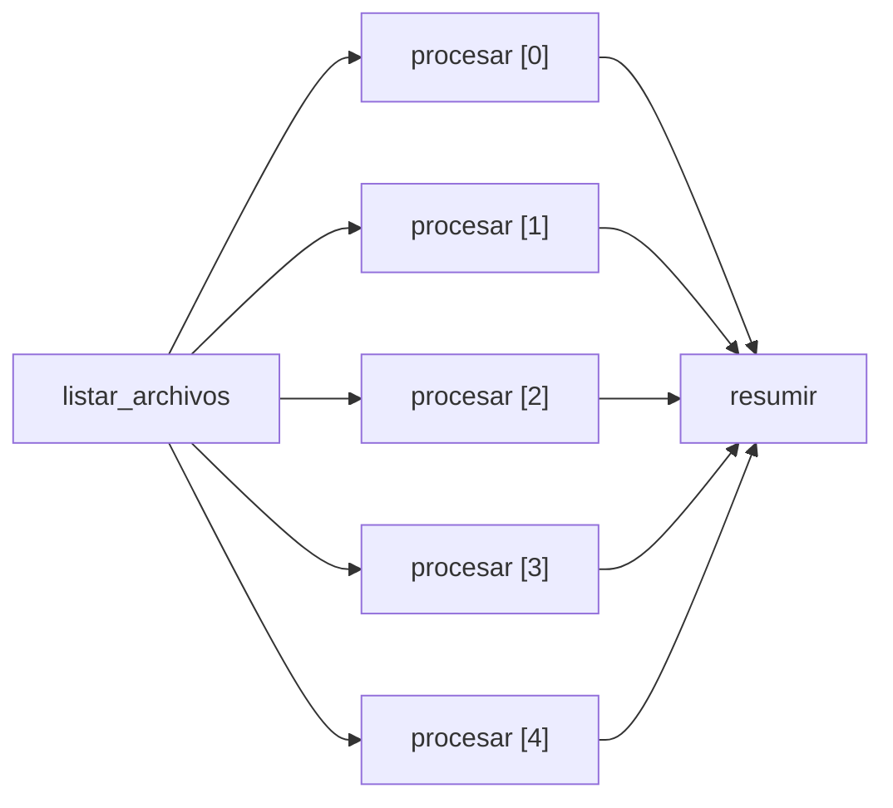

# 12 — Dynamic Task Mapping

> Continúa de [[11 - Assets y Scheduling Event-Driven]]. A menudo el número de tareas **no se conoce hasta ejecutar**: los archivos que llegaron hoy, los clientes activos, los modelos a reentrenar. El **Dynamic Task Mapping** crea **N instancias de una tarea en tiempo de ejecución** a partir de una lista, como un `map()` de Python. Esta nota cubre `expand`, `partial`, `expand_kwargs`, `zip`, `map`, el mapeo de TaskGroups y sus límites.

## Lo básico: `.expand()`

```python
import pendulum
from airflow.sdk import dag, task

@dag(schedule="@daily", start_date=pendulum.datetime(2026, 1, 1), catchup=False)
def procesar_archivos():

    @task
    def listar_archivos(ds=None) -> list[str]:
        # en la práctica: listar S3 / un directorio / una tabla de control
        return [f"s3://raw/ventas/{ds}/tienda_{i}.csv" for i in range(1, 6)]

    @task
    def procesar(archivo: str) -> int:
        print(f"Procesando {archivo}")
        return 100                                  # filas procesadas

    @task
    def resumir(conteos: list[int]):                # recibe la lista de TODOS los resultados
        print(f"Total: {sum(conteos)} filas en {len(conteos)} archivos")

    resumir(procesar.expand(archivo=listar_archivos()))

procesar_archivos()
```



- `expand()` acepta una **lista literal**, un **dict** o un **XComArg** (la salida de otra tarea).
- Cada instancia mapeada tiene su **`map_index`** (0, 1, 2...) y se reintenta, se limpia y se registra por separado.
- El downstream recibe un **iterable "lazy"** con los resultados de todas las instancias (`LazyXComSequence`). Conviértelo con `list()` si necesitas indexarlo.
- Si la lista está **vacía**, la tarea mapeada queda `skipped` (y su downstream también, según las trigger rules).

---

## `partial()`: argumentos fijos + argumentos mapeados

```python
@task
def cargar(archivo: str, tabla: str, modo: str) -> int: ...

cargar.partial(tabla="bronze.ventas", modo="append").expand(archivo=listar_archivos())
```

`partial` define lo que es **igual para todas** las instancias y `expand` lo que **varía**. Los parámetros de la tarea (`retries`, `pool`...) también van en `partial` o en `@task`.

## Producto cartesiano: varios argumentos en `expand`

```python
@task
def entrenar(modelo: str, region: str): ...

entrenar.expand(modelo=["xgboost", "lightgbm"], region=["LATAM", "EMEA", "NA"])
# 2 × 3 = 6 instancias: todas las combinaciones
```

## `expand_kwargs`: combinaciones específicas

Si **no** quieres el producto cartesiano sino combinaciones concretas, pasa una lista de dicts:

```python
@task
def configs() -> list[dict]:
    return [
        {"modelo": "xgboost",  "region": "LATAM", "max_depth": 6},
        {"modelo": "lightgbm", "region": "EMEA",  "max_depth": 8},
    ]

@task
def entrenar(modelo: str, region: str, max_depth: int): ...

entrenar.expand_kwargs(configs())       # 2 instancias, una por dict
```

## `zip`: emparejar listas por posición

```python
archivos = listar_archivos()            # ["a.csv", "b.csv"]
destinos = listar_destinos()            # ["t_a", "t_b"]

@task
def copiar(par: tuple[str, str]):
    origen, destino = par
    ...

copiar.expand(par=archivos.zip(destinos))      # ("a.csv","t_a"), ("b.csv","t_b")
```

## `map`: transformar la lista antes de expandir

`.map()` aplica una función ligera a cada elemento de un XComArg **sin crear una tarea extra**:

```python
def a_ruta_parquet(archivo: str) -> str:
    return archivo.replace("raw", "bronze").replace(".csv", ".parquet")

rutas = listar_archivos().map(a_ruta_parquet)
procesar.expand(ruta=rutas)
```

> La función de `.map()` no puede usar el contexto de Airflow ni hacer I/O pesado: corre al resolver la expansión.

---

## Mapear operadores clásicos

```python
from airflow.providers.standard.operators.bash import BashOperator
from airflow.providers.amazon.aws.operators.s3 import S3ListOperator

listar = S3ListOperator(task_id="listar", bucket="raw", prefix="ventas/{{ ds }}/", aws_conn_id="aws_default")

BashOperator.partial(task_id="contar_lineas", retries=2).expand(
    bash_command=listar.output.map(lambda k: f"aws s3 cp s3://raw/{k} - | wc -l")
)
```

Restricción: no se pueden mapear `task_id`, `pool` ni algunos otros parámetros de BaseOperator. Van en `partial`.

## Mapear un TaskGroup completo

```python
from airflow.sdk import task_group

@task_group
def pipeline_por_cliente(cliente: str):
    @task
    def extraer(c: str) -> str: return f"s3://raw/{c}"
    @task
    def validar(ruta: str) -> str: return ruta
    @task
    def cargar(ruta: str): ...
    cargar(validar(extraer(cliente)))

@task
def clientes_activos() -> list[str]:
    return ["acme", "globex", "initech"]

pipeline_por_cliente.expand(cliente=clientes_activos())
```

Cada cliente obtiene su propia cadena `extraer → validar → cargar`, y las cadenas avanzan **en paralelo e independientes**: `validar[1]` no espera a `extraer[2]`.

---

## Nombres legibles: `map_index_template`

Por defecto la UI muestra `[0]`, `[1]`... Con `map_index_template` cada instancia muestra un nombre útil:

```python
@task(map_index_template="{{ cliente }}")
def procesar(cliente: str): ...

# o con una variable de contexto definida dentro de la tarea
@task(map_index_template="{{ archivo_nombre }}")
def procesar_archivo(archivo: str):
    from airflow.sdk import get_current_context
    get_current_context()["archivo_nombre"] = archivo.split("/")[-1]
```

## Concurrencia y límites

| Configuración | Efecto |
|---|---|
| `max_active_tis_per_dag=4` (en la tarea) | Máximo 4 instancias de esta tarea corriendo a la vez en **todo el DAG** |
| `max_active_tis_per_dagrun=4` | Máximo 4 a la vez **por run** |
| `pool="api_externa"` | Limita contra un recurso compartido (ver [[16 - Executors, Escalado y Despliegue]]) |
| `[core] max_map_length` (1024 por defecto) | Máximo de instancias por tarea mapeada |

```python
@task(max_active_tis_per_dagrun=5, pool="api_crm", retries=3)
def llamar_api(cliente_id: int): ...
```

> **No mapees sobre millones de elementos.** Cada instancia es una task instance con su fila en la DB, sus logs y su overhead de scheduling (segundos). Si tienes 100,000 archivos, agrúpalos en **lotes** (por ejemplo, 50 lotes de 2,000) y procesa cada lote dentro de una tarea con DuckDB o Polars:

```python
@task
def crear_lotes(archivos: list[str], tamano: int = 2000) -> list[list[str]]:
    return [archivos[i:i + tamano] for i in range(0, len(archivos), tamano)]

@task
def procesar_lote(lote: list[str]) -> int:
    import duckdb
    return duckdb.sql(f"SELECT COUNT(*) FROM read_parquet({lote})").fetchone()[0]

procesar_lote.expand(lote=crear_lotes(listar_archivos()))
```

Ver [[34 - Itertools en Profundidad]] (`itertools.batched`).

## Casos de uso típicos

| Caso | Expand sobre |
|---|---|
| Ingestar los archivos que llegaron | La lista de keys de S3 |
| Un modelo por tienda, región o SKU | La lista de segmentos |
| Búsqueda de hiperparámetros en paralelo | `expand_kwargs` con configuraciones (ver [[Python/Optuna/01 - Introducción y Conceptos Fundamentales|Optuna]] para búsquedas inteligentes) |
| Exportar un reporte por cliente | La lista de clientes activos |
| Ejecutar los mismos tests de calidad sobre N tablas | La lista de tablas |

## Ver también

- [[05 - TaskFlow API]]
- [[07 - XComs y Paso de Datos#XComs y dynamic task mapping]]
- [[09 - Branching, Condicionales y Trigger Rules]]
- [[04 - DAGs - Definición y Parámetros#Generar DAGs dinámicamente]]: variación **estructural** (varios DAGs) frente a variación **por ejecución** (mapping)
- [[31 - Funciones de Alto Orden y Programación Funcional]] (en `Python/`): `map`, `zip` y el modelo mental detrás de `expand`
