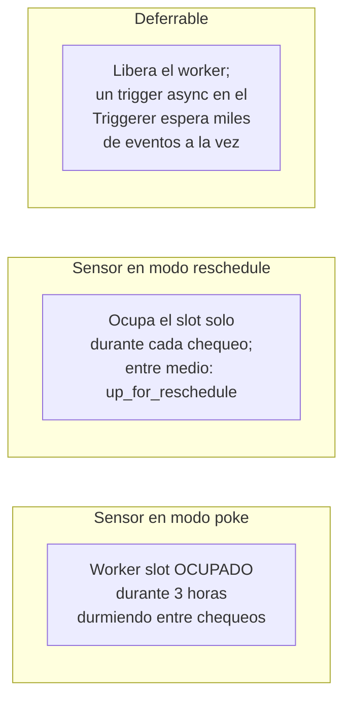
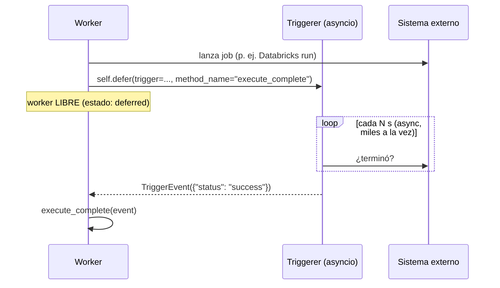

# 14 — Sensores, Deferrable Operators y el Triggerer

> Continúa de [[13 - Connections, Variables, Hooks y Providers]]. Muchas tareas pasan la mayor parte del tiempo **esperando**: que llegue un archivo, que termine un job de Databricks o que otro DAG acabe. Esta nota cubre los **sensores**, sus modos (`poke`/`reschedule`), los **operadores deferrable** que esperan **sin ocupar un worker** y el **triggerer**, el componente asíncrono que lo hace posible.

## El problema: esperar cuesta slots



Con 50 sensores en modo `poke` esperando archivos, puedes tener 50 slots de worker **bloqueados sin hacer nada** y el resto de los DAGs en cola.

---

## Sensores

Un sensor es una tarea que ejecuta repetidamente `poke()` hasta que devuelve `True` o se agota el `timeout`.

### Parámetros comunes (`BaseSensorOperator`)

| Parámetro | Default | Descripción |
|---|---|---|
| `poke_interval` | 60 s | Cada cuánto chequear |
| `timeout` | 7 días | Tiempo total máximo de espera. **Ajústalo siempre** |
| `mode` | `"poke"` | `"poke"` (mantiene el slot) o `"reschedule"` (lo libera entre chequeos) |
| `soft_fail` | False | Si hace timeout, queda `skipped` en lugar de `failed` |
| `exponential_backoff` | False | Aumenta el intervalo entre chequeos |
| `max_wait` | — | Tope del intervalo con backoff |
| `deferrable` | False | (en sensores que lo soportan) Delegar la espera al triggerer |
| `silent_fail` | False | Ignorar errores del poke (que no sean de timeout) y seguir intentando |

### Sensores más usados

```python
from airflow.providers.standard.sensors.filesystem import FileSensor
from airflow.providers.standard.sensors.time_delta import TimeDeltaSensor
from airflow.providers.standard.sensors.date_time import DateTimeSensor
from airflow.providers.standard.sensors.external_task import ExternalTaskSensor
from airflow.providers.amazon.aws.sensors.s3 import S3KeySensor
from airflow.providers.common.sql.sensors.sql import SqlSensor
from airflow.providers.http.sensors.http import HttpSensor

# Archivo en S3 (con comodines), sin ocupar worker
esperar_archivo = S3KeySensor(
    task_id="esperar_archivo",
    bucket_name="raw",
    bucket_key="ventas/{{ ds }}/_SUCCESS",
    wildcard_match=False,
    aws_conn_id="aws_default",
    deferrable=True,
    timeout=pendulum.duration(hours=4).total_seconds(),
    soft_fail=False,
)

# Una consulta que devuelve un valor "truthy"
esperar_carga = SqlSensor(
    task_id="esperar_carga_erp",
    conn_id="postgres_erp",
    sql="SELECT 1 FROM control_cargas WHERE fecha = '{{ ds }}' AND estado = 'OK'",
    mode="reschedule",
    poke_interval=300,
    timeout=6 * 3600,
)

# Un endpoint HTTP que responde lo esperado
api_lista = HttpSensor(
    task_id="api_lista",
    http_conn_id="api_crm",
    endpoint="/v1/export/status",
    response_check=lambda r: r.json()["status"] == "ready",
    mode="reschedule",
)

# Esperar un tiempo relativo al fin del intervalo de datos
esperar_30m = TimeDeltaSensor(task_id="esperar_30m", delta=pendulum.duration(minutes=30), deferrable=True)

# Esperar hasta una hora concreta
hasta_las_8 = DateTimeSensor(
    task_id="hasta_las_8",
    target_time="{{ logical_date.in_timezone('America/Lima').replace(hour=8) }}",
    deferrable=True,
)

# Archivo local o en un volumen compartido
FileSensor(task_id="archivo_local", filepath="/data/in/{{ ds }}.csv", fs_conn_id="fs_default",
           mode="reschedule")
```

### `ExternalTaskSensor`: esperar a otro DAG

```python
esperar_ingesta = ExternalTaskSensor(
    task_id="esperar_ingesta",
    external_dag_id="ingesta_erp",
    external_task_id="cargar_bronze",            # None = esperar el DAG completo
    allowed_states=["success"],
    failed_states=["failed", "skipped"],         # falla rápido en lugar de esperar al timeout
    execution_delta=pendulum.duration(hours=1),  # si el otro DAG corre 1 h antes
    deferrable=True,
    timeout=3 * 3600,
)
```

> El ExternalTaskSensor exige que los **logical dates coincidan** (o que des `execution_delta` o `execution_date_fn`). Es frágil cuando los horarios cambian. Para dependencias entre DAGs, en Airflow 3 suelen ser mejor los **Assets** (ver [[11 - Assets y Scheduling Event-Driven]]).

### Sensor propio con `@task.sensor`

```python
from airflow.sdk import task, PokeReturnValue

@task.sensor(poke_interval=120, timeout=3600, mode="reschedule")
def esperar_modelo_aprobado(ds=None) -> PokeReturnValue:
    from mlflow import MlflowClient
    client = MlflowClient()
    try:
        mv = client.get_model_version_by_alias("churn", "candidato")
        listo = mv.tags.get("aprobado") == "true"
    except Exception:
        listo, mv = False, None
    return PokeReturnValue(is_done=listo, xcom_value=mv.version if listo else None)

version = esperar_modelo_aprobado()
desplegar(version)          # recibe el xcom_value
```

---

## Deferrable operators

Un operador **deferrable** inicia una operación (por ejemplo, lanza un job), y luego **se suspende**: libera el worker y entrega la espera a un **trigger** asíncrono que corre en el **triggerer**. Cuando el trigger detecta el evento, la tarea **se reanuda** en un worker para terminar.



Muchos operadores de providers tienen `deferrable=True`: `S3KeySensor`, `DatabricksSubmitRunOperator`, `BigQueryInsertJobOperator`, `EmrServerlessStartJobOperator`, `DbtCloudRunJobOperator`, `KubernetesPodOperator`, `TriggerDagRunOperator(wait_for_completion=True)`, etc.

```bash
# Activar deferrable por defecto en todos los operadores que lo soportan
export AIRFLOW__OPERATORS__DEFAULT_DEFERRABLE=True
```

> Requisito: el componente **triggerer** debe estar corriendo (`airflow triggerer`). Sin él, las tareas diferidas se quedan en `deferred` para siempre.

### Escribir un trigger y un operador deferrable

```python
# include/triggers/job_trigger.py
import asyncio
from collections.abc import AsyncIterator
from airflow.triggers.base import BaseTrigger, TriggerEvent

class JobTerminadoTrigger(BaseTrigger):
    def __init__(self, job_id: str, poll_interval: int = 30):
        super().__init__()
        self.job_id = job_id
        self.poll_interval = poll_interval

    def serialize(self) -> tuple[str, dict]:
        # ruta importable + kwargs: el triggerer reconstruye el trigger con esto
        return ("triggers.job_trigger.JobTerminadoTrigger",
                {"job_id": self.job_id, "poll_interval": self.poll_interval})

    async def run(self) -> AsyncIterator[TriggerEvent]:
        import httpx
        async with httpx.AsyncClient() as client:
            while True:
                r = await client.get(f"https://jobs.empresa.com/api/jobs/{self.job_id}")
                estado = r.json()["status"]
                if estado in ("SUCCESS", "FAILED"):
                    yield TriggerEvent({"job_id": self.job_id, "status": estado})
                    return
                await asyncio.sleep(self.poll_interval)
```

```python
# include/operators/job_operator.py
from airflow.sdk import BaseOperator
from airflow.exceptions import AirflowException
from triggers.job_trigger import JobTerminadoTrigger

class LanzarJobOperator(BaseOperator):
    def __init__(self, *, payload: dict, **kwargs):
        super().__init__(**kwargs)
        self.payload = payload

    def execute(self, context):
        job_id = lanzar_job(self.payload)                     # llamada síncrona rápida
        self.defer(trigger=JobTerminadoTrigger(job_id=job_id),
                   method_name="execute_complete",
                   timeout=pendulum.duration(hours=6))

    def execute_complete(self, context, event: dict):
        if event["status"] != "SUCCESS":
            raise AirflowException(f"Job {event['job_id']} falló")
        return event["job_id"]
```

Reglas de un trigger:

- `run()` debe ser **100% asíncrono**: nada de `requests` ni `time.sleep`. Usa `httpx.AsyncClient`, `aiobotocore` y `asyncio.sleep`. Un trigger bloqueante congela el triggerer entero.
- Debe ser **serializable** (`serialize()`), porque el triggerer puede reiniciarse y reconstruirlo.
- El triggerer ejecuta **miles de triggers** en un solo event loop, y puede tener varias réplicas con alta disponibilidad.

Ver [[54 - Asyncio en Profundidad]] y [[55 - Async Generators y Async Context Managers]] (en `Python/`).

### Deferral sin worker al inicio (*start from trigger*)

Algunos operadores pueden empezar **directamente** en el triggerer, sin pasar por un worker (`start_from_trigger=True`). Es útil para sensores puros, porque ahorra incluso el arranque inicial.

---

## ¿Qué modo usar?

| Situación | Recomendación |
|---|---|
| Espera corta (< 5 min) y chequeo barato | `poke` |
| Espera larga sin versión deferrable | `mode="reschedule"` |
| Espera larga y el operador soporta deferrable | ⭐ `deferrable=True` |
| Esperar a que llegue un dato de otro DAG | Assets (nota 11) |
| Reaccionar a mensajes de una cola | AssetWatcher (nota 11) |

## Buenas prácticas

- **Siempre** define un `timeout` realista. El default de 7 días deja tareas colgadas una semana.
- Usa `soft_fail=True` cuando no llegar el dato es un caso normal (por ejemplo, feriados) y no un error.
- Pon los sensores en un **pool** propio si hay muchos y no son deferrable.
- Prefiere un `_SUCCESS` o un registro de control en lugar de esperar al archivo de datos en sí, que podría estar a medio escribir.
- Monitorea el triggerer (CPU, triggers activos): es un punto único de espera.

## Ver también

- [[11 - Assets y Scheduling Event-Driven]]
- [[13 - Connections, Variables, Hooks y Providers]]
- [[16 - Executors, Escalado y Despliegue]]: dimensionar workers y triggerer
- [[54 - Asyncio en Profundidad]] (en `Python/`)
- [[23 - Concurrency]] (en `Python/`)
