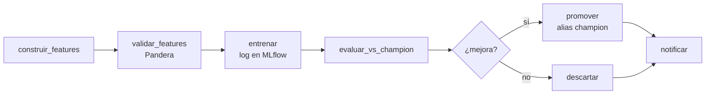

# 15 — Airflow con dbt, Docker, Kubernetes y MLflow

> Continúa de [[14 - Sensores, Deferrable Operators y el Triggerer]]. Airflow vale sobre todo por **lo que orquesta**. Esta nota conecta Airflow con el resto del stack del vault: **dbt** (con Astronomer Cosmos o con la CLI), **Docker** y **Kubernetes** para aislar tareas, **DuckDB** como motor ligero, y un pipeline de **ML con MLflow** que entrena, evalúa y promueve modelos.

## dbt

### Opción A: BashOperator (simple)

```python
from airflow.providers.standard.operators.bash import BashOperator

DBT = "cd /opt/airflow/dbt/mi_proyecto && dbt"

dbt_build = BashOperator(
    task_id="dbt_build",
    bash_command=f"{DBT} build --target prod --select tag:diario --vars '{{\"fecha\": \"{{{{ ds }}}}\"}}' ",
    env={"DBT_PROFILES_DIR": "/opt/airflow/dbt"},
    append_env=True,
)
```

Pros: trivial de montar. Contras: todo el proyecto dbt aparece como **una sola tarea**, así que si falla un modelo no ves cuál en la UI y reintentar significa repetirlo todo.

### Opción B: Astronomer Cosmos (recomendado)

**Cosmos** (`astronomer-cosmos`) lee el proyecto dbt y **genera una tarea de Airflow por modelo, test, seed o snapshot**, respetando el DAG de dbt. Así obtienes reintentos y logs por modelo.

```python
import pendulum
from airflow.sdk import dag, task
from cosmos import DbtTaskGroup, ProjectConfig, ProfileConfig, ExecutionConfig, RenderConfig
from cosmos.constants import LoadMode, TestBehavior

profile_config = ProfileConfig(
    profile_name="mi_proyecto",
    target_name="prod",
    profiles_yml_filepath="/opt/airflow/dbt/profiles.yml",
    # o mapear una Connection de Airflow a un profile de dbt:
    # profile_mapping=PostgresUserPasswordProfileMapping(conn_id="postgres_dwh", profile_args={"schema": "analytics"}),
)

@dag(schedule="0 6 * * *", start_date=pendulum.datetime(2026, 1, 1, tz="America/Lima"), catchup=False)
def elt_ventas():

    @task
    def extraer_a_bronze(): ...

    transformar = DbtTaskGroup(
        group_id="dbt",
        project_config=ProjectConfig("/opt/airflow/dbt/mi_proyecto"),
        profile_config=profile_config,
        execution_config=ExecutionConfig(dbt_executable_path="/opt/airflow/dbt_venv/bin/dbt"),
        render_config=RenderConfig(
            select=["tag:diario"],
            load_method=LoadMode.DBT_MANIFEST,       # o DBT_LS; con manifest el parseo es más rápido
            test_behavior=TestBehavior.AFTER_EACH,   # tests justo después de cada modelo
        ),
        operator_args={"install_deps": True, "vars": {"fecha": "{{ ds }}"}},
    )

    @task
    def refrescar_dashboard(): ...

    extraer_a_bronze() >> transformar >> refrescar_dashboard()

elt_ventas()
```

- `DbtDag` convierte un proyecto completo en un DAG; `DbtTaskGroup` lo inserta dentro de un DAG más grande.
- Instala dbt en un **virtualenv aparte** (`dbt_venv`) para evitar conflictos de dependencias con Airflow.
- Con `LoadMode.DBT_MANIFEST` (usando el `manifest.json` generado en CI), el DAG parsea rápido.
- Cosmos puede emitir **Assets** por cada modelo, de modo que otros DAGs se disparen cuando se actualiza un modelo concreto.

### Opción C: dbt Cloud

```python
from airflow.providers.dbt.cloud.operators.dbt import DbtCloudRunJobOperator

DbtCloudRunJobOperator(task_id="dbt_cloud", dbt_cloud_conn_id="dbt_cloud", job_id=12345,
                       deferrable=True, timeout=3600)
```

Más contexto sobre dbt en producción: [[15 - dbt en Producción - CI-CD y Orquestación|dbt/15]].

---

## Docker: tareas aisladas en contenedores

Así cada tarea corre con **su propia imagen** y sus dependencias, sin contaminar el entorno de Airflow.

```python
from airflow.providers.docker.operators.docker import DockerOperator
from docker.types import Mount

entrenar = DockerOperator(
    task_id="entrenar",
    image="miregistro/churn-trainer:1.4.0",
    command="python train.py --fecha {{ ds }} --experimento churn",
    environment={"MLFLOW_TRACKING_URI": "{{ var.value.mlflow_uri }}"},
    docker_url="unix://var/run/docker.sock",
    network_mode="bridge",
    mounts=[Mount(source="/data", target="/data", type="bind")],
    auto_remove="success",
    mount_tmp_dir=False,
    retrieve_output=True, retrieve_output_path="/tmp/resultado.pickle",   # opcional: XCom desde el contenedor
)
```

Alternativa con decorador: `@task.docker(image=...)` (ver [[05 - TaskFlow API#@task.docker y @task.kubernetes]]). Montar el socket de Docker en el worker tiene implicaciones de seguridad (ver [[Docker/09 - Seguridad|Docker/09]]); en Kubernetes, usa `KubernetesPodOperator`.

## Kubernetes: `KubernetesPodOperator`

Lanza **un pod por tarea**, con su imagen, recursos y nodo. Es el estándar para cargas pesadas o heterogéneas (GPU, mucha RAM, otros lenguajes).

```python
from airflow.providers.cncf.kubernetes.operators.pod import KubernetesPodOperator
from kubernetes.client import models as k8s

entrenar_gpu = KubernetesPodOperator(
    task_id="entrenar_gpu",
    name="entrenar-churn",
    namespace="ml-jobs",
    image="miregistro/churn-trainer:1.4.0",
    cmds=["python", "train.py"],
    arguments=["--fecha", "{{ ds }}"],
    env_vars={"MLFLOW_TRACKING_URI": "http://mlflow.mlops.svc:5000"},
    container_resources=k8s.V1ResourceRequirements(
        requests={"cpu": "2", "memory": "8Gi"},
        limits={"memory": "16Gi", "nvidia.com/gpu": "1"},
    ),
    node_selector={"pool": "gpu"},
    tolerations=[k8s.V1Toleration(key="nvidia.com/gpu", operator="Exists", effect="NoSchedule")],
    service_account_name="ml-trainer",           # IRSA / Workload Identity para S3 sin claves
    get_logs=True,
    on_finish_action="delete_succeeded_pod",     # conserva los pods fallidos para depurar
    deferrable=True,
    do_xcom_push=True,                           # el contenedor escribe /airflow/xcom/return.json
)
```

| | `KubernetesPodOperator` | `KubernetesExecutor` |
|---|---|---|
| Qué es | Un **operador**: esta tarea concreta corre en un pod con la imagen que elijas | Un **executor**: *todas* las tareas corren cada una en su pod con la imagen de Airflow |
| Imagen | Cualquiera (incluso sin Airflow instalado) | La de Airflow (personalizable por tarea con `executor_config`) |
| Uso | Cargas aisladas o de otros lenguajes | Escalado elástico general (nota 16) |

Ver [[Kubernetes/03 - Pods|Kubernetes/03]] y [[Kubernetes/11 - Kubernetes para Servir Modelos de ML|Kubernetes/11]].

---

## DuckDB como motor de cómputo de las tareas

Patrón ligero: cada tarea abre DuckDB **en memoria**, lee de S3 o Postgres, transforma con SQL y escribe Parquet. No hay estado compartido y escala bien hasta cientos de GB por tarea.

```python
@task(pool="cpu_pesado", execution_timeout=pendulum.duration(minutes=45))
def construir_features(logical_date=None) -> str:
    import duckdb
    corte = logical_date.subtract(days=1).to_date_string()
    destino = f"s3://lake/features/churn/fecha={corte}/"
    with duckdb.connect(config={"memory_limit": "6GB", "threads": 4}) as con:
        con.execute("CREATE SECRET (TYPE s3, PROVIDER credential_chain)")
        con.execute(f"""
            COPY (
                SELECT cliente_id,
                       count(*)                                   AS n_compras_90d,
                       sum(monto)                                 AS gasto_90d,
                       date_diff('day', max(fecha), DATE '{corte}') AS recencia
                FROM read_parquet('s3://lake/silver/ventas/**/*.parquet')
                WHERE fecha > DATE '{corte}' - INTERVAL 90 DAY AND fecha <= DATE '{corte}'
                GROUP BY ALL
            ) TO '{destino}' (FORMAT parquet, OVERWRITE_OR_IGNORE)
        """)
    return destino
```

Detalles del lado de DuckDB (idempotencia, locks, memoria): [[DuckDB/16 - DuckDB en Pipelines y Buenas Prácticas|DuckDB/16]].

---

## Pipeline de ML con MLflow

Un DAG de reentrenamiento típico: **features → entrenar → evaluar contra el modelo en producción → promover o no → notificar**.



```python
import pendulum
from airflow.sdk import dag, task, Variable
from airflow.providers.standard.operators.empty import EmptyOperator

@dag(schedule="0 3 * * 1", start_date=pendulum.datetime(2026, 1, 1, tz="America/Lima"),
     catchup=False, max_active_runs=1, tags=["ml", "churn"],
     default_args={"retries": 1})
def reentreno_churn():

    features = construir_features()            # la tarea DuckDB de arriba

    @task
    def validar_features(ruta: str) -> str:
        import pandas as pd, pandera.pandas as pa
        df = pd.read_parquet(ruta)
        esquema = pa.DataFrameSchema({
            "cliente_id": pa.Column(int, unique=True),
            "gasto_90d":  pa.Column(float, pa.Check.ge(0)),
            "recencia":   pa.Column(int, pa.Check.in_range(0, 90)),
        })
        esquema.validate(df, lazy=True)
        return ruta

    @task
    def entrenar(ruta: str) -> dict:
        import mlflow, pandas as pd
        from sklearn.ensemble import HistGradientBoostingClassifier
        from sklearn.metrics import roc_auc_score
        from sklearn.model_selection import train_test_split

        mlflow.set_tracking_uri(Variable.get("mlflow_uri"))
        mlflow.set_experiment("churn")
        df = pd.read_parquet(ruta)
        X, y = df.drop(columns=["cliente_id", "churn"]), df["churn"]
        X_tr, X_te, y_tr, y_te = train_test_split(X, y, test_size=0.2, stratify=y, random_state=42)

        with mlflow.start_run(run_name=f"reentreno_{pendulum.now().to_date_string()}") as run:
            modelo = HistGradientBoostingClassifier(max_depth=6).fit(X_tr, y_tr)
            auc = roc_auc_score(y_te, modelo.predict_proba(X_te)[:, 1])
            mlflow.log_param("datos", ruta)
            mlflow.log_metric("auc", auc)
            info = mlflow.sklearn.log_model(modelo, name="modelo", registered_model_name="churn")
        return {"run_id": run.info.run_id, "auc": auc, "version": info.registered_model_version}

    @task.branch
    def evaluar_vs_champion(resultado: dict) -> str:
        from mlflow import MlflowClient
        client = MlflowClient(Variable.get("mlflow_uri"))
        try:
            champion = client.get_model_version_by_alias("churn", "champion")
            auc_champion = client.get_run(champion.run_id).data.metrics["auc"]
        except Exception:
            auc_champion = 0.0                               # primer modelo
        margen = float(Variable.get("churn_margen_auc", default="0.005"))
        return "promover" if resultado["auc"] > auc_champion + margen else "descartar"

    @task
    def promover(resultado: dict):
        from mlflow import MlflowClient
        MlflowClient(Variable.get("mlflow_uri")).set_registered_model_alias(
            "churn", "champion", resultado["version"])

    descartar = EmptyOperator(task_id="descartar")

    @task(trigger_rule="none_failed_min_one_success")
    def notificar(resultado: dict):
        print(f"Reentreno terminado: AUC={resultado['auc']:.3f}, versión {resultado['version']}")

    res = entrenar(validar_features(features))
    decision = evaluar_vs_champion(res)
    p = promover(res)
    decision >> [p, descartar]
    [p, descartar] >> notificar(res)

reentreno_churn()
```

Piezas del vault que encajan aquí:

- Tracking y Model Registry: [[Python/MLflow/02 - Tracking - Fundamentos y API de Logging|MLflow/02]] y [[Python/MLflow/07 - Model Registry|MLflow/07]].
- Validación de datos: [[Python/Pandera/01 - Introducción y Conceptos Fundamentales|Pandera]].
- Modelos: [[Python/Scikit-learn/01 - Introducción, Filosofía y la API Consistente|Scikit-learn]] y [[Python/Gradient Boosting/01 - Introducción y Panorama|Gradient Boosting]].
- Búsqueda de hiperparámetros dentro de la tarea de entrenamiento: [[Python/Optuna/01 - Introducción y Conceptos Fundamentales|Optuna]].
- Disparar el reentreno por **drift** en lugar de por calendario: un DAG de monitoreo con Evidently que emite un Asset o usa branching (ver [[09 - Branching, Condicionales y Trigger Rules]] y [[18-Monitoreo-y-Observabilidad-de-Modelos]]).
- Versionar los datos de entrenamiento: [[Python/DVC/01 - Introducción y Arquitectura Interna|DVC]] o snapshots de [[DuckDB/14 - DuckLake, MotherDuck y el Lakehouse Ligero|DuckLake]].

### Batch scoring diario

```python
@task
def scoring(ruta_features: str, ds=None) -> str:
    import mlflow, pandas as pd
    mlflow.set_tracking_uri(Variable.get("mlflow_uri"))
    modelo = mlflow.pyfunc.load_model("models:/churn@champion")    # siempre el champion vigente
    df = pd.read_parquet(ruta_features)
    df["p_churn"] = modelo.predict(df.drop(columns=["cliente_id"]))
    destino = f"s3://lake/gold/scores_churn/fecha={ds}/scores.parquet"
    df[["cliente_id", "p_churn"]].to_parquet(destino)
    return destino
```

## Otras integraciones frecuentes

| Integración | Cómo |
|---|---|
| **Spark / Databricks** | `DatabricksSubmitRunOperator`, `DatabricksRunNowOperator` (deferrable), `@task.pyspark` |
| **Snowflake / BigQuery** | `SQLExecuteQueryOperator` con su conn, `BigQueryInsertJobOperator` |
| **Great Expectations** | Provider `great_expectations` (`GXValidateDataFrameOperator` y similares) |
| **Slack / Teams / email** | Notifiers en callbacks (nota 17) |
| **OpenLineage** | Provider `openlineage`: linaje automático hacia Marquez, DataHub, etc. |
| **Azure ML / SageMaker / Vertex AI** | Operadores de cada provider (ver [[51-Azure-ML]]) |
| **Streamlit / Power BI** | Una tarea final que refresca el dataset o invalida la caché |

## Ver también

- [[15 - dbt en Producción - CI-CD y Orquestación|dbt/15]]
- [[DuckDB/16 - DuckDB en Pipelines y Buenas Prácticas|DuckDB/16]]
- [[Docker/10 - Docker para Ciencia de Datos y ML|Docker/10]]
- [[Kubernetes/11 - Kubernetes para Servir Modelos de ML|Kubernetes/11]]
- [[09-MLOps-en-Profundidad]] y [[15-MLflow-en-Profundidad]] (en `Machine Learning/`)
- [[16 - Executors, Escalado y Despliegue]]
