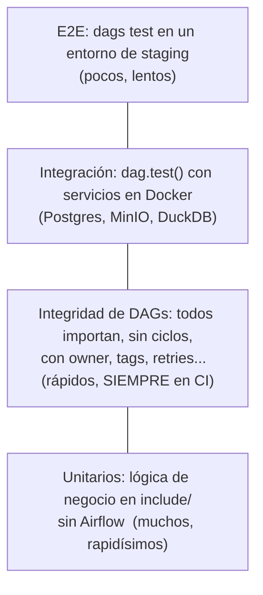

# 17 — Testing, Observabilidad y Buenas Prácticas

> Continúa de [[16 - Executors, Escalado y Despliegue]] y cierra el cheat-sheet. Aquí está lo que separa un Airflow "que funciona en mi laptop" de uno **confiable en producción**: tests de integridad y unitarios con pytest, los principios de diseño de tareas (idempotencia, atomicidad, determinismo), código top-level, **callbacks y notifiers**, Deadline Alerts, logging y métricas, los antipatrones clásicos y la **migración de Airflow 2 a 3**.

## Testing

### Pirámide de tests para Airflow



### 1. Integridad de DAGs (el test imprescindible)

```python
# tests/test_dag_integrity.py
import pytest
from airflow.models import DagBag          # en versiones recientes también: airflow.dag_processing.dagbag

@pytest.fixture(scope="session")
def dagbag():
    return DagBag(dag_folder="dags/", include_examples=False)

def test_sin_errores_de_importacion(dagbag):
    assert dagbag.import_errors == {}, f"Errores: {dagbag.import_errors}"

def test_hay_dags(dagbag):
    assert len(dagbag.dags) > 0

@pytest.mark.parametrize("dag_id", DagBag(dag_folder="dags/", include_examples=False).dag_ids)
def test_convenciones(dagbag, dag_id):
    dag = dagbag.get_dag(dag_id)
    assert dag.tags, f"{dag_id} sin tags"
    assert dag.catchup is False or dag.max_active_runs <= 5, f"{dag_id}: catchup sin límite de runs"
    for t in dag.tasks:
        assert t.retries >= 1, f"{dag_id}.{t.task_id} sin retries"
        assert t.execution_timeout is not None, f"{dag_id}.{t.task_id} sin execution_timeout"

def test_tiempo_de_importacion():
    import time
    t0 = time.perf_counter()
    DagBag(dag_folder="dags/", include_examples=False)
    assert time.perf_counter() - t0 < 10, "Parseo lento: revisa el código top-level"
```

### 2. Tests unitarios de la lógica (sin Airflow)

Si los archivos de DAGs son delgados y la lógica vive en `include/`, testearla es Python puro:

```python
# include/mi_empresa/transform.py
def limpiar_montos(filas: list[dict]) -> list[dict]:
    return [f | {"monto": round(f["monto"], 2)} for f in filas if f["monto"] >= 0]

# tests/test_transform.py
from mi_empresa.transform import limpiar_montos

def test_descarta_negativos_y_redondea():
    assert limpiar_montos([{"monto": 1.234}, {"monto": -5}]) == [{"monto": 1.23}]
```

Para lógica SQL, usa DuckDB en memoria como fixture (ver [[DuckDB/16 - DuckDB en Pipelines y Buenas Prácticas#Testing con pytest|DuckDB/16]]).

### 3. Probar una tarea o un DAG completo

```python
# tests/test_dag_ventas.py
import pendulum
from airflow.models import DagBag

def test_estructura_ventas():
    dag = DagBag("dags/", include_examples=False).get_dag("ventas_diarias")
    assert set(dag.task_ids) == {"extraer", "transformar", "validar"}
    assert dag.get_task("transformar").upstream_task_ids == {"extraer"}

def test_ejecucion_completa(monkeypatch, tmp_path):
    # Mockear lo externo (APIs, S3) y ejecutar el DAG en proceso
    monkeypatch.setenv("AIRFLOW_CONN_AWS_DEFAULT", '{"conn_type": "aws"}')
    monkeypatch.setattr("mi_empresa.extract.descargar", lambda *a, **k: [{"monto": 10.0}])
    dag = DagBag("dags/", include_examples=False).get_dag("ventas_diarias")
    run = dag.test(logical_date=pendulum.datetime(2026, 11, 14, tz="UTC"))
    assert run.state == "success"
```

Ver [[Python/Pytest/09 - Mocking y Monkeypatching|Pytest/09]], [[Python/Pytest/05 - Parametrización de Tests|Pytest/05]] y [[13-Testing-en-Machine-Learning]].

### 4. Lint y pre-commit

```bash
ruff check dags/ include/ --select AIR    # reglas específicas de Airflow (incluye detección de APIs eliminadas en 3.x)
```

```yaml
# .pre-commit-config.yaml
repos:
  - repo: https://github.com/astral-sh/ruff-pre-commit
    rev: v0.8.0
    hooks:
      - id: ruff
        args: [--select, "E,F,I,AIR"]
```

Ver [[44 - Linters y Formateadores]].

---

## Principios de diseño de tareas

| Principio | Qué significa | Cómo lograrlo |
|---|---|---|
| **Idempotencia** | Ejecutar N veces = ejecutar 1 vez | Sobreescribir la partición; `DELETE`+`INSERT` en una transacción; `MERGE`; `CREATE OR REPLACE` |
| **Atomicidad** | La tarea hace todo o nada | Transacciones; escribir en un temporal y renombrar; no dejar archivos a medias |
| **Determinismo** | Mismo input → mismo output | Usar `data_interval_start`/`end` o `ds`, **nunca** `now()`; fijar semillas |
| **Granularidad adecuada** | Ni una tarea gigante ni cientos de microtareas | Una tarea = un paso con sentido propio, reintentable por separado |
| **Sin estado local** | No depender del disco del worker entre tareas | Almacenamiento compartido (S3, DB); pasar referencias por XCom |
| **Airflow orquesta, no procesa** | El trabajo pesado va a DuckDB, Spark, dbt o un pod | Operadores de providers, KubernetesPodOperator |

## Código top-level

El DAG Processor **ejecuta cada archivo de DAG cada pocos segundos**. Todo lo que está fuera de las tareas se ejecuta **en cada parseo**:

```python
# ❌ ANTIPATRONES TOP-LEVEL
import tensorflow as tf                                    # import pesado: segundos en cada parseo
clientes = requests.get("https://api.crm.com/clientes").json()   # llamada de red
umbral = Variable.get("umbral")                            # consulta en cada parseo
df = pd.read_sql("SELECT ...", engine)                     # consulta a una DB
for c in clientes: crear_dag(c)                            # DAGs que dependen de una API

# ✅ CORRECTO
@task
def entrenar():
    import tensorflow as tf                                # import dentro de la tarea
    umbral = Variable.get("umbral")                        # se lee al ejecutar

config = yaml.safe_load(open(Path(__file__).parent / "clientes.yaml"))   # archivo local y estático: OK
```

```bash
# Medir cuánto tarda en importarse un DAG
time python dags/ventas_diarias.py
airflow dags list-import-errors
```

---

## Alertas: callbacks y notifiers

### Callbacks

```python
def alerta_fallo(context):
    ti = context["ti"]
    print(f"FALLÓ {ti.dag_id}.{ti.task_id} (intento {ti.try_number}) run={context['run_id']}")
    print(f"Log: {ti.log_url}")
    print(f"Excepción: {context.get('exception')}")

@dag(default_args={"on_failure_callback": alerta_fallo,
                   "on_retry_callback": None},
     on_failure_callback=alerta_fallo,         # a nivel DAG Run
     on_success_callback=None, ...)
def mi_dag(): ...
```

Callbacks disponibles: `on_success_callback`, `on_failure_callback`, `on_retry_callback`, `on_execute_callback` y `on_skipped_callback` en tareas; `on_success_callback` y `on_failure_callback` en el DAG.

### Notifiers (reutilizables y templated)

```python
from airflow.providers.slack.notifications.slack import SlackNotifier
from airflow.providers.smtp.notifications.smtp import SmtpNotifier

alerta_slack = SlackNotifier(
    slack_conn_id="slack_datos",
    channel="#alertas-datos",
    text=":red_circle: *{{ dag.dag_id }}.{{ ti.task_id }}* falló ({{ ds }}) — <{{ ti.log_url }}|ver log>",
)

@dag(default_args={"on_failure_callback": alerta_slack}, ...)
def ventas_diarias(): ...
```

Notifier propio:

```python
from airflow.sdk import BaseNotifier

class TeamsNotifier(BaseNotifier):
    template_fields = ("mensaje",)
    def __init__(self, webhook_conn_id: str, mensaje: str):
        super().__init__()
        self.webhook_conn_id, self.mensaje = webhook_conn_id, mensaje
    def notify(self, context):
        import requests
        from airflow.sdk import Connection
        requests.post(Connection.get(self.webhook_conn_id).host, json={"text": self.mensaje}, timeout=10)
```

> **Evita la fatiga de alertas:** alerta en `on_failure_callback` (tras agotar los reintentos), no en `on_retry_callback`. Agrupa por DAG y diferencia la severidad (crítico vs. informativo).

### Deadline Alerts (3.1+): el reemplazo de los SLAs

Los `sla=` de Airflow 2 se eliminaron. Airflow 3.1 introduce **Deadline Alerts**: avisan si un DAG Run **no terminó** en un plazo relativo a un punto de referencia (cuándo se encoló, la logical date o una fecha fija), y lo detectan **mientras ocurre**, no después.

```python
from datetime import timedelta
from airflow.sdk.definitions.deadline import DeadlineAlert, DeadlineReference, AsyncCallback
from airflow.providers.slack.notifications.slack_webhook import SlackWebhookNotifier

@dag(
    deadline=DeadlineAlert(
        reference=DeadlineReference.DAGRUN_QUEUED_AT,
        interval=timedelta(hours=2),
        callback=AsyncCallback(SlackWebhookNotifier, kwargs={"text": "ventas_diarias lleva más de 2 h"}),
    ),
    ...
)
def ventas_diarias(): ...
```

> La API de Deadline Alerts es reciente: revisa los imports y parámetros exactos en la documentación de tu versión.

---

## Observabilidad

### Logs

- Cada intento de cada tarea tiene su log, visible en la UI. En producción usa **remote logging** (S3, GCS, Azure Blob, Elasticsearch, CloudWatch) para que los logs sobrevivan a los pods efímeros:

```bash
export AIRFLOW__LOGGING__REMOTE_LOGGING=True
export AIRFLOW__LOGGING__REMOTE_BASE_LOG_FOLDER=s3://empresa-airflow-logs
export AIRFLOW__LOGGING__REMOTE_LOG_CONN_ID=aws_default
```

- Dentro de las tareas, usa `logging` estándar o `self.log` en los operadores. `print()` también se captura. Airflow 3 usa logs estructurados.

```python
import logging
log = logging.getLogger(__name__)

@task
def procesar():
    log.info("Procesando %d archivos", 12)
```

Ver [[52 - Logging Avanzado]] y [[11-Logging-en-Python-para-ML]].

### Métricas

Airflow emite métricas por **StatsD** u **OpenTelemetry**: duración de tareas, tareas en cola, slots libres de cada pool, tiempo de parseo, *heartbeat* del scheduler...

```bash
export AIRFLOW__METRICS__OTEL_ON=True
export AIRFLOW__METRICS__OTEL_HOST=otel-collector
export AIRFLOW__METRICS__OTEL_PORT=4318
```

Métricas clave para un dashboard (Grafana):

| Métrica | Alerta si... |
|---|---|
| `scheduler.heartbeat` | Deja de llegar |
| `executor.queued_tasks` | Crece de forma sostenida (faltan workers) |
| `pool.open_slots.<pool>` | Lleva mucho tiempo en 0 |
| `dag_processing.total_parse_time` | Supera ~30 s |
| `dagrun.duration.success.<dag_id>` | Se desvía de lo habitual |
| `ti_failures` | Sube de golpe |

Ver [[Kubernetes/12 - Observabilidad en Kubernetes|Kubernetes/12]].

### Health checks

```bash
curl localhost:8080/api/v2/monitor/health        # estado de metadatabase, scheduler, triggerer, dag_processor
airflow jobs check --job-type SchedulerJob       # para liveness probes
```

### Linaje

El provider **OpenLineage** emite automáticamente el linaje de entradas y salidas de muchos operadores (SQL, S3, Spark, dbt vía Cosmos) hacia Marquez, DataHub, Atlan, etc. Complementa la vista de Assets.

---

## Antipatrones

| Antipatrón | Problema | Alternativa |
|---|---|---|
| Lógica pesada en el top-level | Parseo lento, carga en la DB | Imports y llamadas dentro de las tareas |
| `datetime.now()` en tareas | Backfills incorrectos | `data_interval_start` / `ds` |
| DataFrames por XCom | Metadata DB enorme | Pasar rutas o un XCom backend en object storage |
| `start_date` dinámico | El DAG nunca corre o se comporta raro | Fecha fija con zona horaria |
| Un DAG monolítico de 300 tareas | Ilegible, frágil | Varios DAGs unidos por Assets; TaskGroups |
| Sensores en modo `poke` durante horas | Workers bloqueados | `deferrable=True` o `mode="reschedule"` |
| Sin `execution_timeout` | Tareas zombis que ocupan slots | Timeout en `default_args` |
| Sin `retries` | Fallos transitorios rompen el pipeline | `retries` con backoff |
| Credenciales en el código | Fuga de secretos | Connections + secrets backend |
| Tareas no idempotentes | Duplicados al reintentar | Sobreescribir la partición o `MERGE` |
| Instalar paquetes en runtime | Lento y no reproducible | Imagen propia con constraints |
| Consultar la metadata DB desde una tarea | Bloqueado en 3.x | REST API o Task SDK |
| Varias tareas escribiendo el mismo `.duckdb` en paralelo | Errores de lock | Pool de 1 slot o escribir Parquet (ver [[DuckDB/10 - DDL, Transacciones y Concurrencia#Concurrencia|DuckDB/10]]) |

---

## Migración de Airflow 2 a 3

### Checklist

1. **Actualiza primero a la última 2.x** (2.10/2.11) y elimina todos los avisos de deprecación.
2. **Imports del Task SDK**: `from airflow.sdk import dag, task, DAG, Asset, Variable, Connection, ...`.
3. **Operadores del provider standard**: `airflow.operators.bash` → `airflow.providers.standard.operators.bash`, etc.
4. `schedule_interval=` / `timetable=` → **`schedule=`**.
5. `execution_date`, `next_ds`, `prev_ds`, `yesterday_ds`... → **`logical_date`**, `data_interval_*` y macros.
6. **Revisa la semántica de los cron**: en 3.x, `CronTriggerTimetable` es el default (ver [[10 - Scheduling, Timetables y Backfills#Timetables: trigger vs. data interval]]). Si dependías de `ds` = "ayer", ajusta o activa `create_cron_data_intervals`.
7. `Dataset` → **`Asset`**; `DatasetAlias` → `AssetAlias`; `triggering_dataset_events` → `triggering_asset_events`.
8. **SubDAGs** → TaskGroups. **SLAs** → Deadline Alerts (3.1+).
9. **Acceso directo a la DB** desde tareas (`settings.Session`, `@provide_session` dentro de tareas) → REST API o métodos del Task SDK.
10. Componentes: `webserver` → **`api-server`**; agrega el **`dag-processor`**; revisa el auth manager (FAB vs. Simple).
11. **XCom pickling eliminado**: los valores deben ser serializables con el serializador de Airflow.
12. `catchup_by_default` ahora es **False**: declara `catchup=True` donde lo necesites.
13. Corre `ruff check --select AIR` para detectar automáticamente las APIs eliminadas, y `airflow config update` para migrar la configuración.
14. Haz la migración primero en un **staging** con una copia de la DB (`airflow db migrate`) y prueba los DAGs críticos.

```python
# Airflow 2                                          # Airflow 3
from airflow import DAG                               from airflow.sdk import DAG
from airflow.decorators import dag, task              from airflow.sdk import dag, task
from airflow.operators.bash import BashOperator       from airflow.providers.standard.operators.bash import BashOperator
from airflow.datasets import Dataset                  from airflow.sdk import Asset
from airflow.models import Variable                   from airflow.sdk import Variable
DAG(..., schedule_interval="@daily")                  DAG(..., schedule="@daily")
"{{ execution_date }}"                                "{{ logical_date }}"
```

El ejemplo de [[50-Orquestacion-Prefect-y-Airflow|ML/50]] está en sintaxis de Airflow 2: es un buen ejercicio migrarlo con esta lista.

---

## Checklist de producción

- [ ] Versión de Airflow y providers **fijadas** con constraints; imagen propia.
- [ ] **PostgreSQL** gestionado como metadata DB, con `db clean` programado.
- [ ] Scheduler, triggerer y API server con **al menos 2 réplicas** (si la criticidad lo exige).
- [ ] **Remote logging** y métricas (StatsD/OTel) con dashboard y alertas.
- [ ] Secretos en un **secrets backend**; nada en el código ni en Variables en texto plano.
- [ ] Cada DAG: `tags`, `owner`, `doc_md`, `retries`, `execution_timeout`, `catchup` explícito, `max_active_runs`.
- [ ] Tareas **idempotentes, atómicas y deterministas**; listas para backfill.
- [ ] **Pools** para cada recurso compartido (DBs de origen, APIs, archivos DuckDB).
- [ ] Sensores **deferrable**; triggerer corriendo.
- [ ] CI con **integridad de DAGs + tests unitarios + ruff AIR** antes de desplegar.
- [ ] Alertas de fallo vía **notifiers**; Deadline Alerts en los DAGs con compromiso de horario.
- [ ] Dependencias entre DAGs por **Assets**, documentadas.

## Ver también

- [[01 - Introducción y Arquitectura]]: mapa completo del cheat-sheet
- [[50-Orquestacion-Prefect-y-Airflow]] (en `Machine Learning/`)
- [[13-Testing-en-Machine-Learning]], [[11-Logging-en-Python-para-ML]] y [[23-Manejo-Profesional-de-Errores]] (en `Machine Learning/`)
- [[44-Ingesta-Incremental-CDC-e-Idempotencia]] (en `Machine Learning/`): idempotencia y cargas incrementales a fondo
- [[48-CICD-con-GitHub-Actions]] (en `Machine Learning/`): el CI/CD donde corren los tests de DAGs
- [[Python/Pytest/01 - Introducción y Arquitectura|Pytest]]
- [[DuckDB/16 - DuckDB en Pipelines y Buenas Prácticas|DuckDB/16]]
- [[15 - dbt en Producción - CI-CD y Orquestación|dbt/15]]
